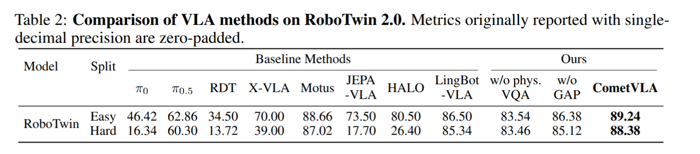

# CometVLA: Co-Training on an Embodied Data Pyramid towards Physical Understanding Note

## Navigation
- Paper card: [CometVLA: Co-Training on an Embodied Data Pyramid towards Physical Understanding card](../cards/CometVLA.md)

## Reading Notes

**怎样让 VLA 真正获得与机器人操作相关的物理理解，并且这种 VLM 层面的“物理理解变强”是否真的会转化成更好的机器人动作能力？**

现有 VLA 通常以预训练 VLM 作为视觉和语言 backbone，因此天然继承了目标识别、空间理解、instruction following 等能力。但机器人 manipulation 不只是“看懂场景”，还要求理解**接触、稳定性、运动趋势、物体受动作后的响应等动态物理规律**。作者认为现有方法在这里存在两个核心 gap。

**第一个是 data/domain gap。** 现有 physical VQA 大多来自互联网图像、第三人称视频或独立的 simulation 场景，它训练出来的“物理知识”与 VLA 实际使用的机器人视角、embodiment 和 action distribution 不一致。即使 VLM 能回答物理问题，也未必能帮助机器人控制。

**第二个是 understanding → action gap。** 现有工作常常证明 VLM 的 physical reasoning benchmark 提升了，但很少严格验证：
$$
\boxed{\text{VLM physical understanding}\uparrow
\quad\Longrightarrow\quad
\text{VLA manipulation performance}\uparrow ?}
$$

贡献：

- Data：构造与 robot action 对齐（从embodied data pyramid）的 Physical VQA
- Architecture：Global Action Prior（GAP）token
- Training：整个 embodied data pyramid 联合训练

### Related Works

#### Action Generation with Embodied Data Pyramid

| 路线                    | 代表工作                     | 主要利用什么                               | 作者认为的缺口                                               |
| ----------------------- | ---------------------------- | ------------------------------------------ | ------------------------------------------------------------ |
| Robot demonstration VLA | RT-2, OpenVLA, Octo, π₀/π₀.₅ | teleoperation / robot trajectories         | 数据贵，而且重点是 action learning                           |
| 多源 VLA                | InternVLA-A1                 | human + synthetic + robot                  | 多种数据一起训练，但“理解→动作”的作用不好单独分析            |
| World Action Model      | EgoScale, FastWAM            | egocentric human video                     | 更多把视频用于 future prediction/world model                 |
| **CometVLA**            | 本文                         | **VQA + ego + simulation + teleoperation** | 希望整个 pyramid 都参与，而且专门研究 physical understanding 是否改善 action |

#### Fine-tuning VLMs with Embodied / Physical VQAs

但 CometVLA 作者认为现有 physical/embodied VQA 仍然有三个问题：

**第一是 domain mismatch。** 很多 VQA 仍来自 web image、第三人称视频或者非机器人 simulation；VLM 学到的“物理知识”未必对应真实 VLA 控制时看到的相机、机器人 embodiment 和 object distribution。

**第二是 annotation mismatch。** 一些方法依赖 bounding box、point、depth 等额外视觉 cue；benchmark 上有效，但实际机器人部署时不一定能直接获得这些 annotation。

**第三，也是本文最重要的 critique：很多 benchmark 只证明“VLM 会答题了”，没有证明“robot action 变好了”。** 

#### Correlation Analysis from VLMs to VLAs

VLM4VLA 专门问了：

> VLM 本身的能力究竟能不能预测 VLA performance？

它故意把 action adaptation 做得非常小，从而控制 action architecture 这个变量。它的一个重要发现反而是：**generic VLM capability 并不能很好预测 downstream control performance；甚至在某些 embodied auxiliary tasks 上把 VLM fine-tune 得更强，也不保证机器人控制变强。** 

这实际上给 CometVLA 提出了一个很强的挑战：

**不是随便提升 VLM 都有用。必须提升“和 action domain 对齐的 physical understanding”。**

但 CometVLA 对 VLM4VLA 的 critique 是：为了研究 VLM，VLM4VLA 把 action expert 故意简化了；这种实验控制很好，但和真正高性能 VLA 中复杂 continuous action expert 的情况存在距离。

于是 CometVLA 给自己找的位置是：

> **既不像一些 VLA 工作那样一次把所有模块都改了，导致无法 attribution；也不像 VLM4VLA 那样为了控制变量而把 action expert 简化掉。**

它保留完整 action expert，然后通过相同/相近架构、改变 physical VQA/data composition，并用 **CometBench VLM score ↔ RoboTwin VLA success rate** 做 correlation analysis，试图直接回答：

**“哪一种 VLM physical capability 真正与 action generation 有关系？”** 

### 实验

phys VQA 相较于 general VQA 在仿真上提升 5 个点

GAP 这玩意很 tricky，而且也没啥用

比较有启发的点就是从 action distribution 上构造 VQA 

### 如何构造 physics VQA

启发式指标找关键时刻（接触、受阻）-> 强VLM
