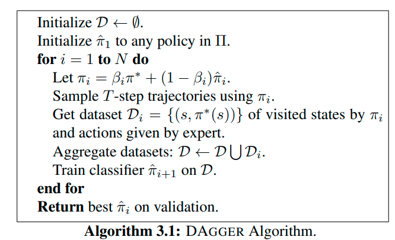

# Behavior Foundation Model: Towards Next-Generation Whole-Body Control System of Humanoid Robots Note

## Navigation
- Paper card: [Behavior Foundation Model: Towards Next-Generation Whole-Body Control System of Humanoid Robots card](../cards/DAgger.md)

## Reading Notes

### 问题描述

- $\pi^*$：专家策略；
- $\pi$：学习到的策略；
- $d_{\pi^*}$：执行专家策略后产生的状态分布；
- $d_\pi$：执行学习策略后产生的状态分布。

下标不是说 $d$ 也是策略，而是在说：

> $d_\pi$ 是被策略 $\pi$ 诱导出来的状态分布。

论文将 $d_\pi^t$ 定义为：从第 1 步到第 $t-1$ 步都执行 $\pi$ 时，第 $t$ 步状态的分布。最终目标是让策略在自己的运行分布 $d_\pi$ 上损失较低。

#### 为什么状态分布由策略决定？

假设环境转移规律是：
$$
P(s_{t+1}\mid s_t,a_t)
$$
策略决定动作：
$$
a_t\sim \pi(\cdot\mid s_t)
$$
于是下一步状态分布为：
$$
d_\pi^{t+1}(s')
=
\sum_s d_\pi^t(s)
\sum_a \pi(a\mid s)P(s'\mid s,a)
$$
这里可以直接看到：
$$
\pi\text{ 不同}
\quad\Longrightarrow\quad
a_t\text{ 不同}
\quad\Longrightarrow\quad
s_{t+1}\text{ 不同}
\quad\Longrightarrow\quad
d_\pi\text{ 不同}
$$
所以在序列决策中，不存在一个完全独立于策略的、唯一的“真实状态分布”。

存在的是：

- 专家运行时的真实分布 $d_{\pi^*}$；
- 学习者运行时的真实分布 $d_\pi$。

训练时采样专家轨迹，只能让经验分布：
$$
\widehat d_{\pi^*}\approx d_{\pi^*}
$$
数据再多，也不意味着：
$$
\widehat d_{\pi^*}\approx d_\pi
$$
因为这不是采样误差，而是两个策略造成的**系统性分布差异**。

#### 行为克隆不是在“克隆专家分布”

更准确地说，Behavior Cloning 做的是：
$$
s\sim d_{\pi^*},
\qquad
a^*=\pi^*(s)
$$
然后训练：
$$
\hat\pi
=
\arg\min_{\pi}
\mathbb E_{s\sim d_{\pi^*}}
[\ell(\pi(s),\pi^*(s))]
$$
也就是：

> 在专家会访问的状态上，学习专家会采取什么动作。

它并没有直接学习或复制 $d_{\pi^*}$。只有当学习策略每一步都完全复制专家时，它才会自然产生相同的状态分布。

但模型通常有一点误差。一旦动作稍有不同，下一步状态也会不同。

#### 驾驶例子

假设专家始终在车道中央，所以专家数据主要是：

| 状态           | 专家动作 |
| -------------- | -------- |
| 正处于车道中央 | 直行     |
| 稍微偏左       | 轻微右转 |
| 稍微偏右       | 轻微左转 |

如果专家驾驶非常稳定，数据中可能几乎没有：

| 状态               | 所需动作           |
| ------------------ | ------------------ |
| 严重偏左、朝向错误 | 大幅右转并稳定车身 |
| 已经压到路肩       | 减速并进行恢复     |
| 车辆发生振荡       | 抑制过度修正       |

学习器上线后，在某一步产生了一个小误差：
$$
\text{车道中央}
\rightarrow
\text{略微偏左}
\rightarrow
\text{更加偏左}
\rightarrow
\text{进入未见状态}
$$
这时模型输入已经不是训练数据中的典型状态。模型可能再犯错，继续进入更陌生的状态。

这就是：
$$
d_{\pi}\neq d_{\pi^*}
$$
也就是论文所说的 distribution shift 或 covariate shift。论文强调，学习器的预测会改变未来输入，因此普通监督学习中的 i.i.d. 假设不再成立。

### 算法

$\pi_i = \beta_i \pi^*+(1-\beta_i)\hat \pi_i$ 这块具体实现是每个时刻都进行一次随机，$\pi^*$ 指的是专家策略，但是不是指的训练的模型而是真正的人类专家（感觉在机械臂或者人形机器人这块很难做到这种介入）

这个 $\beta_i$ 是会逐渐减小到 0

在这种介入下收集的数据会被合并回冷启动数据然后训练下一代模型
