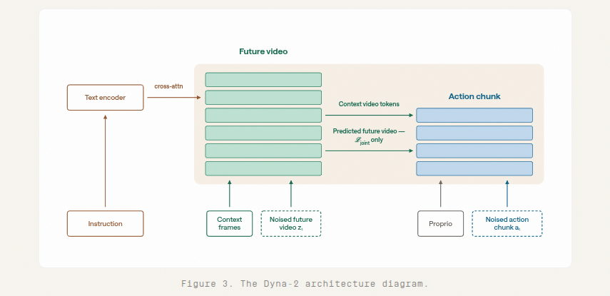
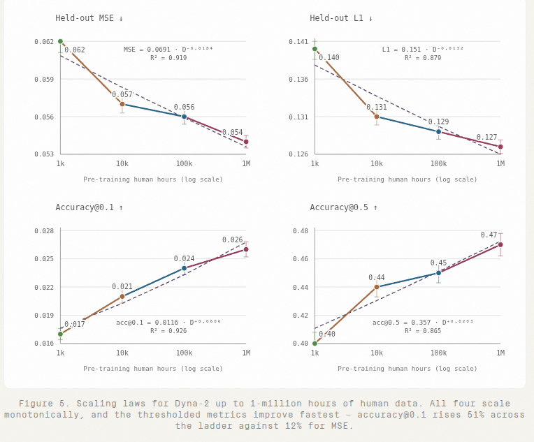
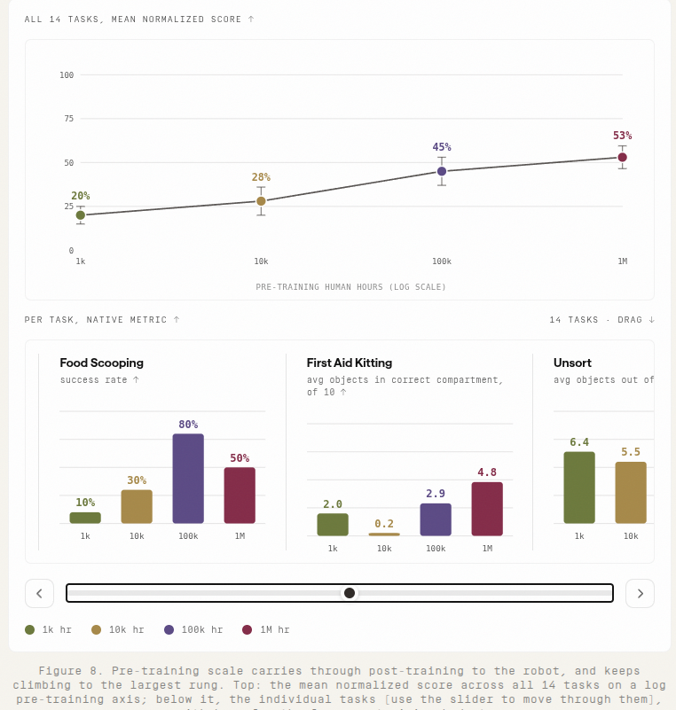
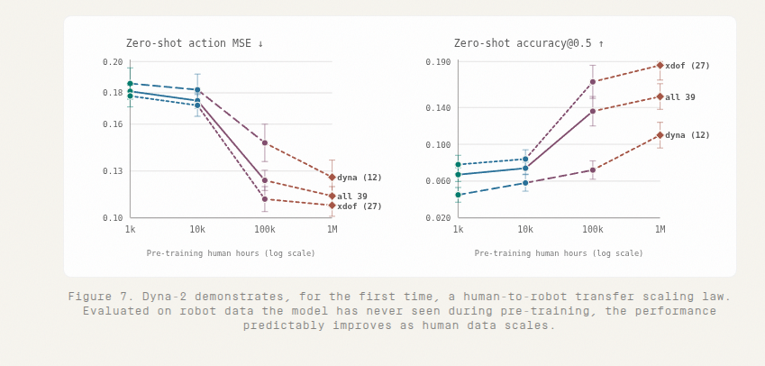

# Dyna-2: A 1-Million-Hour Scaling Law for World-Action Models Note

## Navigation
- Paper card: [Dyna-2: A 1-Million-Hour Scaling Law for World-Action Models card](../cards/Dyna-2.md)

## Reading Notes

在超过一百万小时的第一人称人类视频上进行预训练 WAM, 发现 WAM 的缩放定律在一百万小时人类数据范围内成立


### 模型架构



```
                    Language
                       │
                       ▼
Past Video ──▶ [ Video DiT 1 ] ◀──────────────┐
                    │   ▲                      │
                    │   │ joint attention      │
                    ▼   │                      │
              [ Video DiT 2 ] ◀────────────┐  │
                    │   ▲                  │  │
                    │   │                  │  │
                    ▼   │                  │  │
              [ Video DiT 3 ] ◀─────────┐  │  │
                    │                   │  │  │
                    ▼                   │  │  │
              [ Video DiT 4 ]           │  │  │
                    │                   │  │  │
                   ...                  │  │  │
                    │                   │  │  │
                    ▼                   │  │  │
              Future Video              │  │  │
                                        │  │  │
                                        │  │  │
Proprio ──▶ [ Action DiT 1 ] ───────────┘  │  │
                    │                       │  │
                    ▼                       │  │
              [ Action DiT 2 ] ─────────────┘  │
                    │                          │
                    ▼                          │
              [ Action DiT 3 ] ────────────────┘
                    │
                    ▼
              [ Action DiT 4 ]
                    │
                    ▼
             Future Action Chunk
```

1. Video 和 Action 是两套不同的 Transformer stack

2. 两套 stack 只在“前几层”交互：Video DiT 比 Action DiT 深很多
   
3. Language:  text → video 不是  text → action
      
4. Proprioception: proprio → action stream
      
5. 推理时: 不需要先生成 future video


### 训练数据

迄今为止，我们已构建了一个总计超过一百万小时的人类操作视频语料库。其中大部分是头戴式第一人称记录，内容为人们执行日常操作 —— 烹饪、整理、折叠、组装 —— 由我们的数据合作伙伴以及内部运营采集。我们搭建了一套完整的**数据清洗、手部姿态提取、验证与过滤**流水线，以确保各来源之间的有效性和一致性。对于通过手部姿态质量门槛的片段，其标注包含 **3D 手部姿态轨迹**，我们从中推导出**动作流所训练的伪动作监督：用于末端执行器轨迹的腕部姿态，以及由拇指 - 食指间距推导的连续抓取信号**。我们**不进行任何视觉或具身特定的数据处理来缩小预训练数据与下游机器人数据之间的视觉或运动学差距**；我们的兴趣在于仅从缩放的角度研究模型特性。


### 实验



MSE/L1 都是开环评测的指标




人类数据预训练，小于10小时真机后训练的执行结果




这个还有点意思，是在人类数据预训练，真机上开环测试的结果


分析：

- 暂且抛开开环测试的有效性，百万小时真机数据在验证集上的MSE和L1压根就没有下降多少，10k 0.057,100k 0.056,1M 0.054, 都不说降数量级了，压根就是没降，0.00x 级别的变化
- 不同人类视频预训练然后机器人数据后训练的成功率也没有持续上升，相当多的任务反而随着人类数据的增加而表现变差，相当一部分是波动状态。而且本身真机数据也不少，再者这些个任务也不是多复杂，都在1分钟之内

我实在不明白为什么社区会有这么多吹捧，是看不出来吗？


