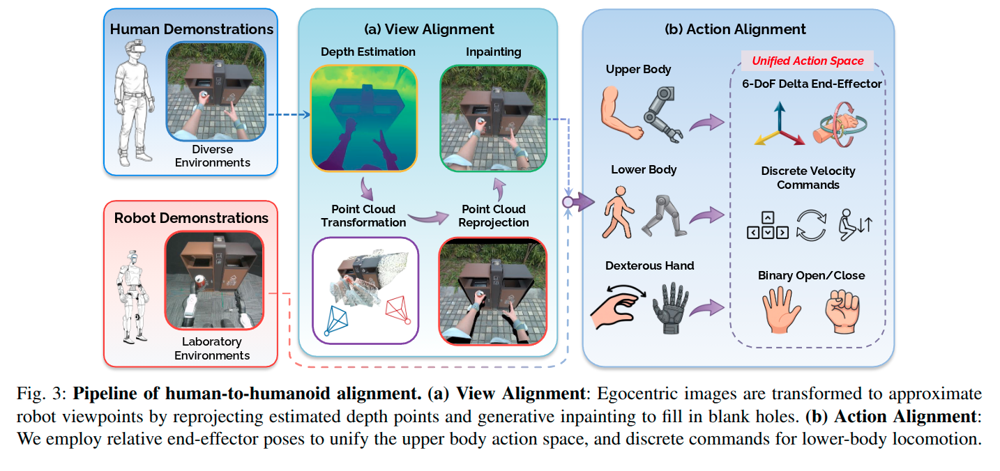
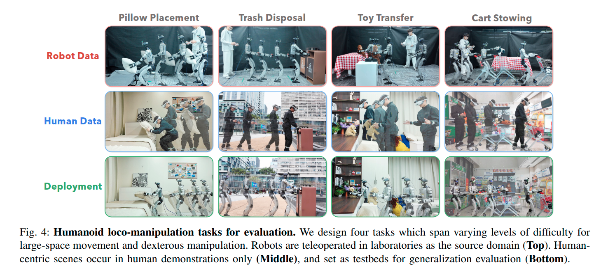
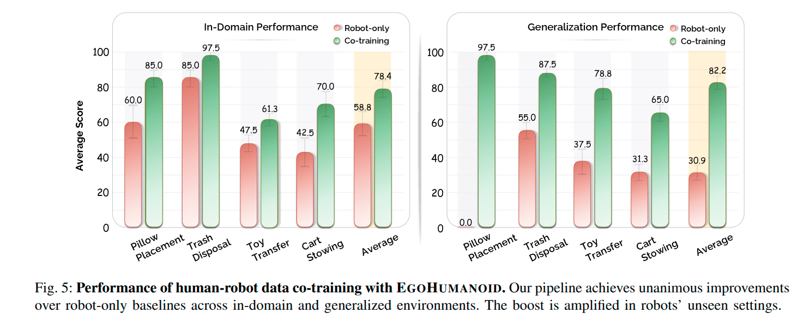
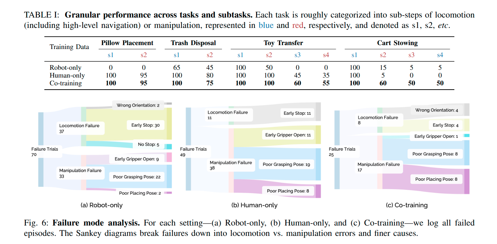
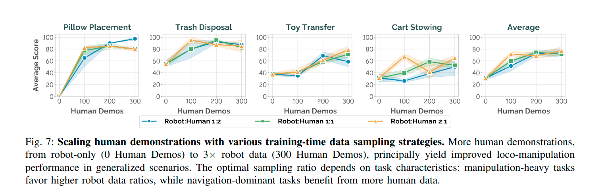

# Unlocking In-the-Wild Loco-Manipulation with Robot-Free Egocentric Demonstration Note

## Navigation
- Paper card: [Unlocking In-the-Wild Loco-Manipulation with Robot-Free Egocentric Demonstration card](../cards/EgoHumanoid.md)

## Reading Notes

该框架的核心洞察是：人类示教数据容易规模化采集、覆盖丰富的真实场景，但存在巨大的“具身鸿沟”（embodiment gap）——人类与机器人在形态、视角、运动学上差异显著。为此，作者提出了一套对齐流水线：

- **视角对齐（View Alignment）**：通过深度估计、点云重投影和扩散模型修复，将人类第一人称视角图像转化为近似机器人低视角的观察。
- **动作对齐（Action Alignment）**：用**末端执行器的增量位姿**统一上半身动作空间，用**离散速度指令**对齐下半身运动，使两套数据能在统一的动作空间下训练。

在 Unitree G1 人形机器人上的实验表明：仅引入人类示教数据（无需任何野外机器人数据），策略性能在**域内场景**提升 20%，在**未见过的泛化场景**中提升 **51%**（对比纯机器人基线），且性能随人类数据量增加持续提升。


### Related Works

这边感觉还是 EgoVerse 写得更好

**A. 用于机器人的第一人称人类数据 (Egocentric Human Data for Robots)**

这是一个快速发展的方向。各类系统（手持夹爪相机、AR/VR 头显等）实现了**无需机器人硬件**就能在多样化环境中采集人类示教数据。现有利用方式分两类：

- **预训练-微调范式**：用人类数据学习视觉表征、运动先验或潜在动作嵌入，**丢弃动作信息**后再微调。
- **协同训练（Co-training）**：通过对齐观察和动作空间，**同时使用人类和机器人的动作作为监督信号**，实现更有效的知识迁移。然而，现有协同训练工作**只针对固定基座操作**，EgoHumanoid 是第一次在**人形机器人移动操作**中验证这一范式。


**B. 跨具身数据对齐 (Cross-Embodiment Data Alignment)**

- **机器人→机器人**：Mirage 用 cross-painting 和 inpainting 消除视觉差异；Chen 等人用生成模型增强机器人外观和视角。动作对齐则采用可迁移的任务空间/末端执行器控制，或映射到共享潜在空间。
- **人类→机器人**：挑战更大（形态、视角、运动动力学差距大），但吸引力也更大。UMI 系列通过手持硬件在采集时提供精确全局位置，但硬件将数据绑定到特定夹爪形态。另一条路线依赖**运动重定向（motion retargeting）**，映射人类运动到机器人构型。并发工作通过估计手部姿态进行协同训练，但只聚焦于**纯操作**或**将移动和操作解耦**（防止基座偏移）。EgoHumanoid 则针对**紧耦合的全身移动操作**，通过专门的视角变换（重投影+生成）和动作重定向来解决更大的形态学鸿沟。


**C. 人形机器人移动操作 (Humanoid Loco-Manipulation)**

- **强化学习路线**：在仿真中设计奖励和课程学习，但面临逐接触物理调参、接触模型不可控、硬件非理想性等缩放瓶颈。
- **VLA 策略路线**：通过扩展模型加入下半身动作指令或运动目标来发展移动操作能力。但大多数方案仍依赖机器人中心的数据或受限于约束场景，缺少环境多样性，无法研究在人类场景中的泛化能力。`

EgoHumanoid 的定位：**将无需机器人的人类第一人称示教数据作为多样化的全身行为来源**，通过显式的视角对齐和动作对齐，实现两种数据源的 VLA 协同训练，为解决场景多样性瓶颈提供了起点。


### Framework



```
人类第一视角示范 ──┐
                  ├─ 视角对齐 + 动作对齐 --> 统一训练数据 --> π0.5 VLA
机器人遥操作数据 ──┘                                  │
                                                    ↓
                                           G1 高层动作指令
                                                     ↓
                                             低层全身控制器
```


#### Data Collection

**人类数据**

人类采集者佩戴：

- PICO VR 头显；
- 5 个 PICO Motion Tracker；
- 头戴式 ZED X Mini 相机。

系统记录：

- 第一视角 RGB；
- 24 个人体关键点；
- 每只手 26 个手部关键点；
- 腕部、骨盆、身体运动轨迹。

优点是无需机器人即可进入家庭、户外、商店等场景采集。

**机器人数据**

机器人数据通过 VR 遥操作 Unitree G1 获得：

- 手柄相对头显的位姿控制机器人腕部；
- 手柄输入控制前进、后退、横移、转向、站立和下蹲；
- trigger 控制 Dex3 手的抓取；
- 低层 locomotion controller 保证机器人稳定执行。

系统记录机器人第一视角 RGB、末端位姿、导航指令和抓手状态。


两种数据都使用 **ZED X Mini 的头部第一视角**。

这减少了相机传感器、图像风格和成像参数带来的额外 domain gap。论文还故意没有依赖腕部相机，因为腕部相机在人体和机器人之间的形态与位置差异更难统一。


#### View Alignment

##### 第一步：单目深度与三维点恢复

对人类第一视角图像使用 MoGe，预测：

- 每像素三维点；
- scale-invariant depth；
- 有效性 mask。

可以粗略理解为把 RGB 图像转换为一张带空间结构的点云。


##### 第二步：虚拟移动相机并重新投影

作者将恢复出的三维点变换到机器人目标相机坐标系，然后重新投影到目标图像平面：

```
Human RGB
   ↓ MoGe
3D point map / depth
   ↓ camera transformation
Robot-height point cloud
   ↓ reprojection
Warped robot-view image
```

实际实现中，他们模拟相机向下平移 **0.25 米**，训练时加入 **±0.05 米**的随机扰动。这个扰动既是对身高误差的容忍，也是视角数据增强。


##### 第三步：生成式补洞

当相机位置改变后，原图中不可见的区域会暴露出来，形成空洞。例如：

- 桌子下方突然可见；
- 物体背后的区域没有对应像素；
- 深度预测无效区域产生黑洞。

作者使用 Stable Diffusion 2.0 Inpainting 填补这些区域，生成完整 RGB 图像。其实现采用 20 个 denoising steps，CFG scale 为 7.5。


**View Alignment 的实际意义**

它不只是做“图像风格增强”，而是做了近似的**几何视角归一化**：

```
人类数据：丰富场景，但相机过高
机器人数据：正确视角，但场景单一

View Alignment：
把丰富的人类场景转换到接近机器人视角
```

实验中，移除该模块会在物体高度变化较大的 Toy Transfer 和 Cart Stowing 上造成明显性能下降。


**潜在问题**

这种方法并不能真正恢复完整三维场景：

- MoGe 深度存在误差；
- 相机转换近似为固定的竖直平移；
- inpainting 填充的是视觉上合理的内容，不保证物理真实性；
- 人的头部俯仰和机器人的头部姿态未必完全一致。

因此，它更接近一种**训练数据域适配**，而不是精确的多视角重建。


#### Action Alignment

作者没有让模型输出人类关节角，也没有把人类骨骼完整 retarget 成 G1 的 29 DoF 关节轨迹。

他们定义了一个统一的、高层的 **18 维动作空间**：
$$
a_t =
[
\Delta EE^L_t,\;
\Delta EE^R_t,\;
c^x_t,c^y_t,c^\text{yaw}_t,\;
g^L_t,g^R_t,\;
\Delta h_t
]
$$
其中：

| 部分         | 维度   | 含义                |
| ------------ | ------ | ------------------- |
| 左臂末端增量 | 6      | 三维平移 + 三维旋转 |
| 右臂末端增量 | 6      | 三维平移 + 三维旋转 |
| 移动指令     | 3      | x、y、yaw           |
| 左右手抓取   | 2      | open/close          |
| 高度变化     | 1      | 站立/下蹲相关       |
| **合计**     | **18** |                     |

这篇的思路就是使用统一的动作空间来 co-training


##### **上半身：6-DoF Delta End-Effector**

对每只手，模型预测：

- 末端位置增量 $\Delta x,\Delta y,\Delta z$
- 末端旋转增量 $\Delta R$

而不是预测绝对腕部位姿。


**数据处理**

人类腕部位姿先转换到以 pelvis 为中心的坐标系，然后：

1. 平移使用 Savitzky–Golay 滤波；
2. 旋转映射到 $SO(3)$ 切空间；
3. 在切空间中平滑；
4. 再通过 exponential map 映回旋转群；
5. 从 100 Hz 降采样到 20 Hz；
6. 计算相邻帧的相对位姿。

对旋转在 $SO(3)$ 上处理，可以避免直接对四元数插值产生符号跳变或不合理平均。


##### 下半身：骨盆轨迹转离散移动指令

机器人遥操作本身使用的是有限的 locomotion primitive：

- 前进 / 后退；
- 左移 / 右移；
- 左转 / 右转；
- 站立 / 下蹲。

为了使人类轨迹兼容这一接口，作者从人的 pelvis trajectory （pelvis指的是骨盆，就是 root）计算：

1. 人体朝向；
2. 世界坐标系中的位移；
3. 将位移投影到人体局部坐标系；
4. 得到前后速度和横向速度；
5. 根据朝向变化得到 yaw rate；
6. 降采样到 20 Hz；
7. 将连续速度量化为离散 bin。

前后速度、横向速度和 yaw rate 分别被量化为 3 个 bins。骨盆高度的帧间变化则作为高度指令。


它没有让机器人模仿人的步态。

它只从人的移动中提取：

> “此时应该往哪个方向移动，以及是否应该降低身体高度。”

具体怎么迈腿、如何保持平衡，由 G1 的低层控制器负责。

因此整个控制形成了分层结构：

```
VLA：
去哪里、手往哪动、是否抓取、是否下蹲
              ↓
Whole-body controller：
关节应该如何运动、如何平衡、如何迈步
```

这显著降低了跨本体迁移难度。


##### 手部：26 个关键点转二值抓取

人的手有复杂的手指姿态，但 Dex3 是三指机器人手。作者再次避免直接 retarget。

处理流程是：

1. 对每根手指的关键点轨迹滤波；
2. 用二次多项式拟合手指关节折线；
3. 计算手指中点曲率 $\kappa_f$；
4. 对所有手指曲率取平均；
5. 通过阈值得到：
   - 0：open；
   - 1：close。


这种表示损失了捏、夹、托、勾等精细手型，但它使人手和机器人手获得了完全一致的控制标签。


#### Policy Co-Training

完成视角和动作对齐后，两种数据都变成：

```
输入：
第一视角 RGB + 语言指令

输出：
统一的 18 维高层动作
```

作者在 π0.5 VLA 上进行微调。输入图像缩放为 224×224，模型每次预测一个 **50-step action chunk**。


论文特意移除了本体状态，例如：

- 人体关节角；
- 机器人关节角；
- 电机状态；
- 机器人特定的 body state。

因为这些状态在人和机器人之间没有共享分布：

```
人的肩关节角 ≠ G1 肩关节角
人的骨盆状态 ≠ G1 base state
人的手指关节 ≠ Dex3 关节
```

加入这些特征会使模型很容易识别“这是人类数据还是机器人数据”，从而妨碍统一表示学习。

但代价是，模型难以从图像中推断当前夹爪的精确朝向和机器人身体状态。作者也承认，**缺少 proprioception 会导致精细旋转操作存在明显歧义**。


#### 为什么必须同时使用 Human Data 和 Robot Data

二者不是简单的“数据量相加”，而是具有不同功能。

**Human data 擅长**

- 场景泛化；
- 导航路线；
- 目标接近策略；
- 高层任务分解；
- 粗粒度放置和抓取；
- 不同家具、光照和背景。


**Robot data 擅长**

- 准确末端姿态；
- 机器人可达范围；
- 精密抓取；
- 机器人手与物体的真实交互；
- 机器人动力学与执行误差；
- 精细旋转和持续接触。

实验也支持这一点：

- Human-only 在导航主导子任务上表现很强；
- 但在 Cart Stowing 等精细操作阶段明显较弱；
- Human + Robot 联合训练在这些阶段提升最大。

论文报告，联合训练的平均分：

- in-domain：约 **78% 对 59%**
- generalization：约 **82% 对 31%**

这里的“51% improvement”指 generalization average score 的绝对分数差，而不是相对提升 51%。


#### 框架的主要局限

##### ① Delta action 仍有旋转歧义

两个画面看起来相似时，机器人当前夹爪朝向可能不同，但模型看不到 proprioception，因而难以决定正确的旋转增量。这对插入、对齐、旋拧等任务尤其不利。


##### ② 动作空间被严重离散和简化

- 行走只有离散速度 primitive；
- 手只有 open/close；
- 没有手指级动作；
- 没有力、触觉或接触状态；
- 不直接控制腿部与躯干的丰富动作。

因此论文中的 “whole-body” 主要是**任务层面的 locomotion + manipulation**，而不是模型直接预测所有全身关节。


##### ③ 人类示范并非完全自然

采集者需要：

- 保持腕部姿态一致；
- 减少躯干摆动；
- 保持手部可见；
- 避免快速运动和遮挡。

否则会产生冲突的动作标签或错误速度估计。

换言之，这是 robot-free demonstration，但还不是 constraint-free demonstration。


##### ④ 依赖成熟低层控制器

VLA 输出的是高层末端和移动命令，真正的：

- 平衡；
- 步态；
- IK；
- 关节控制；
- 全身协调；

由现有低层 whole-body controller 负责。

所以论文主要解决的是**跨本体行为策略学习**，并没有同时解决 humanoid low-level control。


##### ⑤ View Alignment 可能引入生成伪影

扩散模型补出的内容可能在视觉上合理，却不一定与真实几何一致。对于需要毫米级物体边界或接触关系的精细操作，这种误差可能成为错误监督。


### EVALUATIONS



| 任务             | 过程                                   | 主要难点                           |
| ---------------- | -------------------------------------- | ---------------------------------- |
| Pillow Placement | 抱着枕头走到床边并放置                 | 大体积柔性物体、下蹲、柔性表面放置 |
| Trash Disposal   | 携带垃圾并水平插入垃圾桶开口           | 小开口定位、末端精度               |
| Toy Transfer     | 接近玩具、双手抓取、转身搬运、放到桌上 | 多阶段、双手抓取、持物行走         |
| Cart Stowing     | 推购物车、取货、放入车筐、继续推车     | 持续接触、多阶段操作、单手精细抓取 |


评测指标是人物完成阶段比例


#### **Generalization**

加入人类第一视角数据后，机器人能否离开实验室，在家庭、户外和商店等场景中工作？




- robot-only: 100 条 robot episodes
- co-training: 100 条 robot episodes + 300 条 human episodes

**现阶段大多数工作都没有保证对比实验的数据量一样，不过对于现阶段只是以把 human data 用起来提升而不是降低效果为目标还是可以理解的。不过这种 generalization 设置有点太欺负人了，见过和没见过区别当然大**


#### Which subskill benefits most from data transfer?




**人类数据对导航迁移非常有效**

在 Generalization 场景中，Human-only 在四个任务的第一个导航阶段全部达到 100%


**粗粒度 manipulation 也能迁移**

Table I 中：

| 子任务         | Robot-only | Human-only | Co-training |
| -------------- | ---------- | ---------- | ----------- |
| Pillow 放置 s2 | 0          | 95         | 95          |
| Trash 投放 s2  | 45         | 80         | 75          |
| Toy 抓取 s2    | 50         | 100        | 100         |
| Toy 放置 s4    | 0          | 35         | 55          |

这些操作允许一定位置误差：

- 枕头只需放到床的目标区域；
- 玩具抓取可使用双手；
- 玩具放到较大的桌面即可。

因此，视觉观察与末端 delta movement 已足以迁移大量信息。

在 Generalization 场景中，Human-only 在四个任务的第一个导航阶段全部达到 100%


**精细 manipulation 必须依赖机器人数据**

Cart Stowing 的 s2 是：

- 放开购物车手柄；
- 用左侧三指机器人手抓住玩具；
- 姿态还必须适合后续移到购物车上方。

结果：

| 模型        | Cart s2 |
| ----------- | ------- |
| Human-only  | 5%      |
| Robot-only  | 15%     |
| Co-training | **60%** |


- Human-only：知道目标在哪里、应该做什么，但不熟悉机器人的可达性和夹爪几何


- Robot-only：知道机器人的手怎么抓，但对新场景视觉分布不熟悉
- Co-training：场景与任务先验 + 机器人执行先验


**失败情况分析**

| 模型        | 总失败 | Locomotion | Manipulation |
| ----------- | ------ | ---------- | ------------ |
| Robot-only  | 70     | 37         | 33           |
| Human-only  | 49     | 11         | 38           |
| Co-training | 25     | 8          | 17           |

可以看到 human-only 中 manipulation 的错误相当之多

典型问题包括：

- 提前打开夹爪；
- 抓取姿态不合理；
- 放置姿态不合理。

引入 robot data 之后很大缓解


#### Does Performance Scale with Human Data?



只能说有一些上升趋势，论文声称的都上升严重夸大，并不能说明 scaling law.

可能的原因：

- **评测方差较大。** 每个 setting 只有 20 次真实机器人测试，Fig. 7 附近没有清楚报告独立训练种子、置信区间定义或显著性检验。

- **新增数据并非纯增益。** 更多人类示范可能同时引入不同腕部姿态、行走方式、遮挡和标签噪声；作者自己要求示范者保持腕部、躯干和手部可见性一致，说明这类噪声确实会影响学习。

- **负迁移或策略冲突。** 人类执行方式与机器人可执行策略不完全一致，特别是在精细 manipulation 中；增加人类数据可能增强视觉和导航能力，却削弱机器人动作分布的约束。

对比 EgoVerse 这种人类和 robot 使用不同的 action head 的架构噪声还是太多了，数据预处理做的不够好


#### View Alignment Ablation

作者比较：

- 不使用 view alignment；
- 使用完整 view alignment。

但是没有具体消融具体的处理措施


结果位于 Generalization setting：

| 任务             | 无 View Alignment | 完整方法 | 提升      |
| ---------------- | ----------------- | -------- | --------- |
| Pillow Placement | 77.5              | 82.5     | +5.0      |
| Trash Disposal   | 80.0              | 87.5     | +7.5      |
| Toy Transfer     | 25.0              | 41.3     | +16.3     |
| Cart Stowing     | 38.8              | 50.0     | +11.2     |
| **平均**         | **55.3**          | **65.3** | **+10.0** |

Toy Transfer 和 Cart Stowing 提升最大，因为它们包含不同高度的：

- 柜子；
- 桌面；
- 商店货架；
- 购物车。

人类相机高度高于 G1，物体在图像中的投影位置不同。View Alignment 将人类观察近似重投影到机器人高度，同时加入视角扰动，从而减少部署时的 viewpoint OOD。


#### Scene Diversity in Human Data

这是比主 Generalization setting 更严格的测试。

作者固定：
$$
100\text{ robot demos}+300\text{ human demos}
$$
只改变 300 条人类数据来自多少个不同场景，并在一个训练期间完全没出现的新场景测试 Trash Disposal。

| 人类场景数 | s1 导航 | s2 操作 | Average Score |
| ---------- | ------- | ------- | ------------- |
| 0          | 70      | 45      | 57.5          |
| 1          | 90      | 60      | 75.0          |
| 2          | 100     | 50      | 75.0          |
| 3          | 100     | 65      | 82.5          |


因为数据总量固定，性能变化更可能来自：

- 背景多样性；
- 不同目标外观；
- 不同接近路径；
- 不同光照和相机观察；
- 不同操作高度。

这比 Figure 5 更有力地说明：**人类数据的价值不只是数量，而是低成本提供的场景覆盖范围。**

**但是**

- 只在 Trash Disposal 一个任务上测试；
- 从一个场景增加到两个场景时，Average Score 没变化；
- manipulation s2 甚至从 60 降到 50；
- 只有三个场景，规模仍然较小。

因此它证明了 positive evidence，但不是全面的场景 scaling law。


### 总结

首次用 VR+动捕 采集第一视角数据用于人形 VLA 训练，虽然数据预处理和主实验比较粗糙但是结论还是有一定参考价值，有些还可以和 EgoVerse 的结论交叉验证


