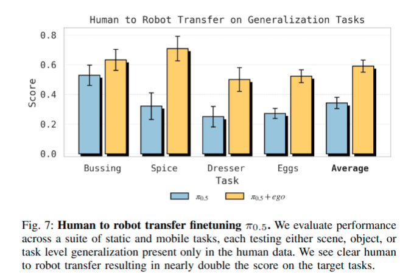
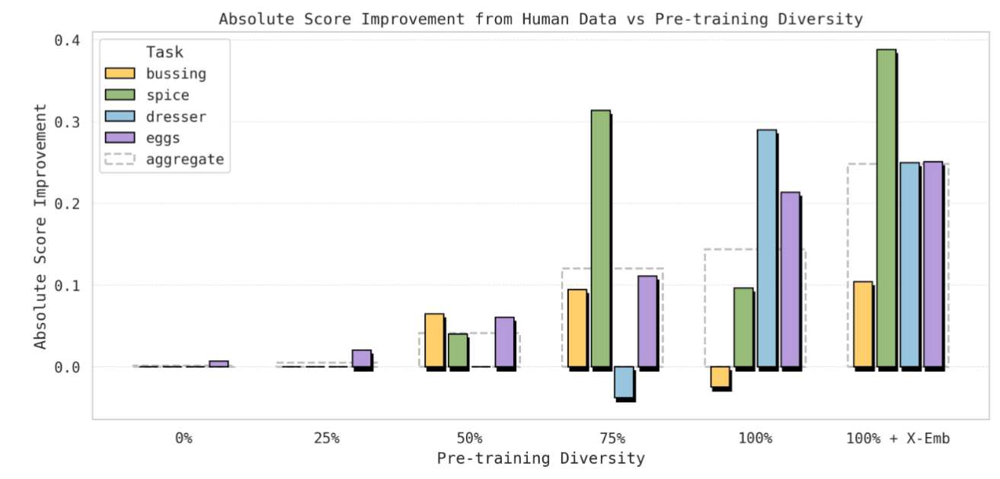
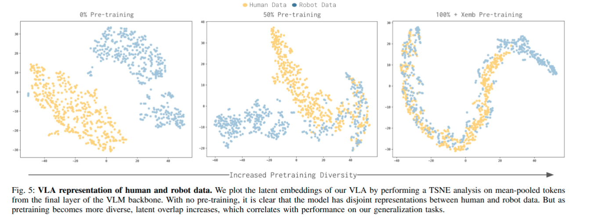
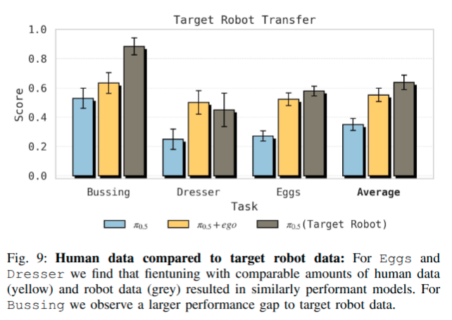
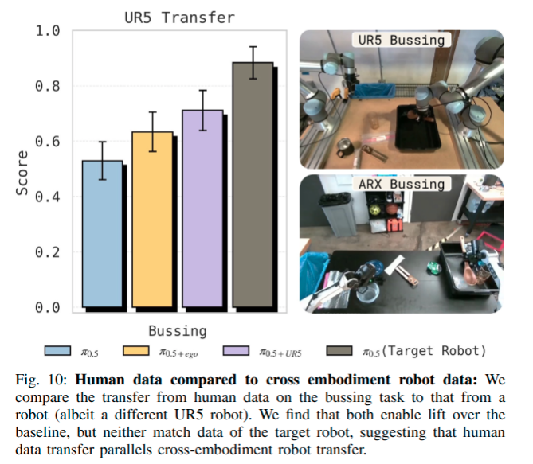

# Emergence of Human to Robot Transfer in Vision-Language-Action Models Note

## Navigation
- Paper card: [Emergence of Human to Robot Transfer in Vision-Language-Action Models card](../cards/EgoPi.md)

## Reading Notes

VLA 想获得开放世界泛化能力，需要大量且多样的数据。机器人遥操作数据昂贵，而**人类视频便宜、丰富，覆盖的场景和任务远多于机器人数据**。但难点在于，人和机器人在外观、运动学、动作空间等方面差异很大，过去通常需要人为设计映射或对齐机制。

作者提出一个很简单的思路：**把 human 当成另一个 embodiment（身体/机器人形态），直接和机器人数据一起 co-training**。他们发现一个类似 LLM scaling 的现象：

> 当 VLA 在足够多样的 **scene、task、embodiment** 上进行预训练之后，human → robot transfer 才明显出现。

也就是说，重点不只是“加入更多 human video”，而是**底座 VLA 本身必须先足够 general**。在预训练规模和多样性不足时，人类数据几乎帮不上忙；当多样性达到一定程度，人类数据带来的收益突然明显增大。


**最重要的实验发现：transfer 会随预训练 diversity 出现**

作者在四种泛化 setting 中测试这种能力，覆盖：

- **Scene generalization**：机器人没见过的新 apartment；
- **Object generalization**：机器人数据中没见过的新物体类别；
- **Task generalization**：机器人数据中从未出现过的新任务语义，例如按颜色分类鸡蛋。

随着机器人预训练数据从较窄变得越来越多样，VLA 越来越能利用 human video。特别是在加入不同 robot embodiments 之后，human data 带来的提升进一步增大。

**为什么 diversity 会起作用？——representation alignment**

作者分析模型的 latent representation 后发现：

预训练不足时：

**human representation ↔ robot representation 相互分离。**

随着 scene / task / embodiment diversity 增加：

**human representation ↔ robot representation 越来越重叠、对齐。**

因此作者提出的解释是：

**diverse pretraining → 学到 embodiment-agnostic abstraction → human/robot 表示自然对齐 → human-to-robot transfer 成为可能。** 


也就是 VLA 首先经过大量预训练，然后不再把人和机器人的动作看作完全不同的分布，之后就可以从人类示范中学习知识（比如原子动作的组合、多样化的策略以及场景泛化等）


### **FINE-TUNING WITH EMERGENT HUMAN-ROBOT ALIGNMENT** 

作者使用预训练的 **π0.5 VLA** 作为基础模型。Fine-tuning 时，人类数据和机器人数据使用基本相同的训练目标。这里所谓 **“emergent alignment”**，并不是设计一个显式的 domain alignment 网络，而是希望一个经过足够多任务、场景和机器人 embodiment 预训练的 VLA，本身已经学到了比较 embodiment-agnostic 的表示，因此能自动把“人的手在做什么”和“机器人的末端执行器该怎么动”联系起来。


**数采设备**：头戴+两个腕部

**数采规范：**操作人员佩戴采集设备，针对每项任务反复录制多组演示；同时为提升姿态追踪精度，还要求操作人员将双手保持在摄像头视野范围内。

本次采集的数据时长如下：餐具清理任务 3 小时、调料整理任务 3 小时、梳妆台整理任务 3 小时、鸡蛋分拣任务 5 小时。

**数据处理和标注：**针对采集得到的原始交互视频，我们采用视觉同步定位与地图构建（视觉 SLAM）技术，求解出头戴摄像头相对于固定世界坐标系的六维位姿变化序列\(\boldsymbol{e}_t \in \mathbb{R}^6\)；同时在头戴摄像头坐标系下，重建出双手各 17 个三维关键点的位置序列\(\boldsymbol{h}_t \in \mathbb{R}^{3\times17}\)。最后，参照机器人遥操作训练数据的标注规范，我们为人类视频数据标注文本子任务，详细记录双臂的具体动作。


**动作空间：**

为降低迁移学习难度，我们在训练数据中力求让人类动作与机器人动作的表征形式保持大致统一。对于机器人遥操作数据，动作表征有多种选择，常见方案包括 “机器人关节位置轨迹” 或 “末端执行器位姿轨迹”。由于人类关节位置难以精确估算，本文选择**末端执行器位姿**作为动作表征方式。

具体而言，末端执行器动作被表示为一段时长为H的动作序列\([\boldsymbol{a}_0,\boldsymbol{a}_1,\dots,\boldsymbol{a}_H]\)；其中每一项\(\boldsymbol{a}_i\)，均代表 “基于当前观测状态六维位姿\(\boldsymbol{s}_0\)” 的相对位姿变化。机器人数据的完整动作空间由三部分拼接而成：左臂末端执行器六维位姿序列 + 夹爪状态、右臂末端执行器六维位姿序列 + 夹爪状态、以及两维机身移动动作；最终得到维度为\(\boldsymbol{a} \in \mathbb{R}^{H\times16}\)的动作序列。

为从人类视频中计算出与机器人对应的动作量，我们首先基于每只手掌、中指与无名指上的三维关键点，定义 “人类末端执行器位姿”（见图 6），并以头戴摄像头位姿\(\boldsymbol{e}_t\)作为参考基准；随后参照机器人末端执行器动作的计算方式，求解出基于当前状态相对位姿的人类末端执行器动作。与之类似，我们将人类视频中基准摄像头位姿，映射到该动作序列首帧基准摄像头坐标系下，以此计算机器人机身移动的等效相对动作。

对于 “夹爪动作”，我们则不直接从人类视频中估算 —— 原因在于人与物体交互时，手部张合程度难以精确判定；因此模型仅从机器人数据中学习夹爪控制策略。综上，最终得到的人类动作维度为\(2\times6+6=18\)维。


思考：学习的时候需要保证 slot semantics 一致，一种方案

Human

```
              L pose     grip   R pose    grip   body 6D
human target: [******]    -     [******]   -     [******]
human mask:   [111111]    0     [111111]   0     [111111]
```

Robot

假设 mobile base = $x,yaw$：

```
              L pose     grip   R pose    grip   body 6D
robot target: [******]    *     [******]   *     [x----yaw]
robot mask:   [111111]    1     [111111]   1     [100001]
```


这种思路和 Robo-manip 跨本体的思路一样，是从统一动作空间的角度出发的。还有一种思路就是 pi07/qwen-VLA 的思路，所有有效动作都是从0开始，加mask，在提示词里面加 control mode——夹爪/人手，ee/joint

但是其实我觉得这两种方式并不冲突，可以并用。但是这样加 tag 之后对模型学习 robot data 和 human data 中相通的部分是有利的还是有害的暂不可知


**训练目标：**

针对复杂长时序任务，表现出色的模型通常同时具备 “高层子任务预测” 与 “低层动作预测” 能力；本文基于人类数据，为模型同时设计了这两项预测任务：

- **低层动作预测**：训练时同时采用两项监督方式 —— 一是对离散 FAST 动作编码执行 “序列下一元素预测”，二是对连续动作分布\(\pi_\theta(\boldsymbol{a}|\boldsymbol{o}_t,l_{\text{subtask},t})\)采用流匹配损失函数；
- **高层子任务预测**：针对文本形式的子任务描述序列，训练模型预测后续子任务文本标记，即求解\(\pi_\theta(l_{\text{subtask},t}|\boldsymbol{o}_t,l_t)\)。


**数据配方：**

在微调阶段，关键在于设计合理的数据混合方案：既要保留模型原有基础能力，又要融入人类数据以提升模型泛化性能。本文采用一种简明的配比策略：**泛化任务人类演示数据与最邻近机器人任务数据按 1:1 比例混合**；以此数据集对具备强大零样本泛化能力的视觉语言动作模型\(\pi_{0.5}\)开展微调，进一步提升其综合性能。为表述简便，我们将融合了第一人称视角人类数据的改进模型记为\(\pi_{0.5}+\text{ego}\)。


### 实验

#### Human to robot transfer benchmark

本基准测试从**场景、物体、任务**三个维度，全面评估人→机器人迁移效果（见图 3）。对每一维度，均设置 “机器人遥操作数据存在覆盖盲区、同时补充针对性人类数据” 的实验方案；训练时采用\(\pi_{0.5}+\text{ego}\)混合数据策略，最终在人类数据引入的全新测试项上评估模型性能。

- **场景迁移**：选定两项任务 ——“调料整理” 与 “梳妆台整理”。机器人原有数据仅覆盖特定住宅环境，仅用机器人数据训练的\(\pi_{0.5}\)在未见过的新住宅环境中泛化性差。我们在目标场景（新厨房）采集人类数据，再用\(\pi_{0.5}+\text{ego}\)在该新场景开展评测。两项任务均为短时序任务，采用**二值成功率**作为评价指标。
- **物体迁移**：机器人原有数据覆盖 “清理摆放着餐具与垃圾的餐桌” 任务；我们额外采集人类数据，引入 “厨房工具” 等全新操作对象，再用\(\pi_{0.5}+\text{ego}\)针对新物体开展评测。本项为长时序任务，评价指标为**摆放正确的物体数量**。
- **任务迁移**：机器人原有数据仅覆盖 “拾取鸡蛋并放入包装盒” 的基础操作；我们采集人类按颜色分拣鸡蛋的视频，以此作为新任务，再用\(\pi_{0.5}+\text{ego}\)开展评测。本项为长时序任务，评价指标为**分拣正确的鸡蛋数量**。



**补充针对性人类数据并采用混合训练策略，能显著提升策略模型的泛化能力**


#### Human to robot transfer emerges as a function of diverse VLA pretraining across scenes, tasks and embodiments

前文已证实\(\pi_{0.5}+\text{ego}\)能够利用人类体感数据拓展能力边界。由此引出本研究的核心问题：**这种迁移能力的形成机理是什么？**

我们提出假设：**在涵盖多场景、多任务、多形态的多样化数据上完成预训练，是实现高效人→机器人迁移的核心前提**。直观来说，经过充分预训练的 VLA 能够学习到适用于不同形态的通用抽象特征 —— 在特征表示层面捕捉不同领域的共有结构，从而为迁移创造条件。

为验证该假设，我们分两步开展实验：第一步，证明人→机器人迁移效果随预训练数据多样性提升而增强；第二步，分析预训练多样性提升过程中模型特征表示的变化规律。


**充分多样化的预训练是实现高效人→机器人迁移的必要条件**

为探究 VLA 预训练对人→机器人迁移的影响，我们保持基准实验流程不变，仅更换预训练初始化模型 —— 各组预训练数据的多样性逐步提升，具体设置如下：

- **0% 组**：仅使用视觉语言基础模型（VLM）权重初始化，无机器人数据预训练；
- **25%/50%/75%/100% 组**：在机器人数据上完成预训练；数据多样性逐步提升，分别对应完整 [场景 - 任务] 组合库的 25%/50%/75%/100%；且数据仅来自目标机器人平台：ARX 与移动 ARX；
- **100%+ 跨形态组**：采用\(\pi_{0.5}\)完整预训练方案（引自 Intelligence 等人文献 [20]），额外融入大量非目标机器人平台数据。

针对每一种初始化方案，我们分别训练两个模型：

- 其一仅使用与目标任务最相似任务的机器人遥操作数据
- 其二在此基础上加入对应人类体感数据。

通过对比两组性能差异，即可量化预训练多样性对人→机器人迁移效果的影响。



**迁移效果随预训练多样性提升显著增强**。在预训练缺失或不足时（0%、25% 组），混合人类数据训练无法带来性能提升；而使用多样化数据完成充分预训练后（75%、100% 组），混合人类数据训练开始展现出显著性能增益；若进一步融入跨机器人平台的多样化数据（100%+ 跨形态组），迁移效果还将继续提升。

针对各任务单独分析还可观察到以下规律：

- **鸡蛋分拣任务**：仅提升机器人数据预训练多样性，无法让模型掌握从未在机器人数据中出现过的 “分拣” 技能（见图 8）；但模型的预训练基础越扎实，就越能从人类数据中迁移并掌握这项全新技能；
- **梳妆台整理任务**：在预训练多样性达到 50% 之前，混合人类数据训练无明显增益，甚至可能出现负迁移；但当预训练多样性提升至 75%→100%+ 跨形态区间时，即便基准模型性能已十分出色，加入人类数据仍能带来稳定且可观的额外提升。


**预训练规模扩大促生通用形态特征表示**



**多样化预训练能够帮助模型构建 “与平台形态无关” 的通用特征表示，进而提升人→机器人迁移性能**。

为验证这一点，我们对混合训练后模型输出的特征向量开展 t 分布随机邻域嵌入（t-SNE）可视化分析（见图 5）。结果显示：当预训练不充分时，模型为人类数据与机器人数据学习到的特征分布相互分离，表明模型仍在分别拟合两类数据的特征规律；而随着预训练多样性逐步提升，两类特征分布趋于融合，说明模型已成功构建出适用于两种不同平台形态的统一特征空间（详细分析见附录 C）。

现有同类研究（EgoBridge）在数据规模有限的前提下，曾观察到 “混合训练可提升性能但特征分布仍相互分离” 的现象，并据此提出需通过显式对齐算法来强制统一两类特征。而本文研究表明：**只要预训练数据的多样性足够充分，仅通过混合训练即可自然实现特征分布的统一对齐，从而有效支撑跨平台迁移**。


#### How does embodied human data compare to data from other robots?

这一节是在比较作为补充数据，在未见场景下的人类采集数据和遥操目标本体采集的数据差距能有多大（这个目标本体也是在预训练中出现过的）

首先将人类数据与 “性能上限参照组” 开展对比 —— 该参照组使用目标机器人自身在对应任务域采集的数据进行微调（见图 9）。结果显示：在分拣鸡蛋与梳妆台整理两项任务上，使用人类数据微调的效果，几乎与使用目标机器人自身数据微调的效果不相上下；但在餐桌清理任务上，目标机器人自身数据的性能显著优于仅使用人类数据的效果



随后我们进一步研究：对于全新任务，人类体感数据的价值是否与其他非目标机器人平台的数据大致相当？我们以餐桌清理任务为例，额外在 UR5 型机器人上采集了 400 组演示数据（时长约 7.45 小时），并测试其向 ARX 型机器人迁移的效果。对比可见：**“人类→ARX” 与 “UR5→ARX” 呈现出高度相似的迁移规律 —— 两者均能超越纯机器人基线，但均无法达到目标机器人自身数据的性能**。这表明：**人类数据参与迁移的机理，与不同机器人平台之间的跨形态迁移机理具有高度共性**



从这可以看出来，人类数据约等于非目标本体在目标场景的补充数据


#### At what level does transfer occur?

人类数据究竟只能迁移高层语义概念，还是同样能够作用于底层动作策略？为回答这一问题，我们开展分层对照实验：

- 餐桌清理与鸡蛋分拣任务：评测阶段不启用高层策略，因此所有性能增益必然全部来自**底层动作预测**的迁移；
- 调料整理与梳妆台整理（移动操作类）任务：同时评测 “高层语义 + 底层动作” 联合作用效果，并设置四组对照 —— 仅机器人数据训高层 + 仅机器人数据训底层、仅机器人数据训高层 + 混合人类数据训底层、混合人类数据训高层 + 仅机器人数据训底层、混合人类数据训高层 + 混合人类数据训底层（见图 11）。

实验结果表明：**仅单独用人类数据优化高层策略或仅优化底层策略，效果均不如 “高低层同时融入人类数据”**，说明迁移同时发生在两个层级。

- 若仅用人类数据优化高层策略：底层执行经常无法正确响应指令。例如调料整理任务中，“拿起调料瓶” 被底层策略误执行成 “拿起托盘上已放置好的瓶子”；梳妆台整理任务中，高层指令 “把项链放进首饰盒”，底层却有时将其放进梳妆柜收纳格中。
- 若仅用人类数据优化底层策略：高层指令预测质量明显下降。例如调料整理任务中，瓶子早已拿起，高层却仍持续输出 “拿起调料瓶” 的指令，导致任务停滞；梳妆台整理任务中，高层常输出错误指令，如 “把发卡放在梳妆台上”，而非正确的 “放进收纳格”。


#### How important are the human worn wrist cameras?

为缩小人类与机器人之间的传感配置差异，我们为数据采集人员配备了小型腕部摄像头，使其视角与机器人手臂上的腕部摄像头尽可能相似。探究其作用，能够为未来大规模人类数据采集的传感配置方案提供依据。我们在 “使用 / 不使用腕部摄像头” 两种条件下，分别评估人类视频带来的迁移效果（见图 12）。结果显示：在餐桌清理、梳妆台整理等任务中，加入腕部摄像头观测数据能显著提升迁移性能；但在调料整理、鸡蛋分拣等任务中，额外摄像头并未带来明显增益。这一结果符合预期 —— 不同任务对 “腕部视角” 的依赖程度不同。综合实验结论：**在人类数据采集过程中配备腕部摄像头，能够最大化覆盖各类任务场景，使迁移效果更均衡。**


### Discussion &  Future Work

本文系统研究了基于\(\pi_{0.5}+\text{ego}\)方案的人→机器人迁移能力及其涌现规律。研究发现：当预训练多样性不足时，视觉语言动作模型（VLA）无法有效从人类数据中迁移知识；而一旦预训练多样性突破关键阈值，迁移能力便会显著显现。尽管本文方案在预训练阶段依赖海量机器人遥操作数据，但实际参与微调的人类数据仅数十小时，且采用结构化分幕式采集范式（**按任务片段、逐段采集的示范数据**，区别于连续无结构的被动视频）。

面向未来，我们将进一步融合更海量的人类体感数据 —— 既包含本文采用的主动演示片段，也涵盖从日常行为视频中获取的被动观察数据。如何在预训练阶段更高效地利用此类非结构化数据，仍有诸多问题亟待解决；但本文工作已为 “规模化融合人类视频数据训练通用机器人模型” 奠定了坚实基础。

本文关于 “人→机器人迁移能力随模型规模与数据多样性自然涌现” 的结论，也为通用机器人模型的发展指明了方向：**与大型语言模型的演进规律相似，扩大 VLA 模型规模与数据范围，不仅能持续提升已知任务的性能，还将不断解锁全新能力**。这一趋势将进一步降低各类数据资源的利用门槛、强化跨领域知识迁移，最终推动机器人基础模型实现更大规模的能力跃升。利用人类视频数据开展训练，正是其中最具代表性的方向之一；随着机器人基础模型的持续演进，未来还将有更多新能力不断涌现，值得持续探索。


### 总结 & 思考

- 对human ego数据的利用还只是：机器人数据预训练，少量 human data 后训练补充场景等的多样性
- human data 有腕部视角

- 在预训练之后，预训练数据中不同本体做相同任务的 latent representation 能否在同一分布？


