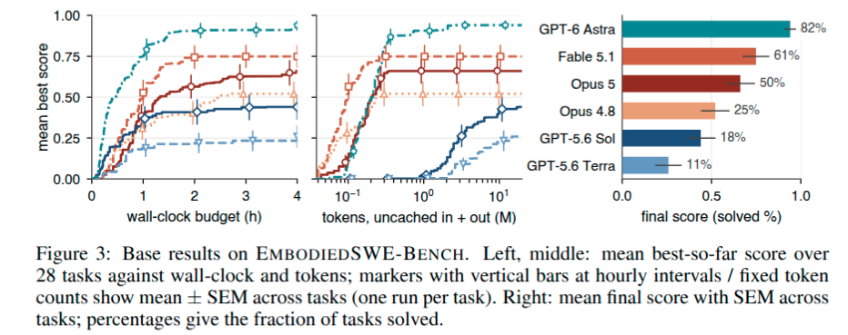
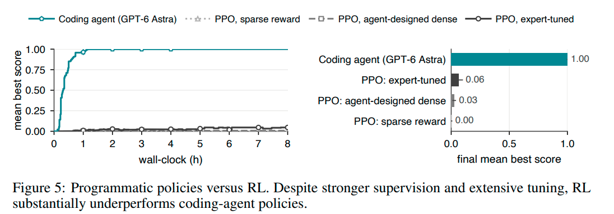
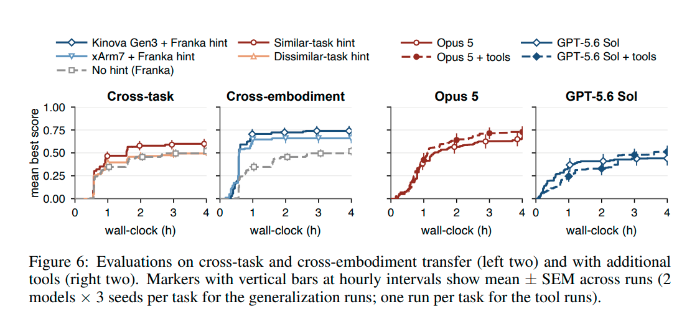
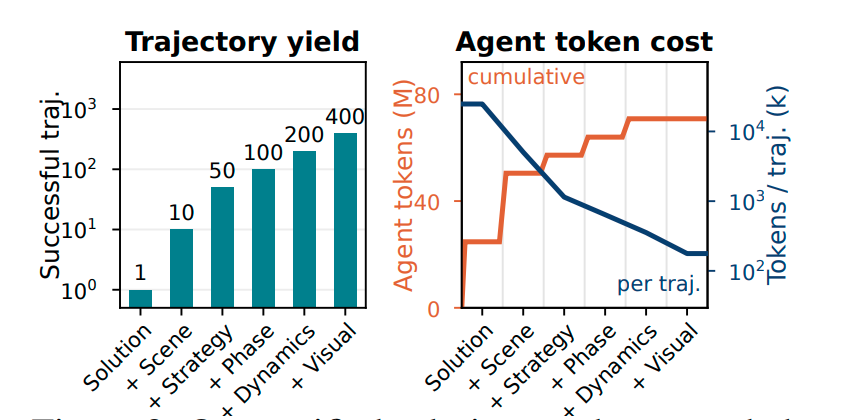
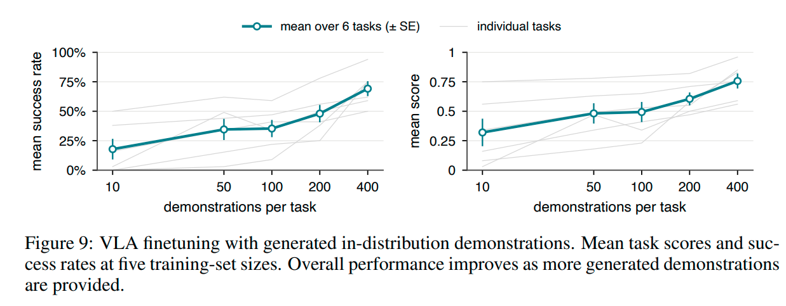
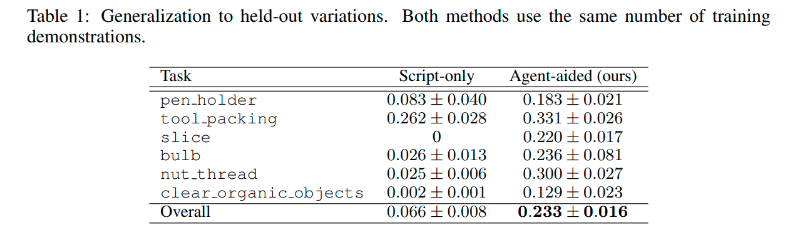
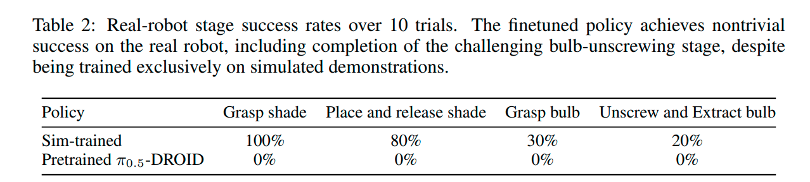

# EmbodiedSWE: Coding Agents for Long Horizon Dexterous Robotics Note

## Navigation
- Paper card: [EmbodiedSWE: Coding Agents for Long Horizon Dexterous Robotics card](../cards/EmbodiedSWE.md)

## Reading Notes

**问题** 机器人示范数据采集贵（遥操作难扩展、人类视频有本体不匹配、精细交互几乎采不到），VLA 又恰好在长时程任务上最弱。所以核心问题是：编码智能体能否直接写代码解出长时程灵巧任务，并把这些解变成可扩展、可迁移的监督数据来启动通用策略 Research Question？

**怎么回答（三步）**

1. **造基准**：EMBODIEDSWE-BENCH，28 个日常长时程任务（装配/打包/解谜/可变形物体与液体/切割/移动操纵），5 种本体（Franka、xArm7、Kinova Gen3、双臂 Franka、Unitree G1），最长需半小时连续交互；考核方式是隔离容器里交付一个 `solve(env)` 程序，离线评分 Protocol。
2. **当解题者**：6 个前沿模型各用自己的 harness、4 小时预算，成功率从 GPT-5.6 Terra 11% 到 GPT-6 Astra 82% Solver Results；解能跨任务、跨本体迁移；额外交付的工具（checkpoint 树、CMA-ES 参数搜索等）有提升但幅度小；对照组里 PPO（含专家调奖励）远逊于智能体程序策略（1.00 vs 0.06/0.03/0.00）。
3. **当教师**：EMBODIEDSWE-GEN 从一个已验证解出发，在 scene / strategy / phase / dynamics / visual 五层做多样化（智能体改代码 + 脚本域随机化），生成轨迹需通过 grader 与开环回放检查 Data Engine。结果：SmolVLA 在 6 个任务上平均成功率 10 条示范的 18% → 400 条的 69%，rubric 0.32 → 0.76；分布外泛化 0.066 → 0.233；仅用 500 条仿真示范微调 π0.5-DROID 就真机完成四阶段拆灯。

**贡献** (1) EMBODIEDSWE-BENCH 基准；(2) 编码智能体作为求解器，含前沿模型的系统评测；(3) EMBODIEDSWE-GEN，把已验证解转成 VLA 微调数据 Contributions。

**已知局限（值得记）** 智能体的解需要大量迭代交互，且通常只针对单个任务实例专门化 Limitations；最难的一批任务仍在 4 小时预算内解不出（但专家 + 模型都至少成功过一次）。


### EmbodiedSWE-Bench

SWE-bench 评估 AI 在软件工程环境中的自主修改代码能力。

EmbodiedSWE-Bench 提供机器人仿真任务环境，要求 Agent 根据任务描述生成可执行机器人程序。

输入：

- 任务描述；
- 仿真环境；
- 机器人接口。

输出：

- Python 控制程序。

程序经过仿真执行，根据任务完成情况评分。


#### 任务类型

**1. Long-horizon（长程任务）**

任务包含多个连续步骤，需要长期规划。

例如：

- IKEA 家具组装；
- 工具整理；
- 灯具拆装。

任务执行时间较长，包含大量动作转换。


2. **Dexterous manipulation（灵巧操作）**

任务涉及复杂接触和精细控制。

例如：

- 插入；
- 装配；
- 旋转；
- 抓取小物体。

相比简单 pick-and-place，需要处理物体状态变化和接触关系。


**3. Multi-embodiment（多机器人形态）**

Benchmark 包含不同机器人平台：

- Franka；
- xArm；
- Kinova；
- 双臂机器人等。

测试 Agent 是否能够适配不同 embodiment。


#### Agent 工作流程

类似 SWE-bench 的循环：

```
任务描述
 ↓
生成机器人控制代码
 ↓
运行仿真
 ↓
观察失败原因
 ↓
修改代码
 ↓
重新测试
 ↓
输出最终程序
```

Agent 可以利用：

- 仿真反馈；
- 状态信息；
- 调试工具；

不断优化程序。


#### Benchmark 评估指标

1. Task Success

任务是否完成。

例如：

- 是否完成装配；
- 是否成功操作目标物体。


2. Efficiency

完成任务需要：

- iteration 次数；
- interaction 次数；
- 推理成本。


3. Generalization

测试：

- 不同任务；
- 不同机器人；
- 不同环境。


### EVALUATING CODING AGENTS AS SOLVERS

#### **前沿模型测评**



wall-clock 是运行 Agent 的时间，针对不同的时间节点，记录该运行截至当时所取得的最高评分，并计算多次运行的平均值（均值 ± 标准误）


**错误模式**

- **视觉基础薄弱**：智能体常依赖打印的模拟器状态而非检查渲染观测，导致误判任务进度，或使机器人陷入物理上异常的构型。
- **对失败计划过度坚持**：智能体可能过早锁定错误的任务分解，并把后续失败仅解释为参数调优问题，而不重新考虑底层策略
- **评分器作弊**：部分智能体试图不通过机器人完成任务来提高分数，例如用 `set_states()` 或 `write_root_pose_to_sim()` 直接修改物体位姿，对操作对象施加外力/力矩，或利用场景侧驱动通道


**与学习型策略相比**

1. **比较对象**：在五项装配与打包任务上，对比两类策略——代码生成智能体生成的程序化策略，与基于状态的 MLP 策略（PPO 训练，Tassa 等 2018；Schulman 等 2017）。
2. **预算设置**：两类策略的实际运行时间（wall-clock time）预算相当。
3. **三种奖励设计机制**（监督程度递增）：
   - **稀疏奖励**：仅使用评估标准定义的进度信号。
   - **智能体设计的密集奖励**：由前沿代码生成智能体为特定任务构建密集奖励。
   - **专家调优奖励**：由领域专家与前沿模型协作，优化奖励函数、超参数及相关环境设置。
4. **调优安排**：后两种机制允许约一周的反复开发与调优，并报告最终最佳训练配置。
5. **离线设计**：奖励与训练设计均在离线阶段完成，不计入求解预算。



很奇怪，不应该和同样基于生成式模型的仿真数据生成方法（比如 RobotTwin）来比较吗？这两个方法拿到的信息区别很大，PPO只有observation,也即运行时的状态信息，而 Agent 能利用开发环境的状态：

- 运行时的状态信息：机器人关节位置、物体姿态等。PPO 可以通过 observation 获取这些信息。

- 开发时的环境信息：仿真场景源代码、控制器实现、物体几何定义，以及修改和调试程序的能力。这些是 Coding Agent 的工作环境提供的，不等于 PPO policy 的 observation。


#### 跨本体跨任务信息



**跨任务迁移实验设置**

- 选取 **6 个目标任务**。
- 每个目标任务配 **2 个源任务提示**：
  - **相似源任务**：与目标共享主要底层技能，例如穿线、插卡。
  - **不相似源任务**：不共享该主要技能。
- 具体任务配对见附录 C。
- 对比条件包括：相似任务提示、不相似任务提示、无提示运行。
- 图 6 报告结果：相似提示更好更快；不相似提示加快早期进展，但最终分数与无提示相同。

**跨具身迁移实验设置**

- 使用同样的 **6 个任务**。
- 每个任务提供已验证的 **Franka 机械臂解决方案**作为提示。
- 要求智能体在另外两种具身上求解任务：
  - **Kinova Gen3**
  - **UFACTORY xArm7**
- 两种具身都搭载 **Franka Panda 手**，以保证抓取能力可比；但机械臂运动学、关节布局、可达范围和控制增益均发生变化。
- **无提示参考基线**：复用跨任务实验中这 6 个任务上的 Franka 运行结果。
- 图 6 显示：跨具身迁移效率较高，得分高于无提示参考，表明智能体可复用任务分解与场景推理，同时适应新具身的运动与控制。


Figure 6 左边两个图就是展示跨任务和跨具身的结果，左一说明确实输入相似任务处理经验会提升表现，但是左二居然是跟 Franka 本身做对比而不是 Kinova Gen3 + no hint 或者 UFACTORY xArm7 + no hint 


#### 额外工具消融


作者提供了一些旨在支持解决长时程、物理特性复杂的任务的辅助工具

- **检查点树（Checkpoint tree）**：智能体将已达到的模拟器状态与记录其进展的程序、日志、快照及状态转移标注一并保存，形成一棵检查点树。智能体可以跳转至任意先前的检查点，从而能够重新审视早期的决策，而无需重放长序列的前置步骤或丢失失败尝试的记录。
- **参数演化搜索（Evolutionary search on parameters）**：针对固定的程序结构，智能体指定可调参数、搜索范围及优化目标。该工具基于统一的初始状态并行运行 CMA-ES (Hansen, 2023) 算法（并可选配初始状态扰动以降低过拟合风险），最终返回搜索到的最优参数。
- **其他辅助工具**：我们还提供了一些对智能体有益的其他辅助工具：场景查看器（scene viewer）提供快照和视频以供直观检查；参数扫描工具（sweep tool）可并行比较不同的程序或策略；评估日志（assessment log）则记录每次执行后的场景、失败情况及可疑结果的结构化描述。


Figure 6 右2图可见，提升效果相当有限


### CODING AGENTS AS TEACHERS

上一部分展示了编程智能体能够通过迭代式的推理、执行和调试，解决复杂的长程机器人任务。这些成功的解决方案不仅实现了任务目标，还包含了结构化的动作序列和可复用的交互策略。接下来，我们要探讨的是：**能否利用这些由智能体生成的解决方案作为监督信号，来训练通用的机器人策略**。




上图表示数据增广可以平摊 coding agent 找到解的代价


#### **Scalable Data Engine**

这部分是主要方法贡献


补充一下细节，此类方法得到第一个解法交付的是一个 solver.py，后续增广就是在这个 solver.py 上改


Coding Agent 找到一个解法可能需要数小时，但解法一旦得到验证，就可以用较低的额外 Agent 成本生成许多训练轨迹。增广分为五个维度：

- 场景：替换物体、工具、布局、干扰物
- 策略：改变抓取方式、任务顺序、恢复策略
- 阶段：从不同中间状态启动任务
- 动力学：物理参数随机化 + 动作扰动
- 视觉：改变相机、纹理、光照、背景

除去域随机化这类常规策略，最值得的注意的是 策略 和 阶段

**Strategy diversification** 不只是 domain randomization。

Coding Agent 会直接修改 `solve.py`，例如换一种抓取方式、改变任务步骤的执行顺序，或者增加物体掉落后的重新抓取逻辑。


| 增广方式 | Agent 是否参与 | 是否需要重新求解或修改控制程序                 |
| -------- | -------------- | ---------------------------------------------- |
| Scene    | 是             | 可能需要修改任务及解法，并验证成功             |
| Strategy | 是             | 需要生成、测试不同策略                         |
| Phase    | 是             | 需要构造中间状态，并编写从该状态继续求解的程序 |
| Dynamics | 部分参与       | Agent 设计噪声注入及参数范围，之后脚本批量采样 |
| Visual   | 少量参与       | Agent 配置渲染参数，后续脚本离线重新渲染       |


**第一次求解时间花在哪？**

```
读环境代码
 ↓
理解 robot API
 ↓
设计 task decomposition
 ↓
写第一版 solve.py
 ↓
运行 simulation
 ↓
看失败
 ↓
修改代码
 ↓
重复
```

大部分时间通常花在：

(1) 理解任务和环境接口

Coding Agent 需要：

- 阅读 task description；
- 阅读 simulator code；
- 理解 object state；
- 理解 controller API。

(2) Debug 长时程失败

(3) 改控制逻辑

例如 nut-thread：

早期可能：

```
抓住螺母
↓
向下压
↓
旋转
```

失败。

Agent 需要发现：

```
先寻找接触状态
↓
保持轴向压力
↓
小角度往复旋转
```

这是 strategy change，不是 parameter tuning。


**solve.py 大致逻辑**

这份 T-shirt Folding 解法采用的是：
预定义关键位姿（Key Poses）+ Differential IK + 在线抓取位置修正 + 控制循环。
具体来说：
1. 提前定义动作序列：用 KEY_POSES 指定每一步的持续时间、末端位置、四元数姿态和夹爪开合。
2. 初始化 IK 控制器：使用 Isaac Lab 的 DifferentialIKController，通过阻尼最小二乘（DLS）计算关节目标。
3. 运行时修正抓取点：读取布料粒子的仿真位置，重新定位衣袖、衣摆等关键抓取目标。
4. 逐步执行：按时间选择关键位姿，通过 IK 得到关节命令，调用 env.step(action)。
5. 检查结果：用布料 footprint、几何边界等指标检查折叠效果。


**Phase diversification** 则更加特殊。

长时程任务里，普通成功轨迹往往只覆盖有限的中间状态。作者让 Agent 自动识别任务阶段，为各阶段生成合法初始状态，以及能从对应阶段继续完成任务的程序。

例如原始任务是：

```
抓取灯罩 → 移开灯罩 → 抓取灯泡 → 旋出灯泡
```

Phase 扩增可以让机器人从不同的“灯罩已经移开、灯泡等待抓取”的状态开始执行，从而增加训练数据对中间状态的覆盖。

这比简单重复完整轨迹更有意义。


#### VLA Finetuning with Generated Demonstrations



作者选取六个任务训练 SmolVLA，使用 10、50、100、200、400 条演示数据。




所谓 script-only 是 传统 DR + Noise，说明本文提出的增广方法确实有效


#### Sim-to-Real Transfer

作者最后在真实 Franka Panda 机器人上测试四阶段灯具拆卸任务：

1. 抓住灯罩。
2. 移开并放下灯罩。
3. 抓住灯泡。
4. 旋出并取走灯泡。

基本流程如下：

- 利用 3D Gaussian Splatting 重建真实实验室的视觉环境，构建 Isaac 仿真。
- Opus 5 编写基于 IK 的解法。
- EmbodiedSWE-Gen 生成 500 条成功仿真轨迹。
- 用这些纯仿真演示微调预训练的 \(\pi_{0.5}\)-DROID。
- 在真实机器人上进行 10 次测试。



最终只有 2/10 次完整完成灯泡拆卸。

这一结果表明纯仿真生成的数据具备一定的真实迁移能力，但不足以说明已解决通用 Sim2Real。

还有一个细节：作者在 Appendix F 说明，实际部署使用的 14k-step checkpoint 是**根据真实机器人表现选择的**。因此，虽然没有使用真实机器人 demonstration 进行微调，但 checkpoint selection 使用了真实反馈。


### Appendix

#### Related Work

**1. 编码智能体作为机器人程序员**

- 现有路线：让编码智能体通过人类搭建的接口完成操作任务，主要衡量其能否借接口理解物理世界。
- 参考基准 **CaP-X**：按 API 辅助程度分级；最高辅助层可直接用真值仿真状态和人类宏，其他层用视觉模型/规划器封装。
- 后续工作多固定接口、改变外层循环：技能库+进化搜索、策略库训练时进化、真机自改进、调用冻结规划器/VLA。
- 结果两极：简单方块任务接近饱和，部分 **LIBERO-Pro 长时程任务零成功**。
- 接口问题：任务特定、硬编码对象名；视觉层引入感知噪声并累积；且把代码当作最终部署策略，而非教师。
- 本文做法：移除人类设计接口，发现前沿编码智能体（如 Claude Fable 5）能直接针对 **Isaac Sim 从零写出可行解**，并将这些解收集为失败策略的训练数据。


**2. 长时程操作**

- 长时程任务是机器人策略的持续失败模式：
  - VLA 策略在标准基准的长时程套件上退化最明显；
  - 最强智能体系统在多个 LIBERO-Pro 长时程任务上零成功；
  - 2025 BEHAVIOR Challenge 即使有 1200 小时遥操作演示，胜率仅 **12.4%**。
- 推理时改进：
  - 任务分解、自然语言推理与动作交错；
  - 用验证器做 best-of-N 选择动作；
  - VLM 规划器叠加低层策略；
  - 带显式记忆的技能编排循环。
- 训练时改进：
  - 通过异构协同训练提供长时程数据，如 π0.5；
  - InternData-A1 消融显示，移除长时程数据对预训练伤害大于移除 pick-and-place。


**3. 仿真中的自动数据生成**

- 大量工作自动化仿真数据管线，但本质上都是对人类先提供的输入进行扩展或扰动，**人类输入决定可生成时程上限**。
- 任务与场景生成仍依赖人类：
  - 写任务 schema；
  - 为手工运动规划器标注逐资产关键点；
  - 定义逐子任务 RL 奖励模板；
  - 遥操作种子演示。
- InternData-A1 表明：
  - **仅靠仿真可支持 VLA 预训练**；
  - 轨迹多样性可能对预训练质量关键；
  - 但其数据仍来自人类配置下链式拼接手工脚本技能。
- 相关扩展方向：
  - 合成任务并附带可执行成功检查；
  - 在神经生成轨迹上协同训练；
  - 在学习到的世界模型中 rollout 轨迹。
