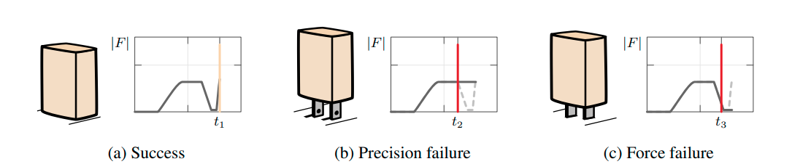
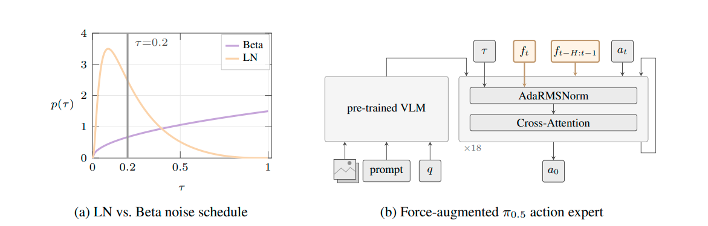
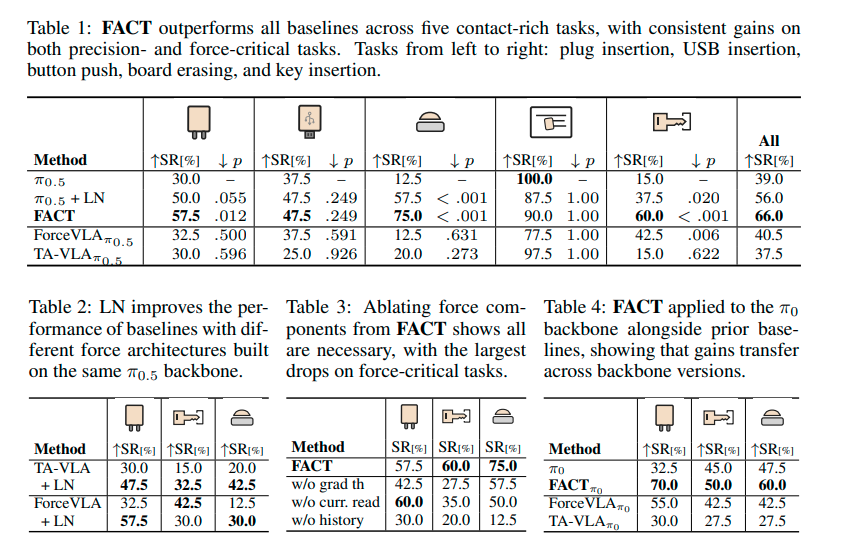

# Demystifying When and Why VLAs Fail in Contact-Rich Tasks and How to Fix Them Note

## Navigation
- Paper card: [Demystifying When and Why VLAs Fail in Contact-Rich Tasks and How to Fix Them card](../cards/FACT.md)

## Reading Notes

**Contact-rich task（富接触任务）** 指的是：机器人完成任务的关键过程里，需要和环境或物体发生**持续、频繁、强约束的物理接触**，而不是“碰一下、抓起来、放下”这么简单。任务成功依赖于如何处理接触力和接触状态. 例如把 USB 插进接口时，仅仅知道 USB 在哪里是不够的。机器人还需要根据“顶住了没有、往哪边卡住了、力在增大还是减小”等信息，不断做毫米甚至亚毫米级修正。

| Contact-sparse     | Contact-rich  |
| ------------------ | ------------- |
| 抓杯子             | 插 USB        |
| 拿起积木           | 插销入孔      |
| 搬箱子             | 拧螺丝        |
| 把苹果放进篮子     | 用刀切东西    |
| 抓衣服             | 擦桌子        |
| 开放空间移动机械臂 | 沿墙/表面运动 |

本文分析了VLA策略在接触密集型任务中经常失败的原因，并识别出两种不同的失败模式：**精度失败**和**力失败**。

- 精度失败的出现是因为流匹配使得训练无法达到低噪声去噪状态，而接触操作需要微小而精确的校正动作。
- 力失效的发生是因为力信号包含丰富的动态信息，而这些信息在将力视为普通输入流时无法被捕捉。

为了解决这两个问题，我们提出了 FACT（基于时间步长调制的力感知接触丰富操作），该方法旨在找出每种失效模式的根本原因。FACT 引入了一种目标噪声调度机制，该机制将训练后的信号重新分配到接触校正区域；此外，它还引入了一种时间感知力注入机制，该机制能够捕捉并利用力信号的独特属性。

### Related Work

#### **Contact-Rich Manipulation** 

机器人在插接、擦拭、装配这类任务中，不仅要“到达正确位置”，还要处理摩擦、柔顺性、卡滞和接触力调节。早期方法主要靠机械柔顺、力控制和搜索策略；之后发展到用强化学习直接学习接触行为，再进一步把视觉和力觉/触觉结合起来。核心矛盾是：**视觉负责空间理解，力觉负责物理接触理解，但二者的数据性质差异很大，直接融合并不容易。**

#### Force-Augmented VLA

不同触觉反馈形式
$$
\text{Haptic / physical feedback}\begin{cases}
\text{Force/Torque} & \text{整体受力} \\
\text{Joint torque} & \text{关节受力响应} \\
\text{Tactile} & \text{接触面的局部空间信息}
\end{cases}
$$
例如 wrist F/T 给你的是一个整体的
$$
[F_x,F_y,F_z,τ_x,τ_y,τ_z]
$$
但 GelSight、DIGIT 这类 tactile sensor 会告诉你**指尖哪里被压了、接触区域长什么样、有没有剪切/滑移**。所以可以粗略记成：**F/T 像“手腕感受到多大的推拉扭”，tactile 像“皮肤感觉具体哪里怎么被碰”。** FACT 本文用的是 wrist-mounted 6-axis F/T，而它在 Related Work 中也明确把 vision-force 和 vision-tactile 分成两条线，这里主要讨论的还是 vision-force. 

| Challenge            | 本质                | 问的是                   |
| -------------------- | ------------------- | ------------------------ |
| ① Force → Action     | **融合机制**        | 力怎么进入 policy？      |
| ② Action resolution  | **闭环控制/实时性** | 力变了之后多久能改动作？ |
| ③ Modality imbalance | **学习机制**        | 模型真的会学着用力吗？   |

| 工作         | 用的 physical signal    | 主要 Challenge       | 核心方法                                 | 我会给它的关键词            |
| ------------ | ----------------------- | -------------------- | ---------------------------------------- | --------------------------- |
| **ForceVLA** | 6-axis F/T              | ① Force → Action     | Force-aware MoE routing                  | **Routing**                 |
| **TA-VLA**   | 原版：joint torque      | ① Force → Action     | history token + future torque prediction | **Temporal modeling**       |
| **FAVLA**    | 6-axis end-effector F/T | ① + ②                | per-layer force injection + fast/slow AE | **Reactive control**        |
| **CRAFT**    | joint torque            | ③ Modality imbalance | VIB + force-first curriculum             | **Force utilization**       |
| **FD-VLA**   | Force 只在训练监督      | ③ / representation   | force distillation                       | **Sensor-free force prior** |
| **FACT**     | wrist 6-axis F/T        | 另起一层             | LN schedule + time-aware force injection | **Failure diagnosis**       |

###  Diagnosing Failures of VLA Policies in Contact-Rich Tasks

1. **Precision failure**

**Delta collapse**: 在自由空间中，动作幅度变化较大且不稳定，但在接触过程中，动作幅度会骤降至接近于零

**Training starvation**：现有主流 VLA, 如 $\pi$ 系列，smolVLA 等对于接近干净动作的去噪时刻采样不足

2. **Force failure**

**Contact Sparsity**：自由移动阶段力信号不起作用，容易学到忽视力输入的策略。

**Temporal Structure**：瞬时测量编码了当前的相互作用状态，而近期历史则编码了导致该状态的动态过程，包括瞬态过程和累积力的积累。忽略任何一个时间尺度都会丢失与任务相关的接触信息。

**Sensitivity modulation**：力对策略的影响应取决于接触状态。在自由空间中，力读数应被有效忽略；而在接触状态下，即使是微小的偏差也应触发纠正措施。

### Addressing Failures of VLA Policies in Contact-Rich Tasks

**Precision failure**：提升接近真实动作的时间步采样，与 beta 相比提升约 6x

[从\_LayerNorm\_到\_AdaRMS.md](../../common_knowledge/从_LayerNorm_到_AdaRMS.md)

**Force failure**：

Contact state:

对最近的传感器窗口 $f_t\in \R^{H_w\times 6}$ 做平均得到 $\bar f_t$，然后通过一个两层的 MLP 注入到 AdaRMSNorm 中：
$$
\Delta\gamma(\bar{f}_t) = W_\gamma \phi_{\mathrm{force}}(\bar{f}_t) \in \mathbb{R}^d
$$

$$
h_t = h_{t-1}\big(\tau\big) + \Delta\gamma\big(\bar{f}_t\big) \cdot \text{RMSNorm}\big(h_{t-1}\big) + \beta_t(\tau) \cdot h_{t-1}g_t(\tau)
$$

Force history: 

每一个历史窗口都通过共享 causal encoder 编码，随后生成的 tokens 被 prepend 到 action expert。

因此：
$$
f_{t−H:t−1}→\{z_{t−H},...,z_{t−1}\}→Action Expert.
$$
这里与 current force 有一个非常漂亮的角色分工：
$$
f_t→\text{modulation}\\
f_{t−H:t−1}→\text{tokens}
$$
Contact gating: 当力小于 0.5N 的时候，截断对力信号的梯度

### 实验

这个 LN 其实更多是一种 trade-off, 适合在后训练的时候用

从消融结果来看，History > current reading $\approx$ Gradient gating

