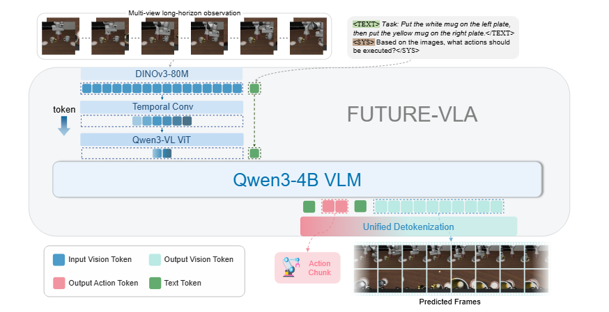
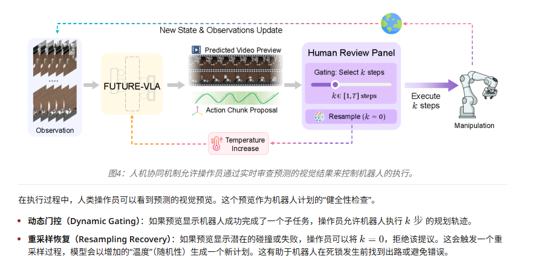

# FUTURE-VLA: Forecasting Unified Trajectories Under Real-time Execution Note

## Navigation
- Paper card: [FUTURE-VLA: Forecasting Unified Trajectories Under Real-time Execution card](../cards/FutureVLA.md)

## Reading Notes

Fast-WAM 风格范式，输出未来帧的embedding作为监督，创新点在于：

**第一，长历史输入的 token-budget compression。**
 FUTURE-VLA 试图解决多视角、长时序历史输入太贵的问题，用 temporally adaptive cascaded compression 在固定 token budget 下保留近期高分辨信息、压缩远期历史。论文把这叫 constrained-budget spatiotemporal compression。

**第二，推理时仍然保留可视化 preview，而不是把 future 退化成训练辅助项。**
 这点和 GigaWorld / Fast-WAM 正好相反。GigaWorld 的设计是 future video generation optional at inference；Fast-WAM 更直接跳过 test-time future prediction。FUTURE-VLA 则坚持让 future preview 在执行时可见、可审计。

**第三，把 preview 接到 execution gating。**
 这是它最像“系统论文”的地方。future preview 不只是 qualitative visualization，而是进入 human-in-the-loop gating：模型先提出 action chunk 和视觉后果，人或 verifier 决定执行多少、是否拒绝、是否重采样。

**级联压缩机制**

该模型使用一个基本的压缩单元——一系列步幅卷积——来处理这些特征。"深度"或这些压缩块的数量是动态的：

- **远距离历史帧**被重度压缩。例如，在$T=16$帧的窗口中，最旧的帧可能会通过多个块进行压缩，显著减少它们的令牌数量。
- **近期帧**保持在较高分辨率。在当前阶段，最新的观测没有进行步幅压缩，确保机器人能获得即时精度所需的精细视觉细节。

在标准化的$8:6:2$分配中，最早的8帧压缩程度最高，中间的6帧压缩程度适中，而最近的2帧保留了最大的细节。这种级联设计使系统能够在比以前的模型更大的时间窗口内运行，而不会超出单帧系统的计算预算。

人机协同：

挺难评的，这个人机协同像是为了合理化推理的时候输出 preview 硬造出来的，没活硬整。典型的学术自嗨，假问题，毫无需求的场景
