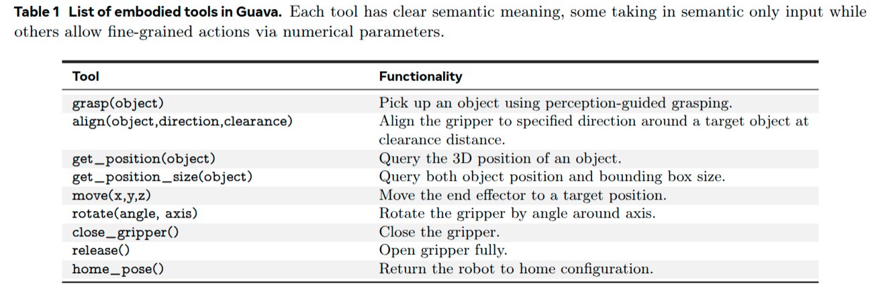
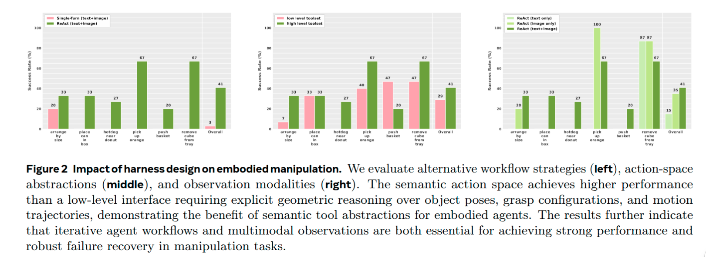
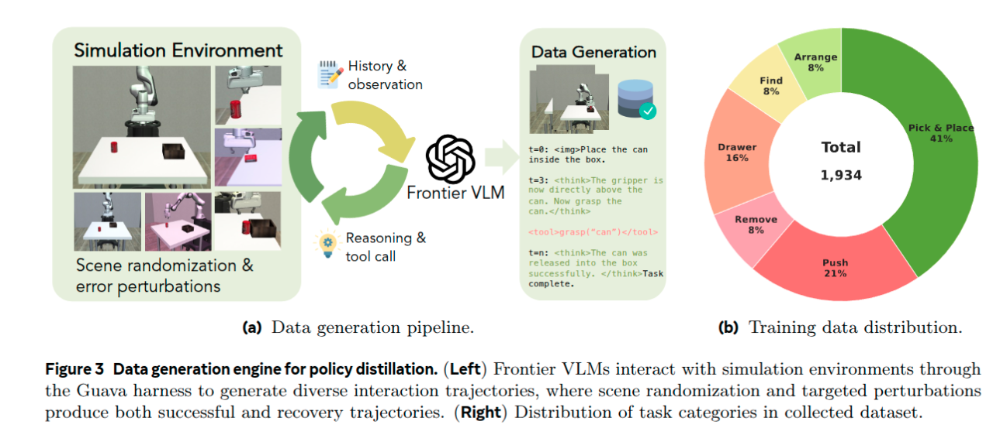
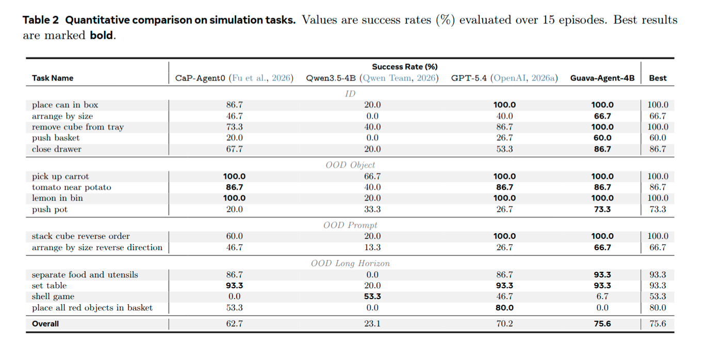
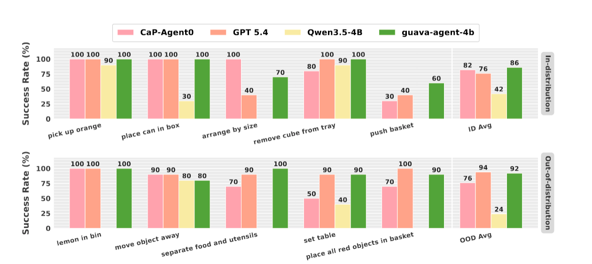
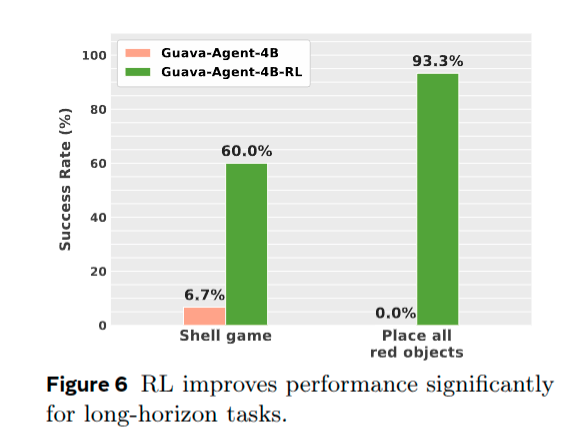
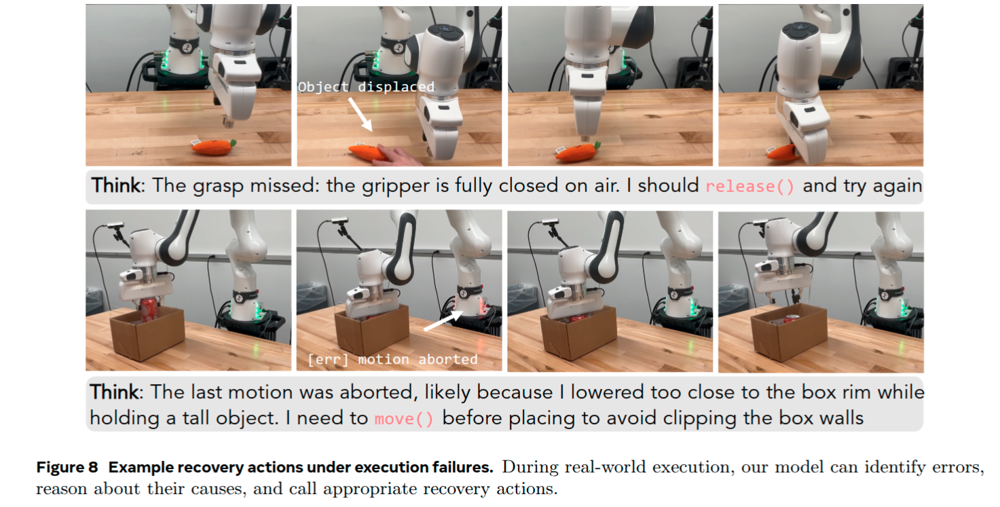

# Guava: An Effective and Universal Harness for Embodied Manipulation Note

## Navigation
- Paper card: [Guava: An Effective and Universal Harness for Embodied Manipulation card](../cards/Guava.md)

## Reading Notes

相比端到端的视觉-语言-动作（VLA）模型，通过工具调用来"驾驭"语言模型是一种替代路线：高层推理由模型负责，感知、规划和控制交给外部模块。作者通过系统探索 agent 工作流、动作空间和观测空间的设计空间，提出了 Guava 框架，并总结出三个关键要素：**迭代的感知-推理-动作循环**（ReAct 式交互）、**语义化的动作抽象**（如 `grasp(object)` 而非关节级控制）和**多模态观测**（图像 + 文本状态）。

在此基础上，他们用**不到 2K 条完全在仿真中采集的轨迹**，把具身操作能力蒸馏进一个 4B 的开源模型（Guava-Agent-4B），最终在仿真和真实世界中都达到与前沿闭源模型相当的性能，并对未见过的物体、新颖指令和长时序任务表现出强泛化 。结论是：精心设计的 harness 可以成为可扩展、与模型无关的具身操作接口。


### Related Work

**Foundation Models for Robotic Manipulation**

| 子路线                       | 代表工作                         | 核心思想                                                     | 动作/规划表示                                          | 主要优势                              | 相对 Guava 的局限                                            | Guava 的对应改进                                             |
| ---------------------------- | -------------------------------- | ------------------------------------------------------------ | ------------------------------------------------------ | ------------------------------------- | ------------------------------------------------------------ | ------------------------------------------------------------ |
| End-to-End VLA               | OpenVLA, π0, π0.5                | 在大规模机器人轨迹上训练视觉-语言-动作模型，直接从图像和指令预测机器人动作 | Learned action head / continuous actions               | 端到端、低层控制能力强                | 依赖大量机器人数据；动作表示较 opaque，不方便显式 constraint checking 和 plan repair | 不直接学习统一 action head，而是让 VLM 调用显式 semantic tools |
| Structured Spatial Reasoning | VoxPoser, MOKA, ReKep, RoboPoint | 让 foundation model 输出 value map、keypoint、affordance、spatial constraint 等中间空间表示 | Structured spatial representation → planner/controller | 空间关系更可解释，便于组合规划        | 往往依赖专门设计的 perception-action interface 和 planning primitives | 用更统一的 semantic action abstraction 作为 agent 接口       |
| Explicit Action Reasoning    | MolmoAct, MolmoAct2              | 在真正执行机器人动作前显式进行 spatial/action reasoning      | Explicit reasoning → learned action model              | reasoning 过程比纯 VLA 更透明         | 最终执行通常仍依赖 learned action head                       | reasoning 结果直接转化为显式 tool calls                      |
| Latent Planning              | ThinkAct                         | 先进行 embodied reasoning，再将规划压缩为 latent representation 去条件化动作模型 | Visual/plan latent → action model                      | 能把高层 reasoning 注入低层 policy    | latent plan 不容易直接检查、修改和修复                       | 使用可读、可调用、可重新组合的 semantic actions              |
| Hierarchical Manipulation    | HAMSTER                          | 将高层 reasoning/planning 与低层控制 policy 分层             | High-level plan → low-level learned policy             | 分离 reasoning 与控制，模块化程度更高 | low-level execution 仍主要由 learned policy 决定             | 将低层能力封装为 explicit callable tools，agent 可逐步选择   |

现有 foundation-model manipulation 方法主要把“动作能力”学习进模型或 action head；Guava 则把动作暴露成显式工具，让 foundation model 主要承担 perception、reasoning 和 tool selection。


**Harnessing Agents for Robotic Manipulation**

| 子路线                     | 代表工作                   | 核心思想                                                  | Agent 与机器人的接口                              | 执行方式                                  | 主要优势                                                     | 相对 Guava 的局限                                            | Guava 的对应改进                                             |
| -------------------------- | -------------------------- | --------------------------------------------------------- | ------------------------------------------------- | ----------------------------------------- | ------------------------------------------------------------ | ------------------------------------------------------------ | ------------------------------------------------------------ |
| Program Generation         | Code-as-Policies           | LLM 生成调用 perception / control API 的机器人程序        | Code / API calls                                  | 通常先生成程序，再执行                    | 模块化、可解释，不需要端到端学习所有控制能力                 | 执行阶段遇到失败后，不容易即时修改剩余计划                   | 改为 step-by-step ReAct tool calling，每一步都重新观察       |
| Programmatic Planning      | ProgPrompt                 | 利用程序化 prompt 让 LLM 生成 situated robot task plan    | Executable program                                | 以程序生成和执行为主                      | 能显式表达长期任务结构                                       | 主要偏 one-shot planning，在线 feedback 利用有限             | 每个动作后重新 perception + reasoning                        |
| Multimodal Code Generation | RoboCodeX                  | 结合视觉场景理解与代码生成，产生可执行机器人程序          | Vision → code → robot APIs                        | Program-level execution                   | 同时利用视觉和语言进行机器人编程                             | 仍以程序生成作为主要 action abstraction                      | Guava 直接将 multimodal observation 放进持续 agent loop      |
| Multi-Robot Agent          | RoCo                       | 使用 LLM 协调多个机器人并结合 motion planning             | Language coordination + planner                   | Multi-agent planning/execution            | 支持复杂多机器人协作                                         | 重点在 coordination，而非通用 closed-loop single-agent manipulation harness | Guava 聚焦单机器人 manipulation 中 agent loop 的系统设计     |
| Heterogeneous Multi-Agent  | EMOS                       | 面向异构机器人系统进行 embodied multi-agent orchestration | Agent / robot modules                             | Multi-agent                               | 扩展到不同 embodiment 和 robot capabilities                  | 主要研究多机器人系统组织                                     | Guava 更关注 manipulation tool abstraction 和在线 failure recovery |
| Tool-Orchestration VLM     | Maestro                    | 用 VLM 统一编排 perception、planning 和 control modules   | VLM → robotic modules                             | Modular tool orchestration                | 与 Guava 非常接近，支持 zero-shot modular manipulation       | Guava 认为现有 harness 对长期任务中的 iterative feedback / repair 仍不足 | 将 ReAct-style closed loop 明确作为 harness 核心             |
| Coding-Agent Framework     | Cap-X                      | 将 coding-agent paradigm 应用于机器人 manipulation        | Coding agent → robot tools                        | Agent/code based                          | 强调可扩展 tool use 和机器人 coding framework                | 与 Guava 属同期路线，但关注点更偏 coding-agent framework     | Guava 聚焦 semantic action、multimodal observation 和逐步 closed-loop reasoning |
| **Guava**                  | **Guava / Guava-Agent-4B** | **将 VLM 作为持续运行的 embodied agent**                  | **Semantic tools + fine-grained numerical tools** | **Observe → Reason → Act → Observe 循环** | **显式可解释、支持 failure recovery、可迭代修改计划，并可用于小模型蒸馏** | —                                                            | —****                                                        |

所谓 one-shot ：

```
初始观察
   ↓
一次性规划
   ↓
A → B → C → D
   ↓
执行完整流程
```


### Gauva: Harnessing VLM for Embodied Manipulation


**核心问题：怎样设计 VLM 与机器人之间的接口，使 VLM 已有的视觉、语言和推理能力能够有效转化为机器人操作能力？**


#### Designing Effective Harness

设计哲学

| 设计             | VLM 不再需要做什么             |
| ---------------- | ------------------------------ |
| ReAct loop       | 不需要一次预测整个未来         |
| Semantic tools   | 不需要解决所有低层机器人几何   |
| Multimodal state | 不需要从像素推断所有机器人状态 |

（所谓 ReAct loop 就是看一下做一下）


最终留下给 VLM 的问题主要是：What should I do next?

而不是：Exactly how should every motor move?



虽然这边说了不要 VLM 解决底层机器人几何，但是还是会有 move, get_position 这种动作，是



文本描述包括物体 3D 坐标、夹爪状态


#### Learning Efficient and Generalizable Agentic Embodied Reasoning

如何蒸馏 GPT 5.4 





本文的 harness 设计：

             User instruction
                    │
                    ▼
              ┌───────────┐
              │    VLM    │
              └─────┬─────┘
                    │
              reasoning / tool call
                    │
          ┌─────────▼─────────┐
          │   Guava Harness   │
          │                   │
          │ 1. observation    │
          │ 2. tool interface │
          │ 3. ReAct loop     │
          │ 4. feedback       │
          └─────────┬─────────┘
                    │
        ┌───────────┼────────────┐
        ▼           ▼            ▼
     grasp()      move()     get_position()
        │           │            │
     skill /      controller   perception
     planner
        │
        └───────────┬────────────┘
                    ▼
                  Robot


训练 pipeline：

我们利用具身数据引擎收集的轨迹（涵盖成功轨迹与恢复轨迹）进行监督微调（SFT），使策略既能学习操作技能，又能掌握针对执行失败的纠正行为。随后，我们借鉴近期针对推理模型的强化学习（RL）后训练方法，采用基于稀疏任务成功奖励的“组相对策略优化”（GRPO）算法。强化学习训练应用于更具挑战性的长程任务，这些任务需要模型具备迭代规划、工具使用以及适应执行误差的能力。


### 实验

#### setting

**模型与训练**：用 4B 参数的 Qwen3.5-4B 作为基座，采用两阶段优化流程（SFT + GRPO），训练时冻结视觉编码器和 aligner，全部训练在 8 张 NVIDIA H100 80GB GPU 上以 bfloat16 精度完成 。

**评估环境**：仿真环境用 [Robosuite](https://www.alphaxiv.org/abs/2009.12293?chatId=019ffe6c-5199-7127-a533-297e11ea07af)，真实世界部署在 Franka Research 3 机械臂上，配一台标定的 Intel RealSense D435 RGB-D 相机。评估套件覆盖多样的物体几何、空间布局和操作策略，包括非抓取类（如推）和长时程任务 。

**任务划分**：分为四类——ID（分布内，任务类型与训练相同但场景配置不同）、OOD object（未见过的物体或物体名）、OOD prompt（新颖语言指令）、OOD long-horizon（需要组合多种操作技能的长序列任务）。主指标是任务成功率，在规定的执行时间步内完成提示指定任务即算成功 。

**基线对比**：三个基线——未做具身后训练的基座 Qwen3.5-4B（同样跑在 Guava 框架下）、配备相同观测空间/工具集/harness 的 GPT-5.4、以及一次性代码生成执行的 CaP-Agent0。所有方法在同一环境中评估，agentic 方法尽可能使用相同的观测输入和工具 API 。

简言之，这一节的关键设计是：用极少的仿真数据蒸馏出 4B 小模型，并在仿真与真实世界两个层面、按 ID/OOD 四个维度检验其泛化能力。


#### ID & OOD 表现



Quantitative comparison on simulation tasks。OOD 物体任务(如 pick up carrot)只是给同一类操作换了新物体,OOD 指令任务(如 stack cube reverse order)是在已见过的物体上换说法,长程任务则是对这些技能的串联


#### Sim2Real



通过 1934 条仿真轨迹学习到的具身工具使用策略，无需额外的现实世界微调，即可有效地迁移到现实世界的操作任务中


#### RL 训练



性能的大幅提升表明，针对具有稀疏成功奖励的挑战性长程任务进行训练，能有效增强恢复行为，使策略能够更好地应对偏离预定轨迹的状态


#### 错误恢复




### Appendix


#### 数据生成

GPT 5.4 + RoboSuite

**系统提示词**

```
You are an intelligent robot arm controller. You will be shown an image of the scene and given a task to complete using the available tools. 

Interaction Loop 
In every response, think step-by-step inside <think></think> tags first, then call exactly one tool. When the task is fully complete or irrecoverable, output your thinking and end with Task complete or Task failed. 

Reasoning Guidelines 
Inside <think>, analyze current scene state - including object and gripper poses, progress of task - what has been done and what remains, result of last action - was it a success, failure, or unexpected outcome, and propose the best next action based on your reasoning... 

Tool Calling 
<tool_call>{"name": "tool_name", "arguments": {"param": value}}</tool_call> 

Gripper State 
The gripper’s current position [x,y,z], rotation [roll,pitch,yaw], and gripper opening % are provided at every turn. Use these values directly in your reasoning when necessary. 

Tool Definition
```


**数据清洗**

- 根据执行结果自动对轨迹进行分类，仅保留任务成功完成的交互片段（episodes）
- 剔除包含错误（如工具参数无效或仿真初始化失败）的轨迹
- 对部分轨迹进行人工检查，识别并移除低质量样本，例如包含无关对话行为、过度自我反思、脱离任务的对话，或其他无助于任务完成的冗余内容。为降低数据集偏差，我们还对高度相似的轨迹进行了去重处理，并移除了因任务提示词或执行历史几乎完全相同而产生的重复交互模式。这一精选过程有助于避免特定任务实例的过度代表性，并促进数据集中行为的多样性。


**错误恢复数据**

基于成功的轨迹，我们通过手动引入误差扰动来生成恢复数据；这些扰动源自一组预定义的常见错误类型，包括抓取失败、搬运途中物体掉落以及对齐错误。随后，我们从受扰动后的状态出发，继续执行交互式数据生成流程。此外，为了降低模型对初始条件的过拟合，我们还从原始轨迹中随机采样状态作为起点，生成额外的轨迹。我们仅纳入有效的反事实样本（例如，推移任务不会涉及抓取失败的情况），并对恢复数据应用相同的数据处理流程，剔除不成功或质量低劣的执行过程。


**数据配方**

Guava-Agent-4B 的微调数据集包含 1,934 条轨迹，对应 237 个不同的任务提示。其中，1,191 条轨迹（62%）为成功执行，而 743 条轨迹（38%）为恢复轨迹。


#### Tools实现

**`grasp(object)`：抓取指定物体。**
 系统首先使用 **SAM3** 从 RGB-D 观测中分割目标物体，然后估计抓取姿态。接口可以接任意学习得到的 **6-DoF 抓取规划器**，也可以使用简单的、基于 PCA 的俯视抓取方法。随后机器人移动到抓取姿态并闭合夹爪。系统还会根据夹爪闭合状态返回抓取结果：如果夹爪无法完全闭合，则认为夹住了物体；如果完全闭合，则返回闭合状态。


**`align(object, position, clearance)`：移动到目标物体周围的某个相对位置。**
 `position` 可以取 `top / left / right / front / back`，表示从哪个方向接近；`clearance` 可以取 `small / medium / large`，表示与物体保持的距离，这几个离散等级可以映射到用户自己定义的具体数值。这样设计的目的，是让 VLM 只进行简单的语义推理，而真正的执行仍然由三维几何信息决定。具体 clearance 距离根据**分割后的目标物体点云几何形状**计算。


**`get_position(object)`：取得目标物体的 3D 位置。**
 返回机器人 base frame 下的物体三维坐标。位置通过目标物体的**分割点云**计算：先去除离群点，再取点云质心。


**`get_position_and_size(object)`：取得位置和尺寸。**
 除目标物体位置外，还会返回其**轴对齐包围盒（axis-aligned bounding box）**尺寸，使 agent 能够考虑物体大小和空间约束。


**`move(position)`：移动末端执行器。**
 输入 Cartesian 坐标 `position=[x,y,z]`，通过位置控制器将机器人末端移动到该位置。


**`rotate(angle_deg, axis)`：旋转夹爪。**
 让夹爪在当前位置绕自身坐标系中的 `x / y / z` 某一轴旋转指定角度。


**`close_gripper()`：闭合夹爪。**


**`release()`：打开夹爪、释放物体。**
 释放之后可以选择执行一个很短的回撤动作，以减少释放后的碰撞。


**`home_pose()`：回到预定义 home configuration。**
 当当前姿态不适合继续操作时，这个工具也可以作为一种 recovery action。


