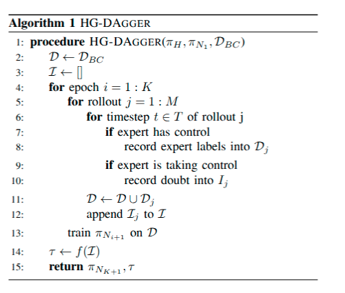

# HG-DAgger: Interactive Imitation Learning with Human Experts Note

## Navigation
- Paper card: [HG-DAgger: Interactive Imitation Learning with Human Experts card](../cards/HG-DAgger.md)

## Reading Notes

**DAgger：算法随机决定这一时刻由谁控制。**
$$
\pi_i=
\begin{cases}
\pi^*, & \text{概率 }\beta_i\\
\hat\pi_i, & \text{概率 }1-\beta_i
\end{cases}
$$
通常每个时间步重新随机一次。

**HG-DAgger：不再抛硬币，由人类专家判断何时接管。**
$$
\pi_i(x_t)
=
g(x_t)\pi_H(x_t)
+
\bigl(1-g(x_t)\bigr)\pi_{N_i}(o_t)
$$
其中：
$$
g(x_t)=
\begin{cases}
1,&\text{人类认为当前不安全，专家控制}\\
0,&\text{人类认为当前安全，学习器控制}
\end{cases}
$$
因此，HG-DAgger 中的切换不是随机切换，而是**人类根据安全风险主动切换**。

### 算法

与 DAgger 的区别就在于何时接管由人类决定，并且只记录人类接管的规划，同时引入风险估计，计算风险大于多少的时候属于高危险阶段，人类会接管
