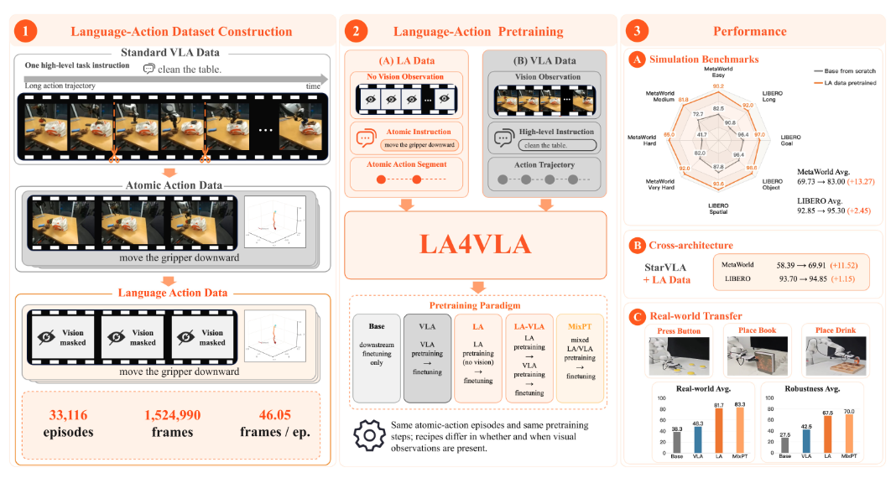
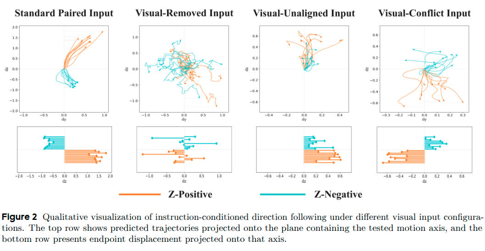
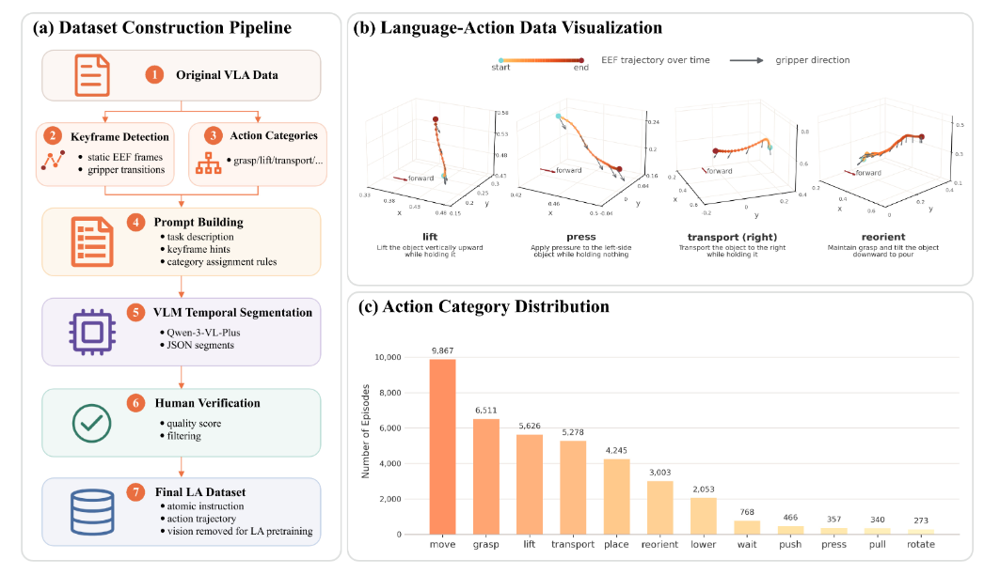
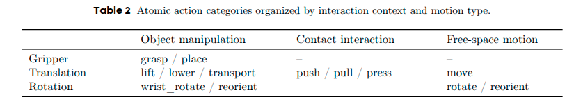
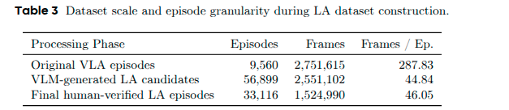
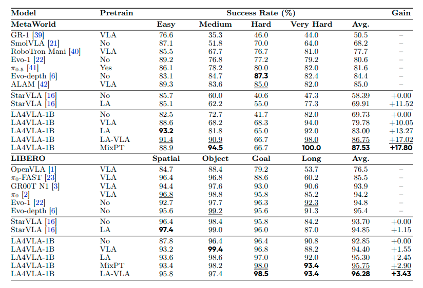
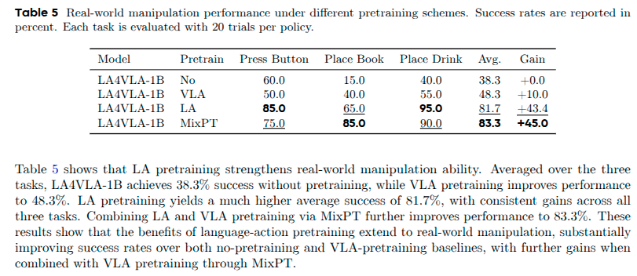
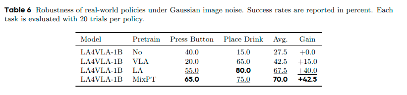
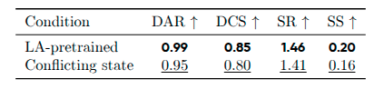
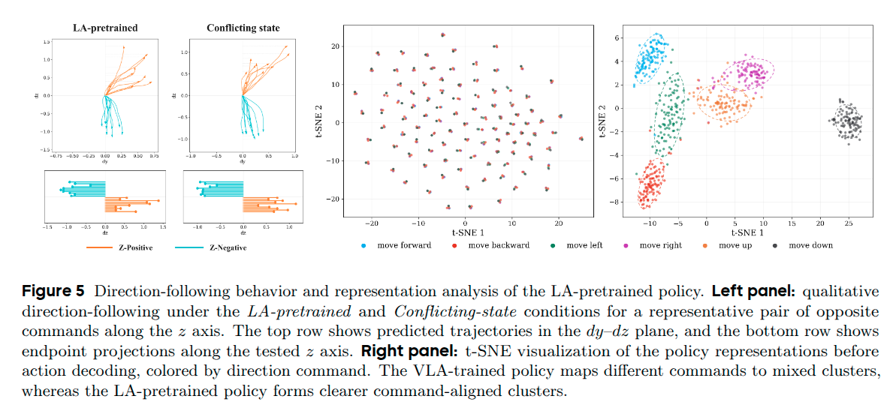

# LA4VLA: Learning to Act without Seeing via Language-Action Pretraining Note

## Navigation
- Paper card: [LA4VLA: Learning to Act without Seeing via Language-Action Pretraining card](../cards/LA4VLA.md)

## Reading Notes


视觉-语言-动作（VLA）模型通常通过联合映射视觉观察和语言指令到动作，在机器人演示数据上进行预训练。然而，**密集的视觉动作监督可能会掩盖相对稀疏的语言-动作信号**。因此，策略可能依赖于视觉捷径，而不是学习语言如何调控动作执行，从而使其对视觉变化非常敏感。为了解决这一局限性，我们提出了LA4VLA，一个语言-动作预训练框架，它使策略能够在没有视觉观察的情况下获取语言调控的动作先验。这些先验**捕捉了跨任务和场景共享的可重用操作技能，从而减少了对特定场景视觉线索的依赖**


视觉和语言对动作学习的贡献方面存在固有的不对称性：

- 在数据层面，一条机器人轨迹可能包含数百甚至数千个图像-动作对，但通常只与一条高级任务指令配对
- 在模型输入层面，视觉观察通常被编码成数百个图像标记，其数量通常比语言指令的标记数量多一到两个数量级


做法：在预训练阶段去掉视觉观测

LA4VLA，这是一个构建显式“语言-动作”（LA）监督信号并将其融入 VLA 学习的预训练框架


结论：仅使用 LA 数据进行预训练所带来的下游任务性能提升，优于仅使用 VLA 数据进行预训练的效果；而结合 LA 和 VLA 数据则能带来进一步的性能增益。语言-动作监督为下游 VLA 策略提供了一种有效且可迁移的训练信号，并与现有的 VLA 学习流程形成了互补。





### Probing Instruction Following in VLAs

普通 VLA 看起来会听语言，但这种“听语言”到底是真的语言控制，还是因为图像和语言在训练数据里刚好配对？

假设原始样本是：

```
Instruction: "move upward to approach the target"
Robot state: s_t
Paired image: 图像中对应的是“向上移动”的轨迹阶段
```

**A. Standard paired input**

```
输入 = 原始 instruction + 原始 robot state + 原始配对 image
```

**B. Visual-removed input**

```
输入 = 原始 instruction + 原始 robot state + mask 掉 image
```

**C. Visual-unaligned input**

```
输入 = 原始 instruction + 原始 robot state + 同场景但不配对的 image
```

**D. Visual-conflict input**

```
输入 = 原始 instruction + 原始 robot state + 相反方向动作对应的 image
```


**Metric**：

**DAR**：Directional Alignment Rate

DAR = 预测终点位移是否落在 instruction 指定方向的半空间里。

例子：

```
Instruction: move upward
预测位移: Δz > 0  → 记为对
预测位移: Δz < 0  → 记为错
```


**DCS**：Direction Consistency Score

DCS = 预测终点位移和真实 demonstration 位移之间的 cosine similarity。

例子：

```
真实动作: 向上 + 稍微向右
预测动作: 也向上 + 稍微向右
DCS 接近 1

真实动作: 向上
预测动作: 横向乱动
DCS 接近 0

真实动作: 向上
预测动作: 向下
DCS 接近 -1
```


**SR**：Separability Ratio

SR = 不同方向命令之间的平均距离 / 同一方向命令内部的平均距离。

直观理解：

```
move up 的预测都聚在一起
move down 的预测都聚在一起
而且 up 和 down 两组相距很远
→ SR 高
```


**SS**：Silhouette Score

SS = 聚类质量指标，看每个样本是否更靠近同类 direction cluster，而不是其他 direction cluster。

例子：

```
move up 的点大多靠近其他 move up 点
并且远离 move down / left / right 点
→ SS 高
```


SS和SR都是基于末端位移量来算的：对每个预测 action chunk，先把 horizon 内的平移增量加起来，就是这次预测的末端总位移向量。


结果：

| 条件                   | DAR  | DCS  | SR   | SS    | 解释                                      |
| ---------------------- | ---- | ---- | ---- | ----- | ----------------------------------------- |
| Standard paired input  | 0.98 | 0.95 | 2.35 | 0.55  | 正常配图时，看起来非常听指令              |
| Visual-removed input   | 0.63 | 0.16 | 1.03 | 0.04  | 去掉图像后，方向一致性严重下降            |
| Visual-unaligned input | 0.66 | 0.37 | 1.13 | 0.05  | 换成不配对图像后，语言控制仍然很弱        |
| Visual-conflict input  | 0.35 | 0.03 | 1.03 | -0.04 | 冲突图像会把动作带偏到相反方向（DAR<0.5） |


可视化：




### Language-Action Dataset Construction



这部分讲的是如何构建LA dataset: 把原来稀疏的高层语言监督，变成更密集的 atomic language-action supervision

**Step 1：从原始 VLA 轨迹开始**

原始 demonstration 里有：

```
visual observations
robot states
language instruction
action trajectory
```

例如原始任务级指令可能是：

```
put the cup into the bowl
```

这句话太高层，不能直接作为每个局部动作片段的语言监督。论文要做的是把一条长轨迹切成短的 atomic segments，并给每段配一个低层动作描述。


**Step 2：提取 keyframe hints**

他们先从 robot state 里提取时间提示：

```
static keyframes
gripper-open events
gripper-close events
```

这些 keyframe 不作为硬边界，只作为 soft cues 放进 prompt，帮助 VLM 判断哪里可能是阶段切换，比如对齐、抓取、放置、开爪、闭爪。

- 机械臂运动停顿点
- 夹爪开合状态变化点


**Step 3：把视频、原始任务、keyframes、原子动作表一起喂给 VLM**

prompt 里包含：

```
1. 原始长任务描述
2. sampled multi-view video frames
3. timestamped keyframe events
4. atomic-action vocabulary
5. primitive definitions（动作具体指的什么，参考Table 8）
6. category assignment rules
7. JSON output schema
```

论文附录给出的简化 prompt 模板里，action vocabulary 包括 `grasp, place, lift, lower, transport, wrist_rotate, reorient, push, pull, press, move, rotate, wait`，还包括 object-status tags：`HOLDING` 和 `EMPTY`。

也就是说，VLM 不是自由写 caption，而是在受约束的 schema 下输出：

```
[
  {
    "subaction": "lift",
    "instruction": "lift the object upward while holding it",
    "start": 3.50,
    "end": 5.00
  }
]
```

论文明确给了这个 JSON 例子。

这里用的VLM是Qwen3-plus的API


**Step 4：语言监督的形式是什么？**

LA 训练真正用的语言输入是 `instruction` 字段，而不是单独的 `subaction` label。

比如：

```
subaction: lift
instruction: lift the object upward while holding it
```

这里：

```
subaction = 结构化 primitive label，用于约束和验证
instruction = 喂给 policy 的自然语言条件
```

这个 instruction 有明确写作规则：

```
描述 action type
描述 direction
可选描述 object status
避免 object identity
避免 appearance
避免 material
避免 scene-specific details
```

论文说 instruction 要写成 compact、vision-agnostic form，描述 action type、direction 和可选 object/object-state information，同时避免外观和场景细节。

所以它不会理想地写成：

```
lift the red cup from the left side of the table
```

而更接近：

```
lift the object upward while holding it
```

或者：

```
transport the object left while keeping it upright
```

这就是 LA 里的语言监督。

**Step 5：人工验证过滤**

VLM 生成的是候选，不直接全收。人工会检查每个候选 segment 的：

```
temporal boundary
primitive label
natural-language instruction
```

是否互相一致。质量分低的会被过滤，例如过度切分、多个 primitive 合并、边界不准、instruction 和动作不匹配等。论文说最终保留 quality score ≥ 2 的 segment。

规模上是：

```
原始 VLA episodes: 9,560
VLM-generated LA candidates: 56,899
Final human-verified LA episodes: 33,116
```

也就是先自动生成候选，再人工过滤，最后得到 LA-33K。


**最终 LA episode 大概是**：

```
sample = {
    "instruction": "lift the object upward while holding it",
    "robot_states": s_t_to_s_T,
    "actions": a_t_to_a_T,
    "visual_observations": None
}
```

训练目标是：

```
instruction + proprioceptive state → action trajectory
```


**原子动作设计：**



**数据集统计**：




### Language-Action Pretraining

Performance on MetaWorld & LIBERO & Real-world






LA-VLA: 先LA后VLA

MixPT: 混训


**视觉扰动鲁棒性**



在真实机器人上加 **Gaussian image noise**。结论很直接：**LA 和 MixPT 在视觉退化时保持更高成功率。**这支持作者的核心假设：LA 预训练减少了 policy 对视觉 shortcut 的过度依赖，使动作预测更受语言和动作 prior 控制。


**指令跟随和表征分析**





