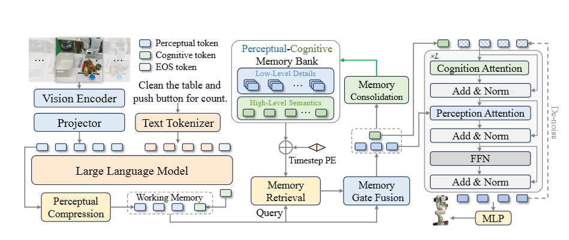
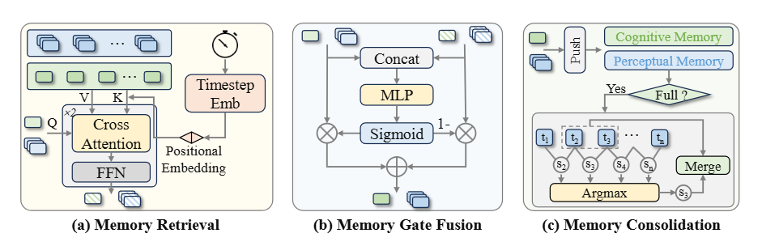

# MEMORYVLA: PERCEPTUAL-COGNITIVE MEMORY IN VISION-LANGUAGE-ACTION MODELS FOR ROBOTIC MANIPULATIO Note

## Navigation
- Paper card: [MEMORYVLA: PERCEPTUAL-COGNITIVE MEMORY IN VISION-LANGUAGE-ACTION MODELS FOR ROBOTIC MANIPULATIO card](../cards/MemoryVLA.md)

## Reading Notes

简单拼接连续帧作为VLM输入作为记忆导致的问题：

（1）自注意力机制的二次复杂度严重限制了可用的时间上下文长度；

（2）连续帧输入与模型单帧机器人预训练分布不匹配

人类的记忆机制：由海马体支持的长期记忆系统——情景记忆，以两种形式编码过去的经验，并带有时间索引：一种是保留精确细节的逐字表征，另一种是捕捉抽象语义的概要表征。在执行过程中，工作记忆从情景记忆中提取与决策相关的背景信息，并将其与当前表征整合，通过小脑控制来指导行动，同时将新的经验巩固到情景记忆中

### Related work

| 建模类别                | 代表作品                       | 方法简述                                     | 局限性                                 |
| :---------------------- | :----------------------------- | :------------------------------------------- | :------------------------------------- |
| **交错式图像-文本格式** | Octo, RoboVLMs, Interleave-VLA | 将多帧图像与文本交替排列，模拟视频数据格式。 | 实现复杂且计算开销极大。               |
| **隐变量传播**          | RoboFlamingo                   | 通过 LSTM 传播压缩后的隐变量 Token。         | 特征过于粗糙，丢失细粒度历史信息。     |
| **视觉轨迹提示**        | TraceVLA                       | 在当前帧图像上绘制历史状态的轨迹。           | 丢失了丰富的语义细节。                 |
| **历史动作提示**        | UniVLA                         | 将过去的动作序列作为文本 Prompt 输入。       | 仅作为思维链过程，未有效利用历史信息。 |

### Method

架构本身比较重，而且细节后期基本没有沿用的（RMBench中MEM-0融合记忆的过程有借鉴），主要看insight就好
