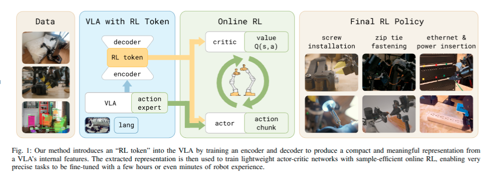
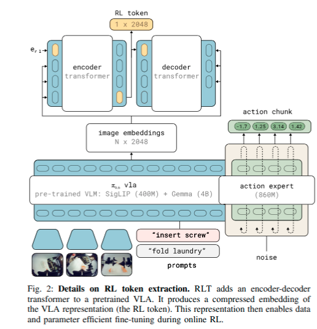
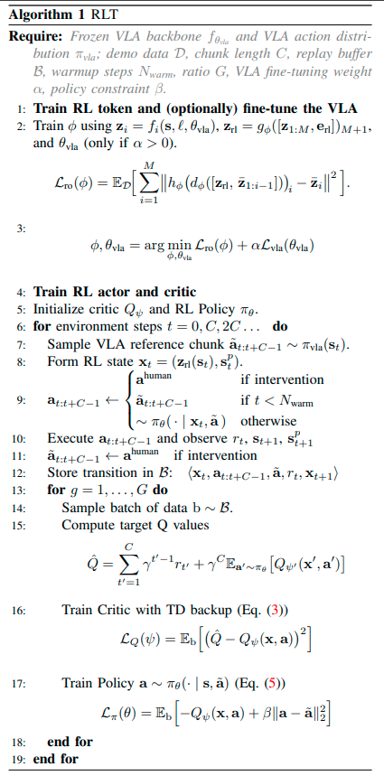
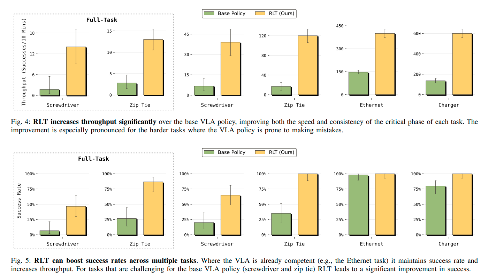
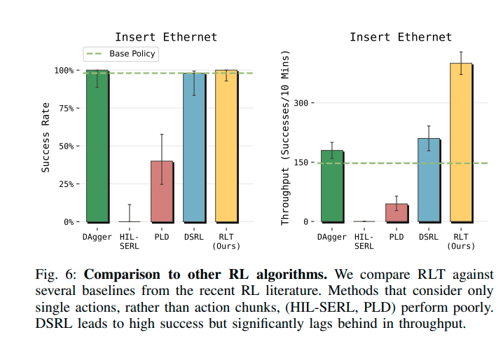
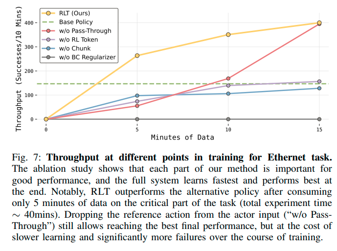
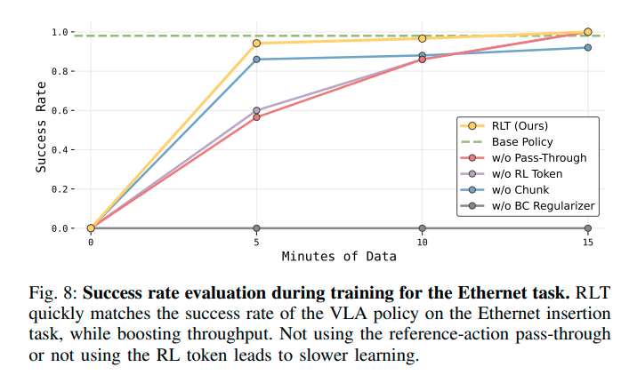
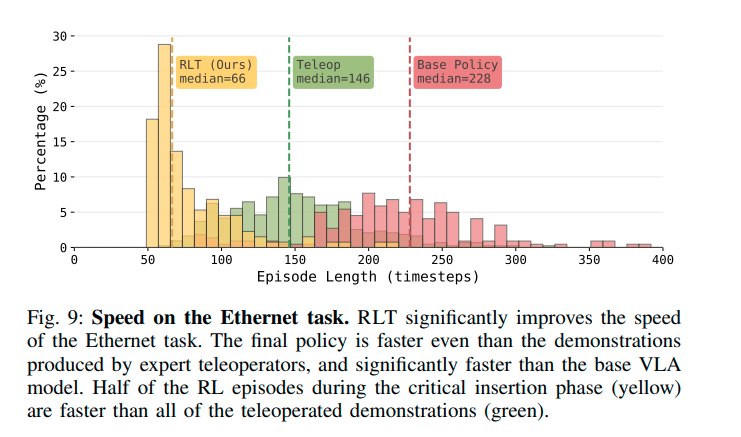

# RL Token: Bootstrapping Online RL with Vision-Language-Action Models Note

## Navigation
- Paper card: [RL Token: Bootstrapping Online RL with Vision-Language-Action Models card](../cards/RL-token.md)

## Reading Notes

**通用视觉—语言—动作模型（VLA）虽然具备较强的泛化能力，但在需要毫米级精度的机器人操作中，最后阶段往往不够快、不够稳定**。例如插入、旋紧等关键动作可能需要停顿和多次重试，微小误差也容易累积为任务失败。

作者认为，在线强化学习（RL）适合解决这一问题：机器人可以直接在目标任务上练习，针对**最容易失败、示范数据又难以覆盖的关键阶段**进行优化。但现实机器人训练的样本预算非常有限，而现有两类方法各有缺陷：

- 对整个基础模型做 RL 微调，通常需要大量数据和计算；
- 传统高样本效率的机器人 RL 使用较小的策略网络，却无法充分利用 VLA 已有的视觉理解和行为先验。

为兼顾两者，论文提出 **RL Token（RLT）**。其思路是让预训练 VLA 输出一个紧凑的“RL token”，把模型内部与任务相关的信息压缩成一个适合强化学习使用的表示。在此基础上，仅训练小型 actor–critic 网络，而冻结主体 VLA。

这一设计形成了明确的分工：

- **VLA** 负责通用视觉理解，并提供较合理的初始动作；
- **轻量级 RL 策略** 根据 RL token，在线优化任务中最困难、最精细的动作；
- 通过正则化约束，新策略不会偏离 VLA 动作太远，因此 RL 本质上是在已有良好行为附近进行局部改进，而不是从零探索。

作者在螺丝安装、扎带固定、以太网线插入和充电器插入四项真实机器人任务上测试该方法。Introduction 报告称，RLT 能在数分钟到数小时的在线训练内同时提高成功率和速度；关键阶段的执行速度最高提升约 **3 倍**，其中一个螺丝插入任务的成功率从 **20% 提高到 65%**，部分精细操作甚至超过了专家遥操作速度。


### Related Works

#### Real-World Reinforcement Learning

作者主要强调以下技术：

- off-policy actor–critic；
- replay buffer 中的数据复用；
- 提高 update-to-data ratio；
- 使用正则化避免高频更新导致训练不稳定；
- 用人类示范初始化 replay buffer；
- 在执行过程中加入人工干预和纠正。

SERL、RL 100 等系统已经表明，小型 actor–critic 策略可以在数小时机器人数据内学会接触丰富的操作任务。但这类方法通常：

- 使用较小的策略网络；
- 依赖 ResNet 等通用视觉编码器；
- 针对单一任务从头训练；
- 没有利用 VLA 已经学到的语言理解、场景语义和行为模式。


#### RL Fine-tuning of VLA

作者按照“**更新 VLA 的多少**”把已有方法放在一条连续谱上。

##### A. 全模型更新

**RECAP**

RECAP 通过离线 RL 更新整个 VLA：

- 学习分布式价值函数；
- 估计每个时间步动作的 advantage；
- 将示范、自动执行和人工干预数据汇总；
- 用 advantage 或 optimality indicator 加权策略训练。

它能够显著提升长时程任务的执行效率，但需要迭代式的数据收集和全模型训练。

**PPO 类方法**

另一些工作直接使用 PPO 或类似 on-policy 方法微调 VLA。作者认为，这类方法在真实机器人上较难实现高样本效率，因为新策略数据必须持续在线收集，而且旧数据通常难以充分重复使用。

RLT 与这类工作的区别是：**冻结大型 VLA，只训练小型 actor 和 critic**，从而降低计算量，并允许使用 off-policy replay。


##### B. 冻结 VLA，训练轻量模块

这一类与 RLT 最接近。

| 方法             | 如何利用冻结的 VLA                                         | 主要局限或与 RLT 的差别                                 |
| ---------------- | ---------------------------------------------------------- | ------------------------------------------------------- |
| ConRFT           | 冻结编码器，微调 action head                               | 单步动作、短时程任务，没有 action chunking              |
| Policy Decorator | 学习 residual action，叠加到 VLA 输出                      | residual 比例需要手工设置；主要在仿真中验证，样本量较大 |
| PLD              | 先训练 critic，再学习单步 residual policy                  | 仍是单步 residual；可将结果蒸馏回 VLA                   |
| GR-RL            | 学习 noise predictor，在 diffusion latent space 中引导 VLA | 多阶段训练，针对长时程系鞋带任务                        |
| DSRL             | 在 diffusion noise space 中训练 latent policy              | 通过改变扩散去噪过程间接控制动作                        |


这些方法的共同目标是：避免对整个 VLA 做昂贵的 RL 微调。


##### RLT 声称的三个关键区别

**1. 用 RL token 作为 RL 状态**

RLT 并非直接把 VLA 的全部中间特征交给 actor–critic，而是训练一个压缩表示：
$$
z_t=\operatorname{RLToken}(h_t^{\mathrm{VLA}})
$$
这个 token 被设计为保留与任务相关的 VLA 内部信息，同时维度足够小，使轻量 actor 和 critic 能够高效训练。作者认为，这比只使用普通视觉编码器更有行为相关性，也比直接处理所有 VLA token 更容易进行在线 RL。

这里的核心创新更准确地说是：

> **为 RL 学习一个来自 VLA 内部表示的任务相关压缩接口。**


**2. RL 的动作是 action chunk，而非单步动作**

ConRFT、PLD 等方法通常在每个控制周期输出单步动作。RLT 则让 actor 和 critic 对一段动作进行建模。

作者认为，这在高频控制和稀疏终局奖励下尤其重要。例如，机器人以 50 Hz 运行，10 秒任务可能产生约 500 个单步决策；如果每次决策执行一个包含若干控制步的 chunk，有效决策长度会显著缩短。

这会带来两个优势：

- 减少 temporal-difference backup 的次数；
- 缩短从最终成功奖励到早期动作的信用分配距离。

因此，action chunking 在本文中不仅是控制输出形式，也是一种改善 RL 信用分配的机制。


**3. 直接生成动作，但以 VLA 动作为条件和锚点**

**RLT 不预测 residual，也不直接操纵 diffusion noise。**其 actor 接收：

- RL token；
- VLA 采样得到的参考动作 chunk。

然后直接输出最终动作 chunk，并通过正则项约束其不要过度偏离 VLA 动作。

概念上可以理解为：
$$
a_{\mathrm{RL}}
\approx
\arg\max_a Q(z,a)
\quad
\text{同时约束 }a\text{ 接近 }a_{\mathrm{VLA}}.
$$
因此其探索空间被限制在 VLA 已经认为合理的行为附近。作者把它描述为：

> 对良好行为先验进行局部改进，而不是无约束地重新搜索动作空间。

这对真实机器人较重要，因为完全随机或大幅偏离基础策略的探索可能效率低且危险。


### Method




#### A. Adapting the VLA to expose an RL interface



这一阶段是在模型训练之后，强化学习训练之前，训练的时候冻结主模型。


Encoder：把 RL token 追加到 image embeddings（在他们的实验中，每个任务使用固定的语言指令，而 RL-token 是每个任务单独训练的，因此在 RL-token 的重建训练中删去了 language embeddings；原则上该结构可以应用于全部 VLA embeddings。）
$$
[z_1,z_2,\ldots,z_M,e_{\mathrm{rl}}]
$$
输出
$$
z_{\mathrm{rl}}
=
g_\phi([z_{1:M},e_{\mathrm{rl}}])_{M+1}.
$$


Decoder：论文使用的是**自回归 decoder**。它逐个重建原始 VLA embeddings。

损失是
$$
\mathcal L_{\mathrm{ro}}
=
\sum_{i=1}^{N}
\left\|
h_\phi
\left(
d_\phi([z_{\mathrm{rl}},\bar z_{1:i-1}])
\right)_i
-
\bar z_i
\right\|^2.
$$
类似 teach forcing 
$$
\begin{aligned}
[z_{\mathrm{rl}}]
&\rightarrow \hat z_1,\\
[z_{\mathrm{rl}},z_1]
&\rightarrow \hat z_2,\\
[z_{\mathrm{rl}},z_1,z_2]
&\rightarrow \hat z_3,\\
&\vdots\\
[z_{\mathrm{rl}},z_1,\ldots,z_{N-1}]
&\rightarrow \hat z_N.
\end{aligned}
$$


#### B. Online RL to refine VLA action chunks

采用 off-policy actor-critic 框架，具体算法用的 [TD3](../../common_knowledge/TD3 算法.md) ，训练 actor $\pi_\theta(\cdot | x,\tilde a _{1:C})$ 和 critic $Q_{\psi}(\cdot | x,\tilde a _{1:C})$（$\tilde a_{1:C}$ 指的是未来 C 步的 action chunk）


##### **训练 $Q_\psi$**

机器人每执行一个动作块，就产生一条 transition：
$$
\left(
\mathbf x_t,\,
\mathbf a_{t:t+C-1},\,
r_{t:t+C-1},\,
\mathbf x_{t+C}
\right)
$$
然后存入 replay buffer：
$$
\mathcal B
$$
数据不一定由当前 actor 生成，也可能来自：

- 冻结的 VLA 策略；
- 当前 RL actor；
- 人工干预动作。


监督信号由 TD error 产生：
$$
\hat Q
=
\underbrace{
\sum_{k=1}^{C}\gamma^{k-1}r_k
}_{\text{当前动作块内已经得到的奖励}}
+
\underbrace{
\gamma^C
\mathbb E_{\mathbf a'\sim\pi_\theta}
\left[
Q_{\psi'}(\mathbf x',\mathbf a')
\right]
}_{\text{执行完动作块后的未来价值}}
$$
目标：
$$
\mathcal L_Q
=
\mathbb E_{\mathcal B}
\left[
\left(
\hat Q-Q_\psi(\mathbf x,\mathbf a)
\right)^2
\right]
$$
论文采用两个 Q 网络，并使用二者较小的值计算 TD target


##### 奖励函数

奖励函数采用稀疏二元奖励：
$$
r_t=
\begin{cases}
1, & t=T\text{，且任务成功}\\
0, & \text{其他情况}
\end{cases}
$$
成功或失败由现场的人类操作员判断；操作员同时发送终止信号，结束当前 episode。论文明确说明，训练时由操作员在 RL 子任务完成时提供稀疏的 $+1$ 奖励。


**奖励针对什么范围？**

论文通常不是让 RL 控制整个长任务，而是只训练最困难的 **关键阶段**。

例如 Ethernet 插入任务可以拆成：
$$
\text{抓取网线}
\rightarrow
\text{移动到接口附近}
\rightarrow
\boxed{\text{精确对准并插入}}
$$
其中：

- 前面容易的抓取、搬运阶段由基础 VLA 完成；
- 到达精确插入阶段时，人类操作员将控制权交给 RL；
- RL 完成插入后，操作员给 $+1$ 并终止 episode；
- 如果明显失败或超出尝试范围，操作员标记失败并终止，奖励为 $0$。

因此这里的奖励准确地说是：

> **关键 RL 子任务是否完成，而不一定是整个完整机器人任务是否完成。**

所以 RLT 不是全程激活的，而是需要有个模型判断进入到“关键阶段”了，需要 RLT 的时候才会启动

论文中：

| 任务          | 什么时候给 (+1)                  |
| ------------- | -------------------------------- |
| 螺钉安装      | 电动螺丝刀正确对准并完成螺钉安装 |
| 扎带穿孔      | 扎带尾端成功穿过窄锁孔           |
| Ethernet 插入 | 网线接头成功插入凹陷接口         |
| 充电器插入    | 充电器正确插入插座               |


##### 训练 $\pi$

$$
\mathcal L_\pi
=
-Q_\psi(\mathbf x,\mathbf a)
+
\beta
\|\mathbf a-\tilde{\mathbf a}\|^2
$$

这个 $a$ 是 Actor 根据输入的动作块输出的

也就是同时满足：

1. 生成 Q 更高的动作；
2. 不要偏离 VLA 参考动作太远。


##### 整体流程





**① Warm-up**

训练初期先让冻结的基础 VLA 执行若干次任务，把数据预先放进 replay buffer：
$$
\mathcal B
\leftarrow
\mathcal B\cup
\text{VLA rollouts}
$$
这样 critic 不必在空数据集上开始学习。

**② Actor 控制机器人**

在每个 action-chunk 边界：

1. VLA 根据当前观测生成参考动作块 $\tilde a$；
2. RL-token 模块生成状态表示 $z_{\rm rl}$；
3. actor 根据状态与参考动作输出实际动作块：

$$
a_{t:t+C-1}
\sim
\pi_\theta(a\mid x,\tilde a)
$$

1. 机器人在真实环境中执行这个动作块。

因此在线训练后期采集的数据，确实是由**当前版本 actor**产生的，不只是固定离线数据。

**③ 获取反馈并存入 buffer**

执行后系统记录：
$$
(x_t,a_t,r_t,x_{t+C})
$$
奖励是稀疏的：任务成功时由操作员提供 $+1$，否则通常为 0。必要时人工也可以接管机器人，人工干预轨迹同样写入 replay buffer。

Replay buffer 中混合了：

- 基础 VLA warm-up 数据；
- 当前和历史 actor 的在线 rollout；
- 可选的人工干预数据。

**④ 更新 Critic**

从 replay buffer 中随机采样历史 transition，使用 TD 学习更新 critic：
$$
\hat Q
=
\sum_{i=1}^{C}\gamma^{i-1}r_i
+
\gamma^C
Q_{\psi'}(x',a')
$$
然后最小化：
$$
\mathcal L_Q
=
\bigl(\hat Q-Q_\psi(x,a)\bigr)^2
$$
critic 学习哪些动作块更可能带来成功，以及哪些动作能更快获得成功奖励。

**⑤ 更新 Actor**

actor 根据 critic 的评价提升动作价值，同时使用 BC regularizer 避免偏离 VLA 动作太远：
$$
\mathcal L_\pi
=
-Q_\psi(x,a)
+
\beta\|a-\tilde a\|^2
$$
更新后的 actor 随后再次用于真实机器人数据采集，形成下一轮循环。


执行动作的优先级别：
$$
a_{t:t+C-1}=
\begin{cases}
a^{\mathrm{human}}, & \text{人工介入}\\
\tilde a_{t:t+C-1}, & t<N_{\mathrm{warm}}\\
a\sim\pi_\theta(\cdot|x_t,\tilde a), & \text{其余情况}
\end{cases}
$$
warmup 阶段主要是初始化 $Q_\psi$，同时 actor 也不用控制策略，而是把采样得到的 a 给 $Q_\psi$ 评估同时计算 $\beta||a-\tilde a||^2$，主要由后者控制

训练初期，critic 是随机初始化的。此时：
$$
\nabla_a Q_\psi(x,a)
$$
通常是噪声较大、方向不可靠的梯度。相比之下，
$$
2\beta(a-\tilde a)
$$
始终有明确方向：把 actor 输出拉向 VLA 动作。

所以即使 $\beta$ 从头到尾固定，早期的**有效训练信号**仍主要来自平方距离项。随着 critic 从成功/失败数据中学到有意义的 Q 函数，Q 梯度才逐渐能够抵消正则项，使 actor 有条件地偏离 VLA。论文也明确描述：critic 有用之后，actor 会在偏离参考动作能够提高预测价值时自然偏离


$\beta,N_{warm}$ ？


### REAL-WORLD EXPERIMENTS

#### Setup

研究问题：

- RLT 是否优于基础 VLA；
- 是否优于其他在线 RL／模仿学习方法；
- RL token、action chunk、BC 正则和 reference-action pass-through 各自是否必要；
- RL 是否能产生演示数据中没有的新策略


任务包括：

- 电动螺丝刀安装 M3 螺钉；
- 双臂穿扎带；
- 插入 Ethernet 接头；
- 插入电源插头。

这些任务共同特点是：前半段相对容易，最后的接触阶段需要毫米乃至亚毫米级对准。机器人以 50 Hz 控制，单步动作为 14 维，RLT 一次预测 10 步，因此 actor 输出的是 140 维 action chunk。


#### 两种评估设置

**关键阶段评估**

机器人直接从“即将进入精细操作”的部分完成状态开始，例如扎带已经被两只夹爪抓住，只测试穿入锁孔的阶段。初始姿态做少量随机化，每个方法在每个任务上评估 50 个 episode。

这种设置的优点是实验很干净：它排除了抓取失败、搬运误差等噪声，能够直接测量 RLT 是否改善了它声称要改善的部分。

但它也是一个相对有利的设置。系统不必自己发现“困难阶段在哪里”，也不必处理完整任务中的全部状态分布。

**完整任务评估**

机器人从 home position 出发，由基础 VLA 执行前半段，再将控制权切换给 RLT。只有螺丝刀和扎带两个较困难任务进行了完整任务评估。训练时也先在关键阶段学习，再逐步转入完整任务分布。

因此这里所谓“full-task RLT”仍然是一个**基础 VLA + 局部 RL 专家**的组合系统，并不是 RL actor 从头到尾控制整个任务。


#### Baselines & Ablations

**HIL-SERL**：训练小型 actor-critic，并利用人工干预；但只使用 ImageNet 预训练的 ResNet 表征，没有利用 VLA 的视觉和行为先验。

**PLD**：学习单步 residual action，再叠加到冻结 VLA 的动作上。

**DSRL**：不直接输出动作，而是在 VLA 的 latent noise space 中选择噪声，从而引导 VLA 生成更好的动作。

**DAgger**：用在线训练期间收集的人工干预数据继续微调基础 VLA。


| 消融版本               | 改动                                            | 结果与解释                                                   |
| ---------------------- | ----------------------------------------------- | ------------------------------------------------------------ |
| **w/o RL token**       | 用冻结的 ImageNet ResNet-10 替代 RL token       | Throughput 降低约 **50%**，说明 VLA 内部表征比通用视觉特征更适合精细操作 |
| **w/o Chunk**          | 从长度为 10 的 action chunk 改为单步动作        | 无法稳定达到基础 VLA 性能；单步动作显著拉长 credit assignment horizon |
| **w/o BC Regularizer** | 设置 ($\beta=0$)，不再约束 RL 动作接近 VLA 动作 | 性能下降最大；actor 必须仅依赖尚不准确的 Q-function，在完整高维动作空间中探索 |
| **w/o Pass-Through**   | 不把 VLA reference action 输入 actor            | 最终能追上完整 RLT，但学习更慢、训练失败更多，并会出现探索漂移或退化行为 |


#### 实验结果

##### Q1：RLT 能否提升基础 VLA 的操作性能？



作者分别在**关键阶段**和**完整任务**两种设置下比较 RLT 与基础 VLA，并使用成功率和单位时间吞吐量作为指标。

在四个任务的关键阶段中，RLT 均优于基础 VLA：

- 对 Ethernet 和 Charger 这类基础 VLA 已有较高成功率的任务，RLT 在保持成功率的同时，将关键阶段执行速度提升约 (3\times)。
- 对 Screw Installation 和 Zip Tie Fastening 这类更困难的任务，RLT 不仅提高执行速度，也显著提升成功率。
- 在完整任务评估中，RLT 使螺丝安装和扎带任务的成功率分别提高约 40 和 60 个百分点。

因此，RLT 的作用分为两类：在基础策略容易失败时提高可靠性，在基础策略已经可靠但动作较慢时减少犹豫和重复尝试、提高吞吐量。


| 任务              | 实际机器人数据量                                  | 备注                               |
| :---------------- | :------------------------------------------------ | :--------------------------------- |
| **Ethernet 插入** | 关键阶段约 **5 分钟**，总实验约 **40 分钟**       | 从图 7 标题可知                    |
| **Charger 插入**  | 未单独说明，落在总范围中段                        | 论文只给出了总范围，没有分解该任务 |
| **Screw 安装**    | 约 **5 小时**（两阶段训练：先关键阶段，再全任务） | 附录 B 中说明                      |
| **Zip tie 紧固**  | 约 **5 小时**（同上两阶段策略）                   | 同上                               |


##### Q2：RLT 与其他在线策略改进方法相比表现如何？



作者在 Ethernet 插入任务上比较了 RLT 与 HIL-SERL、PLD、DSRL 和 DAgger，并为各方法提供相同规模的训练数据。

实验结果表明：

- **HIL-SERL 和 PLD 表现较差。**两者均采用单步动作，在 50 Hz 控制频率和稀疏终局奖励下，需要在数百个决策步骤之间进行信用分配，价值函数难以有效传播奖励。
- **DAgger 和 DSRL 的成功率接近 RLT**，但速度提升较小。
- DAgger 只能学习人工干预和演示中的动作，因此受到人类操作速度的限制。
- DSRL 在 VLA 的 latent noise space 中选择动作模式，能够保持稳定性，但对基础 VLA 的约束较强，限制了策略进一步提升的空间。
- **RLT 在维持基础 VLA 高成功率的同时，将平均完成步数减少约 (2$\times$)**，因此获得最高吞吐量。

这说明 RLT 相比单步 RL 方法更容易处理高频、稀疏奖励任务；相比纯模仿学习和强约束 latent steering，也更有能力优化执行速度。


##### Q3：RLT 的各个组件分别有多重要？




作者在 Ethernet 任务上分别移除 RL token、action chunk、BC regularizer 和 reference-action pass-through。

**1. 移除 RL Token**

将 RL token 替换为 ImageNet 预训练的 ResNet-10 后，吞吐量下降约 50%。

这说明从 VLA 内部提取的 RL token 包含与机器人操作和任务状态相关的信息，通用视觉编码器无法提供同等有效的状态表征。


**2. 移除 Action Chunk**

将长度为 (C=10) 的动作块改为单步动作后，策略无法稳定达到基础 VLA 的性能。

action chunk 可以将数百个高频控制步骤压缩成更少的 RL 决策，缩短信号传播距离；单步控制会显著增加有效决策时域，使稀疏奖励下的信用分配更加困难。

需要注意，该消融同时将 RL token 替换成了 ResNet-10，因为在 50 Hz 下无法为每个单步动作实时查询 VLA。因此，该结果混合了取消 action chunk 和取消 RL token 两种影响。


**3. 移除 BC Regularizer**

设置 (\beta=0)，不再使用
$$
\beta\lVert a-\tilde a\rVert_2^2
$$
约束 RL 动作接近 VLA reference action。

这一消融造成了最大的性能下降。虽然 actor 仍能看到 VLA reference action，但它可以完全偏离该动作，只依赖 Q-function 的梯度进行优化。训练早期 Q-function 尚不准确，actor 因而需要在完整的高维动作空间中进行不受约束的探索。


**4. 移除 Reference-Action Pass-Through**

不再将 VLA reference action 输入 actor，但训练目标中仍保留 BC regularizer。

该版本最终能在较简单的 Ethernet 任务上达到完整 RLT 的性能，但学习速度更慢，训练早期出现更多失败、探索漂移和退化行为。

这说明 reference-action pass-through 主要提供良好的动作初始化和模式信息，而 BC regularizer 则负责限制策略偏离 VLA 的程度：

- Pass-through：让 actor **看到** VLA 建议的动作；
- BC regularizer：要求 actor **不要过度偏离** VLA 动作。

总体来看，四个组件均有正向贡献，其中 BC regularizer 对训练稳定性最关键。完整 RLT 学习最快、最终吞吐量最高，并在只使用约 5 分钟关键阶段机器人数据后超过替代策略。


##### Q4：RLT 能否发现优于原始演示的新策略？



作者对 Ethernet 关键插入阶段的动作速度和行为模式进行了分析。

基础 VLA 经常表现出 probing 行为：

1. 接近端口；
2. 接触或插入失败；
3. 向后撤退；
4. 重新调整位置和角度；
5. 再次尝试。

相比之下，**RLT 学到的策略会以更连续、果断的动作进行插入**。当第一次插入没有成功时，策略不会立即后退，而是保持压力并轻微晃动接头，利用接头和机械结构的柔顺性完成插入。

这种“施压并轻微晃动”的策略没有出现在原始遥操作演示中，而是通过在线探索产生的。最终 RLT 策略不仅明显快于基础 VLA，关键阶段速度也超过了专家遥操作演示；约一半的 RL episode 比所有遥操作演示都快。

因此，RLT 并非只是在复制或平滑人类动作，而是可以利用真实环境反馈，发现演示数据中没有出现的、更高效的接触策略。


### 附录

#### 额外实验细节

#####  Actor 和 Critic 的网络规模

对扎带、Ethernet 和充电器任务：

- actor、critic 都是两层 MLP；
- hidden dimension 为 256。

对更困难的螺丝安装任务：

- 使用三层 MLP；
- hidden dimension 为 512。

actor 和 critic 都从随机初始化开始，输入包括：

- 冻结 VLA 输出的 RL token；
- 机器人本体感觉位置；
- 机器人速度信息。

因此，在线更新部分确实很轻量，不需要更新数十亿参数的 VLA。


##### Reference-action dropout

Actor 会额外接收 VLA 生成的 reference action chunk，但训练时有 **50% 概率将 reference action mask 掉**；推理时则始终提供 reference action。

目的在于防止 actor 简单复制 VLA：

- 未 mask 时：学习如何基于 VLA 建议进行局部修正；
- mask 时：被迫根据状态和 RL token 独立产生动作；
- 推理时：利用 reference action 获得更稳定的行为先验。


##### 动作输出形式

Actor 是一个固定小标准差的高斯策略（）：
$$
\pi_\theta(a\mid x,\tilde a)
=
\mathcal N(\mu_\theta(x,\tilde a),\sigma^2I)
$$
它每次输出长度为：
$$
C=10
$$
的 action chunk。机器人运行频率为 50 Hz，因此一个 chunk 对应约：
$$
10/50=0.2\text{ 秒}
$$
的机器人动作。

固定且较小的标准差意味着探索相对保守，主要围绕当前策略均值和 VLA 建议进行局部探索，而不是在整个动作空间内大范围随机搜索。


##### 数据增广

虽然策略每次执行 10 步动作，但存储数据时以 2 个控制步为 stride，从同一条轨迹中提取重叠 action chunks：

$$
a_{0:9},\ a_{2:11},\ a_{4:13},\ldots
$$
在 50 Hz 下，每秒大约生成：50/2=25 个 RL 训练样本。

因此，5 分钟有效机器人数据大约可以形成：5×60×25=7,500 个高度重叠的 chunk transition。它们并非 7,500 次独立 episode，但可由 off-policy replay buffer 重复训练。


##### 困难任务采用两阶段训练

螺丝安装和扎带任务采用：

1. **关键阶段训练**：直接从精细操作前的状态开始；
2. **完整任务训练**：基础 VLA 完成早期阶段，到关键阶段再切换给 RLT。

作者认为，这既能提高早期训练效率，又能让 RL 策略逐步适应基础 VLA 在完整任务中产生的真实状态分布。

这属于一种 curriculum：先在受控、简单的初始状态分布中学习，再扩展到更加复杂的 full-task 分布。


附录称，螺丝安装和扎带任务报告的是收集约 **5 小时机器人数据后**的策略性能。


**阶段 1：关键阶段训练**

机器人被人工重置到“精细操作即将开始”的部分完成状态。

例如扎带任务中：

- 两只机械臂已经抓住扎带两端；
- 尾端已经位于锁孔附近；
- RL 只需要学习最后的对准和穿入。

初始状态会做小幅随机化。此时 actor 和 critic 从这些短轨迹中在线学习：

1. 冻结 VLA 根据当前图像生成 reference action chunk；
2. 冻结 RL-token 模块生成状态表示；
3. actor 根据状态和 VLA reference action 输出改进后的动作；
4. critic 根据成功／失败奖励学习 Q 值；
5. actor 使用 critic 和 BC regularizer 更新。

关键阶段通常只有约 5–20 秒，因此奖励传播距离较短，初期训练更容易。


**阶段 2：完整任务训练**

论文中的“完整任务训练”并不是让 RL actor 从 home position 控制整个任务。

实际流程是：

```
机器人从 home position 开始
          ↓
冻结的基础 VLA 执行抓取、搬运、粗对准
          ↓
到达关键阶段
          ↓
人工决定切换时刻
          ↓
RL actor 接管精细操作
          ↓
人工给出成功/失败标签
```

在这个阶段，作者**继续训练前一阶段已经学过的 actor 和 critic**。论文使用“advance/move on to a full-task phase”，表明这是延续训练，而不是重新初始化另一套 actor-critic。

仍然只有关键阶段的 transition 被用于 RLT 的训练。基础 VLA 执行早期阶段，主要作用是产生更真实、更复杂的关键阶段初始状态，例如：

- 抓取位置略有偏差；
- 物体朝向不同；
- 末端位姿存在累计误差；
- 扎带或螺丝状态不完全一致。


#### 基线实现细节

所有方法都使用：

- 相同环境；
- 相同 delta action space；
- 50 Hz 控制频率。

##### PLD

PLD 在在线训练前，先使用基础策略的 **50 次 rollout**，通过 Cal-QL 预训练 critic，然后再开始在线 residual-policy RL。

这意味着作者并没有让 PLD 的 critic 完全从零学习，而是提供了离线预训练来提高样本效率。


##### DSRL

DSRL 输出一个：
$$
1\times32
$$
维的 latent action，然后将它沿时间维复制 50 次，以适配 VLA action generator 的噪声输入空间。

因此，DSRL 在一个 action chunk 内使用相同 latent steering 信号，时间维表达能力可能比直接生成完整动作块的 RLT 更受限制。


##### HIL-SERL

HIL-SERL：

- 用 20 个示范 episode 初始化 RLPD；
- 在线训练期间持续提供人工干预。

但它在该实验设置中没有成功。作者认为主要原因是：

- 本文控制频率为 50 Hz，而原系统约为 10 Hz；
- 本文没有使用 action-space bounding box 缩小探索空间。

这是一个重要限定：HIL-SERL 的失败不能简单解释为“该算法本身不行”。实验条件显著增加了它的时域长度和探索难度，而且没有复现其原始系统中的动作边界设计。


##### DAgger

DAgger 使用：

- 原始人工演示；
- RLT 在线训练过程中收集的同一批人工干预数据；

将两者混合后继续微调 VLA。

因此，DAgger 和 RLT 使用了相同的 intervention 数据，但利用方式不同：

- DAgger 将它作为监督学习数据；
- RLT 将其存入 replay buffer，同时结合奖励和自主轨迹进行价值学习。
