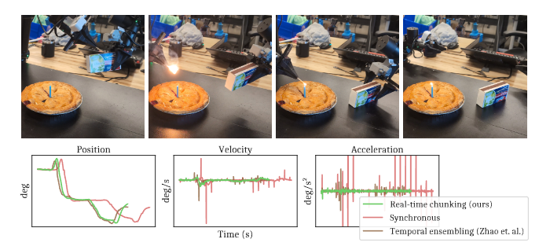
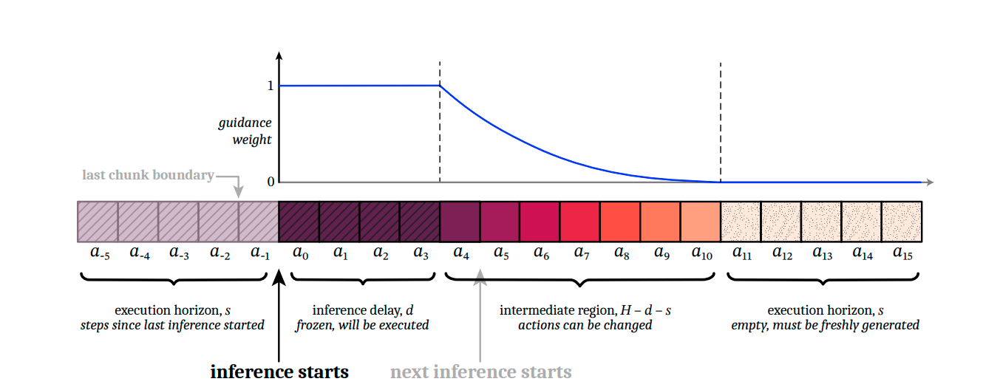
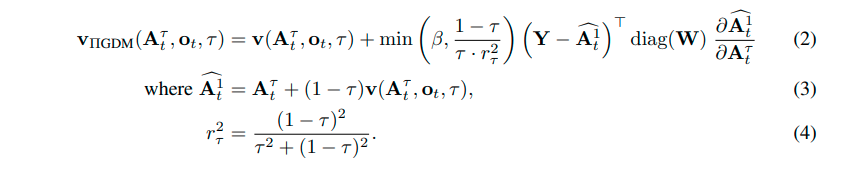
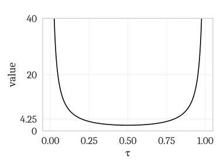
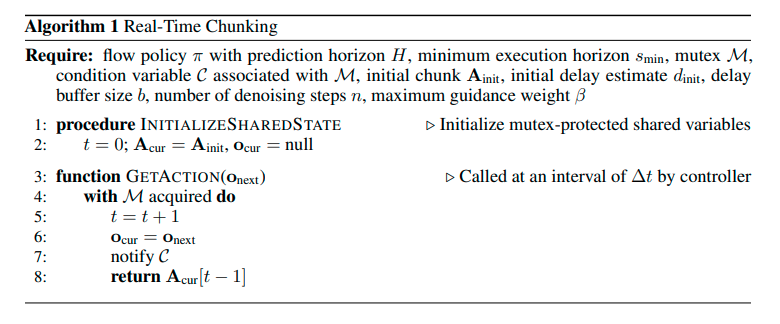
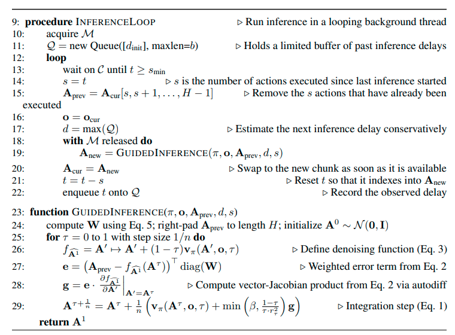
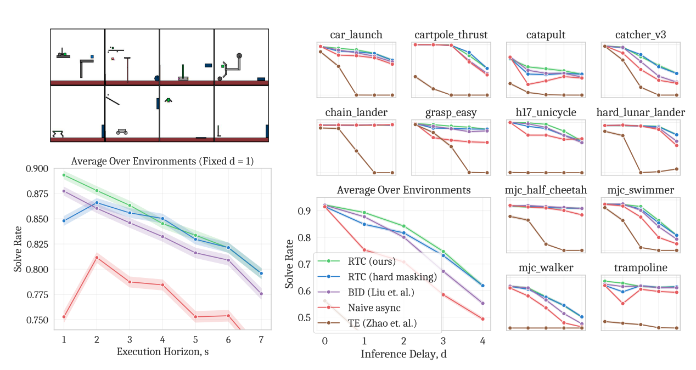

# Real-Time Execution of Action Chunking Flow Policies Note

## Navigation
- Paper card: [Real-Time Execution of Action Chunking Flow Policies card](../cards/RTC.md)
- code: https://github.com/Physical-Intelligence/real-time-chunking-kinetix

## Reading Notes

动作分块技术能够保证高频控制任务的时间一致性，但它并不能完全解决延迟问题，导致在分块边界处出现停顿或分布外的抖动。本文提出了一种新颖的推理时算法，能够实现动作分块策略的平滑异步执行。

实时分块（RTC），无需重新训练即可直接应用于任何基于扩散或流的VLA。它在执行当前动作块的同时生成下一个动作块，将保证执行的动作“冻结”，并将剩余的动作“修复”。为了测试RTC，我们在Kinetix模拟器中引入了一个包含12个高动态任务的新基准测试，并评估了6个具有挑战性的真实世界双手操作任务。结果表明，实时分块 (RTC) 速度快、性能好，并且对推理延迟具有独特的鲁棒性，能够显著提高任务吞吐量，即使在存在较大延迟的情况下，也能确保点燃火柴等精确任务的高成功率。

时间一致性：机器人在连续时间执行控制动作时，动作序列在时间上应该是**连贯、平滑、前后一致**的，而不是一会儿按一个计划动，下一瞬间又突然换成另一个不兼容的计划

下面是同一个肩关节在不同策略下的数据，包括位置、速度、加速度

### Method

等价变换：
$$
v_{\mathrm{guided}}
=
v
+
\alpha_\tau
J_\tau^\top
\operatorname{diag}(W)
\left(Y-\widehat A_t^1\right)
$$
其中：
$$
\alpha_\tau
=
\min\left(
\beta,\,
\frac{1-\tau}{\tau r_\tau^2}
\right) \\

\widehat A_t^1
=
A_t^\tau+(1-\tau)v(A_t^\tau,o_t,\tau) \\

J_\tau
=
\frac{\partial \widehat A_t^1}
{\partial A_t^\tau} \\
$$
这里这个引导可以看作目标函数为
$$
L(A_t^\tau)=\frac 1 2 (Y-\hat{A^1_t})^T diag(W) (Y-\hat{A^1_t}), \hat{A^1_t}=A_t^\tau+(1-\tau)v(A_t^\tau,o_t,\tau)
$$
的优化问题，对 $A_t^\tau$ 求导得优化方向 $J_\tau^\top
\operatorname{diag}(W)
\left(Y-\widehat A_t^1\right)$, 但是模型还是要沿着训练过程学到的方向走，这个速度修正项其实就相当于训练过程加的正则化（所以其实后面在训练过程中引入 RTC 的想法是非常自然的事情）

#### **Y 的计算**

当前控制周期开始时：

- 已经执行当前动作块前 `s` 步；
- 剩余未执行动作：

$$
A_{\mathrm{prev}}=A_{\mathrm{cur}}[s:H]
$$

其中：

- `H`：action horizon
- `s`：已经执行步数

然后补零：
$$
A_{\mathrm{prev}}\rightarrow Y
$$
补零部分不参与 guidance。

延迟估计：
$$
d=\max(d_{t-b},...,d_{t-1})
$$
即使用历史最大推理延迟。

#### **Soft mask**

论文构造：
$$
W_i
$$
含义：

| 区域       | 条件       | 含义            |
| ---------- | ---------- | --------------- |
| 强约束     | $i$        | 已经确定执行    |
| transition | $d\le i$   | overlap，可调整 |
| 自由生成   | $i\ge H-s$ | 没有旧动作约束  |

公式：
$$
\mathbf{W}_i=
\begin{cases}
1, & \text{if } i<d,\\[4pt]
c_i\dfrac{e^{c_i}-1}{e-1}, & \text{if } d\le i<H-s,\\[6pt]
0, & \text{if } i\ge H-s,
\end{cases}
\qquad
\text{where }
c_i=\dfrac{H-s-i}{H-s-d+1},
\quad
i\in\{0,\ldots,H-1\}.
$$

#### $\hat {A^1}$

这里是直接用 $\tau$ 时刻模型估计的速度进行直线外推得到的

#### $\alpha_\tau$

这个其实是优化问题的学习率。

$\frac{1-\tau}{\tau r_\tau^2}$ 形态：

RTC 使用梯度引导，让新生成的动作块与上一动作块保持连续。原始引导系数在去噪起点 $τ=0$ 会趋于无穷，因此作者引入上限 $β$。

附录实验表明：

- 机器人控制通常只使用约 **5 个去噪步骤**，远少于图像生成常用的约 100 步；
- 在去噪步数很少时，过大的引导权重会使动作块发散，并产生更高的加速度和抖动；
- $β$ 增大到约 5 后，任务成功率基本不再提升；
- 因此所有实验均采用较保守的 **$β=5$**。

核心含义是：**更强的跨动作块约束并不总是更好**。引导过强会把生成过程从“平滑衔接”推向数值不稳定和非分布内动作。

#### 算法流程

#### 超参设置

| 超参数     | 含义               | 模拟   | 真实机器人 |
| ---------- | ------------------ | ------ | ---------- |
| $n$        | 去噪步骤数         | 5      | 5          |
| $H$        | 预测时域           | 8      | 50         |
| $s_{\min}$ | 最小执行时域       | 不适用 | 25         |
| $β$        | 引导权重上限       | 5      | 5          |
| $b$        | 延迟历史缓冲区大小 | 不适用 | 10         |

#### Experiment

#### 仿真实验

##### 设置

作者没有使用常见的准静态抓取任务，而是构建了 12 个包含投掷、接取、平衡和动态运动的 Kinetix 任务。环境使用**力控制**，机器人不能像位置控制那样在推理时“保持当前位置”，因此必须持续输出动作；同时作者在动作上加入高斯噪声，使闭环修正更加重要。这个设置确实能直接暴露 action chunk 切换不连续的问题。 

数据和模型设置为：

- 每个环境训练 6 个不同随机种子的 RPO 专家；
- 每个环境生成 100 万个 transition；
- 训练 flow-matching action chunk policy；
- prediction horizon $H=8$；
- 4 层 MLP-Mixer；
- 每个数据点评估 2048 次 rollout；
- 模拟推理延迟 $d=0,\ldots,4$。 

2048 次 rollout 加上 95% Wilson 区间，使仿真结果的统计稳定性较强。

##### 对比方法

主要基线包括：

- **Naive async**：新 chunk 算完后立即切换，不处理连续性；
- **BID**：通过批量采样和 rejection sampling 找到与旧 chunk 连续的新 chunk；
- **Temporal Ensembling，TE**：对同一时刻来自不同 chunk 的预测取平均；
- RTC 的 **hard masking** 版本，用于验证 soft masking；
- 附录还加入了 Diffuser 式直接覆盖已知动作的 inpainting 方法。 

基线覆盖了三种典型思路：直接切换、样本筛选、动作平均，因此整体比较较合理。

##### 结果分析

**推理延迟增加**

随着 $d$ 从 0 增加到 4，所有方法都有一定程度下降，但 RTC 下降最慢，且 RTC 与 BID 的差距随延迟增大而扩大。Naive async 在高延迟时退化明显，符合作者的理论分析：新 chunk 基于较旧的观察生成，与当前实际状态越来越不一致。 

TE 即使在 $d=0$ 时也表现较差。作者认为这些任务存在明显多模态，例如绕过障碍时可以选择左边或右边；对两个有效但不同模态的动作求平均，可能生成一个无效动作。这个实验很好地证明了：

> 动作数值更平滑，不代表动作在策略分布上更合理。

TE方法：策略会连续预测多个 action chunk。由于相邻 chunk 对同一未来时刻都可能给出动作预测，TE 会把这些重叠预测做加权平均

**Execution horizon**

固定 $d=1$，缩短 execution horizon $s$ 相当于更频繁地闭环更新。RTC 随着 $s$ 减小持续改善，而其他方法不能稳定利用这种高频更新，因为 chunk 切换本身可能带来不连续。 

这是实验中一个很重要的结果：RTC 的价值不只是“隐藏推理时间”，它还允许策略以更短的 execution horizon 运行，从而获得更高的闭环反应频率。

**Soft masking 是否重要**

Hard masking 要求新 chunk 的前一段严格复制旧 chunk；soft masking 则让约束权重随时间逐渐衰减。

实验表明 soft masking 通常优于 hard masking，差异在较小延迟时更明显。原因是延迟较小时，旧 chunk 中仍有较多“未必真正执行”的动作；将它们全部硬约束，会限制新策略根据最新观察修正轨迹。 

附录比较了指数衰减、线性衰减、不衰减和立即衰减：

- 指数衰减总体最好；
- 线性衰减非常接近；
- 完全不衰减和立即衰减较差。 

这说明真正重要的不是特定指数公式，而是存在一个**从强连续性约束向自由重规划平滑过渡的区域**。

**Guidance clipping $\beta$**

作者使用 $\beta$ 限制 guidance 强度。消融显示性能在 $\beta\approx5$ 后基本饱和，而继续增大 $\beta$ 会增加最大加速度，并可能让少步数 denoising 下的轨迹发散。 

这项消融支持了选择 $\beta=5$，但有一个局限：它主要验证了作者当前的 5-step denoising 设置，不能保证换模型、动作尺度或 denoising 步数后仍然适用。

#### 真实机器人实验

##### 设置

真实机器人由两条 6-DoF 机械臂和夹爪组成，使用 π0.5 VLA：

- 控制频率 50 Hz，即 $\Delta t=20$ ms；
- prediction horizon $H=50$，约 1 秒；
- 5 个 denoising steps；
- vanilla π0.5 模型推理约 76 ms；
- RTC 推理约 97 ms；
- 加上局域网和系统开销，RTC 的实际总延迟约为非移动任务 109 ms、移动任务 139 ms。 

作者另外人为注入：

- $+0$ ms；
- $+100$ ms；
- $+200$ ms；

对应 RTC 的推理延迟约为 $d=6,11,16$。 

需要特别注意：**RTC 本身没有降低单次模型推理延迟。** 相反，由于每个 denoising step 需要反向传播 guidance，模型推理由 76 ms 增加到 97 ms，其中 denoising 部分由 14 ms 增至 35 ms。RTC 的优势来自计算与执行并行，以及更合理地拼接 chunk，而不是让网络运行更快。

六个任务包括：

- 点燃蜡烛；
- 插入网线两端；
- 移动机器人整理床铺；
- 折叠衬衫；
- 批量整理不同衣物；
- 移动机器人将物品放入水槽。

这些任务涵盖精细接触、长时序、双臂配合、可变形物体和移动操作。每个任务由若干离散子步骤评分。每个任务和有效方法—延迟组合运行 10 次，总计 480 个 episode、约 28 小时真实机器人执行。

##### 真实实验的指标设计

作者没有只报告最终成功率，而是使用三个视角。

###### Cumulative progress vs. controller steps

controller steps 不包含同步方法等待推理的停顿，因此可以排除“RTC 只因为不暂停，所以更快”这一因素。

RTC 在排除暂停后仍普遍更早完成子步骤，说明改善可能来自：

- chunk 切换更平滑；
- 操作失误更少；
- retry 次数更少；
- 闭环修正更及时。 

这是实验中最有说服力的设计之一。

###### Cumulative progress vs. 实际时间

这个指标包含推理暂停，直接反映用户实际看到的任务完成速度。同步执行会在每个 chunk 末尾停顿，因此延迟越大，曲线越慢。

###### Average throughput

作者定义：
$$
\text{throughput}
=
\frac{\text{完成任务的比例}}{\text{episode 时长}}
$$
再对 episode 求平均。它同时考虑速度与完成度，比单独报告成功率更适合长时序任务。误差条为 ±1 SEM。 

但 throughput 也可能掩盖两种不同现象：

- 很快完成一部分，但最终失败；
- 较慢但最终完整成功。

因此最好同时提供完整的每任务最终成功率、完成时间分布和失败类型。

##### 真实实验结果

###### 对延迟的鲁棒性

在测试的 0、100 和 200 ms 额外延迟范围内：

- RTC 的平均 throughput 基本没有下降；
- synchronous 随延迟近似线性下降；
- 两个 TE 版本在 100 和 200 ms 时产生严重振荡，触发机器人的 protective stop，无法正常运行。 

因此，“RTC 在高延迟下显著优于简单异步或动作平均”这一核心结论得到了较强支持。

###### 不仅仅是消除暂停

同步方法最终有时能达到与 RTC 接近的分数，但 RTC 往往更早完成任务，说明同步执行过程中发生了更多错误和重试。

差异最明显的是：

- **点燃蜡烛**：任务精度要求最高，且失败后基本没有重试机会；
- **整理床铺**：模型在操作枕头时较困难，RTC 的连续闭环执行带来较大改善。 

这支持了 RTC 不仅提高 wall-clock（从开始执行到结束所花费的实际绝对时间） 速度，还可能改善实际控制质量。

#### 总结

RTC的效果：

- 消除异步推理 chunk 之间的突变
- 允许更短的 replan 时间，可以做到更快速的反应
- 能适应高延迟情况
- 提升 wall-clock 速度
- 改善实际控制质量

RTC 时间轴：
$$
\begin{aligned}
\text{chunk }k\text{ 开始推理} &: I_k\\
\text{chunk }k\text{ 推理完成} &: I_k+d\\
\text{chunk }k+1\text{ 开始推理} &: I_k+s\\
\text{chunk }k+1\text{ 推理完成} &: I_k+s+d
\end{aligned}
$$
s 是不同 chunk 开始推理的时间间隔，所以其实每个 chunk 实际执行的步数是 s+d
