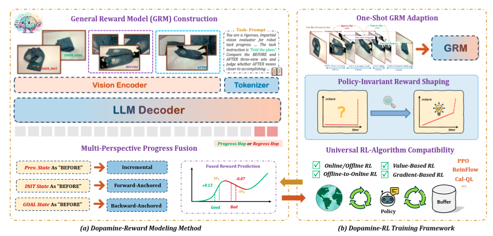
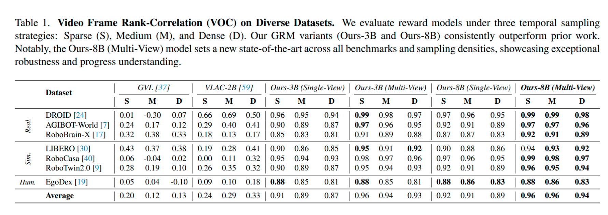
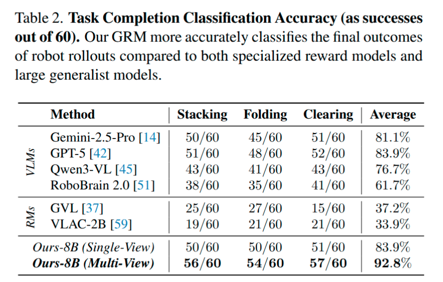
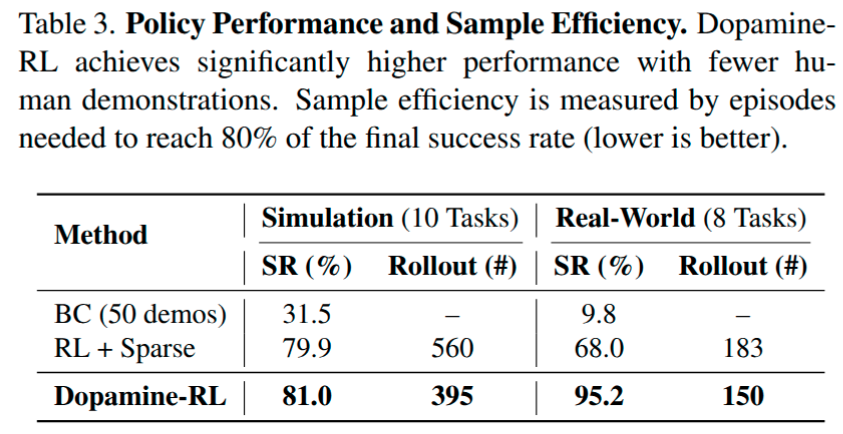
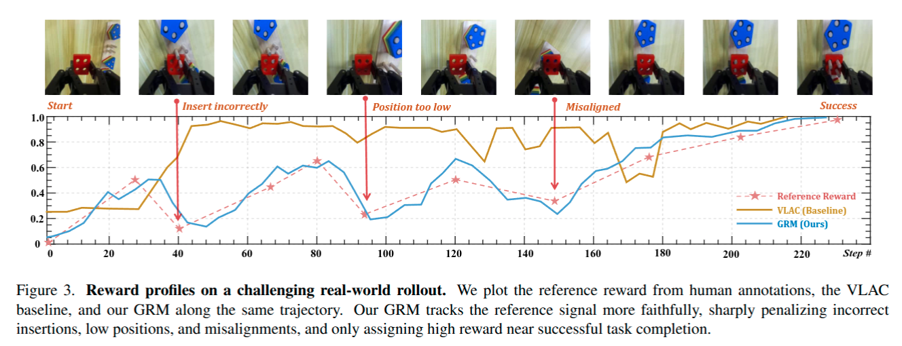
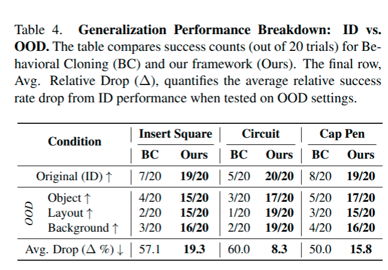
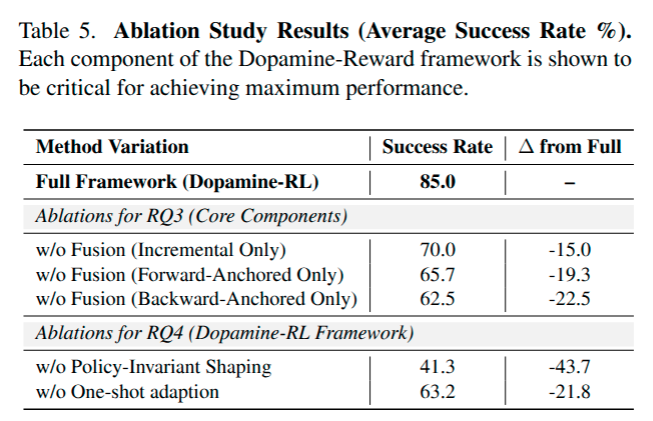

# Robo-Dopamine: General Process Reward Modeling for High-Precision Robotic Manipulation Note

## Navigation
- Paper card: [Robo-Dopamine: General Process Reward Modeling for High-Precision Robotic Manipulation card](../cards/Robo-Dopamine.md)

## Reading Notes

**用大规模多视角数据训一个通用进度奖励模型，再用策略不变的奖励塑形把它安全地接入 RL，让真实机器人只靠一条演示就能快速自学高精度操作技能。**

- **Dopamine-Reward（奖励建模）**：学习一个通用、步骤感知的多视角过程奖励模型。其核心是 **GRM（General Reward Model）**，在超过 3,400 小时的视频数据（35M 样本、100K+ 轨迹、350+ 日常任务）上训练，通过 **Step-wise Reward Discretization**（跳步式相对进度归一化，保证重建的全局进度严格落在 [0,1] 内）获得结构理解，并用 **Multi-Perspective Reward Fusion**（增量预测 + 前向锚定 + 后向锚定三视角融合）克服遮挡等感知局限 。
- **Dopamine-RL（策略学习）**：采用理论上严谨的 **Policy-Invariant Reward Shaping**（等价于以 GRM 进度为势函数的经典 PBRS 框架），使稠密奖励加速训练的同时不改变最优策略，从根本上避免"语义陷阱"（agent 停滞在"看起来不错"的中间状态而非完成任务）。

关键结果：GRM 在进度评估上达到 SOTA（准确率 92.8%，VOC 0.953）；只需一条专家轨迹做 one-shot 适配，Dopamine-RL 就能在约 150 次在线 rollout（约 1 小时真实机器人交互）内把策略成功率从接近 0 提升到 95%，部分任务达 100%，并在未见过的布局、背景和物体变化下保持泛化

### Introduction

当前的 PRM 仍受限于两个根本性缺陷：

- 首先，底层的奖励模型往往存在严重不足：
  - 针对特定任务的设计从根本上限制了泛化能力
  - 均匀的奖励分布无法捕捉关键子步骤的不同重要性
  - 而对单视角观测的依赖在操作场景中往往失效，因为遮挡可能掩盖只有从腕部视角才能观察到的细微进展
- 其次，利用这些密集信号的奖励塑造算法往往在理论上存在缺陷：盲目引入密集奖励可能会引发“语义陷阱” ，即无意中改变最优策略从而误导策略优化，导致智能体优先追求中间步骤带来的高额代理奖励，而非真正的任务目标

为解决这一问题，我们提出了 Dopamine-Reward，这是一种新颖的密集奖励建模方法，旨在**利用多视角输入学习一种通用的、具备步骤感知能力的“过程奖励”**。Dopamine-Reward 通过两项关键技术直接克服了上述局限性：一是构建基于“跳步”（hop-based）的通用分步奖励模型（GRM），以便从不同视角对任务进展形成细粒度且结构化的理解；二是利用 GRM 进行多视角奖励融合，整合双向全局奖励与基于状态的增量奖励，从而实现更精确的奖励评估。这些技术的实现得益于一套精细的标注流程，该流程涵盖了超过 3400 小时的数据、10 万条轨迹以及 350 多种日常任务，确保了数据在真实机器人、仿真环境及以人为中心的视角视频之间具有广泛的覆盖面、细粒度的标签以及均衡的分布。

### Method

#### Dopamine-Reward Modeling Method

##### General Reward Model (GRM) Construction

基于跳跃（进度变化量）而非直接映射进度

**Step-wise task progress discretization. **

给定原始多视角视频轨迹，我们首先使用人工标注的多视角关键帧 ${K_0, K_1, ..., K_N}$ 将每条专家轨迹分割成子任务，其中 $K_0$ 为初始观测值，$K_N$ 为最终成功观测值，每个 $K_j$ 为一组同步的多视角关键帧。为了获得密集监督，我们在每个分割段内执行自适应采样。对于每视角包含 $L$ 帧的轨迹，我们设置一个块大小 $C$ 来确定采样点的总数，并将它们均匀分布在 N 个分割段中

把专家轨迹切成若干 sub-task，再在每一段内部采样。最终得到
$$
S={s_0,…,s_M},Φ(s_i)=i/M.
$$
($M\approx N \times C$)

因此表面上看 $Φ=i/M$ 很“线性”，但这里的 i **不是原始视频时间戳**。因为作者先按照人工语义步骤切段、再把采样点均匀分配给各个 segment，所以它实际上近似表达了：每个关键语义子步骤占据相近的 progress 份额，而不是按照动作实际花费的秒数分配进度。

**Hop-based relative progress normalization**
$$
\mathcal{H}(s_p, s_q) =
\begin{cases}
\dfrac{\Phi(s_q) - \Phi(s_p)}{\Phi(s_M) - \Phi(s_p)} & \text{if } q \ge p \ (\text{PROGRESS}) \\[1em]
\dfrac{\Phi(s_q) - \Phi(s_p)}{\Phi(s_p) - \Phi(s_0)} & \text{if } q < p \ (\text{REGRESS})
\end{cases}
$$
学的是任务进程的百分比

这里其实有个假设，数据集中的任务进度是单调递增的

**Sampling strategy and data balancing**

作者因此先把 [−100%,100%] 的 Hop 空间分 bin，再在每个 Hop bin 中继续按照时间间隔 Δt 分 bin，使大 regression、大 progress、小 progress 都能被充分看到。附录给出的示例是 25 个 score bins，再使用 4 个 temporal-gap bins。时间分 bin 是使得模型学到不同时间实现相同跨度的情况。

此外还专门加入约 5% 的 zero-hop（取时间上非常接近的两个状态） 样本，让模型看到：
$$
s_p≈s_q⟹H=0.
$$
这是在告诉 VLM：

> “视觉上看起来没发生任务进展，就不要凭空编一个 +3%、+5%。”

##### Multi-Perspective Progress Fusion from GRM

为了减少误差累积并确保预测精度的一致性，我们从三个互补的角度融合了基于 GRM 的预测：增量预测、前向锚定预测和后向锚定预测。

**增量预测**：先预测 $\mathcal H ^*$
$$
\Delta \Phi_{t-1,t}^{\star} = \begin{cases} \bigl[1 - \Phi^{\star}(s_{t-1})\bigr] \cdot \mathcal{H}^{\star} & \text{if } \mathcal{H}^{\star} \ge 0 \\[0.5em] \Phi^{\star}(s_{t-1}) \cdot \mathcal{H}^{\star} & \text{if } \mathcal{H}^{\star} < 0 \end{cases}
$$

$$
\Phi_{I}^{\star}(s_t) = \Phi^{\star}(s_{t-1}) + \Delta \Phi_{t-1,t}^{\star}
$$

 **前向锚定预测**
$$
\Phi_{F}^{\star}(s_t) = \mathcal{H}^{\star}(s_{\text{init}}, s_t)
$$
 

**后向锚定预测**
$$
\Phi_{B}^{\star}(s_t) = 1 + \mathcal{H}^{\star}(s_{\text{goal}}, s_t)
$$
 

不改变模型，只改变输入，从不同角度恢复 $s_t$ 的进度
$$
\Phi(s_t) = \frac {\Phi_I(s_t)+\Phi_F(s_t)+\Phi_B(s_t)} 3
$$
它解决的是一个非常经典的问题：

> 局部比较精确，但会 drift；全局比较稳定，但对细微动作不够敏感。

##### Progress Consistency Checking

nline RL 还有一个麻烦。RL 会故意探索，因此肯定会跑到训练数据没见过的 OOD state。这时候 reward model 可能产生：“这个奇怪姿态好像完成度 95%”。然后 policy 就发现一个 reward hack。

作者观察到：对于正常状态，
$$
Φ_F≈Φ_B
$$
对于 OOD 状态，两者往往明显不一致。因此定义：
$$
\bar Φ=\frac {Φ_F+Φ_B} 2
$$
然后：
$$
Δ_{norm}=\frac {∣ΦB−ΦF∣}{\bar Φ+ϵ}
$$
再转换成 confidence：
$$
w_t=e^{−αΔ_{norm}^2}
$$
于是：
$$
Φ_F≈Φ_B⇒w≈1,
$$
说明：

“两个方向都认为它差不多在这个 progress，可以信。”

反过来：
$$
∣Φ_F−Φ_B∣≫0⇒w≈0.
$$
相当于：

“reward model 自己都前后矛盾，先别信。”

然后作者不再直接使用 Eq. (8)，而进行 conservative update：
$$
Φ_t=Φ_{t−1}+\frac {w_t}2[\bar Φ_t−Φ_{t−1}+ΔΦ_{t−1,t}]
$$
当
$$
w_t→0
$$
有 $Φ_t≈Φ_{t−1}$.

即：

> 遇到不确定 OOD 状态时，与其奖励错了，不如暂时不给新的 progress。

注意这里即使 $w_t=1$，最终的状态也是
$$
\Phi_t = \frac{1}{2} \Phi_I + \frac{1}{4} \Phi_F + \frac{1}{4} \Phi_B
$$
与 Eq(8) 的等权重不一样了

##### Hypothesis

- 任务回退是退回到之前的状态（如果掉到了 OOD 的失败情况是没办法给出进度的，论文根据前向和后向锚定预测的差异给出一个不确定性估计）
- 训练数据集中任务进度是单调递增
- 作者提到通过计算完成剩余任务完成百分比的方式对精细操作任务（论文明确说 remaining-distance normalization 的作用是让 **late-stage steps 更显著**，这是公式本身直接保证的；但“late-stage = high-precision”并不是公式自动成立的，而是任务结构上的假设）

#### Dopamine-RL Framework

基于 Dopamine-Reward 的强化学习框架

- 针对快速进展对齐所需的下游任务工作量极小
- 收敛迅速且具备策略不变性保证
- 以及能与多种强化学习范式无缝集成

##### 奖励设计

直觉来说会直接令 $\Phi^*(s_{t+1})-\Phi^*(s_t)$ 作为 reward, 但是这其实鼓励的是推动任务进程的动作，而不是真正完成任务，再加上因为衰减系数的存在，快速达到较高进度然后一直保持的动作会比慢但是最终会完成的动作奖励高
$$
J(\pi) = \mathbb{E}_\pi\left[\sum_{t=0}^{\infty} \gamma^t r(s_t, a_t, s_{t+1})\right] \Leftrightarrow \mathbb{E}_\pi\left[\sum_{t=1}^{\infty} \gamma^{t-1}(\gamma -1) \Phi^\star(s_t) \,\bigg|\, s_0\right]
$$
（其实这里的推导不是为了推出什么不同的东西，推理前后都是等价的，这里推导的目的就是为了暴露同一种东西的另一种含义，叫诊断性推导）

论文做出修正，令 $r(a_t,s_t,s_{t+1})=\gamma \Phi^*(s_{t+1})-\Phi^*(s_t)$，$J(\pi)=-\Phi(s_0)$，与策略无关的

这里其实是 PBRS 的思想, Potential-Based Reward Shaping，基于势函数的奖励塑形，追求的是不改变 “学什么” 只改变 “怎么学”。本文在这里的贡献只是在 PBRS 基础上做了映射，推导以及问题都是之前就有的。之所以没有直接从 PBRS 入手可能是假设读者并不了解。讲故事的技术。

最终的reward：
$$
r_t = \underbrace{r_{gold}}_{\text{决定最终目标}} + \underbrace{\gamma \Phi_{t+1} - \Phi_t}_{\text{改善学习动力学}}
$$
当 $\Phi_t>0.95$, $r_{gold}=1$ 反之为 0

### 实验

| RQ   | 验证内容                                              | 核心实验                                       |
| ---- | ----------------------------------------------------- | ---------------------------------------------- |
| RQ1  | GRM 奖励模型准不准                                    | VOC 排序 + 成功/部分成功/失败分类              |
| RQ2  | GRM 能否帮助 RL                                       | 仿真 + 真机成功率、sample efficiency、OOD      |
| RQ3  | Multi-Perspective Fusion 是否必要                     | 三种单独 progress estimator 消融               |
| RQ4  | Dopamine-RL 的 shaping / one-shot adaptation 是否必要 | 去掉 policy-invariant shaping、去掉 adaptation |

#### RQ1

**EXP 1**

把一个轨迹里的 frame 打乱，然后看 reward model 给出的 progress 排序是否符合真实时间顺序。

指标是 **VOC（Value-Order Correlation）**，范围 [−1,1]，越接近 1，说明模型越能判断“哪个状态离目标更近”。作者又设计了 Sparse / Medium / Dense 三种采样密度，Dense 最考验模型，因为相邻状态变化非常小。

frame-level：输入某一帧，直接估计 progress/value

注意测试数据集都是从 GRM 训练集分出来的，但是相较于同数据训练的 VLAC 也是有明显优势，测试方法是沿用 GVL 的。

**EXP2 任务成功判断**

他们选了 3 个真机任务：

- stacking blocks
- folding T-shirt / pants
- clearing desktop

每个任务 60 条 rollout，分别包含 20 Success、20 Partial Success、20 Failure，总共 180 条。

multi-view 对于最终状态的确认还是很有必要的

这里的 multi-view 指的就是多视角

#### RQ2

仿真上的主要贡献其实是 sample efficiency，而不是最终性能，而真机实验则同时体现出 最终性能 + sample efficiency。

**告诉 policy“你虽然还没成功，但刚才那一步方向是对的”，从而降低 sparse reward 的 exploration difficulty。**

OOD 实验只能说明 RL 的泛化性

#### RQ3 & RQ4

**RQ3**

这个结果与方法设计逻辑是高度一致的：

**Incremental**
 擅长局部变化，但连续累计会产生 drift。

**Forward anchored**
 每次从初始状态判断 → 不积累误差，但是任务后半段细微变化不好判断。

**Backward anchored**
 从目标状态反推 → 接近完成时非常敏感，但前期比较难。

而且 Incremental-only 的 70% 的确高于 Forward / Backward only，也符合“incremental 局部 reward 很重要，但单独使用会 drift”的解释。

**RQ4**

**普通 dense reward**

如果直接使用：
$$
r_t=Φ(s_{t+1})−Φ(s_t)
$$
在 discounted RL 下并不一定保持原任务的 optimal policy。

机器人可能发现：

> “完成任务风险高，不如一直保持在 progress=0.8 的舒服状态。”

于是产生 **reward hacking / semantic trap**。

### 附录

#### **35M 数据构成**

原始数据实际上是 **27.23M samples**：Real-World 16.515M、Simulation 3.531M、Human 7.184M；经过 multi-view expansion / augmentation 后才变成论文宣传的 35M。来源包括 DROID、AGIBot-World、RoboBrain-X、LIBERO、RoboTwin、RoboCasa、EgoDex 和自采数据。按 raw corpus 算，比例大约就是论文写的 real 60%、simulation 13%、human 26%。

数据采样设计也在这里交代清楚了：progress score 从 −100% 到 +100% 分成约 **25 个 score bins**；每个 score bin 再按 temporal gap 分 **4 档**；同时人为加入约 **5% Zero-Hop** 样本，让模型学会“视觉几乎没变化 = 0 progress”，而不是凭空 hallucinate 正 reward。官方后续代码现在也使用 `score-bins=25`、`gap-bins=4`、`zero-ratio=0.05`，另外公开了 `oversample-factor=100` 和 `replace-prob=0.75` 等论文附录没完整列出的处理参数。

#### Training & Evaluation Recipe

GRM 有 3B、8B 两个版本，附录给出的训练规模是 **128×H100 80GB**；3B 约训练 8 天，8B 约 14 天。batch size 分别为 512/256，视觉 encoder LR 5×10−6，LLM LR 10−5，sequence length 8192。

Simulation 用 LIBERO-Goal 的 10 个 long-horizon tasks，并给了两套组合：**PPO + OpenVLA-OFT**，以及 **ReinFlow + π0**。后者使用 8×H100、约 50 小时训练，文中报告平均成功率约 81%；discount factor 为 0.99。

Real-world 部分用的是 **ConRFT / Cal-QL 系的 offline-to-online RL**，policy backbone 是 Octo-Small。它并不是纯粹从零 online 探索：先有大约 **20–30 条 demonstration** 做 offline 初始化，而且 online 阶段还有 **human-in-the-loop intervention** 来纠正危险动作，被纠正的轨迹再加入 demonstration buffer。real-world reward discount 是 0.98，附录写的训练资源则是 1×RTX4090。

#### One-shot 训练

现在公开的 8B fine-tuning script 是：

- 8 GPU
- per-device batch = 2
- grad accumulation = 2
- 2 epochs
- LLM / vision / MLP 都 tune，不是简单 LoRA
- DeepSpeed ZeRO-3。

**Q：**

- 训练用的任务粒度？多阶段怎么办
- 
