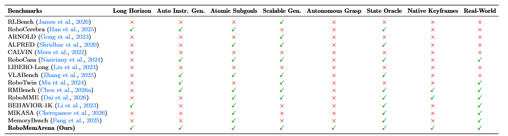
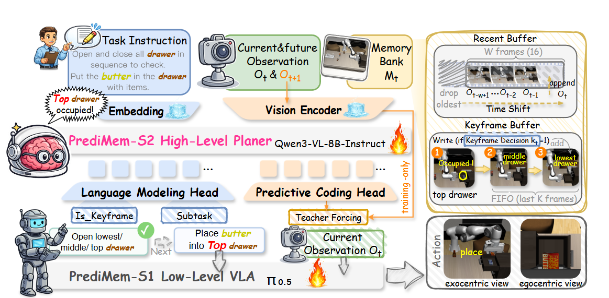
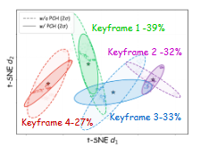
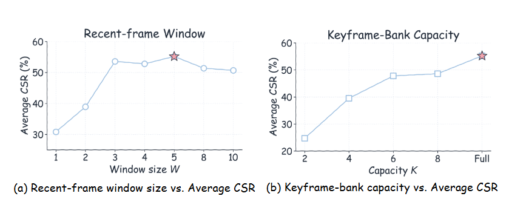

# RoboMemArena: A Comprehensive and Challenging Robotic Memory Benchmark Note

## Navigation
- Paper card: [RoboMemArena: A Comprehensive and Challenging Robotic Memory Benchmark card](../cards/RoboMemArena.md)

## Reading Notes

模拟基准测试基于RoboCasa，场景主要设定在厨房，包含 26 个任务，涵盖 4 个与记忆相关的类别（转移、遮挡、计数、顺序执行），每个任务的平均轨迹长度为 1076 步，其中 68.9% 的子任务与历史相关

| 局限性类型     | 具体表现                              | 涉及的 Benchmark                                        |
| :------------- | :------------------------------------ | :------------------------------------------------------ |
| **通用型局限** | 任务主要靠实时观察，记忆非瓶颈        | RLBench, RoboTwin, RoboCasa, ManiSkill3, BEHAVIOR-1K 等 |
| **规模化局限** | 任务时程短（Short-horizon），覆盖面窄 | MemoryBench, MIKASA, RMBench                            |
| **标注型局限** | 缺乏多模态记忆标注，仅有边界信号      | RoboMME                                                 |
| **验证型局限** | 缺乏仿真与真实世界的对齐评估          | 大多数现有记忆基准                                      |

贡献：

（1）我们提出了一套包含四种记忆需求类别（即转移、遮挡、计数和顺序执行）的任务套件，以及相应的真实世界任务（第 3.1 节）。

（2）我们提出了一种数据生成流程，该流程结合了基于 VLM 的任务分解、自主执行和多条件关键帧提取（第 3.2 节）。

（3）我们将 RoboMemArena 与现有的机器人基准测试进行比较（第 3.3 节）。

（4）我们提出了一种评估协议，该协议既衡量整个任务的成功率，也衡量阶段级进度（第 3.4 节）。

### RoboMemArena

#### 任务描述

**仿真任务 (共26个)**

仿真任务分为四大记忆类型，所有任务都在 3D 厨房场景中进行。

A. 多物体转移 (Transferring) - 4项

这类任务要求智能体在相似容器间移动物体，重点考察对“源-目标”映射的记忆。
*   **转移巧克力与黄油 (Transfer Chocolate Butter):** 分别将巧克力和黄油从盘子1移动到盘子2。
*   **转移黄油与奶酪 (Transfer Butter Cheese):** 将黄油和奶酪从盘子1转移到盘子2。
*   **转移爆米花与曲奇 (Transfer Popcorn Cookies):** 将爆米花和曲奇从盘子1转移到盘子2。
*   **转移酱料/牛奶/果汁 (Transfer Sauce Milk Juice):** 将番茄酱、牛奶和橙汁从橱柜1转移到橱柜2。

B. 多物体遮挡 (Occlusion) - 11项

这是该基准中数量最多的类别，要求智能体记住隐藏在抽屉或微波炉内的物体。
*   **将黄油放入非空抽屉:** 依次打开所有抽屉，将黄油放入已有物体的抽屉中。
*   **将黄油放入空抽屉:** 依次打开所有抽屉，将黄油放入空抽屉。
*   **分别放置曲奇和黄油:** 依次打开抽屉，将曲奇放入顶层抽屉，黄油放入另一个抽屉。
*   **微波炉系列任务:** 例如将曲奇放入微波炉，然后将巧克力也放入曲奇所在的位置（考察对已关闭容器内部空间的记忆）。

C. 多物体计数 (Counting) - 7项

智能体需要执行特定次数的动作，视觉上动作前后的状态高度相似。
*   **倒酱汁任务 (Pour Sauce x2):** 例如“在曲奇上倒两次番茄酱，然后将酱瓶放入沥水架”。
*   **倒酒/倒牛奶:** 例如“在马克杯中倒两次葡萄酒”或“在煎锅里的黄油上倒两次牛奶”。

D. 多物体序列 (Sequence) - 4项

后续动作严格依赖于前序步骤的完成情况或顺序。
*   **按顺序放置 (In Order):** 例如“先将曲奇放入篮子，再将番茄酱放入同一个篮子”。
*   **复杂序列任务:** “在曲奇上倒两次番茄酱，然后将曲奇放入微波炉”（结合了计数与长程操作）。

**真实世界任务** (共5个)（这些任务不像RoboChallenge提供评测接口，只是验证）

这些任务在双臂移动机器人平台（AgileX Mobile Aloha）上执行，用于验证算法的物理通用性。

| 任务名称                                      | 记忆类型    | 详细描述                                                     |
| :-------------------------------------------- | :---------- | :----------------------------------------------------------- |
| **倒瓶子 x2 (Pour Bottle ×2)**                | 计数        | 从水瓶向杯中倒水两次。                                       |
| **带交换的盘子刷洗 (Brush Plates with Swap)** | 序列 + 计数 | 按特定顺序（如：绿盘 -> 棕盘 -> 白盘）刷洗三个盘子。         |
| **物体转移 (Transfer Objects)**               | 转移        | 将西瓜和胡萝卜从一个绿色盘子转移到另一个绿色盘子。           |
| **三杯戏 (Shell Game)**                       | 遮挡 + 追踪 | 将目标隐藏在一个杯子下，随机交换三个杯子的位置，要求机器人识别并找到目标。 |
| **人类早餐模仿 (IHMB)**                       | 模仿 + 序列 | 人类演示一次早餐制作流程，机器人需根据记忆模仿完整的制作顺序。 |

#### Data Generation Pipeline

| 阶段        | 核心任务   | 关键技术/条件                |
| :---------- | :--------- | :--------------------------- |
| **Stage 1** | 任务分解   | VLM 辅助 + 人工精修          |
| **Stage 2** | 自动化执行 | AnyGrasp 抓取估计 + 闭环重试 |
| **Stage 3** | 记忆标注   | 夹爪状态切换 + 速度/方向拐点 |

#### Data Analysis

做个参考，挺多标准比较偏向自己

| 表头                 | 中文解释                       | 它在 benchmark 里衡量什么                                    | 对 memory benchmark 的意义                                   |
| -------------------- | ------------------------------ | ------------------------------------------------------------ | ------------------------------------------------------------ |
| **Long Horizon**     | 长程任务                       | 论文定义为平均轨迹长度超过 1000 steps 的任务。               | 记忆问题通常不会在短任务里充分暴露。长程任务更容易出现遮挡、重复操作、顺序依赖、历史引用等 memory bottleneck。 |
| **Auto Instr. Gen.** | 自动指令生成                   | 是否用 LLM / VLM / multimodal model 自动生成或增强任务指令。 | 影响任务扩展能力。人工写所有指令很慢；自动生成可以扩展任务组合，但也会引入 VLM 生成偏差。 |
| **Atomic Subgoals**  | 原子子目标 / 子任务标注        | 是否提供 step-level subgoals、subtask annotations，或者 symbolic atomic goal predicates，而不是只有最终任务目标。 | 对长程任务很关键。只给 final goal，很难判断失败发生在哪个阶段；有 atomic subgoals 才能训练 planner 和做阶段级诊断。 |
| **Scalable Gen.**    | 可扩展生成                     | 是否能在仿真中自动批量生成 executable trajectories、demonstrations 或 dense action annotations，而不是主要依赖人工采集。 | 衡量数据规模化能力。memory policy 往往需要大量长程轨迹，纯人工 teleoperation 成本过高。 |
| **Autonomous Grasp** | 自主抓取                       | 是否通过 point-cloud-based grasp pose estimation 自动产生抓取动作，不需要人工标注 grasp pose。 | 这是自动采集能否跑通的低层前提。没有自动抓取，长程任务的数据生成很容易卡在人工动作标注。 |
| **State Oracle**     | 状态 oracle / 程序化状态判断器 | 是否有程序化信号判断 subtask 或 stage 是否完成，例如 simulator traces、object states、symbolic predicates。 | 对自动验证和 CSR/TSR 评测很重要。没有 state oracle，就只能靠人工看视频或 final success，难以做大规模评测。 |
| **Native Keyframes** | 原生关键帧标注                 | 是否显式构造 temporal keyframe dataset，用于 hierarchical supervision 或 memory-oriented evaluation。 | 这是 RoboMemArena 最强调的标注点之一。keyframe 告诉模型“哪些历史帧值得写入记忆”，直接服务 memory bank / keyframe retrieval。 |
| **Real-World Eval.** | 真实机器人评测                 | benchmark 论文或项目是否包含与该 benchmark setup 关联的真实机器人评估。 | 说明 benchmark 不是纯仿真构造。RoboMemArena 用 5 个真实任务作为 physical validation set。 |

**Oracle** 在机器学习/机器人论文里通常指：**一个在实验环境中能直接知道“真实状态”或“正确答案”的理想化信息源/判断器**

比较一下RMBench和RoboMemArena：

- 任务和记忆结构丰富度：RoboMemArena 更强
  - RoboMemArena 有 **26 个仿真任务**，覆盖 transferring、occlusion、counting、sequential execution 四类 memory failure modes；平均轨迹长度 1,076 steps；还有 151 个 subtasks，其中 104 个被标为 memory-dependent。
  - RMBench 是 **9 个任务**，分成 M(1) 和 M(n) 两类，用 Task Memory Complexity 控制记忆需求；它的任务设计更受控，但规模更小
- 标注和 memory supervision 丰富度：RoboMemArena 更强（也可以说他提出的模型更依赖标注信息）
  - 除了轨迹还显式构造
    - subtask decomposition
    - native keyframes
    - keyframe-aligned short segments
    - memory-dependent subtask ratio
    - stage-level predicates / CSR
- 低层动作/抓取/物理随机性丰富度：RMBench更强

### PrediMem

和 RMBench 的 MEM-0 类似，都是用关键帧+双系统管理记忆

冰代表冻结，火代表可训练

**S2：高层 planner**

- 输入：
  - 任务指令
  - 当前帧
  - memory bank：短期记忆（recent buffer）+ 长期记忆（keyframe buffer）
- 输出：
  - 判断哪些是关键帧需要保存
  - subtask

**S1：运动规划**

- 输入：subtask + 当前状态
- 输出：action chunk

| 模块                       | 角色                  | 输入                                       | 输出                                         |
| -------------------------- | --------------------- | ------------------------------------------ | -------------------------------------------- |
| **S2：高层 VLM planner**   | 记忆管理 + 子任务规划 | 当前观测 + recent buffer + keyframe buffer | 当前 subtask / primitive + 是否写入 keyframe |
| **S1：低层 VLA executor**  | 动作执行              | 当前观测 + 最新 subtask                    | action chunk                                 |
| **Memory bank**            | 存储历史              | recent-frame buffer + keyframe buffer      | 提供给 S2 使用                               |
| **Predictive coding head** | 训练期辅助            | 当前视觉 hidden state                      | 预测下一帧视觉 latent                        |

### 实验

| 指标    | 全称                    | 衡量标准              | 作用                                         |
| :------ | :---------------------- | :-------------------- | :------------------------------------------- |
| **TSR** | Task Success Rate       | 最终结果 (Binary)     | 衡量任务的最终完成能力                       |
| **CSR** | Cumulative Success Rate | 任务进度 (Fractional) | 区分完全失败与部分完成，分析模型在哪里“掉队” |

**仿真主结果**

| 方法          | Avg TSR | Avg CSR | 主要含义                                  |
| ------------- | ------- | ------- | ----------------------------------------- |
| π0.5 reactive | 21.5    | 38.7    | 当前帧策略在长时序记忆任务上明显受限      |
| HiF-VLA       | 16.9    | 39.8    | 运动表征不足以替代任务级记忆              |
| MemoryVLA     | 15.0    | 35.3    | token-level memory 未必对齐关键物理事件   |
| MemER         | 27.3    | 49.1    | keyframe retrieval 有帮助                 |
| GPT-5.4 as S2 | 8.7     | 30.5    | 闭源强 VLM 直接迁移到机器人记忆任务效果差 |
| PrediMem      | 38.5    | 55.2    | 最强结果                                  |
| Ground Truth  | 46.1    | 64.8    | oracle 参考上界仍不高                     |

 **robotic memory 不是通用 VLM 记忆的直接迁移问题，而是需要机器人数据上的 memory management** 

**Ablation Studies**

| 变体                       | Avg TSR | Avg CSR | 相对完整 PrediMem 的变化 |
| -------------------------- | ------- | ------- | ------------------------ |
| PrediMem                   | 38.5    | 55.2    | —                        |
| w/o Predictive Coding Head | 32.3    | 49.0    | TSR -6.2，CSR -6.2       |
| w/o Keyframe Bank          | 17.7    | 41.6    | TSR -20.8，CSR -13.6     |

- keyframe bank 负责“存什么”
- predictive coding 负责“更好地识别何时该存”

论文还做了 predictive loss 权重消融：权重 **0.0 → 32.3% TSR**，**0.1 → 38.5% TSR**，**0.5 → 31.0% TSR**，**1.0 → 29.8% TSR**。最佳值是 0.1，说明 predictive coding 不能压过 instruction tuning；它适合作为轻量辅助损失，而不是主目标

t-SNE 可视化部分显示，加 predictive coding 后，同类 keyframe 表征更紧凑，不同类更分离

（这玩意没看懂怎么画的，百分比也没解释是啥）

**Scaling Studies**

记忆容量测试

- recent buffer：3–5 帧左右即可，过长会带来冗余和延迟；
- keyframe bank：在“事件筛选后的 keyframe”这个前提下，容量越大越好，论文里 uncapped 最好

