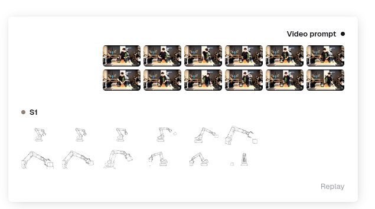
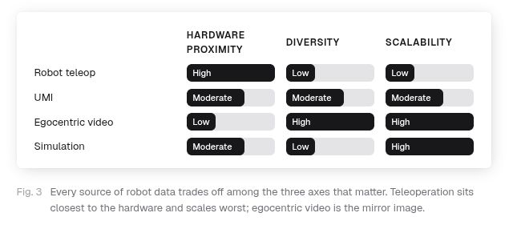
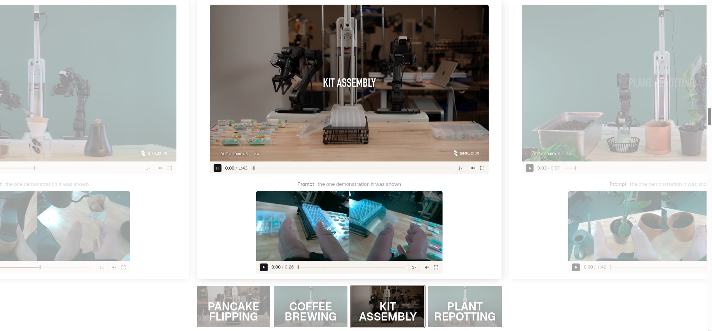
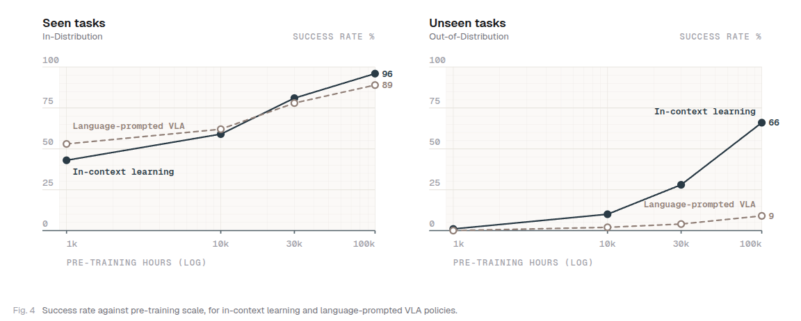
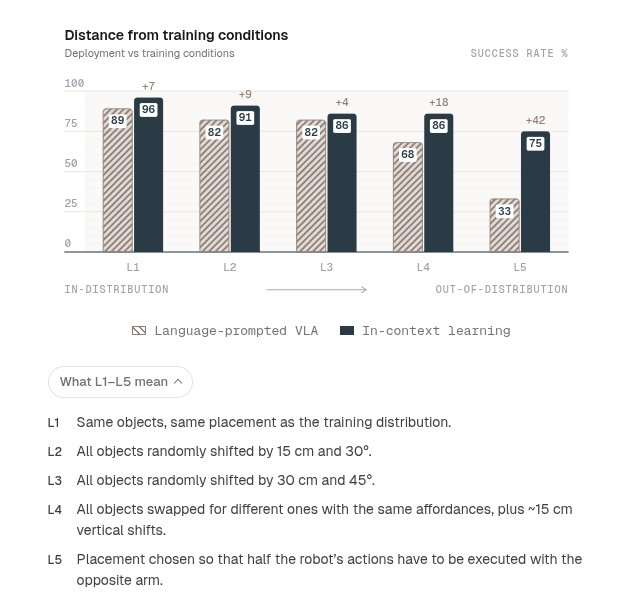

# Introducing S1: In-Context Learning for Robotics Note

## Navigation
- Paper card: [Introducing S1: In-Context Learning for Robotics card](../cards/Skild-S1.md)

## Reading Notes

机器人学迄今为止仍困在 "BERT 时代"。过去几年的机器人研究表明，我们可以利用深度神经网络学习一系列复杂行为。然而，要稳健地执行一项新任务，仍然需要收集数小时的数据并微调一个专用策略。尽管这一范式被广泛接受，它却掩盖了一个令人不安的事实：要为中等复杂度的任务学习出稳健的策略，部署条件下的后训练数据必须达到数十到数百小时。此外，研究表明，当后训练数据足够大且对任务提供密集覆盖时，即使是从零开始训练、完全没有预训练的策略，也能达到后训练基础模型的峰值性能。事后看来这显而易见，但它引出了一个问题：**预训练的意义究竟何在？**

我们认为，预训练的主要目的 —— 如果不是唯一目的 —— 是在机器人领域实现我们从 BERT 到 GPT-3 所见证的同样转变：**上下文学习**，即从一个或少数几个示例中即时学习的能力。

沿两个独立的维度来理解上下文学习：

1. **演示任务在预训练期间是否见过**—— 即分布内任务（in-distribution），还是训练中完全未见过的分布外任务（out-of-distribution）。
2. **演示任务是短时序的原子动作**（5–25 秒），还是长时序的、需要学习新技能或以从未见过的方式进行组合的任务。

我们发现，当前操作领域的上下文学习方法大多覆盖的是短时序任务，或已经存在于预训练分布中的任务。而 **S1 是首个在预训练期间从未见过的极长时序任务（最长达 10 分钟）上展现出上下文学习能力的机器人基础模型**。

#### 训练

从视频可以看出来演示的时候是有各种各样的形式的：遥操、人类第一视角、UMI

而且这个提示是第一视角还是第三视角也没说，一个轨迹有没有配多个视角的提示也没说，很神秘

#### 数据

质量数据是任何基础模型的核心。机器人学面临的挑战在于，没有任何单一数据来源能在三个关键维度上同时达到最优。

- **硬件接近度（Hardware proximity）**：数据与部署硬件的相似程度。
- **多样性（Diversity）**：数据覆盖了多少任务、场景和行为。
- **可扩展性（Scalability）**：收集更多数据的成本有多高。

每一种主要的机器人数据来源都在这三个维度之间做出了权衡。

- **遥操作（Teleoperation）** 与机器人最接近，但可扩展性最差。
- **第一人称视角视频（Egocentric video）** 可扩展性最好，但与机器人之间的域差距最大。没有任何一种来源能在三个维度上全面胜出，这正是押注单一来源目光短浅的原因。Skild 一直在内部同步扩大所有这些数据来源的规模。

#### 实验

**特别提醒：**本文的 success rate 不是“整个长任务从头到尾一次完成的概率”，而是所有任务的平均 per-step success rate（逐步骤成功率）**。评测过程中，如果一步失败，会有人类介入恢复，再继续测试后续步骤，以保证每一步都被评分。因而不能直接把“66%”理解成“66% 的十分钟任务可以完全自主一次性做完”。**

skild 宣称的能在人类演示的情况下完成的 10 分钟以上长程任务。

所谓 scaling law，这个横轴是预训练数据量

在 seen task 上，数据量较少的情况下语言提示会更好，数据量上去之后视频提示更优优势；在 unseen 任务上视频一直更有优势

两种 policy 使用相同的数据、相同的计算量，架构也相同，**只有 prompt embedding 不同**（但是语言描述粒度又是不清楚的……很多疑问）

虽然这个 SR 测得很取巧，估计像传统一样测没这明显优势，相对来看这个优势可能来自以下：

真正需要继续拆的是：**这个 gap 到底来自哪里。** 可能至少有四种来源：

- **prompt 信息量**：S1 拿到完整的视频 demonstration，本身就比一句语言指令包含多得多的轨迹、时序、接触、对象状态等信息；
- **训练目标/架构更适合 imitation**：S1 天生就是为 in-context imitation 设计，language VLA 未必；
- **pretraining scale / data composition 不完全等价**：如果两边模型规模、数据量、训练 compute 不完全 matched，就不能把全部提升都归因于 “ICL paradigm”；
- **benchmark 对 demonstration imitation 特别友好**：如果 unseen task 主要是已知 primitives 的新组合，那么视频 demo 会天然占优势。

总的来说，视频提示确实是一条路，比语言更丰富的表征，但是学习难度也更大

随着测试情况逐渐远离训练情况，ICL 训练的 SR 下降更慢
