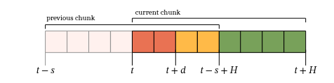

# Training-Time Action Conditioning for Efficient Real-Time Chunking Note

## Navigation
- Paper card: [Training-Time Action Conditioning for Efficient Real-Time Chunking card](../cards/Training-RTC.md)

## Reading Notes

这篇论文提出了一种**训练时动作条件化（Training-Time Action Conditioning）** 方法，用于改进实时分块（Real-Time Chunking, RTC）在机器人控制中的效率。

核心思路是：在**训练阶段**模拟推理延迟，让模型直接学习基于动作前缀（action prefix）来预测后续动作，从而完全避免推理时的计算开销（传统 RTC 需要在推理时用 inpainting 做条件化，增加了延迟和计算成本）。

方法本身非常轻量——只需改几行代码，无需改动模型架构或机器人运行时。实验结果表明：

- **模拟实验**中，在高推理延迟条件下，训练时 RTC 优于推理时 RTC；
- **真实世界实验**（搭纸箱、做浓缩咖啡）中，训练时 RTC 在任务成功率和执行速度上与推理时 RTC 持平，但计算成本更低。

结论是，训练时动作条件化可以作为推理时 inpainting 的**即插即用替代方案**，在不牺牲性能的前提下减少实时控制的计算负担。


### Related Work

RTC 提出了一套异步执行框架，也是本文工作的基础。SmolVLA 同样采用了与 RTC 类似的异步执行机制。但 SmolVLA 没有解决相邻动作块之间的不连续问题，可能在动作块切换时产生分布外的突然“抖动”或“急动”。

与本文同期的研究包括：

- A2C2：通过增加轻量级纠正头解决动作块间的不连续问题。
- VLASH：通过条件化一个未来动作来缓解不连续问题。

本文与 VLASH 的主要区别是：

- VLASH 只条件化于单个未来动作。
- 本文条件化于完整的未来动作前缀，利用更丰富的未来动作信息。


### Method



- $o_t$：控制器在时刻 $t$ 获得的观测；
- $a_t$：某一个控制周期的动作；
- $A_t$：从 $t$ 开始的一整段未来动作；
- $H$：**prediction horizon**，一次预测的动作数量；
- $s$：**execution horizon**，每隔多少个控制周期启动或切换到下一次动作块计算；
- $d$：模型推理所需的控制周期数。


Training-Time RTC 在训练时就让模型反复看到：
$$
[\underbrace{P}_{\text{干净 prefix}},
\underbrace{x_{\text{post}}^\tau}_{\text{带噪 postfix}}]
$$
并直接学习条件速度场：
$$
v_{\theta,\text{post}}
\left(
[P,x_{\text{post}}^\tau],
o,
[1,\ldots,1,\tau,\ldots,\tau]
\right)
$$
它学习的不是普通分布：
$$
p(A\mid o)
$$
而更接近：
$$
p(A_{d:H}\mid o,A_{0:d})
$$
推理时只需：
$$
x_{\text{post}}^{\tau+\Delta\tau}
=
x_{\text{post}}^\tau+
\Delta\tau\,
v_{\theta,\text{post}}(\cdots)
$$
过程变成：

```
固定 prefix + 当前 postfix
  ↓
模型前向
  ↓
只更新 postfix
```

不再需要：

- prefix consistency loss；
- VJP 或反向传播；
- 雅可比线性化；
- inference-time guidance；
- 在线求解 inpainting 约束。
