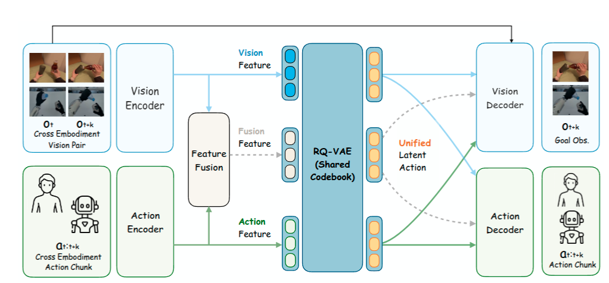
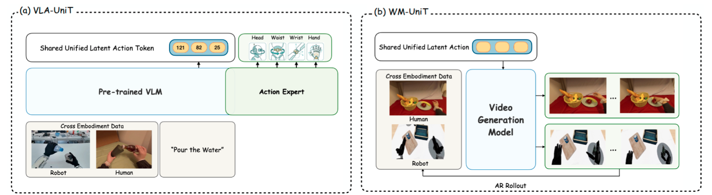
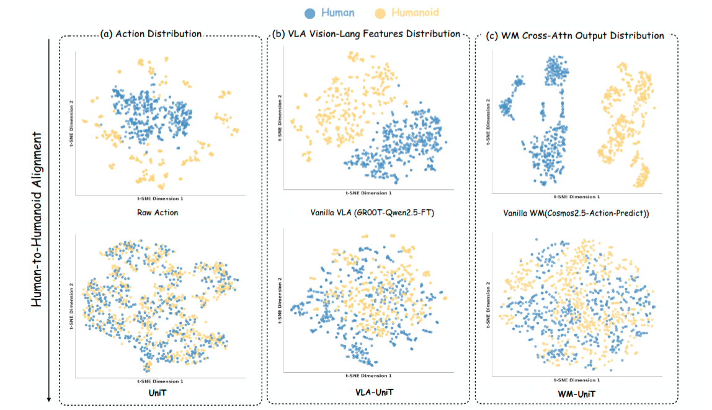
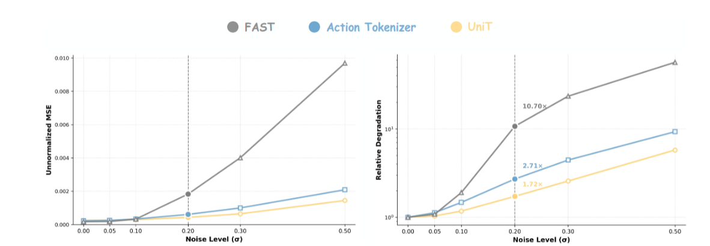
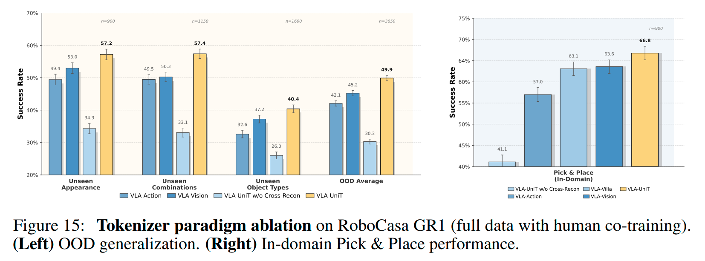

# UniT: Toward a Unified Physical Language for Human-to-Humanoid Policy Learning and World Modeling Note

## Navigation
- Paper card: [UniT: Toward a Unified Physical Language for Human-to-Humanoid Policy Learning and World Modeling card](../cards/UniT.md)

## Reading Notes

UniT（Unified Latent Action Tokenizer via Visual Anchoring）是一个用于跨具身（cross-embodiment）迁移的框架，核心思路是建立一个"统一物理语言"，把人类动作数据映射到人形机器人的动作空间中。它假设**异质动作空间无法直接比较，但不同躯体的动作在视觉上会产生一致的物理结果**，因此用视觉作为锚点：tokenizer 采用三分支交叉重建机制——动作分支预测视觉以锚定运动学结果，视觉分支重建动作以过滤光照、纹理等视觉干扰，融合分支再把两者汇入一个共享的离散潜在空间

- **策略学习（VLA-UniT）**：通过预测统一 token 替代直接回归原始动作，利用海量人类数据实现更好的数据效率和鲁棒的外分布（OOD）泛化，并展示了零样本任务迁移 。
- **世界建模（WM-UniT）**：以统一 token 作为动作条件对齐跨具身动力学，实现从人类数据到人形视频生成的控制增强 。

t-SNE 可视化显示人类与人形机器人的特征在统一 token 空间中收敛到同一流形，说明这套方法为把大规模人类知识蒸馏到通用人形能力上提供了一条可扩展的路径


本文贡献：

**1. 统一的 tokenizer（UniT 本身）**：视觉锚定的三分支 tokenizer + 交叉重建，把人类和人形机器人的异构动作映射进共享的离散潜在空间，同时实现跨本体对齐和动作去噪

**2. VLA-UniT（可泛化的策略执行）**：把 UniT 集成进 VLA 架构（GR00T n1.5 + Qwen2.5-VL），用 token 预测 + flow matching 动作生成替代直接动作回归。三个贡献点：

- **数据效率**：只用 10% 训练数据（每任务 100 条轨迹）就达到 45.5% 成功率，逼近 GR00T 全量训练的 47.8%，约 10 倍的数据节省Data Efficiency；全量数据下 66.7% 总体成功率，超过最佳基线 FLARE（55.0%）11.7 个点Overall Performance。
- **人类到人形迁移**：EgoDex 人类数据 co-training 让模拟 OOD 平均从 34.7% 提到 38.5%，真实机器人上 Geometry 泛化从 23.3% 提到 63.3%、Distractor 从 26.7% 提到 60.0%Real-World OOD。
- **零样本任务迁移**：训练中完全没见过的堆叠任务上，GR00T 和去掉交叉重建的变体都是 0%，UniT + 人类数据达到 60%，并涌现出腰部旋转、转头调整视角等上身协调Zero-Shot Transfer。

**3. WM-UniT（统一世界建模）**：把 UniT 特征作为世界模型的条件接口，替代本体专属的原始动作。人类数据预训练带来一致提升（PSNR 16.34→18.06，EPE 0.478→0.446）WM Pre-Training，跨本体条件化（人类动作→机器人视频、机器人动作→人类视频）在 Gemini-3-Pro 评分的语义、时序、几何一致性上全面超过 raw action 条件（表 3）Cross-Embodiment Conditioning。

另外还有一个贯穿性的结构性贡献：对齐不只停留在 token 层，还传播进了下游模型内部——VLA 的视觉语言特征和 WM 的交叉注意力上下文嵌入都从分离变成重叠（Fig. 7b/c）


（哎，这篇想法简直跟我之前想得一模一样，怪不得让 GPT 调研一下，就给我强烈推荐这篇）


### Related Work

**Learning from Human Data：现有人类数据机器人学习三大路线对比**

| 类别                                                 | 代表方法                     | 核心方案                                                     | 存在缺陷                                                     |
| ---------------------------------------------------- | ---------------------------- | ------------------------------------------------------------ | ------------------------------------------------------------ |
| 视觉预训练路线visual pre-training                    | R3M、VIP、MVP                | 利用海量第一视角人类视频预训练视觉编码器，将预训练编码器作为机器人任务的感知主干网络 | 仅学习视觉观测能力，未引入人手 / 手腕姿态、动作结构信息，无法弥合人类动作到机器人动作之间的具身鸿沟（embodiment gap） |
| 人机联合策略协同训练human + robot co-training policy | HAT、EgoMimic                | 端到端混合人类数据与机器人数据，共同训练动作策略网络         | 人类与仿生人动作空间本身不一致，网络被迫拟合两类差异极大的动作分布，极易产生适配特定本体的捷径解 |
| 动作重定向motion retargeting                         | 各类 IK 逆运动学动作映射方案 | 先通过逆运动学（IK）将人类手腕、手部运动转换为机器人关节动作，再基于转换后数据训练机器人策略 | **动作转换高度依附特定机器人本体结构**；映射后的动作视觉效果往往和原始人类视频无法匹配 |

R3M 这类方案输入是语言和图像，输出还是图像


其实本文的思想从人机协同这边来想最自然。有一种混训方式是人类数据和 robot data 共用 VLM生产条件，用各自的 action head 映射成各自的动作。这里的期望其实是 action head 的训练不会影响 VLM，但是实际上因为对于相同输入，不同动作空间差异很大，最终反向传回来的梯度还是会影响到 VLM。PI 的 knowledge insulation 是一种思路，将动作压缩为 token 训练 VLM，action head 的梯度就不回传了。而本文就是从这个 action 压缩的地方下手，fast tokenizer 没有和结果锚定，类似动作 patten 的人类数据和机器人数据还是不能映射到相近位置，UniT 就是来解决这个 gap 的。


**Latent Action Representations：隐式动作表征三类范式对比**

| 细分类型                             | 代表方法     | 优势                       | 短板                                                         |
| ------------------------------------ | ------------ | -------------------------- | ------------------------------------------------------------ |
| 仅动作输入（action-only）            | VQ-BeT, FAST | 具备精准的运动细节信息     | 无法实现跨机器人本体对齐，泛化性差                           |
| 仅视觉输入（vision-only）            | Moto, LAPA   | 天然适配跨具身本体迁移     | 易习得背景、纹理、光照等无关视觉干扰信息；缺失精细运动控制细节 |
| 视觉 + 动作联合输入（vision+action） | METIS, XR-1  | 同时包含视觉观测与运动信息 | 缺少强有力融合机制，未能将视觉、动作信息凝练为统一的物理动作概念 |


**VLA 与动作条件世界模型共性痛点 & UniT 解决方案**

VLA 和动作条件世界模型存在一致的核心难题：原始动作空间高度依附机器人自身本体结构，不具备跨设备通用能力。为此 UniT 设计了一套统一令牌接口：对于视觉语言动作模型（VLA），该接口充当预测目标；对于世界模型，它则作为条件约束信号，以此解决原始动作空间受本体差异限制的问题。


### Method



这块其实是延承 VQ-VAE 的架构

#### Encoder


**视觉编码**：

      o_t                         o_{t+k}
       |                             |
       +---------+       +-----------+
                 |       |
                 v       v
          +-------------------+
          | frozen DINOv2-L   |
          | layer = -2        |
          +-------------------+
             |           |
             v           v
           f_t        f_{t+k}
             |           |
             +-----+-----+
                   |
                   v
    
      [ Qv Qv ... Qv | f_t | SEP | f_{t+k} ]
        <--- 8 ---->
    
                   |
                   v
          +------------------+
          |    M-Former      |
          | Transformer x 4  |
          | 16 heads         |
          | hidden = 1024    |
          +------------------+
                   |
             只取前8个
             query output
                   |
                   v
             z_v: 8 x 1024


**动作编码**

```
a_{t:t+k}
   |
   | pad / map to unified 128-D
   v
+--------------------------------+
| Embodiment-aware Causal ResNet |
| 1D temporal conv               |
| 3 conv blocks                  |
| kernel=5, stride=2             |
+--------------------------------+
   |
   v
action sequence features
   |
   |                       s_t
   |                        |
   |                        v
   |              +------------------+
   |              | embodiment-aware |
   |              |       MLP        |
   |              +------------------+
   |                        |
   |                    state feat
   |                        |
   +------------+-----------+
                |
                v

 [ Qa Qa ... Qa | state | SEP | action features ]
   <--- 8 ---->

                |
                v
       +------------------+
       |    M-Former      |
       | Transformer x 4  |
       | 16 heads         |
       +------------------+
                |
            前8个query
                |
                v
          z_a: 8 x 1024
```

$a_{t:t+15}\in \R ^{16 \times 128}$


**联合编码**

```
       z_v : 8 x 1024
             |
             | condition
             v

[ Qm x 8 | z_v | SEP | z_a ]

             |
             v
     +------------------+
     | Fusion M-Former  |
     | Transformer x 4  |
     | 16 heads         |
     +------------------+
             |
        first 8 queries
             |
             v
   LayerNorm -> Linear -> GELU
             |
      shared projection
             |
             v
         z_m
```


这里的 M-Former 具体结构就是普通 Transformer，就是在输入加了可学习 token


#### Shared RQ

这一步是把 $z_v$, $z_a$, $z_m$ 映射到词表中的向量上。为了保证词表的连续会做一些量化.

1. **设定** : Encoder 输出连续向量： $$z \in \mathbb{R}^d$$. Codebook 为： $$C = \{e_1, \dots, e_K\}, \quad e_j \in \mathbb{R}^d$$ 
2. **量化过程**：量化时寻找最近的 code： $$k^* = \arg\min_j \|z - e_j\|_2$$ 前向传播使用对应的 codebook vector： $$z_q = e_{k^*}$$ 
   在 UniT 代码中，这一步通过 `torch.cdist` → `argmin` → 查 embedding 实现。 
3. **问题**：离散操作不可导 $\arg\min$ 是离散操作，严格来说： $$\frac{\partial k^*}{\partial z}$$ 无法正常反传，梯度在此处断裂。
4. **解决方案**：Straight-Through Estimator (STE) 代码中使用： $$z_q^{\text{STE}} = z + \text{sg}(z_q - z)$$ 其中 $\text{sg}$ 即 stop-gradient（对应 PyTorch 的 `.detach()`）。UniT 代码写法为： ```python z_q = z + (z_q - z).detach() ```


本文的小巧思是 2-stage RQ（这个不算创新，有RQ-VAE的时候就有了），用两个 128 容量的词表进行量化。第二步词表的量化对象是第一步的残差：
$$
e_1 = Q_1(r_0) \\
r_1 = r_0-e_1 \\
e_2 = Q_2(r_1) \\
\hat z = e_1 + e_2
$$
注意这两张表都是可学习的


另一个 trick 是 unused code reset, 每 100 个 step 检测从未被命中的 code，从当前 batch 采样替换（工程 trick，2020 年左右的 VQ 工作中就已有使用）


#### Decoder 

**视觉解码**

```
current DINO features
256 x 1024
       +
motion summary
1 x 1024
       |
       v
256 x 1024
       |
 positional embeddings
       |
       v
ViT Encoder
12 layers / 16 heads
       |
    LayerNorm
       |
 Linear 1024 -> 1024
       |
       v
predicted future DINO
256 x 1024
```

这个 motion summary 是 8 * 1024 展平后用线性映射得到的，对所有 DINO features 作用


**动作解码**

```
[Q×8 | state | SEP | latent×8]
          18 × 1024
               |
       8-layer Transformer
               |
       only take Q outputs
               |
               v
         (B,8,1024)

================================
       RESNET DECODER
================================

embodiment-specific LN
               |
        Causal ResBlock
               |
        Causal ResBlock
               |
               v
         (B,8,1024)

================================
          UPSAMPLE
================================

linear interpolation
       time: 8 → 16
               |
               v
        (B,16,1024)
               |
embodiment-specific causal Conv1D
          1024 → 128
               |
               v
        (B,16,128)
               |
               v
     reconstructed action
```


#### Loss

$$
\mathcal{L} = \sum_{i \in \{v, a, m\}} \left[ \lambda_v \mathcal{L}_{\cos}\left(\hat{f}_{t+k}^{(i)}, f_{t+k}\right) + \lambda_a \mathcal{L}_{\mathrm{act}}\left(\hat{a}_{t:t+k}^{(i)}, a_{t:t+k}\right) \right] + \mathcal{L}_{\mathrm{RQ}},
$$

求和部分是对三条路径分别重建出来的图像嵌入表示以及动作计算损失，$\mathcal L_{RQ}$ 是 encoder 和 codebook 之间的对齐损失，虽然论文说用的是 commitment loss 但是他们在代码中用的还是完整的 RQ-VAE loss (RQ就是Residual Quantization)
$$
\mathcal{L}_{\mathrm{VQ}} = \underbrace{\left\lVert \mathrm{sg}(z) - e \right\rVert^2}_{\text{codebook loss}} + \underbrace{\beta \left\lVert z - \mathrm{sg}(e) \right\rVert^2}_{\text{commitment loss}},
$$
$sg(\cdot)$ 是梯度截断算子，这两项分别是让 encoder 输出靠近词表和让词表嵌入靠近 encoder

论文的 $\beta_1=0.5, \beta_2=0.1$

这意味着第二级对 encoder 的“必须贴近码字”约束明显更弱，而 codebook 仍然会积极去拟合 residual。**这与“第一级负责较稳定/coarse 的结构，第二级更灵活地补 residual”是吻合的直觉**


#### 下游任务



|                       | VLA-UniT                       | WM-UniT                               |
| --------------------- | ------------------------------ | ------------------------------------- |
| 学什么                | Policy                         | Dynamics / World Model                |
| 输入                  | (o_t,\ell,s_t)                 | (o_t,s_t,a_{t:t+k})                   |
| 输出                  | action chunk                   | future frames                         |
| UniT 用法             | **预测目标**                   | **直接 conditioning**                 |
| UniT branch           | Fusion branch                  | Action branch                         |
| 表示形式              | Discrete code                  | Continuous pre-quantization feature   |
| UniT 的作用           | 约束 VLM hidden representation | 替代 raw action 控制 world model      |
| Cross-embodiment 逻辑 | 相同 intent → 相同监督标签     | 相同 intent → 相同 dynamics condition |

VLA 就跟 KI 训练一样，加一个自回归的监督。而且从代码看确实也是实现了 KI 机制


### 实验

#### Unified Representation: Alignment and Robustness



可以使人类动作和机器人动作分布趋同（但是并不能保证靠近的点是语义相似的）


对噪声的鲁棒：



**action tokenizer 是不用 vision anchor 的 VQ-VAE. 这其实也反映出对噪声鲁棒的特性来自 VQ-VAE 而不是 vision-anchor**

其实 vision-anchor 没有想象中那么大作用


#### 5.2 Policy Learning

| 项目              | Full-data                | Few-shot                                        |
| ----------------- | ------------------------ | ----------------------------------------------- |
| GR1 robot 数据    | 24,000 条，1000/task     | 2,400 条，100/task                              |
| EgoDex human 数据 | **无**                   | **27,419 条 `basic_pick_place`**                |
| Tokenizer 训练    | GR1-full                 | EgoDex + GR1-few-shot                           |
| VLA 训练          | GR1-full                 | EgoDex + GR1 mixed pretrain → GR1-only finetune |
| 主要目的          | 测 UniT 本身是否提高 VLA | 测 human→robot transfer + data efficiency       |

这一节回答的是：**UniT token 作为 VLA 的额外学习目标，是否能提高 robot policy；以及 human data 能否进一步迁移给 humanoid。**

**纯 robot 数据**

在 RoboCasa-GR1 full-data 上，VLA-UniT 达到 **66.7%** overall success，而使用基本相同架构但没有 UniT token prediction 的 GR00T baseline 是 **47.8%**。Pick & Place 为 67.3%，Articulated tasks 为 64.7%。因此即使**没有 human data**，UniT token 作为 structured physical-intent supervision 本身也能改善 policy learning。

在只有 10% robot data，即每任务 100 条 trajectory 时，VLA-UniT 仍达到 **45.5%**，接近 GR00T 使用完整数据的 47.8%。作者据此强调其 data efficiency。


**Human → Humanoid**

在 few-shot robot data 上加入 EgoDex `basic_pick_place` human demonstrations 后，再 robot-only fine-tune：
$$
45.5\%\rightarrow50.0\%
$$
in-domain；OOD average：
$$
34.7\%\rightarrow38.5\%
$$
Pick & Place 提升最明显，从 41.7% 到 49.4%。说明在 tokenizer/VLA 已经共同见过 EgoDex + GR1 的条件下，human data 可以改善 humanoid policy。


**真机**

IRON-R01 上，robot-only UniT 已经明显优于 GR00T；再加入 EgoDex 后：

- Pick & Place：70% → **78%**
- Pouring：35% → **75%**

Pouring 提升尤其明显，作者认为 human demonstration 中丰富的双臂协调模式能够通过 shared representation 转移到 humanoid。

还做了一个 **zero-shot stacking**：robot training data 没有 stacking，而 EgoDex human data 有 stacking。GR00T 和去掉 cross-reconstruction 的 UniT 都是 0%，UniT robot-only 是 10%，加入 human data 后达到 **60%**。这是第五节里最直接的 task-level human→robot transfer 证据之一。

**核心结论：**

UniT 有两个收益：robot-only 下提高学习效率；human+robot 下进一步产生跨 embodiment transfer

但需要注意，论文展示的并不是“预训练好的通用 tokenizer zero-shot 应用于新机器人”；human 和目标/相关 robot data 基本都参与了 UniT/VLA 的训练。


#### 5.3 World Modeling

这一节把 UniT 从 policy target 扩展成 **world model 的 action-conditioning interface**。

传统 world model 条件是：
$$
(o_t,a_{t:t+k})\rightarrow o_{future}
$$
UniT 则把 embodiment-specific raw action 换成 UniT 的 continuous pre-quantization representation：
$$
(o_t,z_{\text{UniT}})\rightarrow o_{future}.
$$


**Controllable Generation**

作者首先在单 embodiment DROID 上比较：

- Raw Action
- WM-Action：action-only latent
- WM-UniT：vision-anchored latent

WM-UniT 获得最好 EPE 0.2588，同时 PSNR/SSIM/LPIPS也略优；说明 UniT 不只是跨 embodiment 时有效，在单机器人上也能提供较好的 action-conditioning representation。

在 EgoDex + RoboCasa-GR1 joint training 时区别更明显。例如 GR1：
$$
PSNR:13.45\rightarrow17.66 \\
EPE:0.558\rightarrow0.453.
$$
说明 raw human/robot actions 很难共享同一个 dynamics model，而 UniT 更适合作为统一 conditioning interface。


**Human → Humanoid dynamics transfer**

作者又先用 EgoDex `basic_pick_place` 预训练 WM-UniT，然后在 RoboCasa-GR1 pick-and-place 上 fine-tune。相比没有 human pretraining：
$$
FVD:180.51\rightarrow153.31 \\ EPE:0.478\rightarrow0.446
$$
说明 human data 学到的 dynamics prior 可以改善 humanoid world modeling。

最后做了直接 **Human→Robot / Robot→Human conditioning**：source embodiment 的 UniT action representation 直接 condition target embodiment 的视频生成，而且这一阶段不做额外 domain adaptation。生成结果能较好保留 reach、grasp、rotation、动作幅度和时序等信息。

**核心结论：**

UniT 不只可以作为 VLA supervision，也可以作为 human/robot 共用的 world-model action interface

这部分加强了“physical language”这个 claim，因为同一种 representation 同时能服务 **policy prediction** 和 **future dynamics generation**。


#### 5.4 Tokenizer Design Ablation

这一节回答：**UniT 的提升究竟来自哪里？**

作者主要验证两个设计：

1. Vision + Action 都需要；
2. 仅仅同时使用两种 modality 不够，必须通过 **cross-reconstruction 显式对齐**。

OOD average：
$$
\text{Action-only}=42.1\% \\ \text{Vision-only}=45.2\% \\ \text{Vision+Action without Cross-Recon}=30.3\%  \\ \text{Vision+Action without Cross-Recon}=30.3\% \\  \boxed{\text{Full UniT}=49.9\%}
$$
。

最有信息量的是：
$$
\boxed{
\text{Vision+Action without alignment}
<
\text{Vision-only / Action-only}
}
$$
也就是说，**把两种 modality 放在一起本身甚至可能有害**；真正关键的是：
$$
z_a\rightarrow \hat v  \\
z_v\rightarrow \hat a
$$
这种 cross-reconstruction，让 action representation 必须解释视觉物理变化，同时 visual representation 必须保留可用于动作 reconstruction 的信息。

作者还比较双向 reconstruction 与类似 VLA-Villa 的单向 Vision→Action reconstruction，Full UniT 仍然更好，因此支持 bidirectional reconstruction，但这一差距没有“有无 cross-reconstruction”那么大。



好像这个 cross-recon 也没多大用，跟一般的 RQ-VAE
