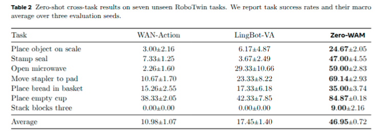
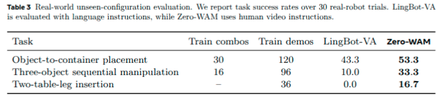
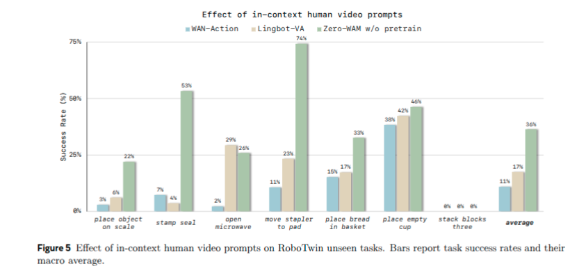
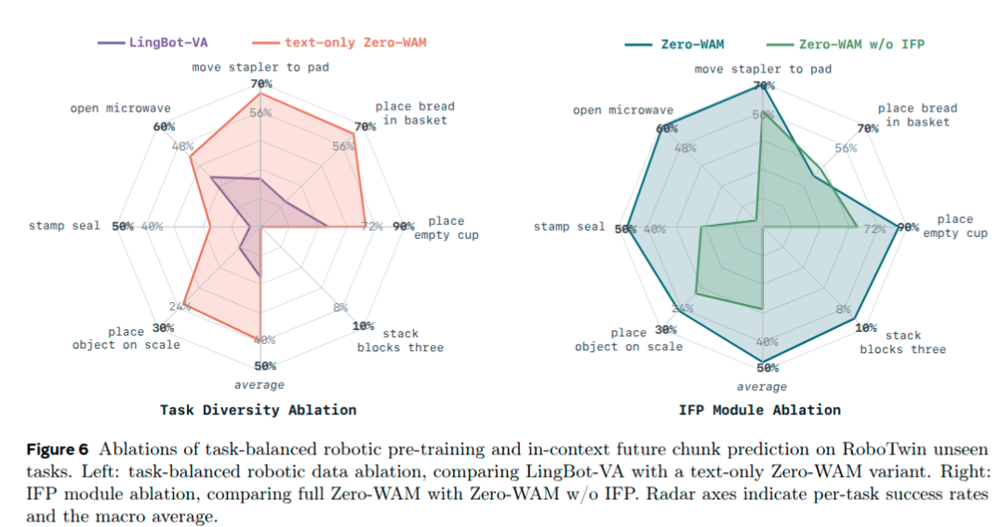

# Zero-WAM: In-Context World-Action Modeling from Human Videos for Open-Ended Task Generalization Note

## Navigation
- Paper card: [Zero-WAM: In-Context World-Action Modeling from Human Videos for Open-Ended Task Generalization card](../cards/Zero-WAM.md)

## Reading Notes

Zero-WAM把大语言模型里的in-context learning范式搬到了机器人操作上：任务不再用语言描述，而是用一段人类演示视频作为上下文指令，让策略零样本执行训练中从未见过的任务。动机很直接——语言经常欠指定操作任务（空间约束、中间状态、时序结构难以说清），而人类视频直接呈现期望的视觉状态变化，只是它不携带可执行动作 。

为了支撑这个想法，论文解决两个关键问题：

- **数据稀缺**：作者提出一条自动pipeline，用任务级采样的机器人轨迹配合VLM（Gemini 3.1 Pro、Qwen3.6-Plus）做任务分析、图像编辑（Nano Banana 2、Qwen-Image-2.0）和视频生成（Wan 2.7、Kling AI 3.0），把机器人轨迹自动转成语义匹配的人类视频，再配回原轨迹形成human-robot ICL对。产出是HumanGen：74.2K对、覆盖8.6K个任务；同时把五个公开机器人数据集重切分出6000+任务、每epoch约400K条轨迹的Task-diverse VA语料，防止预训练被少数重复遥操作任务主导 。
- **捷径问题**：训练中模型常常仅凭机器人历史+语言指令就能预测下一块视频，导致它学会忽略人类视频。为此提出IFP（in-context future chunk prediction）辅助目标——让模型从当前表示并行预测多个带时间步长的未来视频块，且IFP分支不直接看到人类视频，逼着主干把人类视频里的任务信息编码进表示里 。

效果上，在RoboTwin 2.0的7个未见任务上平均成功率46.95%，比最强视频动作基线LingBot-VA高出29.5个百分点；真实Franka机器人上也验证了对多物体场景、长时序操作和精细插入等未见配置的泛化 。模型本体是在[LingBot-VA](https://www.alphaxiv.org/abs/2601.21998?chatId=01a07add-6b39-7ee1-bc19-6932ef3e1625)的因果视频动作框架（Mixture-of-Transformers）上，把Wan-2.2-TI2V-5B改造成因果策略，人类视频通过高度轴RoPE偏移与机器人视频在序列中区分开。


### 数据流水线

**Task-diverse VA ：**

- AgiBot
- InternData-A1
-  Open_X-Embodiment
- RoboCOIN
- RoboMIND

尽管这些数据集包含大量机器人轨迹和广泛的任务覆盖，但许多轨迹来自同一任务的重复遥操作。直接使用原始分布会导致预训练被冗余轨迹过度影响，使模型无法充分利用源数据集中已有的任务多样性。通过将每个数据集重新划分为任务来解决这一问题，其中每个任务由操作动作和物体的组合来定义。任务标签在原始数据集元数据可用时从中获取，或在元数据不足时从机器人轨迹中解析。然后，我们从每个任务中采样有上限数量的轨迹，采样上限根据每个源数据集的任务内多样性进行调整。在这五个源数据集中，我们采样了超过 6000 个任务，以及每个训练轮次（epoch）约 400K 条对应的机器人轨迹。


**In-Context Human Video Generation Pipeline**

```
带 action 的完整 Robot trajectory
        │
        ▼
① VLM 看完整 robot video
   Gemini 3.1 Pro / Qwen3.6-Plus
        │
        ├─ task name
        ├─ initial object states
        ├─ object state changes
        ├─ final object states
        └─ image editing prompt
        │
        ▼
② 编辑 robot 第一帧
   Nano Banana 2 / Qwen-Image-2.0
        │
        ▼
   Human 初始观察图
        │
        │ + 上面提取的 object-state information
        ▼
③ VLM 生成详细 video prompt
        │
        ▼
④ Wan 2.7 / Kling 3.0
   生成 human manipulation video
        │
        ▼
⑤ VLM 质量过滤
   - semantic consistency
   - physical plausibility
        │
        ▼
⑥ Human video + 原 Robot trajectory/action
   = 一个 ICL training pair
```


**HumanGen**

| 子集                     | 来源                                                         | 任务数 | 样本数（human-robot 对） |
| ------------------------ | ------------------------------------------------------------ | ------ | ------------------------ |
| Pre-train ICL (External) | AgiBot、InternData-A1、Open-X-Embodiment、RoboCOIN、RoboMIND 五个公开数据集（>45 种机器人本体） | 5,062  | 41,188                   |
| Pre-train ICL (In-house) | 自采数据（双机械臂 Franka、Galaxea R1 Pro 等）               | 3,522  | 30,247                   |
| Simulation ICL           | RoboTwin 2.0 的 50 个任务（每个 50 条轨迹）                  | 50     | 2,500                    |
| Real-world ICL           | 真实双机械臂 Franka 上的三种任务族                           | —      | 252                      |

Real-world ICL 的人类演示是实拍的不是生成的


### 架构

```
                 Human demo video
                        |
                        |
                        v
Current robot video --> Video Transformer
                        |
                        |
                 predicted robot future
                        |
                        |
                        v
                 Action Transformer
                        |
                        |
                        v
                    robot action
```

遵循 LingBot-VA 的方法，我们通过将 Wan-2.2-TI2V-5B（一个双向文本/图像到视频生成模型）转换为上述因果视频-动作策略模型，构建 Zero-WAM。

附带两个特色组件：**将人类视频作为上下文任务规范（human video as in-context task specification）**，**上下文未来片段预测（in-context future chunk prediction）**


**human video as in-context task specification**

这个是用 HumanGen 训练的，训练方法是 teach forcing


RoPE offset for ICL human video —— 这里用的是 3D RoPE, 用在某一个维度加偏移的方式把人类视频演示和输入的机器人视频分离开


**In-context future chunk prediction**

目标：避免模型仅通过外推机器人最近的自身状态来预测下一段视频而忽略人类演示

IFP 是一个：

> 仅用于训练阶段的辅助目标（training-only auxiliary objective）。

它要求模型：

> 根据当前机器人视频表示，预测多个具有时间间隔的未来机器人视频片段。

IFP 的解法是**把监督的落点从"预测下一块"移到"预测更远的未来"**：不再只监督 $x_{i+1}$，而是让模型从当前机器人视频表示出发，一次性预测多个跨步的未来视频块。远端未来无法靠局部外推得到，模型只能去编码人类视频里传达的长时序任务演化。

这里的情况就是输入的人类示范视频是全程任务，具有更长程的信息，而机器人自身相关的输入只有近期信息。

```
┌─────────────────────────────────────────────────────────────────────────────┐
│                          训练阶段（IFP 启用）                               │
├─────────────────────────────────────────────────────────────────────────────┤
│                                                                             │
│   ┌───────────────┐     ┌──────────────────────────────────────────────┐   │
│   │  人类示范视频  │────▶│         主视频 Transformer                  │   │
│   │      h        │     │   (Main Branch)                             │   │
│   └───────────────┘     │   ┌────────────────────────────────────┐   │   │
│                         │   │  Layer 1  │ Layer 2 │ ... │ Layer M│   │   │
│                         │   └────────┬────────┬──────────┬────────┘   │   │
│                         │            │        │          │            │   │
│                         │            ▼        ▼          ▼            │   │
│                         │   ┌────────────────────────────────────┐   │   │
│                         │   │  收集 M 层隐藏表示 {r₁,r₂,...,r_M} │   │   │
│                         │   └────────────────┬───────────────────┘   │   │
│                         │                    ▼                       │   │
│                         │   ┌────────────────────────────────────┐   │   │
│                         │   │    拼接 + MLP 投影 (P_fuse)       │   │   │
│                         │   │         φⁱ⁺¹ = 融合特征           │   │   │
│                         │   └────────────────┬───────────────────┘   │   │
│                         └────────────────────│──────────────────────┘   │
│                                              │                          │
│                    ┌─────────────────────────┼──────────────────────┐   │
│                    │                         ▼                      │   │
│                    │   ┌────────────────────────────────────────┐   │   │
│                    │   │           K 个 IFP 模块               │   │   │
│                    │   │   (G₁, G₂, ..., G_K)                 │   │   │
│                    │   │   每个 = 1层 Transformer             │   │   │
│                    │   │   初始化自主分支最后一层              │   │   │
│                    │   └────────┬───────┬───────┬────────────┘   │   │
│                    │            │       │       │                 │   │
│                    │   ┌────────▼───────▼───────▼────────────┐   │   │
│                    │   │   并行预测 K 个跳步未来视频块        │   │   │
│                    │   │   目标: x^(i+2), x^(i+5), x^(i+8)   │   │   │
│                    │   │   (步长 s=3 为例)                   │   │   │
│                    │   └────────────────┬─────────────────────┘   │   │
│                    │                    ▼                         │   │
│                    │   ┌────────────────────────────────────┐   │   │
│                    │   │   IFP 损失 (流匹配损失 × 权重)    │   │   │
│                    │   │   L_ifp = Σ w_k · L_fm            │   │   │
│                    │   └────────────────────────────────────┘   │   │
│                    └─────────────────────────────────────────────┘   │
│                                                                     │
│   ⚠️ 关键设计：IFP 模块 ❌ 不直接看人类视频 h                        │
│   └── 只能通过 φⁱ⁺¹ 间接获取（φⁱ⁺¹ 是主分支看过 h 之后产生的）    │
│                                                                     │
├─────────────────────────────────────────────────────────────────────────────┤
│                         推理阶段（IFP 移除）                               │
├─────────────────────────────────────────────────────────────────────────────┤
│                                                                             │
│   ┌───────────────┐     ┌──────────────────────────────────────────────┐   │
│   │  人类示范视频  │────▶│         主视频 Transformer                  │   │
│   │      h        │     │   (Main Branch)  ← 已被 IFP 训练“逼”会了    │   │
│   └───────────────┘     │   从 h 中提取任务信息的能力 ✅               │   │
│                         └──────────────────────────────────────────────┘   │
│                                                                             │
│   🗑️ IFP 模块全部移除，不参与推理                                          │
│                                                                             │
└─────────────────────────────────────────────────────────────────────────────┘
```


### 实验

#### 仿真

baselines：

- WAN-Action 是最纯粹的对照。它从 Wan-2.2-TI2V-5B 这个通用文/图生视频模型出发，套用与 Zero-WAM 相同的 MoT 因果 video-action 框架，然后直接在 43 个已见 RoboTwin 任务上训练——没有机器人数据的预训练，只把通用视频先验适配到 RoboTwin 上。它可以被理解为"把通用视频模型直接改造成策略"的下限参照。
- LingBot-VA 在此之上多了一层机器人 video-action 预训练。论文直接使用其发布的预训练 checkpoint，再在同样的 43 个已见任务上做后训练。也就是说，它具备通用视频先验加机器人数据先验，但从未见过人类视频任务指令。
- Zero-WAM 在预训练阶段的投入最多。它以 Wan-2.2-TI2V-5B 为底座，先在大规模混合数据上做预训练：Task-diverse VA（约 6,000 个任务、每轮约 400K 条轨迹）与 HumanGen（74.2K 人类-机器人 ICL 对，覆盖 8.6K 个任务），两者采样比例为 1∶5；预训练共消耗 15,360 GPU 小时。Pre-training Mix。随后在 RoboTwin 上用 64 张 GPU 做 4,000 步后训练，联合采样 Task-diverse VA、HumanGen 和 RoboTwin 数据，比例 2∶10∶3



对 RoboTwin 2.0 的 50 个任务各生成 50 条人类视频，共 2,500 条 ICL 样本构成 Simulation ICL 子集；其中 43 个任务的 2,150 条用于后训练，剩下 7 个任务的 350 条留给零样本评估（具体评测的时候用的是50条中的哪一条，没说）


#### 真机

双臂 Franka


- **Object-to-container placement（物体入容器）**：机器人需单臂或双臂协调地把物体放进目标容器。作者收集 30 个物体–容器训练组合下的 120 条演示，用于让策略拟合 Franka 本体；评估时留出一部分物体和容器，因此每个测试配置里至少有一个物体或容器是机器人训练演示中没见过的。Zero-WAM 成功率 53.3%，高于语言条件的 LingBot-VA 的 43.3%
- **Three-object sequential manipulation（三物体顺序操作）**：考察能否跟随人类视频指定的长程操作顺序。场景含多个物体和容器，每个测试回合按人类视频给出的**随机顺序**选择三个物体。作者从 16 个训练组合收集 96 条演示，并为它们配了对应的人类视频指令。测试时人类视频按任意顺序操作三个物体，其中包含未见过的物体和容器；Zero-WAM 达到 33.3%，明显超过 LingBot-VA 的 10.0%
- **Two-table-leg insertion（桌腿插入）**：考察细粒度的人类视频任务指定。任务要把两条桌腿插入桌面底座上指定的孔中，人类视频负责指明哪条颜色的腿插进哪个目标孔。这一精度插入场景只收集了 36 条演示。测试时由人类视频指定两条桌腿的目标孔，机器人需按此完成两次插入。绝对成功率受精密物理插入难度限制，但 Zero-WAM 在未见插入配置上成功，而 LingBot-VA 成功率为零。作者还观察到对未见颜色与类型的桌腿、桌面底座也出现成功的定性迁移，说明细粒度任务指定从人类视频指令中比从纯语言中更可靠地被遵循。




### 消融

#### 人类演示promt

这一组对照全部只训练 43 个已见 RoboTwin 任务，用来剥离大规模预训练的影响。

- WAN-Action（仅语言条件）：10.98%
- LingBot-VA（仅语言条件，但保留机器人视频-动作预训练）：17.45%
- Zero-WAM w/o pretrain（Wan-2.2 初始化 + ICL 人类视频）：36.36%

从 10.98% 到 36.36% 这一跳，说明 ICL 视频确实提供了文本之外的额外任务信息——毕竟两组初始权重相同，唯一差别就是是否把人类视频作为条件。更有意思的是第三行：Zero-WAM w/o pretrain 在小规模 ICL 数据上就压过了带着机器人预训练的 LingBot-VA，说明**"任务接口的形式"（视频 vs 文本）在跨任务场景下可能比"预训练规模"更关键**。

但作者自己也点出了边界：三个变体在 stack blocks three 上全部得零分，而完整 Zero-WAM 在正实验中能拿到非零成功率。也就是说小规模 ICL 数据对长时序未见任务无效，**大规模 task-diverse ICL 预训练是必需项而非可选项**。



同时比较 Figure 5 和 Table 2 也能看出大规模 ICL 预训练对各任务的影响：

- place object on scale: 22% -> 24%
- stamp seal: 53% -> 47%
- open microwave: 26% -> 59%
- move stapler to pad: 74% -> 69%
- place bread in basket: 33% -> 35%
- place empty cup: 46% -> 85%
- stack blocks three: 0 -> 9%

可以看到在有些任务上预训练+后训练是不如直接后训练，但是在开微波炉和放空杯子到杯垫上提升显著，可能是泛化性带来的。


#### IFP目标



**增益高度集中在"需要从视频推断未见动态"的任务上。** stamp seal、open microwave、place object on scale 三个的涨幅都在 14 个百分点以上，恰好是必须依赖任务说明、无法靠历史外推的类型。这与 IFP 的动机——把监督推向远端未来、迫使模型编码视频中的长时序演化——是对应的


#### Task-balanced Data

text-only Zero-WAM: 保留全部 ICL 样本，只把 human-video latent mask 掉，让每个 human-robot pair 退化成一条普通的语言条件 video-action 样本

这个模型是为了和 LingBot-VA 对比：LingBot-VA（原始分布、无 human video）17.45% → text-only Zero-WAM（task-balanced 数据、无 human video）39.44% 
