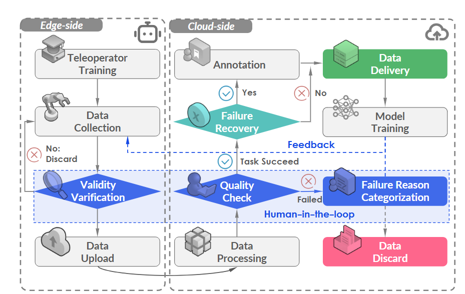
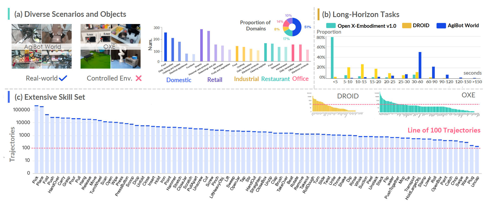
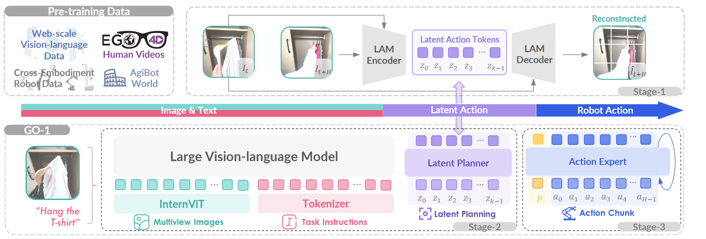

# AgiBot-World Note

## Navigation
- Paper card: [AgiBot-World card](../cards/AgiBotWorld.md)

## Reading Notes

### 平台&数据

**核心规模与统计数据**

AgiBot World 在数据规模上相比现有数据集实现了数量级的增长，特别是在双臂协同和长程任务（Long-horizon tasks）方面表现突出。

| 指标                        | 统计数值         |
| :-------------------------- | :--------------- |
| **轨迹总数 (Trajectories)** | 1,001,552+ (1M+) |
| **总时长 (Total Duration)** | 2,976.4 小时     |
| **具体任务 (Tasks)**        | 217 个           |
| **原子技能 (Skills)**       | 87 种            |
| **场景数量 (Scenes)**       | 106 个           |
| **覆盖物体 (Objects)**      | 3,000+ 种        |

#### **硬件平台：AgiBot G1**

数据集采用标准化的 **AgiBot G1** 人形机器人进行采集，确保了数据的统一性与可复现性：

- **形态**：双臂 7-DoF 机械臂，配备移动底盘及可调节腰部。
- **末端执行器**：支持标准夹爪或 6-DoF 灵巧手，部分夹爪配备了视触觉传感器（Visuo-tactile sensors）。
- **传感器配置**：全身搭载 8 个摄像头（包括 RGB-D 和鱼眼相机），覆盖头部、手腕及后方视野，控制频率为 30 Hz。

#### Data Collection: Protocol and Quality

**数采流程**

1. 在正式开始数据采集之前，我们首先进行初步数据采集，以验证各项任务的可行性并建立相应的采集标准：大致分为以下几类

   | 标准类别              | 具体包括什么                                                 | 作用                                                         |
   | --------------------- | ------------------------------------------------------------ | ------------------------------------------------------------ |
   | **任务可行性标准**    | 任务是否能被当前机器人硬件、末端执行器、遥操作系统稳定完成；是否需要双臂、灵巧手、移动底盘、视觉触觉传感器等能力 | 排除无法稳定采集或超出机器人能力边界的任务                   |
   | **场景配置标准**      | 初始场景如何布置、物体位置/数量/种类、环境域归属，例如家庭、零售、工业、餐厅、办公等 | 保证同一任务的数据分布可控，同时覆盖真实场景多样性           |
   | **任务执行标准**      | 任务从哪里开始、到哪里结束；中间是否需要多个 atomic skills；是否允许长时程操作、工具使用、双臂协作、接触丰富操作 | 保证 episode 的语义一致，不同操作者采集的是同一种任务        |
   | **成功/失败判定标准** | 轨迹是否完成目标；是否存在可恢复失败；失败原因和时间点是否需要标注 | 决定 episode 是否保留、作为正常样本还是 failure recovery 样本 |
   | **数据完整性标准**    | 是否缺帧、传感器数据是否完整、图像/深度/关节状态/action 是否同步 | 确保数据可以用于策略训练，而不是只有视觉片段                 |
   | **动作质量标准**      | 是否存在过长停顿、无效动作、起始/结束 transition 不一致、idle frame 过多 | 减少低质量 demonstration 对 policy learning 的干扰           |
   | **标注标准**          | task-level instruction、sub-step instruction、key-frame 标注、item / scene / skill / task-level annotation | 让轨迹不仅能做 imitation learning，也能支持 VLA/VLM policy 的语言条件训练 |

2. 在可行性验证和采集标准审核之后，经验丰富的远程操作员布置初始场景，并按照既定标准正式开始数据采集。所有数据均在本地进行初步有效性验证，例如验证是否存在缺失帧。一旦确认数据完整，便将其上传至云端以进入下一阶段

3. 在后处理阶段，数据标注员将验证每个片段是否符合第一阶段建立的采集标准，并提供语言标注

**故障恢复**

在数据采集过程中，远程操作员偶尔可能会出现错误，例如在操作机械臂时不慎掉落物体。然而，他们通常能够从这些错误中恢复，并成功完成任务，而无需对设置进行完全重新配置。我们并未丢弃这些轨迹，而是保留它们，并手动标注每条轨迹对应的故障原因和时间戳。这些轨迹被称为故障恢复数据，约占数据集的百分之一。我们认为它们对于实现策略对齐和故障反映至关重要，而这对于推进下一代机器人基础模型的发展至关重要

**人机协作（持续改进）**

在收集数据标注者的反馈的同时，我们采用人机协作的方法来评估和改进数据质量。该过程包含一个迭代循环：收集少量演示数据、训练策略，并将生成的策略部署到位以评估数据可用性。基于策略的性能，我们迭代地改进数据收集流程，以解决已发现的缺陷或效率低下问题。例如，在实际部署过程中，**模型在动作开始时会出现长时间的停顿**，这与数据标注者的反馈相符，他们指出收集的数据中存在不一致的转换和过多的空闲时间。为此，我们修订了数据采集协议，并**引入后处理步骤以消除空闲帧**，从而提升数据集在策略学习中的整体效用。这种反馈驱动的方法确保了数据质量的持续改进。

#### 数据统计

AgiBot World 的开发基于一个占地超过 4000 平方米的大型数据采集设施。这个庞大的环境包含 3000 多个独特的物体，分布在各种精心设计的场景中，旨在模拟真实世界环境。该数据集涵盖了广泛的场景和设置，确保了规模和多样性，从而有助于构建可泛化的机器人策略，并重现真实世界的多样性。

 **真实世界的场景与物体多样性**

该数据集依托于一个面积超过 4,000 平方米 的大型采集基地，旨在完美还原现实生活的复杂性。

- 五大核心领域：包括家居（Domestic）、零售（Retail）、工业（Industrial）、餐厅（Restaurant）和办公室（Office）。
- 细分场景：例如家居领域细分为卧室、厨房、客厅、阳台等；零售领域则包含货架区、生鲜区等。
- 海量物体：包含超过 3,000 种 独特的互动对象，涵盖食品、家具、服装、电子设备等。

**突破性的长程任务能力** 

这是 AgiBot World 与以往数据集（如 OXE, DROID）最显著的区别。

- **持续时间**：以往数据集的轨迹大多集中在 5 秒以内（单一步骤），而 AgiBot World 的轨迹通常在 **30 秒左右**，部分甚至超过 **2 分钟**。
- **任务复杂度**：数据涵盖了如“泡咖啡”等由多个原子技能组成的连续、完整任务，而非碎片化的动作。
- **细粒度标注**：为每个子步骤提供了关键帧和指令标注，以辅助策略学习如何处理这些挑战性场景。

**全面的技能覆盖范围**

在任务设计上，作者有意平衡了基础技能与高价值技能的占比：

- **基础技能**：如“拾取与放置（Pick-and-place）”仍占主流，保证了模型的底层稳健性。
- **高难度技能**：专门整合了以往数据集中罕见但极具实用价值的动作，如 **“切（Chop）”** 和 **“插拔（Plug）”**。
- **数据支撑**：确保每项技能都有至少 100 条以上的轨迹支撑，从而实现稳健的策略训练。

### 模型

**GO-1**

