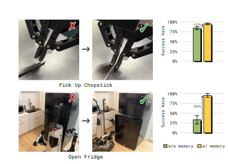
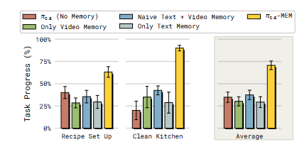
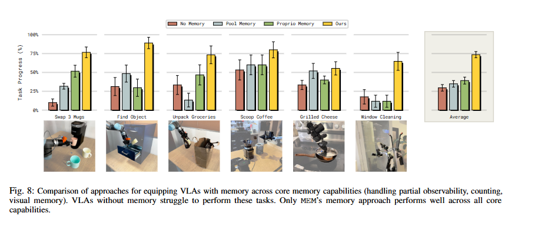
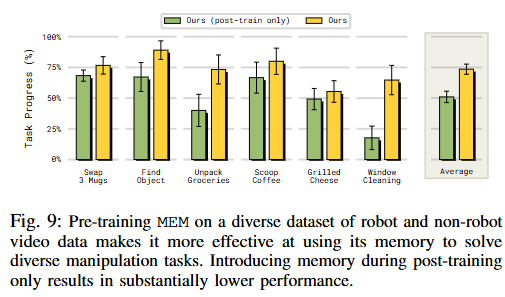
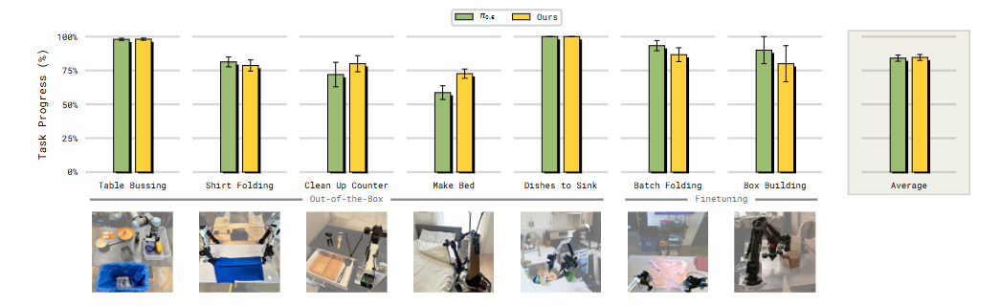

# MEM Note

## Navigation
- Paper card: [MEM card](../cards/pi-MEM.md)


## Reading Notes


观察：机器人可能需要记住最近的观察结果来应对遮挡情况，也可能需要记住在烹饪食物时已经添加过某种食材。但这些记忆本质上是不同的：前者可能只需要在短时间内存储少量图像，而后者可能需要长期记忆，但只需要少量信息。


**短期视频记忆** 

其核心解决的是机器人**物理操作的连贯性**和**实时反馈**：

- **解决遮挡问题 ：** 当机器人的机械臂或物体自身遮挡住视觉目标时，短期记忆能让模型“记住”物体的位置和状态。
- **上下文策略调整 ：** 能够识别最近的失败尝试并调整策略。例如在抓取筷子失败后，机器人能根据前几秒的记忆调整抓取高度或力度。
- **物理动态理解：** 帮助机器人理解自身运动和环境变化的细微动态，防止在精细操作（如擦拭桌面、洗盘子）中出现动作停滞。


**长期语言记忆** 

长期记忆通过自然语言摘要的形式，捕捉跨度达 15 分钟的语义信息。其核心解决的是**任务逻辑的连贯性**：

- **多阶段任务进度跟踪：** 在烹饪或整理房间等长程任务中，机器人需要记住哪些步骤已完成，哪些尚未开始。
- **处理部分可观测性：** 记住不在当前视野内的环境状态。例如，记住刚才人把东西放进了哪个抽屉，或者记住 grocery bag 里还有多少东西没拿出来。
- **状态保持：** 记住在任务结束前需要恢复的环境状态，例如在完成厨房清洁后，记得关上之前打开的所有橱柜门或冰箱门。


### Related Work

之前处理记忆的方法：

- **循环记忆模块**
   早期方法使用 recurrent memory，但扩展能力有限。
- **输入完整历史观测**
   一些 transformer 方法直接把过去的观测历史输入模型，但这种方式计算量大、延迟高，难以支持长时程任务。
- **潜变量记忆**
   有些工作使用 latent memory，但通常只在短时程任务上验证。（MemoryVLA）
- **启发式压缩记忆**
   包括只保留 proprioception、本体感知信息、2D 点轨迹、关键帧或自然语言描述等。但这些单一模态都会损失某些关键能力：
- - 本体感知、点轨迹或语言描述会丢失精确空间信息，例如抓取角度、高度；
  - 关键帧虽然节省计算，但过度稀疏会损失对环境和机器人动态的估计能力。


**MEM 与前作的关键区别**

-  记忆载体的本质不同：

  - MemoryVLA/ReMem-VLA：它们的长短期记忆本质上都是向量（Embeddings/Queries）。向量记忆的缺点是“不可解释”且容易在长时间尺度下产生漂移（Drift）或被噪声淹没。

  -  PI 的 MEM：它将长期记忆直接推到了语言空间。语言是高度压缩且具有符号性的。一句“我已经洗完了锅”比一串 1024 维的向量更能抵抗时间带来的“记忆模糊”。 

- 处理任务的时间尺度：

  - 在 MEM 之前，大多数 VLA 所谓的“长程”其实只有几分钟（如 1-3 分钟）。
     PI 的 MEM 证明了通过文本总结作为接合面，可以将记忆维持到 15 分钟以上。在这个尺度下，传统的向量循环（Recurrence）几乎必然会崩溃，而文本总结却能像人类的“备忘录”一样稳定。 

- “接合面”的显式化

  - MemoryVLA 的结合是隐式的（库检索）。 

  -  MEM 的结合是显式的（Prompt 注入）。它将记忆变成了一种“任务指令的动态补完”。


### Method


$$
\pi(a_{t:t+H}, l_{t+1}, m_{t+1}\mid o_{t-T:t}, m_t, g)
\approx
\pi_{\mathrm{LL}}(a_{t:t+H}\mid o_{t-K:t}, l_{t+1}, g)
\pi_{\mathrm{HL}}(l_{t+1}, m_{t+1}\mid o_t, m_t, g),
$$

也即$\pi_{HL}$，high-level的policy，根据goal（g），当前状态和记忆输出low-level的指令。然后$\pi_{LL}$，low-level的policy，根据goal，low-level的指令和最近的历史状态输出action chunk


从形式上来看，感觉就是在pi05 subtask规划上更进一步


因为高底层记忆是两个系统，感觉可以异步执行


#### Language Memory for Long-Term Memory

$$
\begin{aligned}m_t: \text{I placed a plate in the }& \text{ cabinet and moved to the counter.}
\\
&\Downarrow
\\
m_{t+1}: \text{I placed a plate in the cabinet,} &\text{ moved to the counter, and picked up a bowl.}

\end{aligned}
$$

训练数据的获取：用现成的LLM，输入子任务标注以及是否失败的标注然后要求总结所有与未来任务相关的信息

> we pass the subtask instructions together with an indicator whether the subtask execution failed or succeeded to an offthe-shelf pre-trained language model (LLM) and ask it to summarize all information from the previous subtasks that is still relevant for future task execution

生成的时候注意要压缩：

- 保持简洁，减少推理时间
- 减少训练-推理偏移


#### Video Encoder for Dense Short-Term Visual Memory

根据之前的研究（如RTC），推理一个action chunk的时间最好不要超过300ms，否则机器人会出现严重的滞后


引入temporal attention，每隔四层在同 patch 不同时刻进行时序注意力计算，最后取当前时刻帧


这个temporal attention直接在已经嵌入的QKV空间中做，直接加因果掩码然后计算注意力分数加权（不得不再次感叹注意力机制的强大）


伪代码

```
# conceptual only
x = patchify(video_frames)      # [B, T, N, D]

for layer_id, layer in enumerate(vit_layers):
    x = spatial_attention(x)    # per frame: [B, T, N, D]

    if layer_id % 4 == 0:
        x = temporal_attention(x)  # per patch across time
```


一般选取T=6，包括当前帧和过去5个observation。后训练时可以扩展到18帧，54s


#### Integrating MEM into the π0.6 VLA

**本体状态的处理**：使用连续状态嵌入，通过线性投影将每个本体感觉状态投影到骨干嵌入空间。这样，对于长度为 K 的观测记忆，我们仅生成 K 个本体感觉状态标记。（K是短期记忆的帧数）（之前的pi模型是把本体状态作为文本输入的！）


**预训练：**使用多种混合数据对 π0.6-MEM 进行预训练，这些数据包括远程操控机器人演示、策略部署数据和人工纠正数据以及视觉语言任务和视频语言任务（例如视频字幕）在预训练期间，我们使用六个观测序列（五个过去观测和一个当前观测）训练模型，观测间隔为一秒。在训练后阶段，我们发现可以**灵活地扩展**这一范围，并容纳更长的基于观察的记忆（在我们的实验中，最多可达 18 帧和 54 秒的基于观察的记忆）


### 实验验证

#### 长期记忆（解决复杂长时域任务的必要条件）


即使是 π$_{0.6}$ 这样先进的 VLA 模型，在缺乏记忆的情况下也无法处理具有灵活子任务序列和部分可观测性的现实任务（如清理厨房、准备食谱）。MEM 显著提升了这些任务的成功率和进度


**视频记忆的必要性：**

在擦盘子任务中机器人当前看到的图像可能很相似：

> 盘子在水槽里，海绵压在盘子上，有泡沫，有反光，有遮挡。

这个画面在以下几种情况下都可能差不多：

1. 刚开始擦，还很脏；
2. 已经擦了 5 秒，但污渍被泡沫遮住；
3. 已经擦了 20 秒，基本干净；
4. 海绵正好挡住关键区域；
5. 视觉模型因为水渍、反光、光照误判。

所以策略不能总是只问“当前看起来干不干净”。在部分可观测场景下，它还需要知道：

> 我刚刚是不是已经对这个区域连续擦过很多次？
>  我是不是已经完成了足够的覆盖？
>  我是不是正在重复同一个动作但没有新进展？

但是，短期记忆也只是让模型有建模能力，能不能获得利用短期记忆的能力还是要看训练数据


还有就是做咖啡的时候掌握加咖啡的量


整体来说可以提升操作能力，具体来说

- 防止反复失败重试
- 可以利用先前失败尝试的上下文信息（进行不同的尝试）


**记忆压缩优于朴素记忆：**

因为没有一个显式的阶段判断器，所以在实际inference的时候高层策略经常会输出同样的subtask。朴素压缩会导致记忆重复


#### 短期记忆（In-Context Adaptation of Manipulation Strategies）

测试情景：

- 在桌面高度超出分布范围的情况下拾取筷子等扁平物体（这会导致频繁的抓取错误）
- 在冰箱门开启方向不明确的情况下打开冰箱（这会导致反复尝试失败）


为了教会策略情境自适应策略，需要收集**有针对性的人类反馈**：在策略失败后，由人类进行干预，演示修正后的操作策略，例如调整抓取高度来拾取筷子




与有记忆的 MEM 与无记忆的 $\pi_{0.6}$ 在**相同的干预数据**上进行微调，对比如上，说明有建模能力才能学习到对应策略


消融实验证明各组件的有效性：




#### 对比实验



- pool memory: （pi-mem说它的压缩过于激进了）
  - **独立特征提取**：对过去的每一帧图像，利用预训练的单帧 Vision Transformer (ViT) 进行编码。
  - **平均池化压缩**：将所有过去帧产生的特征向量取平均值，聚合成一个单一的**“存储标记”（Memory Token）**。
  - **输入主干**：将这个池化后的标记与当前帧的完整特征一起输入 VLA 模型。
- proprio memory：（处理很快，但是对于依赖环境信息的任务直接完蛋）
  - **忽略历史视觉**：不处理任何过去的图像帧。
  - **记录自身状态**：仅保留机器人过去的**本体感知数据**（如关节角度、夹爪开合度、末端执行器位置等低维数据）。
  - **线性映射**：将这些低维状态通过一个简单的线性层投影到模型的嵌入空间，然后作为序列输入。




模型中仅在后训练引入记忆的版本，在利用过去时间步的信息方面明显较差。预训练中引入记忆的重要性！




MEM 不仅在需要记忆的任务中有效利用了记忆，而且在具有挑战性的灵巧操作任务中也能达到π0.6 VLA的最先进性能。这一点值得注意，因为之前的许多研究都报告称，在策略中添加内存会导致性能下降，例如由于因果混淆。


作者认为MEM的优异性能很大程度上归功于我们**多样化的预训练数据混合**，其中包含不同最优性、速度和控制频率的片段，以及各种互联网视频。这种多样性可以防止视频编码器中出现虚假相关性，而这些虚假相关性在训练较小、更均匀的机器人数据集时可能会出现，并导致先前研究中报告的带内存策略的脆弱性和性能下降。
