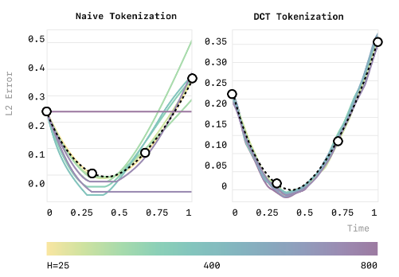
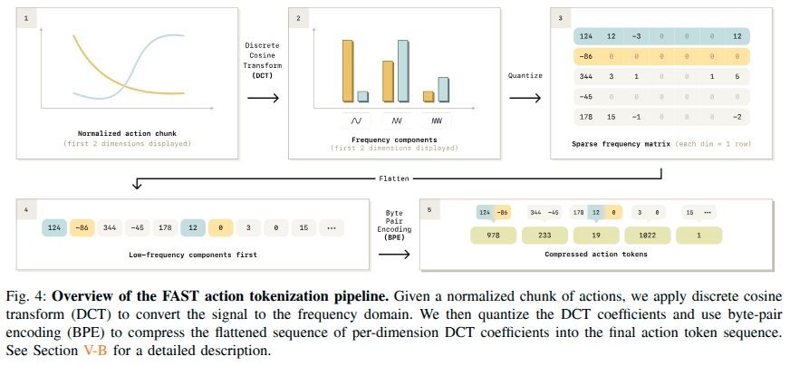
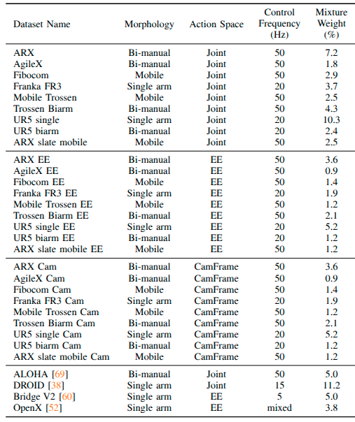

# FAST: Efficient Action Tokenization for Vision-Language-Action Models Note

## Navigation
- Paper card: [FAST: Efficient Action Tokenization for Vision-Language-Action Models card](../cards/pi-FAST.md)

## Reading Notes


用NTP训练的底层逻辑：

- 复用LLM
- 建模多峰分布


**分箱方案的缺点：**“无限复制”的陷阱

想象你在以 **50Hz**（每秒采样50次）的频率教机器人叠衣服。由于采样极快，机器人每 1/50 秒产生的位移微乎其微（比如从 $0.001$ 移动到 $0.0011$）。

- **冗余严重**：因为移动太小，连续几十个时刻的动作都会落在同一个“箱子”里。
- **模型“变懒”**：模型在训练时发现，只要简单地**重复上一个时刻的 Token** 就能获得很低的损失值。
- **后果**：模型最后学会了“复读机”模式，无法学会精细的动作逻辑，导致在叠衣服等复杂任务上完全失败。

> “直观地说，在这种情况下，只需简单地复制最近的动作 Token 即可实现较低的 Token 预测损失，从而使模型陷入较差的局部最优解。” 


**核心见解**：在训练前必须对机器人动作信号进行压缩，以降低连续词元之间的相关性


**借鉴**：BPE、DCT编码


### Case study



构建一个合成时间序列数据集，目标是预测一条穿过四个随机生成点的三次样条曲线


使用基于transformer的自回归模型在不同采样频率下拟合，发现H=800时拟合成一条直线


从本质上讲，自回归模型的训练目标是根据之前所有的标记（tokens）来预测下一个标记。因此，其学习信号的大小与给定 $T_{1:i-1}$ 条件下 $T_i$ 所包含的边际信息量成正比。关键在于，当使用简单的逐时间步标记化方案时，随着训练信号控制频率的提高，这种边际信息量会趋近于零。这会大大**减慢训练过程中的收敛速度**，并且会使拟合复杂的高频数据集变得困难。

> Fundamentally, autoregressive models are trained to predict the next token, given all previous tokens. As such, their learning signal is proportional to the marginal information content of Ti given T1:i−1. Crucially, when using the na¨ıve per-timestep tokenization scheme, this marginal information approaches zero as the control frequency of the training signal increase


### Method

FAST的处理其实是参考`连续时间序列`领域的压缩方法


文中提到，任何足够有效的压缩方法，只要应用于动作目标，都有助于提升 VLA（视觉-语言-动作）模型的训练速度




假设机器人一次预测未来 $T$ 步动作，每步动作有 $D$ 维：
$$
A = \begin{bmatrix}
a_{1,1} & \cdots & a_{1,D} \\
a_{2,1} & \cdots & a_{2,D} \\
\vdots &  & \vdots \\
a_{T,1} & \cdots & a_{T,D}
\end{bmatrix} \in \mathbb{R}^{T \times D}
$$
**归一化：**

首先针对每个动作维度做 quantile normalization：把训练集中的第 1% 和第 99% 分位数映射到 $[-1,1]$。这样关节角、末端位姿、夹爪开合等量纲不同的动作可以进入相近的数值范围，同时降低异常值的影响。
$$
\tilde a_{t,d}
=
2\frac{a_{t,d}-q_{1\%,d}}
{q_{99\%,d}-q_{1\%,d}}-1
$$
**对每个动作维度沿时间轴做 DCT**

对于第 $d$ 个动作维度：
$$
[\tilde a_{1,d},\tilde a_{2,d},\ldots,\tilde a_{T,d}]
$$
而是对整段时间序列做离散余弦变换：
$$
C_{k,d}=\operatorname{DCT}
\left(\tilde A_{:,d}\right)_k
$$
DCT类似DFT，仅用余弦作为基函数进行分解，$C_{k,d}$ 为分解得到的系数


**对 DCT 系数进行量化**

DCT 后仍然是连续浮点数，还不能直接作为 Transformer 的离散 token。

FAST 对频率系数做：
$$
Q_{k,d}=\operatorname{round}(sC_{k,d})
$$
其中 $s$ 是 scale。论文的单数据集实验通常使用，$s=10$

很多原本很小的高频系数经过缩放和取整后就变成了 0，于是得到图中第 3 步的稀疏整数矩阵。scale 越大，重建越精确，但整数序列越难压缩；scale 越小，压缩率越高，但量化误差也越大。

得到的Q矩阵有以下特点：

- 每一行对应一个动作维度；
- 每一列对应一个 DCT 频率；
- 第一列是所有动作维度的最低频成分；
- 越往右频率越高

这一步是唯一有损的压缩


**按“低频优先”展开矩阵**

逐列展开，即先输出所有维度的低频系数

顺序可以概括为：
$$
[Q_{0,1},Q_{0,2},\ldots,Q_{0,D},
Q_{1,1},\ldots,Q_{1,D},\ldots]
$$
论文称其为 **column-first / frequency-major flattening**。这样设计是因为自回归模型会按照从左到右的顺序预测 token：

1. 先预测整条轨迹的低频骨架；
2. 再预测中频修正；
3. 最后预测高频细节。

这里提到一个**低频能量聚集现象**，也就是低频能量更趋近于真实能量，而高频能量决定的是细微的震荡

> dft来源于一般的周期函数展开成fourier级数，所以对于聚集的问题可以使用一般的连续周期函数类似说明。连续周期函数展开成fourier级数，第一点fourier系数收敛到0，也就显示高频的影响逐渐消失；第二点对于（原函数 - fourier展开式前n项和）一致收敛到0，也就是说明低频占据函数主项，高频逐渐失去作用（高频决定细节，低频决定函数轮廓）；第三点对于（原函数 - fourier展开式前n项和）做L2积分，也就是能量积分，是收敛到0，更加说明低频能量趋近于真实能量，而高频能量决定细微的震荡，是可以忽视的。就以上三个证据，足矣说明低频的地位远远高于高频。 然后说dct比dft有更好的能量聚集，这句话本身就是自相矛盾的，dct来源于偶函数下的dft，两者的数学性质完全一致，二者应该是有一样好的能量聚集性，只不过dct更适用于偶函数下的dft。
>
> 源自：https://zhuanlan.zhihu.com/p/85299446


**使用 BPE 把整数序列进一步压缩**

经过量化后虽然出现大量 0，但如果把每个整数都单独作为一个 token，序列仍然比较长。

因此 FAST 在大量训练 action chunk 上训练一个 BPE tokenizer。它的作用与语言模型中的 BPE 类似：

- 统计频繁共同出现的相邻整数模式；
- 把这些模式合并成一个新的 token；
- 重复进行，直到达到指定词表大小。

BPE是没有参数的，只是需要建表，所以需要“训练”


这一步也可以用其他的无损压缩算法，比如霍夫曼编码


经过 FAST 后，训练样本从：
$$
(\text{image},\text{instruction})
\rightarrow A_{1:T}
$$
变成：
$$
(\text{image},\text{instruction})
\rightarrow
[z_1,z_2,\ldots,z_L]
$$


**与之前的VQ相比**

实验表明，这两个参数对结果的敏感度较低，因此我们在所有针对单一数据集的Tokenization实验中均采用了相同的参数值（舍入缩放比例为10，BPE词表大小为1024）。这与依赖向量量化（Vector Quantization, VQ）的端到端学习压缩模块形成了鲜明对比。此类网络通常训练繁琐，且需要针对特定数据集仔细选择超参数才能获得良好的重构效果


**使用**

可以直接从`transformers`导入使用，可以先在自己的数据集上fit再用，后者实际使用效果视自己数据集和pi-fast tokenizer训练的1M数据集的分布差异决定，可以用token的压缩率评估

```python
from transformers import AutoProcessor 
tokenizer = AutoProcessor.from_pretrained( "physical-intelligence/fast", trust_remote_code=True ) 
tokens = tokenizer(action_chunk)
```


### Experiment

#### Tokenizer 压缩率对比

| 数据集     | 动作维度 | 控制频率 | Naive Token 数 | FAST Token 数 | 压缩比 |
| :--------- | :------- | :------- | :------------- | :------------ | :----- |
| BridgeV2   | 7        | 5 Hz     | 35             | 20            | 1.75x  |
| DROID      | 7        | 15 Hz    | 105            | 29            | 3.6x   |
| Bussing    | 7        | 20 Hz    | 140            | 28            | 5.0x   |
| Shirt Fold | 14       | 50 Hz    | 700            | 53            | 13.2x  |

FAST 在高频任务上压缩效果尤其显著，且 **consistently 为每个机械臂生成约 30 个 token**（与频率无关）（shirt fold是双臂任务）

这里`naive token`指的是一个action chunk中的所有动作维度（这里以未来1s的action chunk为预测目标），所以数量 = action_dim * f


#### 不同 Tokenization 方法的政策性能对比

**关键发现**：

- **Naive tokenization** 在高频任务（Table Bussing 20Hz、T-Shirt Folding 50Hz）上完全无法学习有效策略
- **压缩-based 方法**（FAST、FSQ）显著优于 naive 方法（FSQ就是上面提到的VQ，学习式tokenization）
- **FAST** 在灵巧高频任务上表现优于 FSQ，且无需额外神经网络训练
- **FAST+**（通用 tokenizer）性能与数据集特定的 FAST tokenizer 相当（泛化性能好）


#### DROID 数据集上的zero-shot 泛化

FAST 首次实现了在 DROID 数据集上训练出可在**未见环境中zero-shot 评估**的通用策略：

- 在三所大学校园的不同环境中测试
- 可执行抓取放置、开关柜门、开水龙头等任务
- 即使失败的试验也显示出合理的行为


#### 消融实验

**骨干网络独立性**：

- 将 FAST+ 应用于 OpenVLA，在 T-shirt folding 任务上显著提升性能
- 证明 FAST 可广泛应用于各种预训练 autoregressive transformer 模型

**BPE 压缩步骤的重要性**：

- 移除 BPE 后性能下降（但仍优于 naive tokenization）
- 无 BPE 时存在大量重复的 0-token，稀释学习信号并显著减慢推理速度


#### FAST vs 扩散模型（π₀）

| 方面             | FAST-based VLA                             | 扩散 π₀      |
| :--------------- | :----------------------------------------- | :----------- |
| 小数据集（<50h） | 性能相当                                   | 性能相当     |
| 大数据集         | **收敛快 3x**                              | 较慢         |
| 语言指令遵循     | **更好**（DROID 评估中扩散模型常忽略指令） | 较差         |
| 训练效率         | **5x 更少 GPU 小时**                       | 基准         |
| 推理速度         | ~750ms/chunk                               | ~100ms/chunk |


#### 大规模跨具身训练

在 10k 小时机器人数据上训练 **π₀-FAST** 通用策略：

- 在最具挑战性的 laundry folding 任务上匹配扩散 π₀ 的性能
- **训练速度提升 5x**
- 首次使 autoregressive VLA 能在复杂灵巧任务上与扩散 VLA 竞争


### DISCUSSION AND FUTURE WORK

未来研究主要包括三个方向：

1. **扩展动作分词器的适用范围**
    在移动机器人、灵巧手和人形机器人等不同形态上验证 FAST+ 的实际控制性能，并探索其他动作压缩与编码方案。
2. **研究更优的 VLA 架构**
    系统比较自回归解码和扩散解码在训练速度、语言理解能力及动作表达能力方面的优劣，也可研究压缩动作编码与非自回归解码的结合。
3. **提升推理速度**
    π0-FAST 的推理速度目前慢于扩散模型，可能限制其在高动态任务中的应用。未来可借鉴大型语言模型的推理加速技术，优化自回归 VLA 的实时控制能力。

总体而言，FAST 为构建通用、高效的机器人动作分词器提供了重要基础，但在跨机器人形态泛化、模型架构选择和实时推理方面仍需进一步研究。


### Appendix

#### Data Mixture for Training Universal Tokenizer



选用的都是1s时长的action chunk，既有EE又有关节角

1. 各数据源先按自身统计量，对每个动作维度做 quantile normalization；
2. 不同维度的动作统一 padding 到 **32 维**；
3. 对每个动作维度沿时间轴独立做 DCT；
4. 将量化后的 DCT 系数展平；
5. 用一个共享 BPE 词表压缩这些系数序列。

在第五步不同源数据混在


