# PI0.5 Note

## Navigation
- Paper card: [PI0.5 card](../cards/pi05.md)

## 配置环境

```bash
git clone --depth 1 --recurse-submodules --shallow-submodules https://github.com/Physical-Intelligence/openpi.git

cd openpi
```


uv清华源：

`export UV_DEFAULT_INDEX="https://pypi.tuna.tsinghua.edu.cn/simple/"`


安装依赖：

```bash
GIT_LFS_SKIP_SMUDGE=1 uv sync
GIT_LFS_SKIP_SMUDGE=1 uv pip install -e .
```


**AutoDL学术加速**：

`source /etc/network_turbo`


**在LIBERO中安装了libero但是在其他环境找不到：**

路径问题，在LIBERO仓库内：`echo "$PWD" > "$(python -c "import sysconfig; print(sysconfig.get_path('purelib'))")/libero_custom.pth"`


`ModuleNotFoundError: No module named 'robosuite.environments.manipulation.single_arm_env'`: robosuite版本过高——`pip install "robosuite==1.4.1"`


**PyAV编译失败：**LeRobot需要`av==14.4`，这个又对ffmpeg版本有要求，不能太新也不能太旧，`conda install ffmpeg=7.1.1 -c conda-forge`


**HuggingFace镜像：**`export HF_ENDPOINT=https://hf-mirror.com`


## Inference

**占用显存：**约19G


**Eval逻辑：**（一个任务50次，需要6分钟左右）

1. 遍历不同的task_id，用task_suite读取初始状态参数

2. 预热，在执行动作前，代码设置了一个 args.num_steps_wait 的等待阶段（给环境物理引擎一点时间进行重置或让物体在初始位置趋于稳定，避免起始帧不稳定的动力学干扰）

3. 观测数据预处理:

   1. ```python
      element = {
          "observation/image": img,
          "observation/wrist_image": wrist_img,
          "observation/state": np.concatenate(
              (
                  obs["robot0_eef_pos"],
                  _quat2axisangle(obs["robot0_eef_quat"]),
                  obs["robot0_gripper_qpos"],
              )
          ),
          "prompt": str(task_description),
      }
      ```

      全局图像+腕部/第一人称图像+末端执行器位姿和状态变量（如夹爪开合度）
      **Policy只需要给出高层动作，如夹爪应该向前2cm并夹紧，而具体机械臂如何移动就交给底层控制即可**

4. **推理与重规划策略 (Action Chunking & Replan)**：

   1. 如果 action_plan （队列）为空，说明需要请求模型生成一段动作序列 (action_chunk)（如果不为空就不生成）
   2. 构造包含图像、机器人末端执行器（EEF）状态、夹爪状态及任务描述（Prompt）的 element 字典。
   3. 调用 policy.infer(element) 获取预测的动作块。
   4. 将动作块填入队列（只截取前`args.replan_steps`步）

5. 从 action_plan 中逐个弹出动作 (popleft) 并执行 env.step(action)。如果环境返回 done=True，则视为一次成功执行，并立即跳出当前循环，更新成功计数器


## 源码分析

**结构：**主体结构（`Policy`）由预处理+model+后处理组成，这种封装把预处理参数和model一起保存，用起来方便


### PI0_Pytorch

图像 + 文本 -> prefix

时间步 + $x_t$ + （state，pi0.5忽略） -> suffix + adarms_cond

prefix + suffix + mask + adarms_cond -> action chunk


在推理过程中，时间步和$x_t$在生成动作块的过程会不断变化，而图像和文本是暂时固定的，所以prefix可以复用


#### 基本功能函数


**模型加载逻辑**

```python
logging.info(f"Downloading/Loading checkpoint from: {args.checkpoint_dir}")
ckpt_path = download.maybe_download(args.checkpoint_dir)

logging.info(f"Initializing local policy config: {args.config_name}")
config = _config.get_config(args.config_name)

# 创建训练好的本地策略模型
policy = policy_config.create_trained_policy(config, ckpt_path)
logging.info("Local policy successfully loaded!")
```

`maybe_download`: 如果输入是本地路径则直接返回，如果是云端路径就返回本地cache路径

`get_config`: 这个返回的是`src/openpi/training/config.py`的`_CONFIGS_DICT`中的内容

`create_trained_policy`: 先检查`ckpt_path`下有没有safetensors，有就是pytorch model，没有的话就在`ckpt_path/params`下加载jax参数。函数不涉及对GPU的选择，只检查能不能用，可以用`CUDA_VISIBLE_DEVICES=1 python xxx.py`来选择用哪些gpu


**self.embed_prefix**

- images -> `self.paligemma_with_expert.embed_image`
- language tokens -> `self.paligemma_with_expert.embed_language_tokens` 


**self.embed_suffix**

- noisy_actions -> `self.action_in_proj`(`nn.Linear`)
- timestep -> `create_sinusoidal_pos_embedding`（正余弦位置编码）-> mlp 得到 adarms_cond


**self._prepare_attention_masks_4d**


**self.sample_time**

```python
def sample_time(self, bsize, device):
    time_beta = sample_beta(1.5, 1.0, bsize, device)
    time = time_beta * 0.999 + 0.001
    return time.to(dtype=torch.float32, device=device)

```

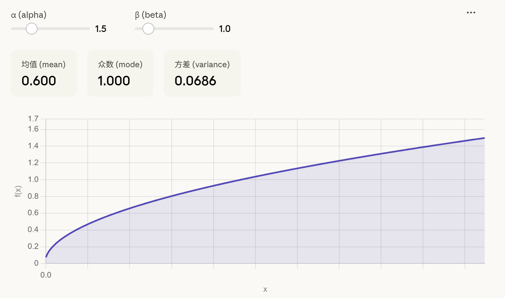

beta分布范围是[0,1]，用这个分布是因为t->0的时候接近于目标，训练梯度小，浪费算力

`time_beta`到`time`是数值稳定trick


**self.sample_noise**

$x_0 \sim \mathcal{N}(0,1)$


#### Forward

训练用


1. 输入预处理
2. 构建flow matching目标
   1. 采样随机噪声$x_0$和时间步$t$
   2. 获得带噪动作$x_t =t\times x_0+(1-t)\times action$
   3. 计算模型需要预测的真实目标值 $u_t = noise - actions$
3. 编码prefix: 将图像（通过 SigLIP）和语言指令编码为特征向量
4. 编码suffix：将机器人状态、带噪动作 x_t 和时间步 time 编码为特征向量。（如果在 pi05 配置下，还会生成自适应 RMSNorm 的条件变量 adarms_cond）
5. 注意力掩码构建与模型推理：
   1. 将前缀和后缀的特征、Padding 掩码、注意力掩码拼接在一起，保证：
      - prefix看不到suffix
      - suffix可以看到prefix
      - suffix内部因果掩码
   2. 生成 2D/4D 的**因果注意力掩码（保证动作不会看到未来的动作）**
   3. 送入核心的 Transformer 模型 (paligemma_with_expert.forward) 进行前向传播
6. **动作映射与计算损失**
   1. 截取模型输出中对应动作的部分（最后 action_horizon 个 token）
   2. 通过线性层 (action_out_proj) 映射回动作的原始维度，得到预测值 v_t
   3. 计算预测值 v_t 与真实目标 u_t 之间的 MSE Loss


#### Sample_actions

推理用


1. 采样高斯噪声
2. 编码prefix
3. 预计算KV cache（prefix的序列长度是image的patches数量和指令的token数），让gemma_expert关注prefix信息
   **注意：这里的KV cache是paligemma全部18层的，后续计算suffix的时候要把这些kv cache对应放到gemma_expert的层**
4. 迭代去噪：这个过程的KV 是suffix的KV和perfix的KV concat


### Gemma_Pytorch

#### Init

实例化并配置两个底层模型：PaliGemma（作为主 VLM）和 Gemma（作为 Expert 专家模型）。专家模型没有自己的 Embedding 层，它完全依赖外部传入的 embedding，节省了显存


PaliGemma的视觉用的SigLIP，Gemma-expert因为少了embeding（参数量为V*hidden，约为0.5B）和SigLIP(约0.4B)，参数量少很多


PaliGemma中视觉输入先经过SigLIP的视觉塔（Vit结构，27层）然后通过投影层映射到Gemma的hidden dim，之后与语言的token embedding拼接再经过Gemma语言模型（18层）


#### 精度控制

**to_bfloat16_for_selected_params**

管理模型的数值精度，以在节省显存/加速计算与保持训练稳定性之间取得平衡


#### 模态嵌入函数

embed_image, embed_language_tokens：分别调用 PaliGemma 的视觉塔提取图像特征，以及调用其文本嵌入层提取文本特征


#### Forward


**suffix==None**

- 直接调用 self.paligemma.language_model.forward。
- **输出**：返回前缀的隐藏状态和 KV Cache（prefix_past_key_values），后缀输出为 None。


**prefix==None**

- 直接调用 self.gemma_expert.model.forward。
- **输出**：返回后缀的隐藏状态，前缀输出为 None。


**均不为None**

1. 使用checkpoint技术分别加载每层参数进行计算
2. 步骤 A: 输入与标准化 
   - 分别对 PaliGemma 和 Gemma Expert 的当前层输入进行 LayerNorm。如果启用了 adarms，则注入条件向量（adarms_cond）
   - **注：flow matching中suffix必须包括noisy action和时间步信息，pi0.5的设计将时间步信息生成门控信息，用来控制gemma-expert和paligemma前馈时正则层的缩放**
3. 步骤 B: 独立投影 Q, K, V 
   - 两个模型各自使用自己的 q_proj, k_proj, v_proj 权重，将隐藏状态投影为 Query, Key, Value 向量。
4. 步骤 C: 序列拼接 (Concatenation) 
   - `query_states = torch.cat(query_states, dim=2)`
   - 将两个模型的 Q, K, V 在**序列长度维度**上拼接在一起。此时，前缀和后缀被视为一个连贯的长序列
   - 这一步是**跨模态融合**
5. 步骤 D: 旋转位置编码 
   - 对拼接后的全局 Q, K 向量统一应用 RoPE，确保全局的相对位置关系。
6. 步骤 E: 全局注意力计算
   - 使用 modeling_gemma.eager_attention_forward 计算注意力。由于 Q, K, V 是拼接的，mask用的先前构造的因果注意力掩码
7. 步骤 F: 输出切分与投影
   - 将全局注意力输出 (att_output) 按照原来的序列长度重新切分为两半（start_pos:end_pos）
   - 两部分分别通过各自模型的输出投影层 (o_proj)
8. 步骤 G: 独立的前馈网络与残差连接
   - 两部分分别应用各自的第一层门控残差 (_gated_residual)
   - 两部分分别经过各自的 Post-Attention LayerNorm
   - 两部分分别通过各自的 MLP 层
   - 两部分分别应用各自的第二层门控残差


## 论文细节


### 关于subtask的实现

> At runtime, during each step of inference, the model first predicts the semantic subtask, inferring the behavior that is appropriate to perform next based on the task structure and the semantics of the scene, and then predicts the low-level robot action chunk based on this subtask.

但是后面还说了

> the high-level inference process still runs at a lower frequency than low-level action inference

所以合理推测subtask会持续一段时间再重新预测


比较pi05的subtask和embodied CoT:

> Our method uses the same exact model for both high-level and low-level inference, in a recipe that more closely resembles chain-of-thought [82] or test-time compute [39] methods, though unlike embodied chain-of-thought methods [88, 46, 61], the high-level inference process still runs at a lower frequency than low-level action inference

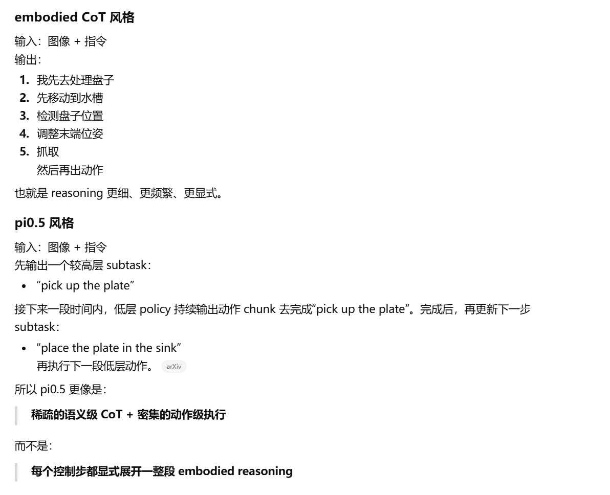


### 关于训练

注意 pytorch 训练脚本是没有 free module 而 jax 训练脚本有，但是 free module 默认是空。根据 OpenVLA 的结果，ViT 不应该被冻结，应该一起训

> 在预训练 (pre-training) 阶段，π0.5 使用压缩式的动作分词器 (FAST action tokenizer) 将动作表示为离散的 token。
>
> 在后训练/推理阶段，π0.5 建立在 π0 模型设计的基础上，使用Flow Matching来表示动作分布，从而实现高效的实时推理和对细粒度连续动作序列的表示能力。


**预训练数据**：

- 多样化移动机械臂数据 (Diverse Mobile Manipulator data, MM)：大约 400 小时的数据，来源于移动机械臂在约 100 个不同的家庭环境中执行家务任务的记录。这些数据与模型评估中清洁和整理新家环境的任务直接相关。
- 多样化多环境非移动机器人数据 (Diverse Multi-Environment non-mobile robot data, ME)：收集了单臂或双臂非移动机器人在各种家庭环境中的数据。由于这些机器人更轻、更易于运输，因此能在更广泛的家庭环境中收集到更多样的数据集。这些数据来自与移动机器人不同的实体。
- 跨实体实验室数据 (Cross-Embodiment laboratory data, CE)：包含在实验室环境中，使用多种机器人类型（包括单臂、双臂以及固定和移动基座）和简单桌面环境收集的广泛任务数据（例如，收拾餐具、折叠衬衫）。其中一些任务与模型评估高度相关，而另一些则不相关（例如，研磨咖啡豆）。该数据集还包括开源的 OXE 数据集，它是 π0 模型所用数据集的扩展版本。
- 高层子任务预测数据 (High-Level subtask prediction, HL)：通过手动标注 MM、ME 和 CE 数据中的语义子任务描述，训练 π0.5 联合预测子任务标签（文本形式）和动作（以子任务标签为条件）。这使得模型能够同时充当高层策略（输出子任务）和低层策略（执行动作）。此外，还会标注并预测当前观察中相关的边界框。
- 多模态网络数据 (Multi-modal Web Data, WD)：包含图像标注（CapsFusion、COCO）、问答（Cambrian-7M、PixMo、VQAv2）以及物体定位任务。这些数据集通过添加室内场景和带有边界框标注的家用物品的网络数据进行了扩展。


在预训练的时候为什么要让PaliGemma预测action token？是为了学习：

- 图像里哪些视觉线索和机器人动作有关
- 语言指令、场景语义、机器人状态和动作之间怎么对应
- 不同 embodiment、不同环境下，什么 observation 会对应什么控制行为


**后训练**

> 在经过离散 token 预训练 28 万个梯度步之后，模型进入后训练 (post-training) 阶段，此阶段额外进行 8 万个梯度步的训练。用于将模型专门化 (specialize) 到移动操作在家居环境中的应用场景。

模型会**联合训练**以进行 next-token prediction ，从而**保留文本预测能力**。同时，**流匹配损失**也应用于动作专家（在后训练开始时，动作专家权重被随机初始化）

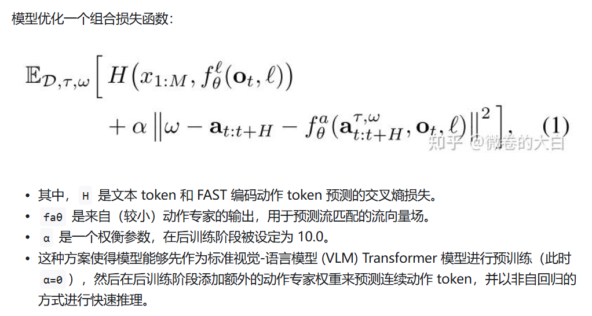


## 微调

单卡调完发现多卡训练总是跑不起来，用`compute-sanitizer`和`CUDA_LAUNCH_BLOCKING=1` debug发现是NCCL版本不匹配，升级之后可以正常跑


CUDA_VISIBLE_DEVICES=0,1,2,3 JAX_PLATFORMS=cpu torchrun --standalone --nnodes=1 --nproc_per_node=4 scripts/train_pytorch.py pi05_libero --exp_name finetune_libero


### LoRA

训练：$W\rightarrow W+\Delta W$

用低秩矩阵$AB$近似$\Delta W$, $A\in \R^{N\times r}$, $r << N$


**训练流程**

1. **初始化阶段**

   - 冻结底座模型：
     - 加载预训练模型（如 LLaMA、Qwen 等）。
     - 将其所有原有参数 $W_0$ 的梯度计算关闭（`requires_grad = False`）。

   - 注入 LoRA 模块：在目标网络层（通常是 Transformer 的 Attention 层中的 Query 和 Value 投影层，有时也包括 MLP 层）旁路添加 $A$ 和 $B$ 两个线性层。

   - 参数初始化：

     - 矩阵 $A$：使用 **随机高斯分布（Gaussian noise）** 初始化。
     - 矩阵 $B$：使用 **全零（Zero）** 初始化。

     - 目的：
       - 保证在训练开始的第 0 步，$\Delta W = B \times A = 0$。
       - 这样模型最初始的输出和原预训练模型完全一致，防止训练初期产生剧烈的震荡。

2. **前向传播阶段**
   1. 当输入数据 $x$ 进入带有 LoRA 的层时，数据会分成两路：
      - 主干路：通过冻结的原权重计算，得到 $W_0 x$*。注：这部分为了节省显存，通常会用半精度 fp16/bf16 甚至 int8/int4 量化计算，即 QLoRA。*
      - LoRA 支路：通过低秩矩阵计算，得到 $BAx$
   2. 合并输出：将两路的输出相加，并乘以一个缩放系数（Scaling Factor）： $$h = W_0 x + \frac{\alpha}{r} (BAx)$$(注：$\alpha$ 是一个常数超参数，用于控制 LoRA 对原模型影响的权重比；$r$ 为秩)*

3. **反向传播阶段** 

- 梯度流向：反向传播时，梯度只会流向矩阵 $A$ 和 $B$
- 显存优势: 不需要保存 $W_0$ 的优化器状态（如 Adam 的动量和方差）

4. **参数更新阶段** 


**AdaLoRA：**动态调整r


### compute_norm_stats

为什么要单独执行？

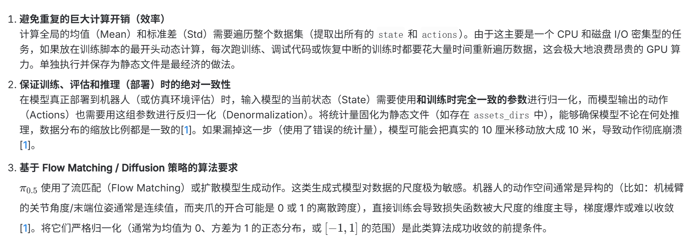

LIBERO 官方一共包含 130 个操作任务。它被划分为几个子集：LIBERO-Spatial（10个任务）、LIBERO-Object（10个任务）、LIBERO-Goal（10个任务）和 LIBERO-100（包含90个预训练任务和10个测试任务）。 每个任务包含 50 条高质量的人类遥操示范。总计：130 × 50 = 6,500 条轨迹


在训练之前需要`uv run scripts/compute_norm_stats.py --config-name pi05_libero `对数据进行正则化预处理：

1. 


### 测试pi05_base

1. 下载`pi05_base`权重：`gs://openpi-assets/checkpoints/pi05_base`
2. 在libero上做inference需要知道libero数据集的正则化参数（均值和方差），这些在`pi05_libero/assets/physical-intelligence/libero/norm_stat.json`里面，把这个文件夹copy到pi05_base的`assets`下面就可以跑了
3. config选择`pi05_libero`，因为这个config不涉及模型结构，只影响训练参数还有`action_horizon`


CUDA_VISIBLE_DEVICES=0 python scripts/train_pytorch.py pi05_libero --exp_name finetune_libero

CUDA_VISIBLE_DEVICES=0,1,2,3 JAX_PLATFORMS=cpu CUDA_LAUNCH_BLOCKING=1 NCCL_P2P_DISABLE=1 NCCL_IB_DISABLE=1 NCCL_SHM_DISABLE=1 torchrun --standalone --nnodes=1 --nproc_per_node=4 scripts/train_pytorch.py pi05_libero --exp_name finetune_libero


CUDA_VISIBLE_DEVICES=0,1,2,3 JAX_PLATFORMS=cpu NCCL_ALGO=Ring  NCCL_P2P_DISABLE=1 NCCL_SHM_DISABLE=1 torchrun --standalone --nnodes=1 --nproc_per_node=4 scripts/train_pytorch.py pi05_libero --exp_name finetune_libero


CUDA_VISIBLE_DEVICES=0,1 JAX_PLATFORMS=cpu CUDA_LAUNCH_BLOCKING=1  NCCL_SHM_DISABLE=1 torchrun --standalone --nnodes=1 --nproc_per_node=2 scripts/train_pytorch.py pi05_libero --exp_name finetune_libero


### 微调流水线


1. 初始化：是否ddp（多卡分布式训练）、wandb初始化
2. build_datasets
3. 构建模型，加载参数，选择优化器AdamW
4. 训练循环
   1. 
5. 


### 细节

NVIDIA Pro 6000 跑 pi0_base, 显存占用约8GB，约30s跑完一个task的50 episodes

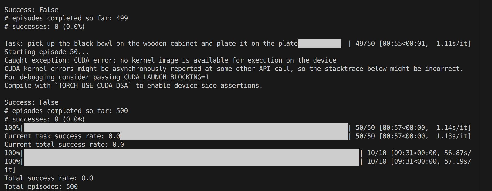

4卡全量训练30k需要150h


**Eval: **`CUDA_VISIBLE_DEVICES=6 bash eval.sh /jumbo/graphmind/yinghao/openpi/checkpoints/pi05_libero/finetune_libero /jumbo/graphmind/yinghao/eval_pi/eval_summary.log`


## Serving

```mermaid
flowchart TD
    %% =========================
    %% 入口与配置
    %% =========================

    A["Flask 请求入口<br/>
    src/openpi/serving/flask_server_g1_with_hands.py:163"] --> B["llm_robot.policy.infer&#40;data, ...&#41;"]

    C["训练配置<br/>
    src/openpi/training/config.py:3412"] --> C1["Pi0Config<br/>
    pi05 = True<br/>
    use_G1_dataset = True<br/>
    claws_separation = True<br/>
    action_dim = 102<br/>
    hand_action_dim = 12<br/>
    state_horizon = 5"]

    %% =========================
    %% Policy 加载
    %% =========================

    subgraph LOAD["Policy 与模型加载"]
        L1["create_trained_policy&#40;&#41;<br/>
        src/openpi/policies/policy_config.py:16"] --> L2{"checkpoint 中存在<br/>model.safetensors？"}

        L2 -- "是" --> L3["train_config.model.load_pytorch&#40;&#41;<br/>
        src/openpi/policies/policy_config.py:48"]

        L3 --> L4["创建 PI0Pytorch&#40;config&#41;<br/>
        src/openpi/models/model.py:248"]

        L4 --> L5["safetensors.torch.load_model&#40;<br/>
        model, weight_path&#41;"]

        L5 --> L6["构造 Policy<br/>
        sample_actions = PI0Pytorch.sample_actions"]
    end

    C --> L1
    L6 --> B

    %% =========================
    %% 输入预处理
    %% =========================

    subgraph INPUT["输入预处理"]
        I1["原始输入 data"] --> I2["G1WithHandsInputs<br/>
        src/openpi/policies/g1_policy.py:78"]

        I2 --> I3["图像字段映射<br/>
        front_head → base_0_rgb<br/>
        left_hand → left_wrist_0_rgb<br/>
        right_hand → right_wrist_0_rgb"]

        I2 --> I4["状态字段处理<br/>
        arm state：35 维<br/>
        hand state：12 维<br/>
        history：5 帧"]

        I2 --> I5["prompt 语言输入"]

        I3 --> I6["图像缩放至 224 × 224"]
        I4 --> I7["state 编码 / token 化"]
        I5 --> I8["prompt token 化"]

        I6 --> I9["input transforms 输出"]
        I7 --> I9
        I8 --> I9
    end

    A --> I1
    I9 --> B

    %% =========================
    %% Policy.infer
    %% =========================

    subgraph POLICY["Policy.infer 外层逻辑"]
        P1["Policy.infer&#40;&#41;<br/>
        src/openpi/policies/policy.py:87"] --> P2["执行 input transforms"]

        P2 --> P3["添加 batch 维度"]
        P3 --> P4["转换为 CUDA Tensor"]
        P4 --> P5["准备上一轮动作<br/>frozen_action_num<br/>freeze_source_end"]

        P5 --> P6["self._sample_actions&#40;...&#41;<br/>
        src/openpi/policies/policy.py:145"]

        P6 --> P7["实际调用<br/>
        PI0Pytorch.sample_actions&#40;&#41;"]
    end

    B --> P1

    %% =========================
    %% sample_actions 路径分流
    %% =========================

    subgraph ROUTE["sample_actions 推理路径分流"]
        R1["PI0Pytorch.sample_actions&#40;&#41;<br/>
        src/openpi/models_pytorch/pi0_pytorch.py:943"] --> R2{"use_G1_dataset<br/>且<br/>claws_separation？"}

        R2 -- "True && True" --> R3["sample_g1_actions_with_hands&#40;&#41;<br/>
        src/openpi/models_pytorch/pi0_pytorch.py:1112"]

        R2 -- "否则" --> R4["普通 sample_actions 推理路径<br/>当前配置不会进入"]
    end

    P7 --> R1
    C1 -. "决定分流条件" .-> R2

    %% =========================
    %% G1 双 expert 推理
    %% =========================

    subgraph G1["G1 手臂与手部分离推理"]
        G1A["生成初始噪声"] --> G1B["arm_noise<br/>形状：[B, 50, 102]"]
        G1A --> G1C["hand_noise<br/>形状：[B, 50, 12]"]

        G1B --> G2["处理 image、language token、state"]
        G1C --> G2

        G2 --> G3["embed_prefix&#40;&#41;"]
        G3 --> G4["PaliGemma 编码<br/>三路图像 + 语言"]
        G4 --> G5["构造 suffix 输入<br/>state + action noise + time"]

        G5 --> G6["根据上一轮动作<br/>构造冻结区域"]
        G6 --> G7["初始化<br/>arm_x_t = arm_noise<br/>hand_x_t = hand_noise"]

        G7 --> LOOP
    end

    R3 --> G1A

    %% =========================
    %% 去噪循环
    %% =========================

    subgraph LOOP["10 步 Flow-Matching 去噪循环"]
        D1["for step_i in range&#40;num_steps&#41;<br/>
        src/openpi/models_pytorch/pi0_pytorch.py:1224"] --> D2["计算当前时间 t 与步长 dt"]

        D2 --> D3["denoise_step_with_g1_actions_with_hands&#40;&#41;<br/>
        src/openpi/models_pytorch/pi0_pytorch.py:1399"]

        D3 --> D4["Arm Expert<br/>预测 arm_v_t<br/>[B, 50, 102]"]

        D3 --> D5["Hand Expert<br/>预测 hand_v_t<br/>[B, 50, 12]"]

        D4 --> D6["应用冻结区域约束"]
        D5 --> D6

        D6 --> D7["arm_x_t = arm_x_t + dt × arm_v_t"]
        D6 --> D8["hand_x_t = hand_x_t + dt × hand_v_t"]

        D7 --> D9{"完成 10 步？"}
        D8 --> D9

        D9 -- "否" --> D1
        D9 -- "是" --> D10["得到去噪后的<br/>arm actions 与 hand actions"]
    end

    %% =========================
    %% 输出处理
    %% =========================

    subgraph OUTPUT["输出拼接、拆分与返回"]
        O1["拼接动作<br/>
        concat&#40;arm_x_t, hand_x_t, dim=-1&#41;"] --> O2["模型原始输出<br/>[B, 50, 114]"]

        O2 --> O3["返回 Policy.infer"]
        O3 --> O4["output transforms"]

        O4 --> O5["拆分动作<br/>
        src/openpi/transforms.py:1322"]

        O5 --> O6["arm_actions = actions[..., :102]<br/>形状：[B, 50, 102]"]

        O5 --> O7["hand_actions = actions[..., 102:114]<br/>形状：[B, 50, 12]"]

        O6 --> O8["移除 batch 维度"]
        O7 --> O8

        O8 --> O9["Flask 获得结果<br/>
        result['actions']：(50, 102)<br/>
        result['hand_actions']：(50, 12)"]
    end

    D10 --> O1
```

 目前 openpi 的手是单独 DiT 控制的，GR00T 中是用 MLP 做的，因为当初只讨论说要和控制身体的权重分开但是并没有统一架构 [2026/7/28]


## 其他

### **模型精度**：

对于计算密集型的算子（如 Linear、Conv 矩阵乘法），bfloat16 的精度完全够用，因为神经网络对权重的微小扰动有天然的鲁棒性；但对数值极其敏感的“统筹性算子”（归一化层、softmax、旋转位置编码等），必须用 float32


bf16相比于float16牺牲了精度但是得到了和float32一样的表示范围，解决了上溢和下溢问题：
$$
x=(-1)^{sign}\times 1.{mantisia}\times 2^{exponent}
$$
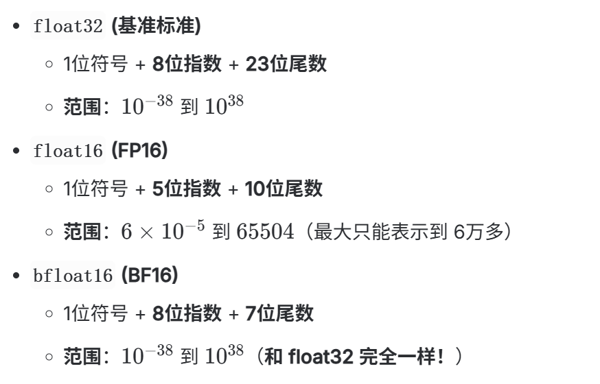


### **关于AR和flow matching输出动作的对比**

AR的前提是动作离散化（分chunk，会损失一些精度），然后一个一个生成动作token，最终得到动作序列

flow match是一次性生成动作序列，采样的噪声和生成的动作序列形状一致


### **关于RoPE**

RoPE 的位置与传统的“加在输入 Embedding 之后”不同。它是在 Transformer 的每一层内部、自注意力机制计算点积之前应用的

https://zhuanlan.zhihu.com/p/647109286


### **Pi0和Pi0.5的区别**

- 对于时间信息的注入：
  - Pi0: 将时间步经过正弦位置编码后，直接与加噪的动作特征在特征维度上拼接（torch.cat([action_emb, time_emb], dim=2)），然后通过一个两层的 MLP (action_time_mlp_in/out) 融合
  - Pi0.5: 引入AdaRMS
- 对于状态信息的处理：
  - Pi0: 将state信息经过nn.Linear映射后拼接
  - Pi0.5: 将状态离散化然后作为文本输入到 VLM 中，action expert 不再接受


**选择环境：**`CUDA_VISIBLE_DEVICES=7 python eval_libero.py`


### **关于显存占用**

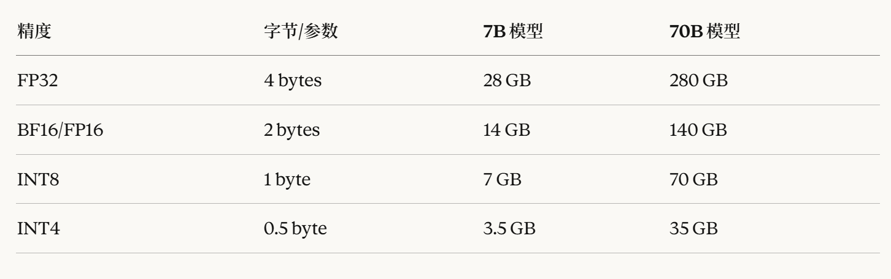

**inference**：

- 模型权重：参数量*P（精度）

- KV cache：

  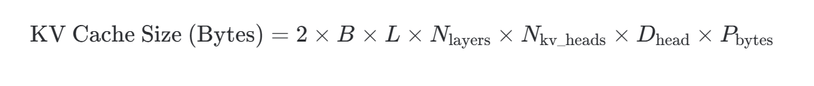

- 中间激活值：

  - 推理时不需要保存完整的激活树，但当前层正在进行计算时的输入、输出以及一些临时张量（如 Attention Matrix Q×K^T）依然需要占用显存。在大 Batch Size 或超长 Context（Prefill 阶段）时，这一块的显存峰值（Peak Memory）不容忽视。

- CUDA Context 与框架开销：PyTorch 自身运行、CUDA 环境初始化、cuDNN 的 Workspace 等，通常会占用 500MB 到 1GB 左右的基础显存。


注：`checkpoint`技术是舍弃训练过程的中间激活值，减少训练时激活值显存占用的。这些激活值是用来算梯度的，所以inference的时候不需要这个技术，直接舍弃中间激活值就可以了。模型权重没特殊说明一般都是全部加载到显存中。


**train：**

- 模型权重：参数量*P（精度）

- **优化器状态**（大头）：

  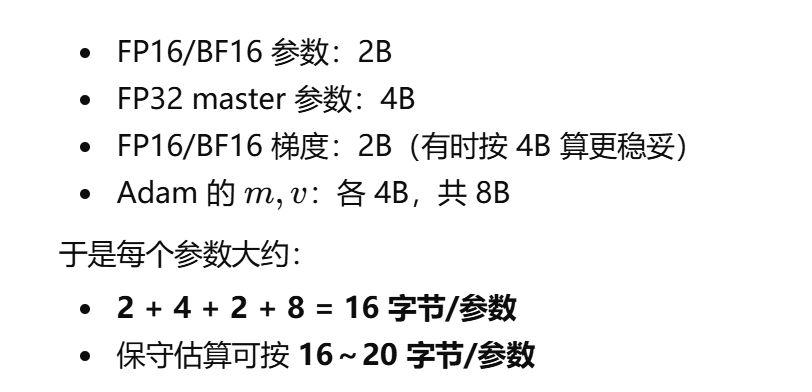

  BF16参数用于前向和后向计算梯度，master用于梯度更新，避免下溢（更新幅度太小BF16接收不到）；m，v分别是参数的一阶动量和二阶动量

- 激活值

  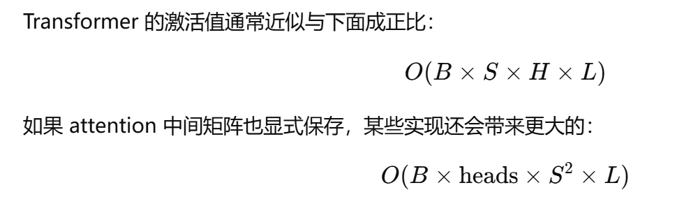

- temporary buffers：

  - CUDA kernel workspace
  - all-reduce / reduce-scatter buffer
  - layernorm / matmul 临时空间
  - 显存碎片


### **关于分布式训练**

记模型参数量为$\psi$，节点数为$N$


#### Data Parallel

1. 把batch分成多份给多个GPU前向传播并计算梯度
2. 汇总梯度信息到GPU0，并计算平均梯度
3. GPU0更新参数并将模型参数广播到其他GPU

对于GPU0,传入$(N-1)\psi$,传出$(N-1)\psi$，对于其他GPU，传入传出都是$\psi$


#### Distributed Data Parallel

**Ring All-Reduce**

DDP默认的通信方式

通信量：

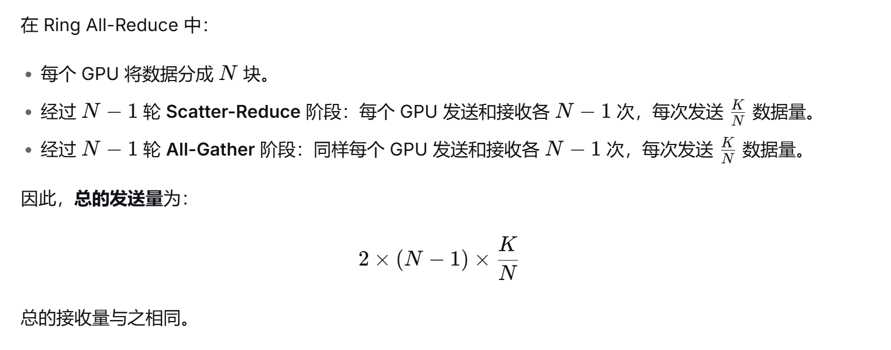

scatter reduce是指每个GPU都有N块中一块的均值，all gather是指把每个GPU中的均值互相广播直到每个GPU都有所有数据的均值

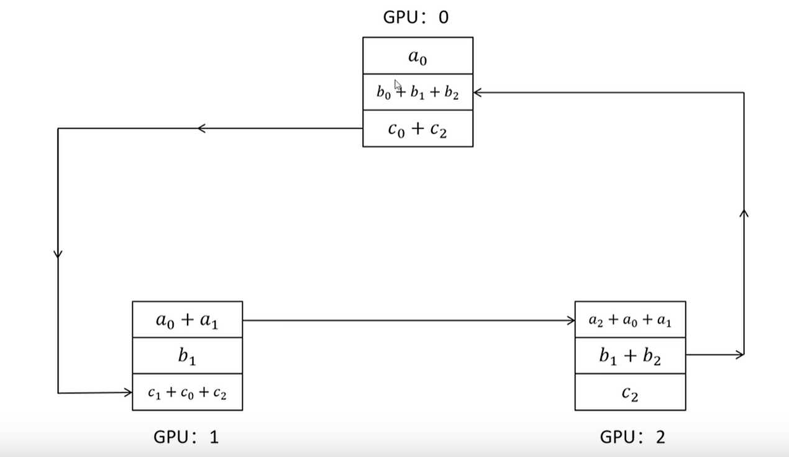

实际应用时一般是分桶的通信：将网络参数倒排（输出层放最上面），一边计算下层的梯度，一边在上层的桶之间通信

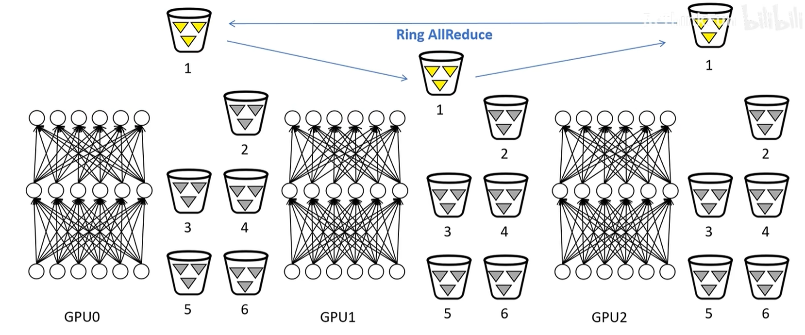
