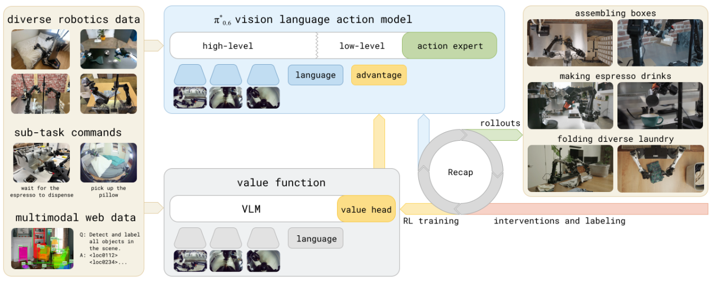

# PI0.6 Note

## Navigation
- Paper card: [PI0.6 card](../cards/pi06.md)

## Related Work

先前用RL提升VLA表现的技术路线：

- PPO及其变体训练：not scalable，数据利用率低
- 基于预训练VLA做强化学习微调.部分研究还探索了如何将学习到的行为提炼回VLA，以实现端到端的迭代改进：提升的是外接控制器，而不是 VLA 本身的能力

pi06：使用（迭代的）离线强化学习方法，对整个 VLA 模型进行端到端的训练，并采用表达力强的流匹配 VLA 模型（与pi05不同，pi06先用 offline RL/advantage conditioning 训练一个 $π^*_{₀.₆}$ base，再针对具体任务用 demonstrations 和真实机器人经验继续 fine-tune）

## Method

### **Recap Pipeline**

预训练的时候包括步骤2&3，后续训练包括所有步骤

**Data collection: **

运行VLA做任务，并且打标签，同时可选提供一些人类介入的轨迹

**Value function training**

用上一步收集的数据训练一个多任务的value function

标注的时候采用稀疏reward：
$$
r_t =
\begin{cases}
0 & \text{if } t = T \text{ and success} \\
-C_{\text{fail}} & \text{if } t = T \text{ and failure} \\
-1 & \text{otherwise}
\end{cases}
$$
$C_{\text{fail}}$是一个很大的数。所以累积reward可以直接反映任务进程，越接近0，表明越接近成功

value function的输出$p_{\phi}(V|o_t,l)\in[-1,0]$, 间隔是$\frac 1 {200}$, 监督信号$R_t(\tau)$需要归一化然后离散为201维的向量$R^B_t(\tau)$（具体是hard on-hot还是插值论文没具体说），然后用cross-entropy训练
$$
\min _\phi \mathbb E_{\tau\in D}[\sum_{o_t\in \tau}H(R_t^B(\tau),p_\phi(V|o_t,l))]
$$
输出时，
$$
V^{\pi_{\text{ref}}}(o_t, \ell) = \sum_{b \in [0, B]} p_\phi(V = b \mid o_t) v(b)
$$
$v(b)$是bin对应的值

**Advantage conditioned training**

value function 根据prefix给出轨迹是否足够优，根据这个作为条件训练VLA

policy extraction: 利用现有的价值函数训练一个改进策略，需要满足：

- 能有效利用多样化离策略数据，包括初始演示、专家干预以及来自最新策略和旧策略的自主训练片段
- scalable，易用与大型VLA
- 能够有效利用好数据和坏数据

现存一些方法及问题：

- 策略梯度：flow matching model不会输出动作分布，所以很难适配
- AWR：加权学习，即基于advantage赋予权重，没办法利用坏数据

最接近的方法：advantage conditioning，在所有数据上做supervised learning，同时在输入中加入基于advantage的最优性判断
$$
\min_{\theta} \mathbb{E}_{\mathcal{D}_{\pi_{\text{ref}}}} \left[ -\log \pi_\theta(a_t \mid o_t, \ell) - \alpha \log \pi_\theta(a_t \mid I_t, o_t, \ell) \right],
\\
\text{where,\;}
I_t = \mathbf{1}\left(A^{\pi_{\text{ref}}}(o_t, a_t, \ell) > \epsilon_\ell\right).
$$

## Q:

### 为什么value function是学习分布？

**训练目标本身是noisy的**

同一个 $o_t,l$ 可能对应不同的后续结果

例如任务是：
$$
ℓ=\text{make espresso}
$$
当前图像 $o_t$：杯子已经放到咖啡机下面。

数据里可能有两种后续：

| 后续轨迹               | return |
| ---------------------- | ------ |
| 正确按下按钮，成功萃取 | −0.1   |
| 机械臂碰歪杯子，失败   | −1.0   |

这比单个 −0.55-0.55−0.55 更忠实地表示：**这个状态有一半概率通向成功，一半概率通向失败**

### 示性函数的输出如何作为条件？

把True/False的输出作为token加入到prefix中，不会被忽略？存疑

