# PI0.7 Note

## Navigation
- Paper card: [PI0.7 card](../cards/pi07.md)

## Reading Notes

**有 Vision-Language-Action (VLA) 模型的问题：**

（1）泛化能力不足

很多模型只能完成训练数据中接近的任务：

例如：

- 训练过“拿杯子” → 可以拿类似杯子；
- 但遇到“把杯子装进盒子并放到架子上”这种组合任务，容易失败。


（2）依赖任务专用训练

很多机器人模型虽然性能很好，但需要：

- 针对某个机器人；
- 针对某个任务；
- 使用强化学习或大量示范数据 fine-tune。

这限制了机器人基础模型的真正意义。

理想状态应该是：

> 一个模型 → 多种机器人 → 多种任务 → 零样本执行

而不是：

> 一个任务 → 一个模型 → 大量重新训练


本文模型展示的特性：

- **开箱即用表现优异**：\(\pi_{0.7}\) 能够完成一系列高难度、长时序的操作任务，例如操作意式咖啡机、叠衣服、清理垃圾袋、折叠纸箱以及给蔬菜削皮等，且无需针对特定任务进行后期训练，可在多种环境下稳定运行。
- **指令泛化能力强**：\(\pi_{0.7}\) 能够理解多样化的语言指令集，在全新环境中依然表现稳定；即便面对复杂且前所未见的语言指令与指代说明，也能展现出出色的泛化能力。举例来说，即便身处从未接触过的厨房与卧室环境，它依然能够执行各类开放式语言指令。
- **跨本体迁移可行**：\(\pi_{0.7}\) 支持短时间内快速完成跨机器人本体的能力迁移。举例而言，即便某款机器人从未接受过衣物折叠相关训练，借助跨本体迁移技术，它也能完成 T 恤折叠这类高难度操作，其表现堪比专业操作人员通过遥操作控制机器人进行首次尝试的效果。
- **组合泛化灵活**：\(\pi_{0.7}\) 能够将已掌握的操作技能重新组合，以全新的方式完成新任务。例如，我们可以通过指令引导 \(\pi_{0.7}\) 使用空气炸锅制作红薯，或是指引它以全新流程完成各类操作任务。


### Method

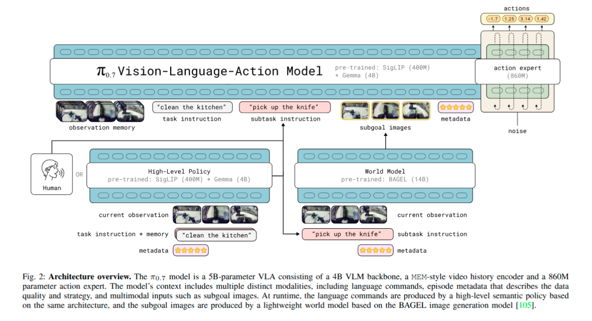


#### 提示词

本节详细介绍π0.7模型所使用提示词中包含的各项上下文组成部分。**模型训练过程中会对各组成部分进行随机丢弃**，以确保模型在测试阶段能够灵活处理任意组合的上下文信息，无需依赖全部组件。


**A. 子任务指令**

参考π0.5模型的设计思路，除整体任务文本描述$\ell_t$（例如“清洁厨房”）外，我们还在提示词中加入更高层级的中间文本，用于明确当前语义子任务，记为$\hat{\ell}_t$（例如“打开冰箱门”）。在实际推理阶段，**该子任务文本可由经过训练的高层策略生成、由人工指定，也可省略，且可随任务推进动态更新**。

研究团队收集了大量不同场景、不同类型的任务数据，并为各数据片段标注了详细的文本描述。将语义子任务信息纳入模型输入，还支持以口头分步指导的方式对模型进行实时教学。由于模型经过多样化语言指令训练，能够跟随人类实时指令完成新任务——例如按照指导将红薯放入空气炸锅（见图14）。教学完成后，即可利用这些指导数据对π0.7模型进行微调，训练出一套高层策略：该策略以机器人观测结果、整体任务说明及历史子任务指令为输入，自动输出后续子任务（见图2左下）。最终通过这套高层策略，机器人可自主完成完整任务流程。


**B. 子目标图像**

子任务指令虽能清晰传达任务的高层意图，但往往缺少执行层面的关键细节——例如“打开冰箱门”仅说明目标，却未告知机械臂应如何握持门把手。为解决这一问题，研究团队引入**子目标图像**：通过图像形式呈现任务短期内应达到的理想状态，更直观地定义任务成功推进后的场景样貌。

研究中采用多视角子目标集合$\mathbf{g}_t = [G_t^1, G_t^2, \dots, G_t^n]$，其中$G_t^i$代表第$i$路摄像头视角下的期望未来画面。通过多视角子目标，既能在基准视角体现环境与物体层面的预期结果，又能在手腕视角体现机械臂与末端执行器的动作目标，有效提升模型在空间定位与动作控制上的准确性。

推理阶段，子目标图像由轻量级世界模型生成。该模型以当前子任务指令$\hat{\ell}_t$为输入（与主模型输入一致），并基于海量视频与图像编辑数据完成预训练，因此具备较强的泛化能力。以实时观测为基础生成的子目标图像，相比纯文字指令往往能更清晰地明确任务目标，从而提升模型的指令遵循能力与泛化性能。

该世界模型记为$g_\psi$，训练优化目标为：
$$
\max_\psi \mathbb{E}_{D_g} \left[ \mathcal{L}_{\text{CFM}} \left( g^\star_t,\; g_\psi(o_t,\,\hat{\ell}_t,\,m) \right) \right]
$$
其中$\mathcal{L}_{\text{CFM}}$为标准流匹配损失函数；$g^\star_t$为真实未来子目标图像；$m$为第五章C部分所述的回合元数据；训练数据集$D_g$则选自第五章A部分中经过高质量子任务标签$\hat{\ell}_t$标注的数据片段——数据片段末尾帧即作为真实子目标图像，即$g^\star_t = o_{t,\text{end}}$。

参考SuSIE模型的做法，研究团队基于成熟的开源图像生成与编辑模型初始化该世界模型，具体选用BAGEL[105]——一个拥有140亿参数的混合Transformer架构模型，具备图像理解、编辑与生成能力。训练过程中还整合了网络公开数据、第一人称视角人类视频等非机器人领域数据，帮助模型学习通用语义与物理规律，并通过子目标图像将这些知识迁移至π0.7主模型。相关实现细节详见附录C。


**C. 回合元数据**

扩充模型可用上下文信息的核心目标之一，是让模型能够基于规模更大、多样性更强的轨迹数据完成训练。因此除高质量演示数据外，π0.7也纳入质量参差不齐的演示数据（含失败案例）以及前期模型自主运行所产生的数据。为保证模型在测试阶段仍能表现优异，研究团队为这些多样化轨迹补充了标注信息，帮助模型准确理解数据背景。

为此，研究团队在提示词中增加“回合元数据”字段，用于记录训练回合的各项属性，记为元数据集合$m$，包含但不限于以下标签：
- **整体耗时**：以时间步长衡量的回合总时长。按每500步为一个区间离散化分组，例如时长在1750–2250步的回合统一标注为“2000步”。通常来说，完成速度越快代表任务质量越高、过程中失误越少。
- **整体质量**：以1–5分量化评估任务执行效果，5分为最优。
- **失误记录**：标注对应动作段是否出现操作失误（例如抓取失败、执行错误子任务等），由人工对数据进行粗略标注。

综上，π0.7模型训练时可获得回合真实耗时、人工标注的整体质量与失误情况等监督信号。多样化的训练数据（包含不同质量、不同速度的回合）使模型能够学习到元数据与最优动作之间的关联规律。在实际部署时，即可通过设定元数据字段，指导机器人以更高效率、更优质量且尽可能零失误地完成任务。


**D. 控制模式**

为适配不同的底层动作执行方式，训练阶段同时纳入**关节空间控制**与**末端执行器控制**两类动作数据，并在提示词中通过文本标识$c \in \{\text{joint},\; \text{ee}\}$指定控制模式，部署时可根据任务需求灵活选择。


**E. 完整提示词示例与训练策略**

以下为整合全部上下文信息后的提示词示例：

```
<多视角观测画面>
<多视角子目标图像>
任务：给蔬菜去皮。
子任务：拿起削皮刀。
耗时：8000步。
质量：5分。
失误：无。
控制模式：关节空间控制。
<本体感知数据>
```

训练过程中会对提示词各组成部分执行**随机丢弃策略**，从而让π0.7在测试阶段可灵活选择部分组件运行（例如仅用观测与文字指令、不依赖子目标图像）。研究发现：加入子目标图像后，模型收敛速度显著提升——此时动作预测可转化为“基于前后帧推导合理动作”的逆动力学问题。因此训练时仅对每批次中**25%**的样本附加子目标图像；在包含子目标图像的样本中，又会以**30%**的概率丢弃子任务指令$\hat{\ell}_t$（因子目标图像本身已能提供更丰富的细节，可替代文字指令）。对于回合元数据，**15%**的样本完全不提供该字段；若保留元数据，则其中耗时、质量、失误三项信息还将各自以**5%**的概率随机省略。控制模式字段则始终保留，不进行随机丢弃。


#### 训练

相较于此前的 π0.5 与 π0.6 模型，π0.7 在架构上的核心改进主要为：引入 MEM 模型提出的历史视觉编码器 [37]，以及在输入上下文中纳入视觉子目标图像 ¹。

**输入处理与视觉编码器设计**

模型最多接收四路相机图像输入（前视角、两路手腕视角、可选后视角），每路图像最多包含历史六帧；同时最多接收三路子目标图像（不含后视角）。

- 历史帧经视觉编码器处理后，压缩至与单帧图像相同数量的令牌；子目标图像采用同一编码器处理。
- 观测图像与子目标图像统一缩放至 448×448 像素分辨率。
- 历史帧按 1 秒步长采样；训练过程中以 30% 概率完整丢弃全部历史帧，后视角图像（若存在）同样以 30% 概率单独丢弃。


**注意力掩码机制**

采用**分块因果掩码策略**：

- 观测图像令牌内部、子目标图像令牌内部各自使用双向注意力；
- 子目标图像令牌可额外访问观测图像令牌信息；
- 后续文本令牌仅使用因果单向注意力（详见附录掩码示意图）。


**本体感知输入编码**

机器人本体状态信息\(q_t\)（含历史状态数据）同样输入主干网络。与 π0.6 采用离散文本令牌表示状态的方式不同，π0.7 参考 MEM 方案，通过线性投影将状态维度映射至主干网络隐藏层维度以生成嵌入向量。每一时间步历史状态视为独立令牌；若某历史帧被丢弃，则对应状态令牌同步掩码屏蔽。


**动作预测头与时序策略**

- **动作专家模块**：参数量 8.6 亿的 Transformer 网络，以流匹配为优化目标，直接预测连续动作值；并引入自适应 RMSNorm 注入流匹配所需的时序步长信息。
- **动作分块机制**：固定同时处理 50 个动作令牌，对应未来 50 步的动作序列；50 个动作令牌内部双向交互，并可访问视觉 - 语言主干网络的中间特征输出。
- **实时动作分块（RTC）**：训练阶段即启用实时动作分块策略，用于缓解推理延迟带来的控制抖动、输出平滑动作轨迹；训练时模拟 0–12 步推理延迟，对应 50Hz 控制频率下最大 240 毫秒推理时延。


**子目标图像配套训练方案**

为保证模型可兼容不同时延、不同画质的子目标图像（含世界模型生成的图像），训练阶段同时使用两种来源的子目标图像：

1. **真实子目标图像采样策略**：25% 概率取数据片段末尾帧（与世界模型训练的监督信号保持一致）；75% 概率从当前时刻之后 0–4 秒区间内均匀随机采样未来帧作为子目标。
2. **缓解虚实域偏差**：在真实样本基础上，大量混入世界模型生成的子目标图像样本 —— 即用生成图像替代真实未来帧，构造额外训练样本，有效缩小 “训练用真实图像、部署用生成图像” 带来的域差距。


#### 推理

部署阶段，无需针对特定任务微调，即可通过灵活配置上下文信息，让 π0.7 呈现不同行为特性。无论执行何种任务，提示词中始终固定包含**控制模式**与**回合元数据**两类字段，其中元数据统一按以下规则设定：

- **整体耗时 / 速度**：按对应任务历史回合时长的第 15 百分位设定（代表该任务的高效基准）；
- **整体质量**：固定设为最高分值 5；
- **失误标记**：固定设为无失误。

子任务指令\(\hat{\ell}_t\)则有两种来源：既可由训练得到的高层语言策略自动生成，也可由人类监督员实时提供以实现教学指导（见第五章 A 节）。


**子目标图像更新机制**

若启用子目标图像，则按 “先触发即更新” 原则刷新画面：当语义意图发生变化（即切换至新的\(\hat{\ell}_t\)），或距离上次生成子目标图像已达\(\Delta=4\)秒时，立即更新。完整运行流程见算法 1。


**异步推理机制**

系统采用**异步并行推理架构**：子目标图像生成与子任务指令生成在独立线程中并行执行；VLA 动作推理时始终取用当前已生成的最新可用结果，无需等待单次生成完成。


**动作生成与执行参数**

所有实验统一配置：

- 扩散去噪步数：5 步；
- 单次生成动作块长度：50 步；
- 实际执行步数：从生成的 50 步中选取\(\hat{H} \in \{15, 25\}\)步执行。


**无分类器引导（CFG）增强性能**

由于训练时对各上下文组件执行过随机丢弃，π0.7 支持对提示词任意组件施加**无分类器引导（CFG）**，例如通过引导让模型生成更高效的动作序列。具体在每步动作去噪过程中，按以下公式修正动作梯度：
$$
\nabla_a \log \pi_\theta(a_{t:t+\hat{H}} \mid o_t,\,C_t) \;+\; \beta\!\left(\,\nabla_a \log \pi_\theta(a_{t:t+\hat{H}} \mid o_t,\,C_t) \;-\; \nabla_a \log \pi_\theta(a_{t:t+\hat{H}} \mid o_t,\,C_t^\text{uncond})\,\right)
$$
式中\(C_t^\text{uncond}\)代表 “无条件推理” 时所使用的上下文集合，\(\beta\)为 CFG 引导权重。

尽管理论上可对任意上下文组件施加 CFG，本研究重点针对**回合元数据**字段实施引导，以此显著提升精细操作任务的性能；实际测试中选取适中强度\(\beta \in \{1.3,\;1.7,\;2.2\}\)开展实验。


等价于标准的 CFG：
$$
s_u+w(s_c-s_u)
$$


强化条件带来的影响


### 实验

#### A. Out-of-the-box performance on challenging tasks

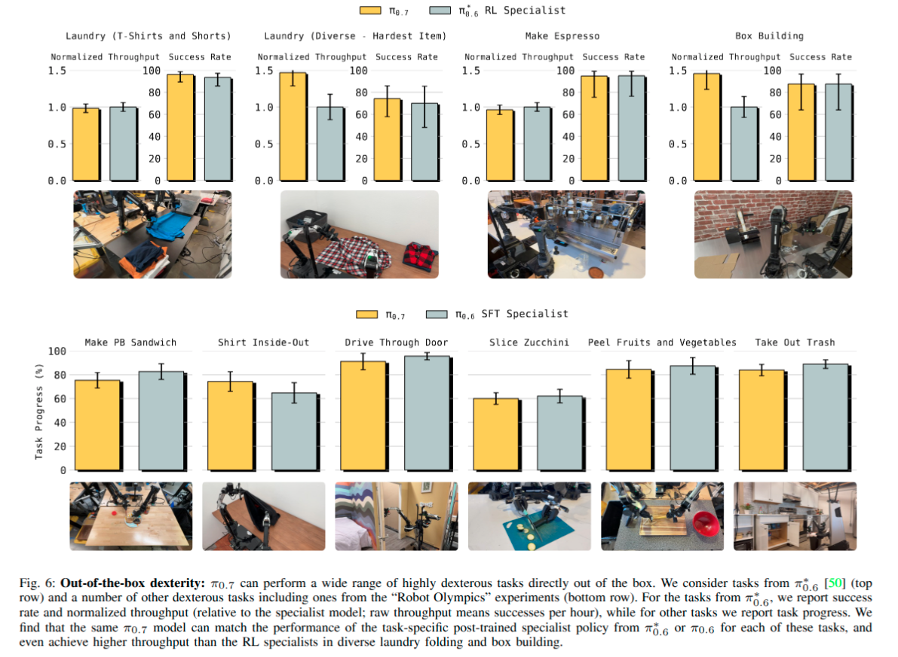

$\pi_{0.7}$ 接近 RL specialist，laundry 和 box building 甚至 throughput 超过 specialist。


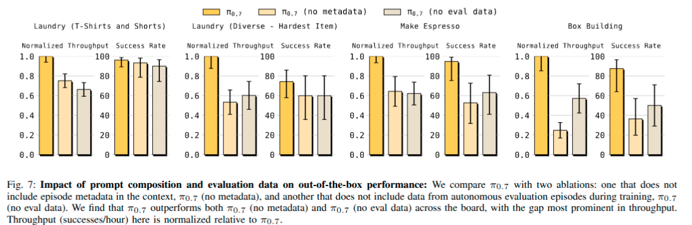

这里的 no evaldata 指的是没有机器人执行的数据，二者都是在训练时就没加

**不要过滤坏数据，而是告诉模型数据质量**


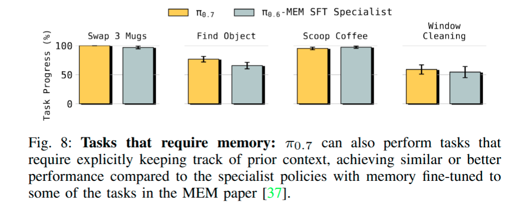

记忆能力也不错


#### B. Instruction following

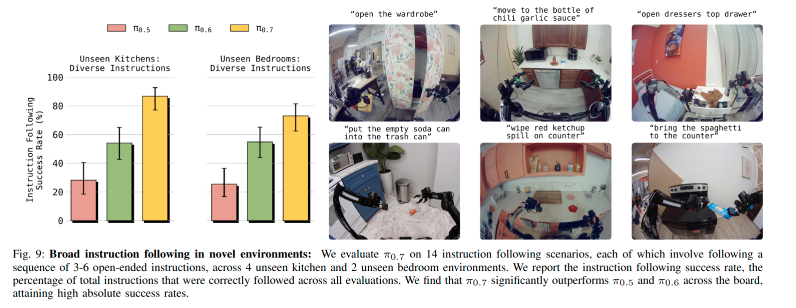

陌生环境能否听懂指令


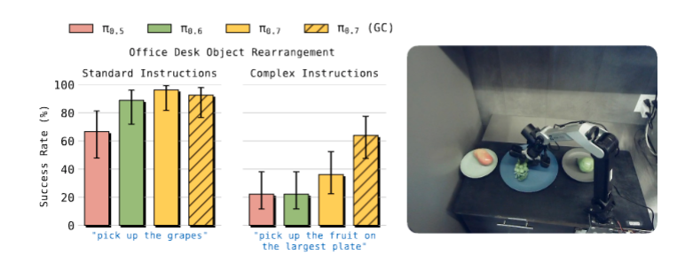

在执行**复杂的指代性指令**方面：π0.7 及其前序模型均能成功完成较简单的物体重新摆放指令（如“拿起勺子”、“把勺子放在叉子左侧”和“把勺子放在叉子右侧”），但在处理复杂且非典型的指令（如“拿起桌上最大的碗”、“拿起我用来喝汤的餐具”以及“拿起最大盘子里的水果”）时，π0.7 的表现显著优于其他模型。引入由轻量级世界模型生成的子目标图像（即 π0.7 (GC)），进一步提升了指令执行能力，使 π0.7 在遵循复杂指令方面表现出更强的能力。

（这个思路将指令转为目标图像，缓解了对语言注意力不足的问题）


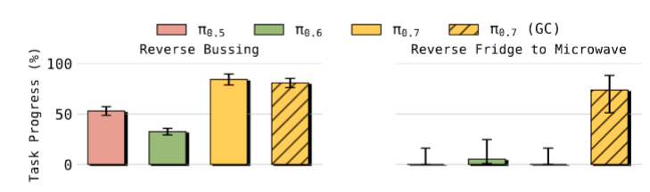

做一些违背常识的任务，比如把餐具放进垃圾桶和把垃圾放进餐具盒。可以看出来 subgoal image 的引入对指令遵循在某些任务上很重要。（world model 确实很尊重指令）


#### C. Cross-embodiment transfer

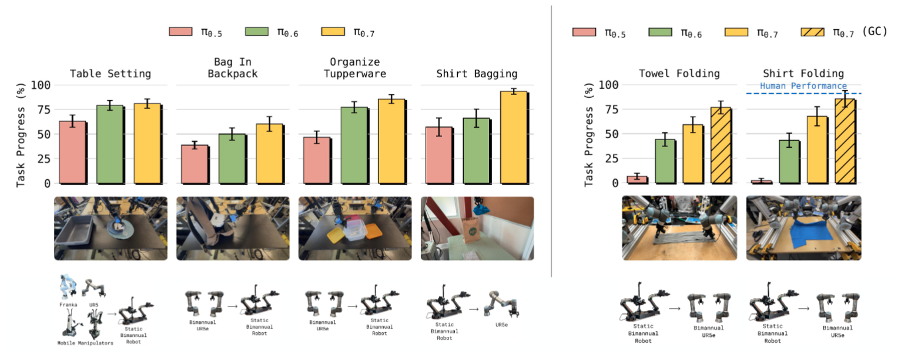

这个跨本体其实没有严格跨本体，是从 large checkpoint 在一个本体上训练然后迁移的


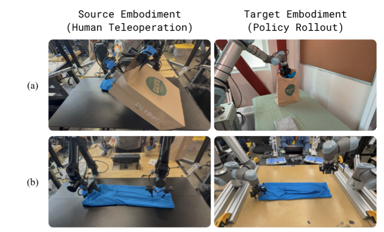

跨具身迁移能够产生适应目标具身特性的涌现策略。(a) 在源机器人上，人类操作员需一只手撑开袋口，另一只手执行插入动作；而在 UR5e 目标机器人上，策略 π0.7 发现了一种单臂“抓取-放置”策略，该策略更契合该机器人较大的作业范围。(b) 在源机器人上，人类操作员通常以倾斜的末端执行器姿态接近衬衫；相比之下，π0.7 在 UR5e 上生成了垂直抓取动作，这更适合该大型机器人的手臂布局。在这两种情况下，**该策略均超越了对源机器人行为的简单复制，而是针对任务发现了更适合目标具身特性的操作策略**。


policy latent space 里面已经形成可组合技能。


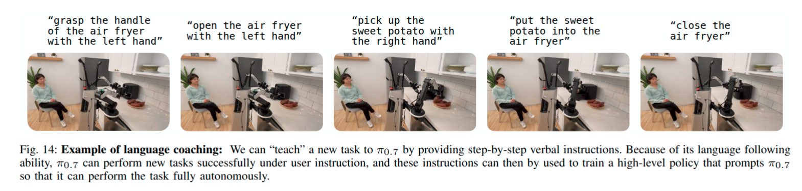

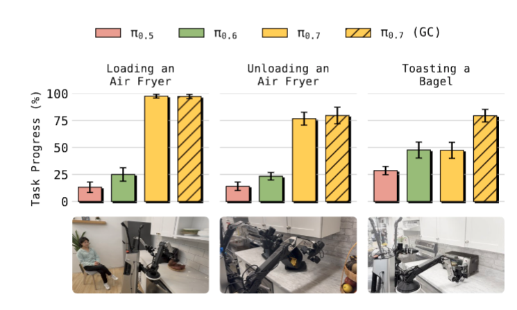

人教模型做完全新的任务；与其他模型比较


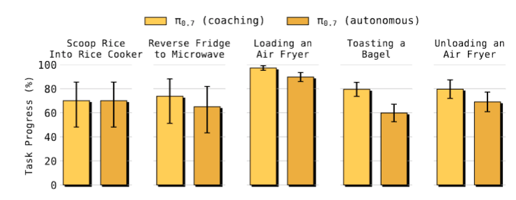

将指导的数据收集起来训练策略即可让模型学会该任务


#### D. Compositional task generalization

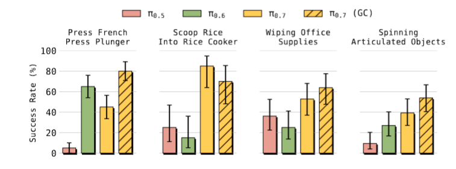

真正的 zero-shot，虽然是短程

其实这里看出来，world model 对于 zero shot 的作用并没有那么决定性

一般来说 VLM 的 zero-shot 得到 subtask 比根据 subtask 生成动作策略容易


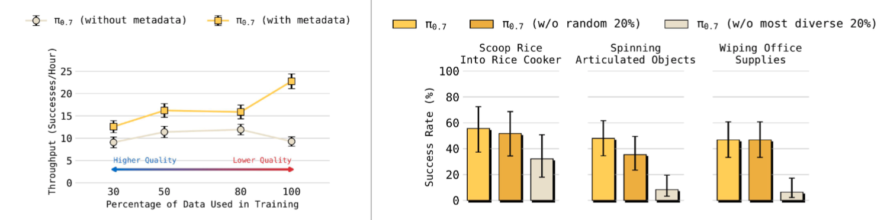

泛化性能随多样化上下文与数据规模变化的表现：左图：我们发现，在利用元数据（metadata）进行训练时，π0.7 的性能能够随数据集规模的扩大而持续提升，即便数据的平均质量有所下降。相比之下，若不使用丰富的条件信息（conditioning information）进行训练，随着更多低质量数据的引入，π0.7 的性能反而会下降。右图：当 π0.7 在训练时剔除了任务多样性最高的机器人数据，其性能会出现显著下滑。这表明，π0.7 能够利用**机器人数据中的任务多样性**，从而显著提升其在组合式任务上的泛化能力。


这里的不同质量我倾向于是不同得分的数据


### Appendix

#### B. Attention Pattern

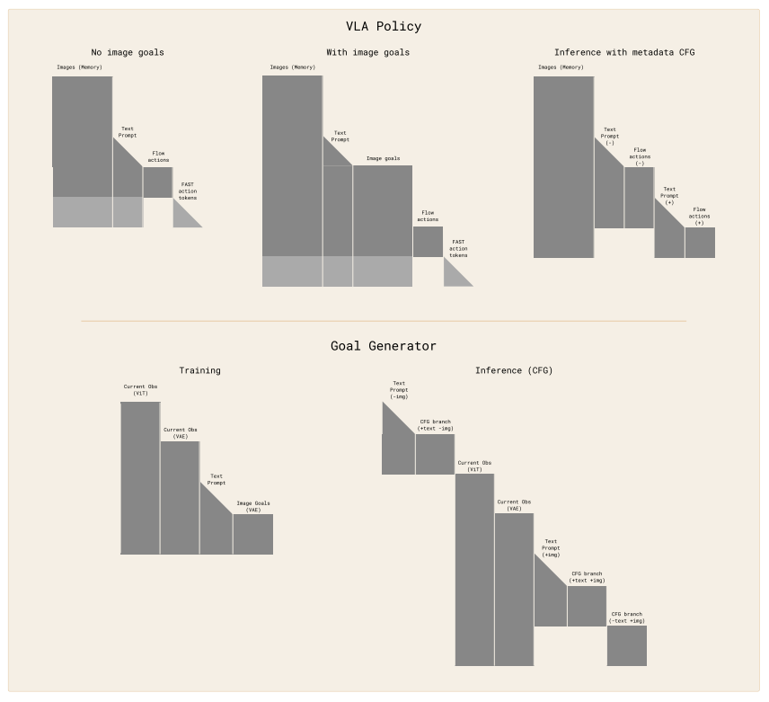

VLA policy 中 "Inference with meta CFG" 倒数第二行应该是画错了，text prompt(+) 不应该关注 text prompt(-) 


可以把 subtask 看作 meta data 的一部分，在训练的时候随机 drop, 所以在推理的时候要不要都不影响


ViT + VAE 的架构是来自 BAGEL


####  C. Training of the world model

1. **模型初始化与训练数据**：世界模型由 BAGEL 初始化，训练优先选用高质量时序分段标注的机器人、第一视角人体视频，并混入开源图文数据集保留语义能力；
2. **数据与编码架构**：每条样本含指令、3 路相机帧、3 张目标帧；图像同时经过 ViT（语义，7B LLM 主干，448×336）与 VAE（细节，7B 生成主干，512×384）编码；分辨率差异来自各自 patch 尺寸；
3. **注意力与 CFG 推理机制**：π0.7 采用多种定制注意力规则；推理使用无分类器引导（CFG），构造互不交互的正负分支注意力树提升效率；世界模型 CFG 掩码更复杂；FAST token 和流动作训练时互不参与注意力计算；
4. **测试配置**：子目标重新生成间隔设置为 4s，对齐 SuSIE 方案。


#### D. Inference speed and optimization

1. **基础推理硬件**：π0.7（Gemma3 4B）单卡 H100 推理；最简版本 3 相机输入、5 步去噪下可达 38ms；开启 MEM 编码器 + 子目标图像后最坏 127ms。
2. **子目标图像生成难点**：依赖 14B 模型迭代去噪，序列长度近万 token，算力开销大。
3. **子目标生成优化手段**：4 张 H100 做 4 路张量并行、矩阵乘法 8bit 量化、修改版 SageAttention 加速注意力；25 步（图文双 CFG）去噪生成耗时 1.25s。
4. **调度策略**：采用异步推理，π0.7 执行任务和世界模型生成下一阶段子目标并行进行，减少等待延迟。


#### E. Comparison of action spaces in cross-embodiment transfer

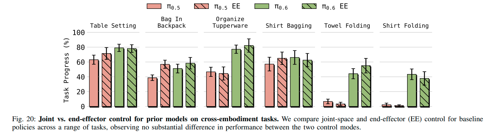

跨具身任务中 EE 没有相对 joint 的绝对优势


#### G. Detailed task descriptions and scoring rubric

- **衣物整理（T 恤与短裤）**：
  - 从洗衣篮中取出一条短裤或一件 T 恤，将其整齐对折、折叠成型，并妥善叠放。
  - 评分标准：成功折叠衣物并整齐堆叠于其他衣物之上，即为成功。
- **衣物整理（最难款 - 多样衣物）**：
  - 从洗衣篮中取出一件有领扣衬衫，将其整齐对折、折叠成型，并妥善叠放。
  - 评分标准：成功折叠衣物并整齐堆叠于其他衣物之上，即为成功。
- **制作浓缩咖啡**：
  - 按标准流程制作并萃取一份双份浓缩咖啡，要求操作顺序与器具摆放位置准确无误。
  - 评分标准：按序完成以下全部步骤即为成功：填粉并压粉、将把手锁紧至对应冲煮头、完成萃取、将咖啡杯置于杯碟并移至指定位置。
- **组装纸箱**：
  - 将展开的纸板组装为立体纸箱。
  - 评分标准：折叠成型且无明显破损，即为成功。
- **制作花生酱三明治**：
  - 制作花生酱三明治，沿对角线完整切开后摆盘；盖好花生酱瓶盖；将餐盘推至远处。
  - 满分 9 分，评分细则：拧开瓶盖、均匀涂抹花生酱、盖上另一片面包、沿对角线完整切开、将刀具放回餐盘、将餐盘推至指定位置、整体整洁度各得 1 分。
- **T 恤翻面**：
  - 取出一件里外反穿的 T 恤，将其完全翻正（衣身与两袖均翻正），随后整齐折叠。
  - 满分 7 分：取到衣物 + 1 分；衣身翻正 + 1 分；左袖翻正 + 1 分；右袖翻正 + 1 分；折叠整齐 + 1 分；叠放至衣物堆 + 1 分；摆放至指定位置（右上角）+1 分。
- **穿门通行**：
  - 打开自动闭合式柜门，控制机器人完全进入柜内，最后在机器人处于柜内的状态下关闭柜门。
  - 满分 3 分：成功开门 + 1 分；进入深度足以使柜门正常关闭 + 1 分；通行过程平稳无碰撞门框 + 1 分。
- **西葫芦切片**：
  - 使用系有挂绳的刀具切菜，另一只手扶住西葫芦，将其切成均匀薄片。
  - 满分 3 分：正确握持刀具 + 1 分；完整切为均匀薄片 + 1 分；使用完毕将刀具放回砧板右侧 + 1 分。
- **果蔬削皮**：
  - 一手固定果蔬于砧板，另一手持削皮器将其完全削皮。
  - 满分 9 分：取到削皮器 + 1 分；削皮完成 25%+1 分；削皮完成 25%–50%+1 分；削皮完成 50%–75%+1 分；削皮完成 75% 以上 + 1 分；削皮完毕将果蔬放入碗中 + 1 分；清理 25%–50% 果皮至垃圾桶 + 1 分；清理 50%–75% 果皮至垃圾桶 + 1 分；清理 75% 以上果皮至垃圾桶 + 1 分。
- **更换垃圾袋**：
  - 取出旧垃圾袋并置于桶旁，为垃圾桶套好新袋，随后将垃圾桶归位，并关闭柜门 / 盖好桶盖。
  - 满分 12 分。  ① 取出垃圾桶（3 分）：正确开启柜门将垃圾桶取出 + 2 分；移至厨房地面便于操作处 + 1 分。  ② 拆除旧袋（3 分）：使袋口脱离桶沿 + 1 分；收拢并稳妥上提取出垃圾袋 + 1 分；取出后放置于桶旁地面 + 1 分。  ③ 套新袋（3 分）：取新垃圾袋 + 1 分；将袋口展开 + 1 分；完全套入桶内并将袋口边缘均匀翻折固定于桶沿 + 1 分。  ④ 垃圾桶归位（3 分）：将垃圾桶放回柜内 + 2 分；操作结束后完全关闭柜门 + 1 分。
- **调换三杯位置**：
  - 依次将三个马克杯逐一移至咖啡机滴水盘，每放置一杯后按需放回桌面，确保三杯均完成一次摆放。
  - 满分 4 分：取下第一杯并放回桌面 + 1 分；将第二杯放置于咖啡机 + 1 分；取下第二杯放回桌面 + 1 分；将第三杯放置于咖啡机 + 1 分。
- **物品查找**：
  - 从抽屉中取出指定物品，并恢复环境整洁（物品置于桌面、抽屉关好）。
  - 满分 4 分：一次成功拉开目标抽屉 + 1 分；取到海绵刷 + 1 分；将海绵刷放置于桌面 + 1 分；关好目标抽屉 + 1 分。
- **舀取咖啡豆**：
  - 用量杯从咖啡豆盒中舀取满满两勺咖啡豆倒入研磨机，随后盖好研磨机盖子。
  - 满分 5 分：打开研磨机盖子 + 1 分；拿取量勺 + 1 分；舀取第一勺并全部倒入研磨机 + 1 分；舀取第二勺并全部倒入研磨机 + 1 分；盖好研磨机盖子 + 1 分。
- **清洁玻璃**：
  - 向玻璃表面喷清洁剂，抽取纸巾擦拭玻璃至完全干燥，最后将纸巾丢弃。
  - 满分 5 分：均匀喷洒清洁剂 + 1 分；抽取清洁纸巾 + 1 分；擦拭至玻璃洁净无水渍 + 1 分；使用后纸巾投入垃圾桶 + 1 分；玻璃表面无残留液滴 + 1 分。
- **物品分类（反向规则）**：
  - 按反向映射规则分拣 12 件物品：垃圾投入回收桶，餐具与器皿投入垃圾桶。
  - 满分 12 分：将餐盘 / 杯子 / 碗 / 餐具正确投入垃圾桶（共 7 项，每项 1 分）；将塑料瓶 / 锡纸 / 塑料盖 / 外卖餐盒 / 零食袋正确投入回收桶（共 5 项，每项 1 分）。
- **食物转移（冰箱←微波炉）**：
  - 将装有冷冻即食食品的餐盘从微波炉取出并放入冰箱，流程结束时餐盘已置于冰箱内。
  - 满分 6 分：打开微波炉门 + 1 分；关闭微波炉门 + 1 分；取出餐盘 + 1 分；将餐盘放入冰箱 + 1 分；打开冰箱门 + 1 分；关闭冰箱门 + 1 分。
- **餐桌布置**：
  - 从收纳箱中取出餐垫、水杯、餐盘、餐巾与餐具，在桌面合理摆放。
  - 满分 7 分：每件物品摆放到位各得 1 分；摆放位置严重不当每项扣 1 分。
- **收纳小包**：
  - 将小布袋 / 小包放入背包（无需拉上拉链）。
  - 满分 3 分：取到布袋 + 1 分；打开背包 + 1 分；将布袋放入背包 + 1 分。
- **叠放保鲜盒**：
  - 将三个尺寸依次递减的保鲜盒叠套在一起，并将盒盖整齐叠放。
  - 满分 6 分：每个保鲜盒叠套到位各得 1 分；对应盒盖整齐叠放各得 1 分。
- **衣物装袋**：
  - 将两件衬衫完全放入纸质购物袋中（可结合语言指令完成）。
  - 满分 4 分：每件衬衫正确拾取 + 1 分；每件衬衫完全装入袋内 + 1 分。
- **T 恤折叠**：
  - 将平铺状态的 T 恤折叠为标准形态。
  - 满分 6 分：完成第一次对折（双臂配合抓取，折边偏差不超过 12.7 厘米）+1 分；完成第二次对折（判定标准同上）+1 分；完成最后折叠（单手操作，边缘对齐偏差不超过 12.7 厘米）+1 分；根据最终形态规整度另计 0–3 分。总分达 6 分即为合格。
- **压下法压壶杆**：
  - 将法压壶压杆完全下压至底部。
  - 满分 1 分：成功将压杆下压至壶底并穿过咖啡粉层 + 1 分。
- **舀米入饭煲**：
  - 从米桶中取出量米杯，舀取大米并倒入已开启的电饭煲内锅。
  - 满分 3 分：取到量米杯 + 1 分；舀取大米 + 1 分；将米倒入电饭煲 + 1 分。
- **放入空气炸锅**：
  - 打开空气炸锅，将红薯放入炸篮，随后关闭炸锅。
  - 满分 4 分：打开炸锅 + 1 分；取到红薯 + 1 分；将红薯放入炸篮 + 1 分；关闭炸锅 + 1 分。
- **取出空气炸锅食物**：
  - 拉出炸篮，将 8 块模拟薯条全部倒至餐盘。
  - 满分 2 分：全部取出食物 + 1 分；全部稳妥倒至餐盘 + 1 分。
- **烤制贝果**：
  - 将半块贝果放入烤面包机，旋转旋钮启动烘烤，随后取回餐盘并置于上方柜中，取出烤好的贝果装盘。
  - 满分 7 分：打开炉门、放入贝果、关闭炉门、旋转旋钮、取出餐盘、取出烤好食品、装盘摆放各得 1 分。
