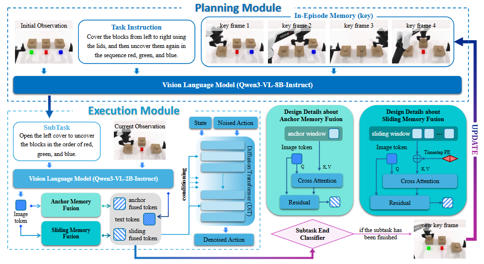

# RMBench: Memory-Dependent Robotic Manipulation Benchmark with Insights into Policy Design Note

## Navigation
- Paper card: [RMBench: Memory-Dependent Robotic Manipulation Benchmark with Insights into Policy Design card](../cards/RMBench.md)

## Reading Notes

### Introduction

现有benchmark问题

- MemoryBench：包含七个涉及记忆的单臂操作任务，但只有三个任务能在仿真中可靠地复现，而且该基准测试对任务设计的指导性有限
- LIBERO-Long：提供了十个长时域任务，但由于所有与任务相关的信息在整个执行过程中都可观察，因此这些任务并不明确要求记忆

Task Memory Complexity

RMBench 包含 9 个双臂操作任务，涵盖不同级别的任务记忆复杂性，能够对机器人操作中的记忆保持和利用进行大规模和可控的研究

主要测长期记忆

### RMBench

论文把操作任务建为 POMDP：隐状态 $s_t$、观测 $o_t$、动作 $a_t$。到时间 $t$ 的完整历史是：

$$
h_t = (o_{1:t}, a_{1:t-1})
$$

然后定义一个记忆状态 $M_t^{(h)}$，它最多编码 $k$ 个任务相关的过去观测。TMC 就是最小的整数 $m \ge 0$，使得存在一个最优策略 $\pi^*$，它不用完整历史 $h_t$，只靠 $M_t^{(m)}$ 也能做出同样的最优动作：

$$
\exists \pi^* \ \text{s.t.} \ \pi^*(a_t \mid h_t) = \pi^*(a_t \mid M_t^{(m)}), \forall t
$$
**例 1：Observe and Pick Up → M(1)**
 任务开始时，架子上有一个 reference object，桌上有多个候选物体。机器人先观察 reference object；之后 reference object 被遮挡；机器人必须从桌上拿起匹配物体。
 这里当前画面里已经看不到 reference object，所以机器人必须记住“刚才看到的目标物体是什么”。只需要记住这一个关键过去观测，因此是 M(1)M(1)M(1)。

**例 2：Put Back Block → M(1)**
 四个 pad 围绕中心摆放，一个 block 初始放在某个 pad 上。机器人要把 block 移到中心、按按钮，再把 block 放回原来的 pad。
 执行到“放回去”时，当前状态只显示 block 在中心附近，但“原来的 pad 是哪一个”来自过去。只需记住 block 最初所在 pad 这个信息，所以是 M(1)M(1)M(1)。

**例 3：Press Button → M(n)**
 桌上有左、中、右三个按钮和两个数字牌。机器人要按左键若干次，次数由左数字决定；再按中键若干次，次数由右数字决定；最后按右键确认。
 这里不仅要记住两个数字，还要在执行过程中持续记住“已经按了几次”。例如数字是 3 和 5，则左键阶段需要跟踪 1/3、2/3、3/3；中键阶段又要跟踪 1/5 到 5/5。所需历史信息随任务实例中的次数变化，不是固定一个观察点，因此归为 M(n)M(n)M(n)。

**例 4：Battery Try → M(n)**
 两个电池随机朝向，机器人需要不断尝试不同插入顺序和方向，直到成功。
 这里机器人需要记住“哪些方向/顺序已经尝试过、哪些失败了、下一次应该尝试什么”，属于试错式累计历史，因此是 M(n)M(n)M(n)。

**M(1)**

| 任务                | 任务内容                                                     | 记忆点                   |
| ------------------- | ------------------------------------------------------------ | ------------------------ |
| Observe and Pick Up | 先看参考物，参考物隐藏后，从桌上拿匹配物                     | 记住参考物               |
| Rearrange Blocks    | 两个 pad、一个按钮、两个 block；移动中间 block、按按钮，再移动另一个 block 到中间 | 记住初始布局和阶段       |
| Put Back Block      | block 从原 pad 移到中心，按按钮，再放回原 pad                | 记住原始 pad             |
| Swap Blocks         | 两个 block 在不同 pad 上，借助空 pad 交换位置后按按钮        | 记住交换进度和原位置关系 |
| Swap T              | 两个不同颜色 T 形块互换位置和朝向                            | 记住目标位置与朝向       |

**M(n)**

| 任务               | 任务内容                                                     | 记忆点                      |
| ------------------ | ------------------------------------------------------------ | --------------------------- |
| Battery Try        | 两个电池随机朝向，反复尝试不同插入顺序和方向，直到成功       | 记住已尝试组合、失败历史    |
| Blocks Ranking Try | 三个不同颜色 block 随机排列，反复调整排列并按按钮确认，直到顺序正确 | 记住尝试过的排列和反馈      |
| Cover Blocks       | 红、绿、蓝三个 block 和三个 cover；先从左到右盖住，再按红-绿-蓝顺序揭开并归位 | 记住颜色位置、盖/揭阶段顺序 |
| Press Button       | 根据两个数字牌，分别按左键和中键指定次数，最后按右键确认     | 记住目标次数和当前计数      |

### Mem-0 Policy

#### Planning Module：负责“记住已经做过什么，再决定下一步”

$$
s_t​=V_{plan}​(o_0​,g,M_{t−1}​) 
$$

- $o_0$：episode 初始 RGB 观察；
- $g$：全局任务指令；
- $M_{t-1}$：已经完成的子任务记忆；
- $s_t$：下一个子任务文本描述。

$$
M_{t−1}​=\{(s_i​,o_i^{end}​)\}_{i=1}^{t−1}​
$$

子任务文本描述 + 该子任务结束时的图像观察，也即用显示关键帧存储记忆

Mem-0 **不是每个 timestep 都重新规划**。它只在 Subtask End Classifier 判断子任务结束后才重新调用 Planning Module

#### Execution Module：负责“根据当前子任务生成动作”

QWen3整合subtask instruction和current observation然后融合anchor 记忆（阶段开始的关键帧）以及滑动窗口记忆（短期记忆）最后输出一个条件向量输入给DiT（类GR00T风格）

