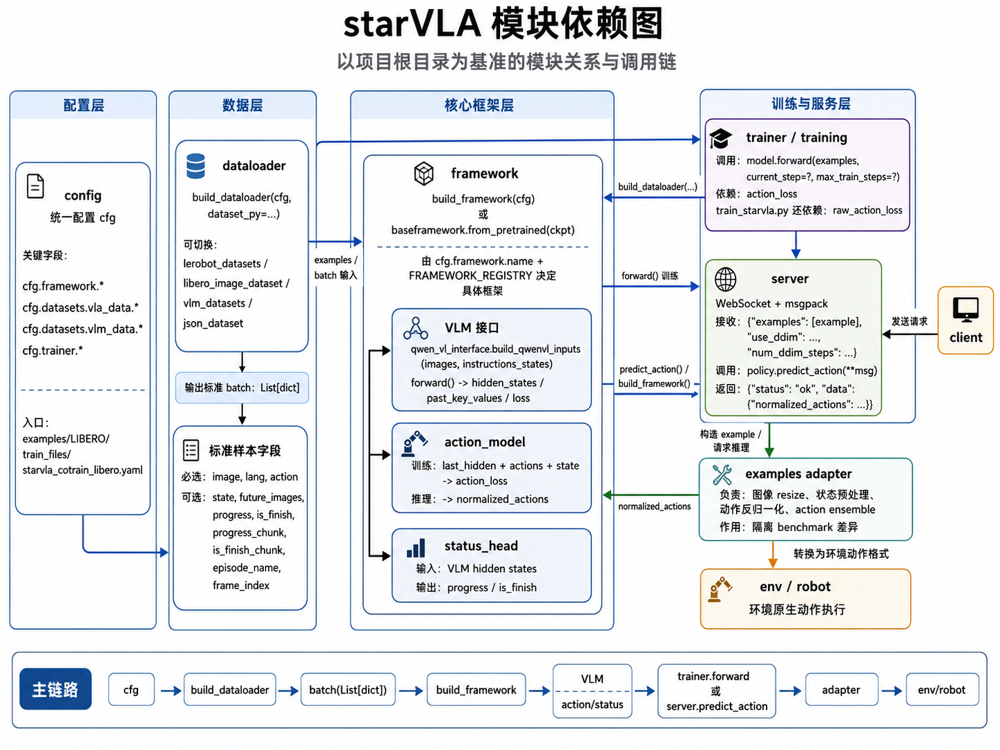

# starVLA Note

## Navigation
- Paper card: [starVLA card](../cards/starvla.md)

## Reading Notes

**主要贡献**：


**1. 提出了“[广义 VLA](https://zhida.zhihu.com/search?content_id=277755964&content_type=Article&match_order=1&q=%E5%B9%BF%E4%B9%89+VLA&zhida_source=entity)”的统一理论与架构 (Generalized VLA Architecture)**

- **理论统一**：通过引入辅助损失函数（Laux​ ），将 VLM（预测文本）和世界模型（预测未来视觉状态）从数学层面统一到同一个动作生成的策略分布公式中。
- **极致的模块化**：彻底解耦了特征提取与动作生成。框架原生实现了四种最具代表性的动作头（Action Heads）：

- `StarVLA-FAST`（基于词表的自回归离散动作生成）
- `StarVLA-OFT`（极简连续多层感知机回归）
- `StarVLA-π`（基于 DiT 的流匹配/扩散去噪）
- `StarVLA-GR00T`（系统1与系统2结合的双系统推理）

**2. 突破性的[多模态协同训练](https://zhida.zhihu.com/search?content_id=277755964&content_type=Article&match_order=1&q=%E5%A4%9A%E6%A8%A1%E6%80%81%E5%8D%8F%E5%90%8C%E8%AE%AD%E7%BB%83&zhida_source=entity)策略 (Multimodal Co-training Pipeline)**

- 针对机器人微调中常见的“灾难性遗忘”（即模型丧失原有的空间推理和问答能力）问题，设计了**[双数据加载器](https://zhida.zhihu.com/search?content_id=277755964&content_type=Article&match_order=1&q=%E5%8F%8C%E6%95%B0%E6%8D%AE%E5%8A%A0%E8%BD%BD%E5%99%A8&zhida_source=entity)（Dual-loader）**机制。
- 允许在同一个优化步骤中，混合来自 Web 的 VLM 预训练数据和机器人轨迹数据进行协同训练，在大幅提升动作成功率（如在 LIBERO 上极少量步数即可达 96%+ 成功率）的同时，完美保留了模型的空间感知与常识推理能力。

**3. 跨具身“[通才模型](https://zhida.zhihu.com/search?content_id=277755964&content_type=Article&match_order=1&q=%E9%80%9A%E6%89%8D%E6%A8%A1%E5%9E%8B&zhida_source=entity)”的训练能力 (Cross-Embodiment Generalist Capability)**

- 通过简单的动作空间对齐策略（统一 Padding 至 32 维），打破了不同机器人自由度（DoF）和动作空间的壁垒。
- 支持将来自不同硬件形态、不同任务环境（如 LIBERO, SimplerEnv, RoboTwin 2.0 等）的数据池化，成功训练出性能超越单一领域“专才”的跨基准“通才模型”。

**4. 部署导向的标准化生态与 I/O 契约 (Standardized Evaluation & [Sim-to-Real](https://zhida.zhihu.com/search?content_id=277755964&content_type=Article&match_order=1&q=Sim-to-Real&zhida_source=entity))**

- **统一的 I/O 接口**：强制模型输入仅为原始图像和文本，屏蔽了底层张量处理的复杂性。
- **零代码修改部署**：采用基于 WebSocket 的客户端-服务器架构，使得模型在仿真环境（Sim）中验证后，**无需修改任何代码**即可直接接入真实的 ROS（机器人操作系统）进行物理机部署，彻底打通了 Sim-to-Real 的工程壁垒。集成了 7 大开箱即用的评估环境，为开源社区确立了新的基础设施标杆。


### 整体框架

- starVLA: 核心框架
- deployment：通用推理服务层
- examples：具体应用场景层



#### StarVLA

**config**

- data_config: 放数据集信息，包括训练数据索引、动作维度、归一化统计文件、评测任务位置
- deep_speeds: 配置分布式训练相关参数
- training: 运行基础配置、framework参数


##### dataloader

从 NVIDIA GR00T 体系移植来的dataloader

- gr00t_lerbot: 

  - data_config.py: 定义不同机器人用哪些 video/state/action/language 键，以及对应的 transform。ROBOT_TYPE_CONFIG_MAP 是总映射表。

    - 定义各modality的key：

      ```
      video_keys = [...]
      state_keys = [...]
      action_keys = [...]
      language_keys = [...]
      ```

    - 

  - datasets.py:

    - LeRobotSingleDataset：单个机器人轨迹数据集
    - CachedLeRobotSingleDataset：带缓存版本；
    - LeRobotMixtureDataset：多数据集混合采样。
    - 还负责读 LeRobot 元数据、统计量、视频帧、parquet，以及混合采样权重。

  - mixtures.py: 数据集混合表。把 data_mix 名字映射到具体的数据集列表、采样权重、robot type。

    ```json
        "lerobot-tianji-0508": [
            ("/mnt/data/lerbot-tianji-0507/", 1.0, "srobot_tianji"),
            ],
    ```

    第一个参数是数据路径，和yaml的`vla_data.data_root_dir`拼接，第二个是采样率，第三个对应config.py中的config类名

  - embodiment_tags.py: 机器人 embodiment tag 和 robot_type -> tag 的映射。

  - index.py: 视频读取工具，按 index 或 timestamp 抽帧。

- *datasets.py


##### model

- tools：提供注册表、冻结状态检查、checkpoint 配置读取等公共工具
- modules：负责“VLM、动作头、视觉编码器、投影器、状态头”等底层部件
  - vlm：Qwen2.5-VL、Qwen3-VL、Florence2
  - action_model：diffusion、flow matching、RDT、MLP regression、FAST
        tokenization、VLA-Adapter
  - dino_model & projector: 辅助视觉分支，主要给M1和QwenDual这类双路结构用 
  - gr00t_policy/atlas_policy.py: GR00T风格的cross embodiment tokenizer
    - action tokenizer 本体是 MultiEmbodimentActionEncoder，它不是一个单独命名为 tokenizer 的模块，而是 3 层 category-specific linear 组成的 MLP：
            - W1: action_dim -> hidden_size
            - W2: 拼上 timestep embedding 后再投影
            - W3: 再投影一次
- framework：负责“把各组件组装成完整 VLA 模型”
  - M1.py：最像“原始 InternVLA-M1”路线，Qwen + DINO + Layerwise QFormer + DiT diffusion action head。
  - QwenGR00T.py：Qwen hidden states -> GR00T flow-matching action head，action head只取最后一层
  - QwenRDT.py：Qwen -> RDT2 action head，支持 KV cache、selected layers、latent CoT
  - QwenPI.py：功能最多的一个，集成了 layerwise flow-matching、progress-aware 版本、latent CoT、DINOv3 latent 监督，像研究实验主战场。
  - QwenOFT.py：OpenVLA-OFT 风格，把 action token 注入到 VLM 里，再做连续动作回归。
  - QwenFast.py：把连续动作离散化成 FAST token，走自回归 next-token prediction。
  - QwenAdapter.py：VLA-Adapter 路线，往 Qwen 末尾拼 action query token，再回归动作。
  - QwenDual.py：Qwen + DINO 双路条件后接 GR00T 头。


关于laten CoT


##### training

主训练循环：

1. 参数读取和配置：
   1. 读取 YAML 配置 + CLI 覆盖参数
   2. 包装配置对象，追踪哪些配置项被访问
   3. 创建输出目录
2. 模型&优化器构建：
   1. 构建模型框架
   2. 构建 VLA / VLM dataloader
   3. 构建优化器和学习率调度器
3. 训练代理：
   1. 初始化 trainer
   2. 加载权重、冻结模块、分布式封装
   3. 进入训练循环
4. 保存最终模型并关闭 W&B


**Trainer** 逻辑：

```
__init__
  → 保存 cfg / model / dataloader / optimizer / scheduler / accelerator
  → 初始化 completed_steps、batch size、best score 等状态

prepare_training()
  → set_seed
  → load pretrained / resume
  → freeze modules
  → print trainable params
  → setup_distributed_training
  → init wandb
  → init checkpoint

train()
  → 创建 dataloader iterator
  → while completed_steps < max_train_steps:
        get batch
        _train_step(...)
        completed_steps += 1
        eval
        log
        save checkpoint
  → _finalize_training()
```

train的loss来自self.model.forward，想调节训练目标就在forward里面算好各部分，放到 action_loss 里面

**VLAMTrainer**: VLA & VLM cotraining，vla loss和vlm loss叠加训练


### 实践经验

#### **如果要自定义一个framework需要改哪些内容？**

- 类定义
- 配置文件
- loss计算
- dataloader


#### **QWen 3视频输入**

- 支持视频/图片列表输入
- 视频采样参数是`fps`，图片列表的采样频率是`sample_fps`，这个频率是采样后帧间间隔


#### **VLM相关**

- `apply_chat_template` 会把它转成 Qwen 官方 chat 格式的字符串，类似：

  ```
  <|im_start|>user
  <image>
  请描述这张图
  <|im_end|>
  <|im_start|>assistant
  ```


#### QWen3.build_qwenvl_inputs

- 整理message：image，text，video

- `batch_inputs = processor.apply_chat_template`, batch_inputs内容：

- | key                 | 含义                                                   | 给谁用                  | size                                                      |
  | ------------------- | ------------------------------------------------------ | ----------------------- | --------------------------------------------------------- |
  | `input_ids`         | tokenized 后的文本 + 图像占位 token 序列               | LLM                     | batch * n_tokens                                          |
  | `attention_mask`    | padding mask，`1` 是有效 token，`0` 是 padding         | LLM causal mask         | batch * n_tokens                                          |
  | `mm_token_type_ids` | 多模态 token 类型，通常 `0=text`, `1=image`, `2=video` | M-RoPE / position ids   | batch * n_tokens                                          |
  | `pixel_values`      | processor 预处理后的图像 patch 张量，不是原图          | vision encoder          | n_patch * n_pixel_per_patch                               |
  | `image_grid_thw`    | 每张图对应的视觉 grid：`[T, H, W]`                     | vision encoder + M-RoPE | n_images(每个样本输入了三个视角的图片，所以是batch*3) * 3 |

- 全链路：

  ```
  examples
    ↓
  forward()
    ↓
  _Memory_QWen3_VL_Interface.build_qwenvl_inputs(...)
    ↓
  qwen_inputs / batch_inputs
    ↓
  _forward_qwen(qwen_inputs, inputs_embeds=...)
    ↓
  self.qwen_vl_interface(**model_inputs)
    ↓
  _Memory_QWen3_VL_Interface.forward(...)
    ↓
  MemoryQwen3VLForConditionalGeneration.forward(...)
  ```


#### 适配自己的数据集

1. 改`./starVLA/dataloader/gr00t_lerobot/data_config.py`以及`mixtures.py`
2. 改造数据集适配 lerobot 格式
3. 添加 `modality.json` 并与 `data_config.py` 适配
