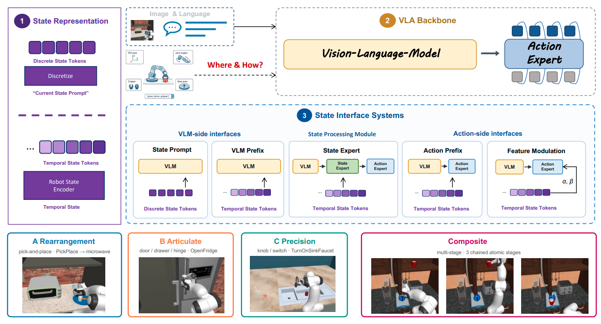
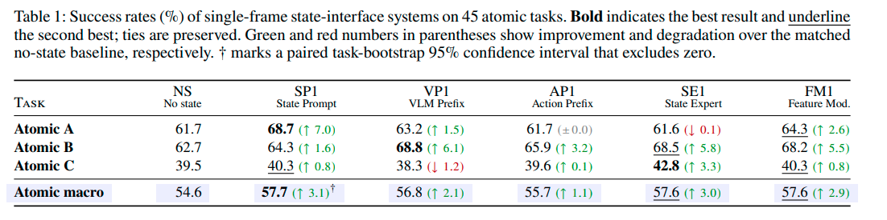
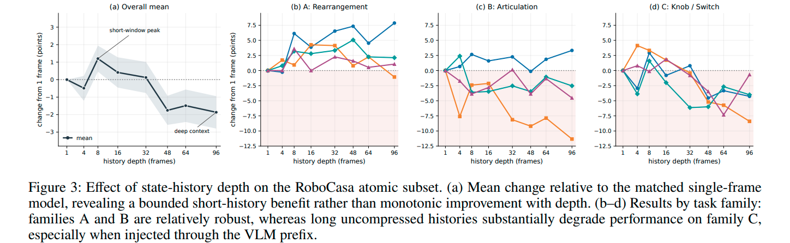
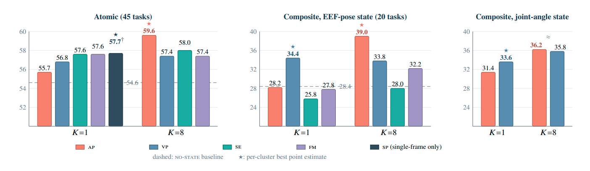

# How Should Vision-Language-Action Models Use Proprioceptive State? Note

## Navigation
- Paper card: [How Should Vision-Language-Action Models Use Proprioceptive State? card](../cards/引入本体记忆.md)

## Reading Notes

三个非常明确的问题：

1. **当前时刻的 state 到底有没有用？**
    也就是，在 closed-loop manipulation 中，仅仅告诉模型机器人现在的姿态/位置，是否真的会提高成功率？以及**哪些类型的任务更需要它**。
2. **state history 有没有用？**
    绝大多数 VLA 只输入当前一帧 state，但理论上过去几十帧可以提供运动趋势、速度、当前所处的操作阶段等信息。因此作者研究从 **1 到 96 帧**的 state history。一个很重要的实验设计是：他们不只是比较 “1 帧 vs 96 帧”，还设置 **repeat-current control**——把当前 state 重复很多遍，使 token 数量相同。这样可以区分：
   - 提升究竟来自“更多 conditioning capacity/token”
   - 还是来自历史 state 中**真正的 temporal variation**。
3. **state 应该注入模型的哪里？**
    是应该先进入 **VLM backbone**，参与视觉、语言的 multimodal reasoning；还是应该直接进入 **action-generation module / action expert**，直接影响动作生成？

为了回答这三个问题，作者固定 backbone、训练数据、action representation 和 evaluation protocol，只改变 state 的处理方式，并实现了五种典型方案：

- **State Prompt (sp)**：把 state 离散化成文本 token，塞进语言 prompt
- **VLM Prefix (vp)**：把连续 state embedding 放进 VLM
- **Action Prefix (ap)**：直接放进 action expert
- **State Expert (se)**：单独做一个处理 state 的 expert
- **Feature Modulation (fm)**：用 state 去调制 action features。

实验规模是 **45 个 atomic tasks，覆盖 3 类任务，再加 20 个 composite tasks**；state history 从 **1 帧 sweep 到 96 帧**。Abstract 没有直接把所有数值结果列出来，而是强调他们最终从这些实验中总结出了一套 state-aware VLA 的设计原则。

### Method

#### 任务设置

作者选用 **π0.5** 作为统一基础模型，其结构可以简化成：
$$
(\text{Image},\text{Language})
\rightarrow \text{VLM}
\rightarrow \text{Action Expert}
\rightarrow \text{Action}
$$
其中 Action Expert 用 flow matching 生成动作。

他们把整篇论文的设计空间拆成三个变量：
$$
\boxed{
\text{Representation}
\times
\text{History Length }K
\times
\text{Injection Site}
}
$$
也就是：

- state 是 **discrete token 还是 continuous embedding**；
- 给当前 1 帧，还是给过去 K 帧；
- state 进入 **VLM side**，还是 **action side**。

所有系统保持相同的：

- action-generation objective；
- data pipeline；
- training recipe；

原则上只改变 state 怎么表示、经过哪条计算路径进入模型。作者特别强调，他们比较的是一个个**完整的 state-conditioning system**，而不只是抽象意义上的“注入位置”。

实验中用的本体是一个 16 维度向量：双臂夹爪角度以及坐标+四元数

#### State Interfaces：五种具体接法

| 方法   | State 形式          | 进入哪里             | 核心思想                        |
| ------ | ------------------- | -------------------- | ------------------------------- |
| **SP** | discrete text       | VLM                  | 把 state 当语言                 |
| **VP** | continuous tokens   | VLM                  | state 参与 multimodal reasoning |
| **AP** | continuous tokens   | Action Expert        | state 直接 condition action     |
| **SE** | continuous tokens   | 独立 State Expert    | state 有自己的 transformer      |
| **FM** | conditioning memory | Action Expert layers | state 调制 action feature       |

单帧情况下，五个接口新增参数分别大约是：
$$
\begin{array}{c|c}
\text{Interface}&\text{Additional parameters}\\
\hline
SP&0\\
VP&4.26M\\
AP&1.08M\\
SE&199.30M\\
FM&123.84M
\end{array}
$$

#### 实验

实验分成两套 benchmark：

- Atomic 部分有 45 个单阶段任务，提前按控制语义分成 

  - A：rearrangement / pick-and-place
  - B：articulated object interaction
  - C：knob / switch 等精细操作

  每类 15 个任务，并且**每个 family 单独训练一个 category expert**。每个 atomic task 做 50 次 closed-loop rollout。

- Composite 部分有 20 个由 2–3 个 atomic subgoal 串起来的长程任务，每种 interface 在 20 个任务上联合训练一个 policy，每个任务评估 25 次；这里评估的是新的 episode，而不是 unseen task semantics，所以本质上是 **in-distribution long-horizon control，不是泛化测试**。

##### RQ1: Does Current State Improve Control?

family-level 结果完全不一致。A 类 rearrangement 中 SP 达到 68.7%，比 no-state 高 7.0；B 类 articulation 中 VP 最好，为 68.8%，提升 6.1；C 类 precision task 中 SE 最好，为 42.8%，而 VP 反而从 39.5% 降到 38.3%。因此作者提出“没有 task-agnostic best interface”，这个结论我认为是合理的。

这里其实可以进一步解释为什么会这样。

A 类任务需要较大范围的位置移动，state 里的 EEF pose 和尤其 mobile-base world pose 很可能直接提供很强的几何定位 cue。B 类需要持续接触、开门/抽屉等 motion phase tracking，连续 state 可能更容易描述“现在运动到了哪个阶段”。C 类则是很小的 workspace 和精细动作，任何 stale 或不准确的 state-action correlation 都可能更容易干扰视觉反馈。这个机制是合理解释，但**论文并没有通过 causal intervention 证明 family 差异就是这些原因**；作者自己也主要把它作为与不同控制需求“consistent with”的解释。

SP 好有很大可能是 pi05 预训练就用的这种方式

##### RQ2: Is State History Useful, and How Much Is Needed?

1. 简短的状态历史有助于提升性能，而过长的原始状态历史反而可能带来负面影响：较好的取值是 8 帧（连续），对应 0.4 s 左右

（这里只有 SP single-frame，因为作者认为SP这种形式不能自然拓展到历史）

2. 历史帧放在 action expert 中表现比放在 VLM 中更好
   
3. 性能提升本质上源于时序结构信息，而非输入 token 数量增加带来的容量增益：
   历史长度增加会同步带来条件输入 token 数量的增长，这可能造成 “模型容量提升导致性能改善” 的混淆性解释。为排除这一因素，我们将 8 帧历史模型与一种输入位置数量完全匹配的对照模型进行对比 —— 该对照模型仅在相同数量的输入位置上重复输入当前状态信息。实验结果显示，这种 “重复当前状态” 的对照模型性能远低于按真实时序输入的 8 帧历史模型，且配对任务自举法计算得到的置信区间不包含零点（详见附录 B）。由此可见，性能提升绝无法仅通过增加输入位置数量来解释，其本质来源于连续状态序列中所蕴含的时序变化信息。
4. 无论采用何种状态表示形式，不论是 EEF 还是 joint space, 上述结论均具有稳健性。

##### RQ3: Where Should State Enter?

1. 采用单帧状态（𝐾=1）时，从视觉语言模型（VLM）侧注入效果更优。
2. 采用短序列状态历史（𝐾=8）时，优势则决定性地转向动作生成端注入。

**VLM 侧注入状态，是在动作生成前对多模态整体上下文进行修正；而动作端注入状态，则是在动作生成专用模块内部直接发挥作用**

### Appendix

#### A. Probe Experiments

这里用的代理是对 flow matching 的每一个时间步 $t$
$$
c_t = \hat a_t^{\text{true}} - \hat a _t^{\text{off}},r_t=a^*-\hat a _t^{\text{off}}
$$
计算 $cos<c_t,r_t>$，评判加入历史是否对动作有修正作用，更靠近 $a^*$，即 ground truth 

